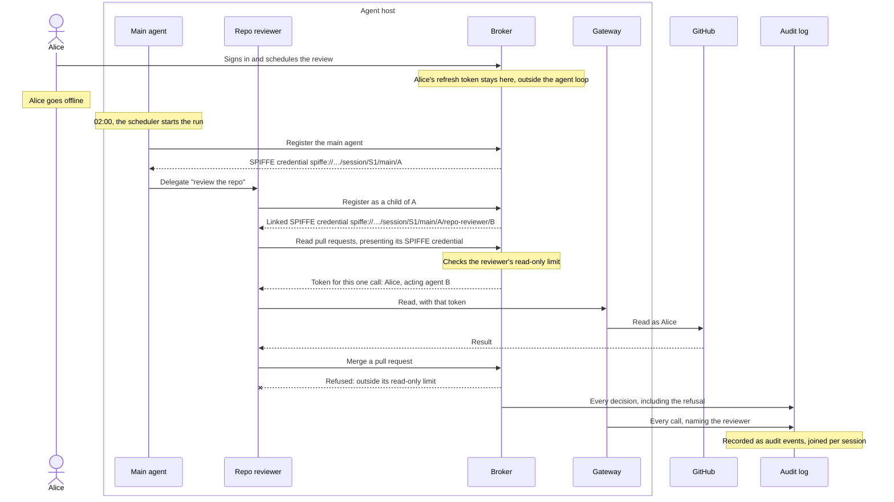
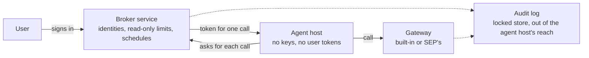

# Agent identity: what the demo delivers, and how it becomes complete

## What's part of the December milestone

*A and B are instance IDs: unique per running agent, so two agents with the same definition in one session are told apart.*

**Who holds which credential:**
- **Alice's refresh token:** broker only, outside the agent loop. It acts for Alice only with the broker's own key.
- **Each agent's SPIFFE credential:** in the agent host, never in the model. It says which agent is asking; on its own it grants nothing.
- **Gateway token:** handed to the agent host for one call. It allows this tool, with these arguments, once.
- **Alice's GitHub token:** gateway only, read-write, never leaves the gateway.
- **The model** sees no credentials at all. No agent ever holds a credential that can write.
- **Session IDs are references, not credentials.** The model never chooses one: the harness attaches it. And knowing one gets you nothing: a call also needs the agent credential registered to that session, and the sign-in server checks that the agent and the user belong together. Only someone controlling the agent host itself could combine them.

**How agent access is down-scoped:**
- The broker loads agent definitions at startup, from files the operator controls. The harness can't change them.
- The repo-reviewer definition lists the GitHub tools it may use, and they are all read tools. We don't rely on the tool server marking its own tools as read-only.
- Sub-agents attenuate with delegation: a sub-agent never gets more access than its parent.
- The broker checks every call against that list. Anything else is refused and the refusal is recorded; no token is issued, so nothing reaches GitHub.
- Each gateway token is tied to the exact call the broker approved (tool, arguments, operation ID, sent as OAuth `authorization_details`), so it can't be reused for anything else.

---

## What the demo delivers

| Ask | In the demo |
|---|---|
| Identity per agent, per session | Each agent gets its own SPIFFE credential, and the credential's ID includes the session |
| Linked sub-agents | The reviewer's credential shows its parent; the audit log records the link |
| Attribution | Every call names Alice and the acting agent |
| Read-only, limited credentials | The broker enforces the read-only limit; each gateway token allows one approved call |
| Scheduled | Runs while Alice is offline, on a refresh token from her sign-in |
| Auditable trail | Every decision and call recorded as audit events, joined per session (ways to make it tamper-resistant: see options) |

---

## From demo to v1: what the demo defers

**What changes, and why it matters:**

| | Demo | v1 | Why it matters |
|---|---|---|---|
| **Where the broker and gateway run** | All inside the agent host's process: the broker, both sign-in servers and the gateway share its memory and keys | The broker and its sign-in server run as their own service, with their own keys and storage; the gateway runs as its own deployment; the agent host keeps only agent credentials and one-call tokens | Breaking into the agent host yields no keys and no user tokens: it can't create agents, widen their tools, act for users who aren't using it, or erase what it reported |
| **Which gateway** | Our built-in gateway | Also SEP's connector gateway, linked once by each user | Customers keep their connections in SEP |
| **Read-only limits** | The broker allows only the tools listed in the agent's definition | The same allow list, kept as versioned policy; every decision records which policy version allowed or refused it; the gateway's one-call check works across replicas | An auditor can tell exactly which rule allowed or refused each call |
| **Schedules** | Work between restarts | Survive restarts, renew before they expire, can be revoked | Unattended agents stay under the user's control |
| **Stopping things** | Delete the schedule or restart | Sign-out everywhere, or disabling the account at the company IdP, stops all of that user's agents and schedules; revoking an agent revokes its children | One action ends a user's agents everywhere |
| **Credentials** | Fixed lifetime, keys per process | Renewed automatically; keys rotated and kept in a key service | No long-lived secrets in the agent host |
| **Audit log** | Audit events recorded per session | Each component writes to storage the agent host can't touch; sequence numbers expose gaps; records from different components are cross-checked | One component lying shows up against the others |

Schedules already use a broker handle, a renew call and a revoke call; only storage and retries come later.

---

## The audit log: options for tamper resistance

None of these is tracked yet; each builds on the one before.

| Option | What it is | What we can say |
|---|---|---|
| **Locked storage** | Audit events shipped off the agent host to a bucket nobody can change for the retention period | "Stored records can't be changed or deleted" |
| **Signed hourly seals** | Every hour, a collector signs a list of that hour's record fingerprints, chained to the previous hour; a check finds changed, missing or inserted records (the AWS CloudTrail approach) | "Tamper-evident, and anyone can verify a copy" |
| **Signed and chained at the source** | After the split, the broker and gateway chain and sign their own records (the [current design](agent-identity/audit.md) defers this) | "The agent host can't forge them" |
