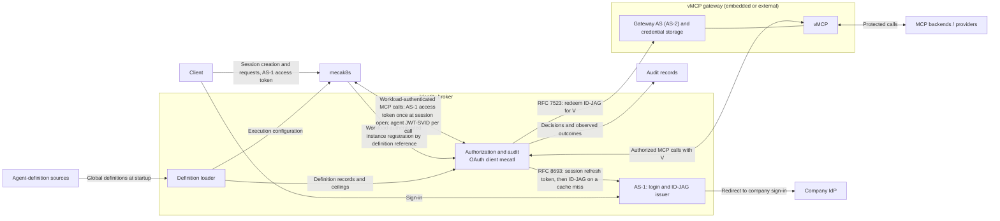

# Agent identity and authority

This document proposes how Mecatl identifies who is acting, and bounds what they may do, in a deployment that serves many users and sessions. A user starts an agent, which may delegate work to subagents. An operator must be able to trace every protected tool call to the agent instance that made it and to the user it acted for. The call must also stay within the agent's purpose: a code-review agent that calls GitHub with its user's token holds everything that user can do, including merging, but it should only read. An agent's authority is therefore the intersection of its user's permissions and its own, and a subagent never gets more than its parent.

The platform's workload identity cannot express this. It names the service, mecak8s, and one mecak8s process hosts many users, agent definitions, and running agents. This design gives each agent instance a credential of its own, ties it to a user sign-in that Mecatl cannot fabricate, and places the checks and the audit trail in an identity broker outside the agent loop.

The document follows one agent from session creation, through delegation, to a tool call that uses the user's credentials to reach an external service. It covers MCP tool calls that pass through the broker. Recording who acts comes first; enforcing each agent's bounds follows (see [order of work](#order-of-work)).

*This document describes the intended architecture, not current implementation status.*

## Why this matters

Suppose Alice asks her main agent to review PR 42. It delegates to `code-reviewer`, which calls an MCP tool using Alice's GitHub credentials. GitHub sees access under Alice's account. That alone does not tell an auditor which agent made the call, why it had access, or whether the action stayed within the delegated task.

Four problems follow:

- An agent name is only a claim until the system establishes its definition. An audit record that names `code-reviewer` is useful only if we know which definition the name refers to, where that definition came from, and what was loaded for the session. A trusted source outside the agent loop must provide these facts.
- The user's credentials hide the acting agent. GitHub sees only Alice. The audit must keep both identities: whose access the call used, and which agent made the call.
- A user's credential can do more than the agent should do. For example, Alice's GitHub credential can merge a PR, but the `code-reviewer` agent must only review. The design combines the user's permissions with the agent's permissions. A child agent can have the same authority as its parent, or less, so a main agent cannot reach tools it lacks by delegating to a child whose definition allows them.
- The harness (the code that runs the agent loop) cannot give independent evidence of its own actions. Its execution log helps explain what it tried to do. Evidence of an external action must come from the component that checked and dispatched the action, together with the result that the component observed.

These guarantees hold only for calls that pass through the broker. A call that goes around the broker skips its checks and its audit trail. In the remote deployment, protected operations must pass through the broker.

The architecture must connect these facts. An auditor should be able to follow Alice's request through the delegation to the tool call, identify the authority under which it was permitted, and distinguish a successful operation from a denied call or an unknown outcome.

## The identity model

A definition describes a kind of agent, such as `code-reviewer`. Its source is part of that identity: a repository's definition and an administrator's definition with the same name are not interchangeable.

An instance is one use of a definition in a session. Alice and Bob can use the same definition but have distinct instances. Restoration preserves an instance; a new session creates another.

A run is one execution by an instance. Reviewing PR 42 and later PR 57 uses the same reviewer identity but separate authorization contexts. A delegated child has its own instance and run, linked to the creating instance and delegating run.

The user is the person on whose behalf the agents act. mecak8s, the service that hosts the agents, is the platform workload: it serves many users at once and has its own infrastructure identity. Each agent instance also has an identity of its own, in a separate agent trust domain.

## Establishing an agent's identity

The [agent-definition loader](agent-definitions.md#loading-definitions) resolves definitions from configured sources, such as administrator-managed files, repositories, or APIs; the loop cannot establish identity by supplying a name. The selected definitions stay fixed for the session. Their sources and revisions must remain available across pauses and restoration, so repository changes cannot silently replace them.

An agent definition is a value, `AgentDef`, that combines instructions, execution settings, and tool configuration. This design proposes to split it. The harness gets the configuration that it needs to execute the agent. The broker gets the definition records and the authority ceilings that it needs to authorize MCP calls. A ceiling is the set of MCP server/tool pairs that an agent can call.

Changing a turn limit must not change the agent's identity. Loading a definition must not grant access to a user's accounts.

## Where trust lives

The agent loop uses those definitions to perform work, but it cannot decide which identities or permissions the rest of the system should trust. Definition loading, authorization, and audit therefore need trusted responsibilities outside the loop.

mecak8s hosts the API and the harness, which runs the agent loop. It validates the access token of the user who starts the session. AS-1, Mecatl's login authorization server, issued that token.

The **identity broker** establishes who is acting. Its modules load agent definitions, accept instance registrations from mecak8s and issue instance credentials, sign users in, check each protected MCP tool call, and get downstream access with credentials that the broker controls. Once the authority work is in place, the broker also bounds what each agent can reach. It records the audit trail. It is the existing MCP broker, extended, and one trusted component. It starts as modules inside the mecak8s process and later becomes a separate service. See [deployment and threats](#deployment-and-threats).

The broker has these modules:

- The **definition loader** loads agent definitions from configured sources. It gives the harness the execution configuration.
- The **agent-instance issuer** signs a JWT-SVID for each instance that mecak8s registers, in an agent trust domain separate from the platform's and from AS-1 and AS-2. It signs on mecak8s's report: in SPIRE terms, the broker is the attestor, and mecak8s's registration is its only evidence.
- **AS-1** signs users in and issues ID-JAGs. An ID-JAG is a short-lived, single-use signed grant that names the user and the acting agent. It is addressed only to AS-2, the gateway's authorization server, which redeems it for an access token, and only when the broker's client presents it.
- The authorization and audit logic.

This design scopes broker authorization to MCP tools. Extending that boundary to filesystem operations, Shell, and agent spawning is a [future direction](all-tool-mediation.md); their authorization and routing remain to be designed.

The broker does not decide whether agents start or whether runs execute; mecak8s owns agent lifecycle and run execution. Registering an instance with the broker records its identity and grants no permission to run.

The diagram shows the broker-backed remote architecture's MCP path. Local deployments can retain direct tool access; protected operations in the remote deployment must pass through the broker.

At startup, the broker's [definition loader](agent-definitions.md#loading-definitions) loads the global agent definitions from configured sources and records their sources, revisions, and ceilings in the broker. Before the agent loop starts, mecak8s's trusted session lifecycle code persists the session's fixed definition selection and [registers the main instance](agent-definitions.md#registering-instances) with the broker under workload authentication, naming its definition by reference. Several points about loading and registration are still open. See [open questions](#open-questions).

The vMCP gateway sends protected MCP calls to MCP backends and providers. It has three parts: AS-2, the gateway's authorization server; provider credential storage; and the vMCP, which dispatches the calls. The gateway can run inside the Mecatl deployment (embedded mode) or outside it (external mode).

Mecatl uses two authorization servers because the gateway may belong to someone else. One server that both holds users' provider credentials and issues grants naming the user and the agent works when Mecatl runs the gateway, but not when another operator runs it and owns the credentials. AS-1 therefore issues the grants, and AS-2, the gateway's server, holds the credentials and redeems the grants, so one protocol serves both modes. The two keep separate keys even in embedded mode, where the split is a protocol boundary, not a security boundary.

Sign-in happens at AS-1 rather than in mecak8s so that Mecatl cannot invent a user: mecak8s only forwards a token AS-1 signed, and every later grant names the user from AS-1's record. This is how Alice's tool calls get access:

1. Alice signs in at AS-1. AS-1 redirects her to the company identity provider (IdP).
2. Her client calls mecak8s with an AS-1 access token.
3. mecak8s validates the token and checks that Alice currently owns the session.
4. At session open, mecak8s passes the token to the broker once.
5. The broker exchanges the token at AS-1 for a refresh token. The refresh token is bound to the broker session.
6. When the broker has no cached vMCP access token for this session, agent, gateway, and user, it sends the refresh token and the acting agent's JWT-SVID to AS-1. The JWT-SVID lets AS-1 name the acting agent in the ID-JAG's `act` claim, so the gateway and the audit trail can attribute the call. It asserts the agent rather than authenticating it, because agents share one process. AS-1 returns an ID-JAG that names Alice and the agent.
7. The broker redeems the ID-JAG at AS-2 and gets the vMCP access token `V`.

The broker holds the refresh token because agents keep working after Alice closes her client. The token carries her authority for that one broker session, has a hard expiry, and is revoked when the session closes or she signs out everywhere. The broker is one OAuth client, `mecatl`, at both AS-1 and AS-2, and authenticates with `private_key_jwt`, so a leaked refresh token is useless without the broker's key. AS-2 maps the AS-1 subject to its native user. An external gateway also requires a one-time consent link, which the user creates at AS-2's own login. The link is the user's own statement, made at the gateway, that Mecatl may act for them, so a compromised AS-1 cannot use the gateway credentials of a user who never chose Mecatl. AS-2 never receives Alice's AS-1 token or the agent's JWT-SVID. The tools themselves execute the operations.

See [credentials and lifecycle](credentials-and-lifecycle.md#interactive-execution) for the full walkthrough and [MCP gateway modes](mcp-gateway-modes.md) for the gateway side.

AS-1 issued Alice's token after her company-IdP sign-in, and every ID-JAG takes its subject from AS-1's record of the refresh token, never from anything mecak8s sends with a call. When the broker asks for an ID-JAG, AS-1 checks two things:

- The acting instance is registered to the broker session.
- The combination of client, subject, actor, and target is allowed. The client is `mecatl`. The subject is Alice. The actor is the acting agent instance. The target is the AS-2 gateway.

AS-1 cannot check that the agent registration, the ancestry, the run, and the delegation are genuine. Trusted lifecycle code in mecak8s reports these facts. The agent loop must not choose them. Each agent has its own credential, but agents that share one mecak8s process are not isolated from each other.

## Deployment and threats

The broker starts as modules inside the mecak8s process: broker core, AS-1, the agent-instance issuer, and the definition loader. Later these modules move together into one separate broker service. The protocol and token formats are the same in both deployments; what changes is which process holds the broker's keys, refresh tokens, and records. Starting inside mecak8s ships the protocol sooner. Moving out protects those keys, tokens, and records against a compromised mecak8s; it is not about hostile workspace code, which executor Pods already contain.

Some protections do not depend on where the broker runs:

- **Hostile workspace code** runs in executor Pods, behind the execution provider. In both deployments, executors get no broker credentials, no database credentials, and no network path to mecak8s internals or the key management service (KMS).
- **A prompt-injected agent** never sees or chooses credentials. Harness code attaches them, and the model supplies only tool names and arguments.
- **The user comes from a sign-in at AS-1**, not from a mecak8s report. mecak8s passes on the AS-1-signed access token once, AS-1 converts each token at most once, and every ID-JAG names the user from AS-1's record. Correct mecak8s code cannot name a user who did not sign in. An attacker running code in the process that holds AS-1's keys can, and while the broker runs inside mecak8s that process is mecak8s; see the first row of the table below.

Where the broker runs matters against one attacker: someone with code execution in the mecak8s process. The table shows, for each threat, whether the attack works, is limited, or is blocked.

| Threat from a compromised mecak8s | Broker inside mecak8s | Separate broker service |
| --- | --- | --- |
| Act as any user, by signing an ID-JAG for a user who is not present | Attack works. The process holds AS-1's signing key and the broker's client key. In embedded mode, the attacker can reach every user connected to the gateway. In external mode, the attacker can reach only users who have a consent link. | Attack limited. mecak8s holds no keys. It can act only in broker sessions that are open and bound to its workload. A session ends when it closes or when its refresh token's hard expiry passes. mecak8s can also open new sessions with fresh tokens from users who are using it now. |
| Steal refresh tokens or signing keys | Attack works. A KMS stops the attacker from copying a key out. It does not stop the attacker from signing with the key while the attacker is inside the process. | Attack blocked, if the broker has its own database credentials and only the broker's service account can sign with its KMS keys. |
| Read users' provider tokens in embedded mode | Attack works, if the gateway store shares storage credentials with mecak8s. | Attack blocked, if the embedded gateway is its own deployment with its own credentials. |
| Tamper with broker and AS-1 audit records | Attack partly blocked. Records that are already in an external append-only store survive. From then on, the compromised process can forge or suppress its own records. | Attack blocked for broker and AS-1 records, because mecak8s does not write them. This holds if the records go to an append-only store that mecak8s cannot write. |

In both deployments, the broker trusts mecak8s to report these facts:

1. Which agent instance made a call.
2. Which loaded definition a session uses as its root.
3. Which instance created which child.
4. The run and delegation context.
5. Which open session a call belongs to.

The broker cannot verify facts 1 to 4. For fact 5, the broker checks the session against the user's token and the session's recorded owner. This check catches mistakes.

The broker loads global definitions itself, so mecak8s cannot supply their content or ceilings. Audit records mark each fact that mecak8s reported.

The authority work limits what those reports can achieve. With ceilings set by the loader and the operator's list of definitions that can be a session's root, a compromised mecak8s cannot exceed the widest definition a session may use as its root, whichever agent it claims is acting. A run grant is a credential that AS-1 mints for one run, from a fresh access token the user sent. With run grants and a separate broker, a compromised mecak8s needs a fresh token from the user for each run, but it can still turn any request the user sends into a run of its choosing, one run per token, and scheduled runs keep their own authority. Only a key held by the client that signs each run's start would prevent that.

A separate broker service delivers its protections only if the split is real:

- the broker has its own database, KMS permissions, and namespace;
- mecak8s cannot create pods, read secrets, or change configuration in the broker's namespace;
- mecak8s cannot write the broker's workload allowlist, trust bundle, or policy inputs;
- the embedded gateway is its own deployment.

While the broker runs inside mecak8s, the [modulith constraints](implementation.md#modulith-constraints) keep the later move a deployment change.

## What this design does not guarantee

Precise limits matter as much as guarantees. This design does not provide:

- **Isolation between agents in one process.** Per-agent credentials attribute calls; they do not stop code inside mecak8s from acting as another agent.
- **Verification of what mecak8s reports.** Which instance acted, which definition is a session's root, which instance created which child, and the run and delegation context stay mecak8s's word, marked as such in audit.
- **Protection against a compromised mecak8s while the broker runs inside it.** See the table above.
- **Coverage beyond the broker.** Calls that bypass the broker, and filesystem tools, Shell, and spawning, are outside this design.
- **Non-repudiation.** Audit records are unsigned.
- **Proof of provider-side effects.** A record shows what the recording component observed; an unknown outcome stays unknown.
- **Instant downstream revocation.** ID-JAGs and vMCP access tokens already issued stay valid until they expire, so their lifetimes are short.

## Following an action through the architecture

Alice asks her main agent to list pull requests and review PR 42. Once the session's definitions are loaded, the main agent calls `pull_request_list`, then delegates to `code-reviewer`. The reviewer calls `pull_request_read` for PR 42. Each call requires its own authorization decision.

During the identity work, the broker checks the session, the workload, that the acting instance is registered to the session, and the route. Once the [authority work](#order-of-work) is in place, it also uses Cedar, a policy engine, to check the reviewer's effective ceiling: the reviewer's definition ceiling, narrowed by the main agent's. Even then, the design does not evaluate PR-specific delegated bounds or comprehensive enterprise user policy.

AS-2 and vMCP enforce the user and the connection. AS-2 redeems the ID-JAG only for a mapped user. In external mode, the user must also have a consent link. vMCP dispatches only with Alice's stored credential.

If all required checks pass, vMCP dispatches the call through the authorized connection with its native provider credential. That credential stays outside the harness and the model. In embedded mode, it can be inside the Mecatl deployment. If any check denies the call, no request reaches GitHub. Missing, stale, or revoked identity, consent, connection, or authorization evidence fails closed, with no fallback to a service credential, another user, or a more privileged agent.

GitHub sees access under Alice's account. The broker's audit record supplies the rest of the story: which reviewer acted, which agent delegated the work, why the call was permitted, and what result was observed. A missing result is recorded as unknown, not as proof that the operation never happened. Each record is written by the component that made the decision: the broker, AS-1, AS-2, and the vMCP all record through the toolhive-core audit logger, to a store mecak8s cannot write.

See [Interactive execution](credentials-and-lifecycle.md#interactive-execution) for the detailed credentials sequence.

## Standards

The design composes existing OAuth and workload-identity standards rather than inventing a token format. Sign-in is OIDC with the authorization code flow and PKCE, and mecak8s validates AS-1's access token as an RFC 9068 JWT access token. Session open and ID-JAG issuance are RFC 8693 token exchanges, and AS-2 redeems the ID-JAG with the RFC 7523 JWT-bearer grant. The broker authenticates as a confidential client with `private_key_jwt`, so the refresh tokens it holds are useless without its key.

ID-JAG ([draft-ietf-oauth-identity-assertion-authz-grant](https://datatracker.ietf.org/doc/draft-ietf-oauth-identity-assertion-authz-grant/)) and identity chaining ([draft-ietf-oauth-identity-chaining](https://datatracker.ietf.org/doc/draft-ietf-oauth-identity-chaining/)), which external mode follows, are Internet-Drafts and may change. ID-JAG is scoped to parties in different trust domains; embedded mode, where all parties share one, reuses the format to keep one protocol path.

Agent credentials are SPIFFE JWT-SVIDs. Each protected call is authenticated at two layers, as the WIMSE architecture recommends: the platform workload, and the acting agent. The ID-JAG and the vMCP access token are bearer tokens; short lifetimes, a single audience, and single use of the ID-JAG limit what a stolen one can do.

## Order of work

Mecatl builds this design in two steps. The identity work comes first, and the authority work follows once the identity work is in place. The order follows the dependencies: a ceiling attaches to a definition and to the chain of instances that created each other, so the broker can enforce ceilings only once definitions and registrations are recorded. Recording first also lets attribution ship without committing to a policy model.

The **identity work** establishes who acts and records it:

- the broker modules: definition loader, agent-instance issuer, AS-1, and broker core;
- definitions loaded with their provenance;
- instance registration, with the incarnation, definition reference, and creation parent;
- agent-instance credentials;
- the credential flow: sign-in at AS-1, the session-bound refresh token, ID-JAG issuance, AS-2 redemption, and per-user provider credentials at the gateway;
- the broker's identity checks: session, workload, and that the acting instance is registered to the broker session;
- the run owner on every call, checked against the grant in use, so that shared sessions can come later without a call using the wrong user's credentials;
- sign-out and revocation: signing out of one client leaves background agents running, so signing out everywhere stops every agent and schedule acting for the user, and AS-1's upstream re-check does the same when the company IdP disables the account;
- audit of who acted, for whom, through which delegation, and what was decided, dispatched, and observed.

The **authority work** decides what each agent may do:

- the definition loader resolving each definition's ceiling into permitted MCP server/tool pairs, and the operator's loader configuration naming which definitions may be a session's root and capping the ceiling of definitions from other sources;
- each instance's effective ceiling, its definition ceiling narrowed by its parent's;
- Cedar policy generation and a ceiling check on every call;
- grants scoped to a run the user started, replacing the session's standing refresh token, so that sessions of absent users carry no authority;
- task-specific delegation bounds, and user, resource, and argument policy.

Until the authority work is in place, the only ceiling checks are the harness's delegation restrictions. The broker adds none. The identity work records the definition reference and the creation parent at registration. So the authority work adds computation, not a migration. The chapters describe the whole design and say which parts belong to the authority work.

## Open questions

The design does not yet settle these points:

- How the broker stores the source and revision of each agent definition.
- How the broker loads definitions that do not come from the global sources, such as repository definitions.
- The API that mecak8s uses to register an agent instance with the broker, and the durable schema of the registration records.
- How the broker verifies the context that mecak8s reports with each call: the instance, the run, the delegation, and the session. Today the broker accepts this context as a report. It checks only the session, against the user's token and the session's recorded owner.
- How to stop code inside the mecak8s process from posing as the trusted lifecycle code or as another agent.

## Detailed chapters

These chapters describe each part of the design in detail.

| Chapter | What it covers |
| --- | --- |
| [Audit](audit.md) | Sets the requirements for attribution, correlation, evidence, redaction, and durability of audit records. |
| [Agent definitions](agent-definitions.md) | Describes `AgentDef`. Separates the harness's execution configuration from the authority that the broker enforces. |
| [MCP authorization](mcp-authorization.md) | Describes how user permissions and agent permissions control MCP calls, and how the broker uses ToolHive. |
| [MCP gateway modes](mcp-gateway-modes.md) | Connects the broker's grant issuer to the vMCP gateway's authorization server. One protocol works with an embedded gateway or an external gateway. |
| [Credentials and lifecycle](credentials-and-lifecycle.md) | Follows one request from credential to outcome, with validation and audit evidence. Then explains credential renewal and recovery. |
| [Run owner](run-owner.md) | Records who started each run and checks it against the grant in use. Keeps shared sessions possible later. |
| [All-tool mediation](all-tool-mediation.md) | Describes how the authorization boundary could extend to filesystem tools, Shell, and spawning. This is a future direction. |

The [implementation and verification companion](implementation.md) records integration requirements and checks. This design replaces an earlier model in which the harness signed agent credentials and wrote its own audit records.