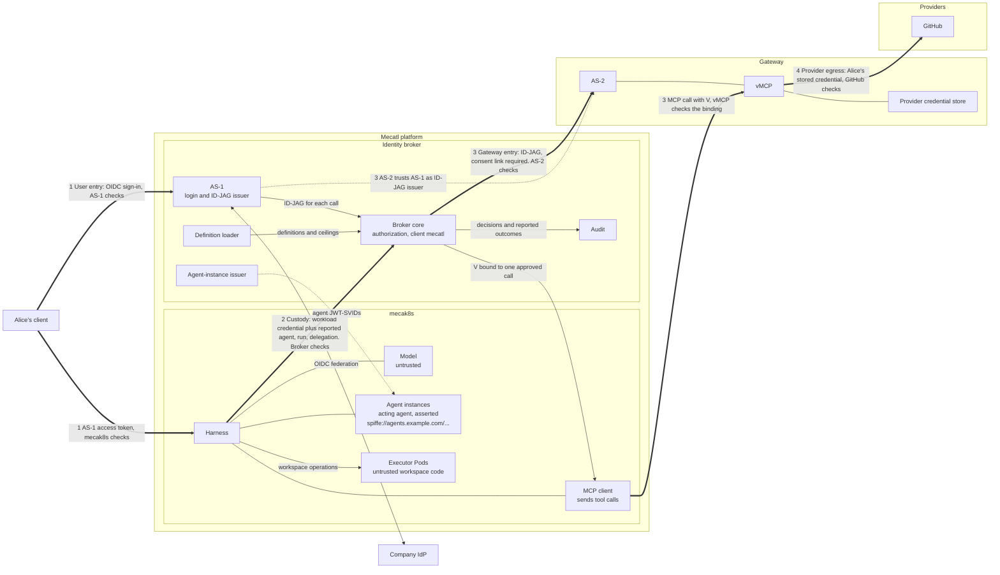

# Agent identity and authority

This document describes how Mecatl identifies the agents it runs and bounds what they can do.

Mecatl runs agents for many users in one deployment. An agent acts with its user's access to external services, such as GitHub, through a gateway that speaks MCP, the Model Context Protocol that agents use to call tools. It can hand parts of its work to sub-agents, and a run, together with its sub-agents, can start on a schedule while its user is offline. The agent host, the service that runs the model and its tools, serves many users and agents at once.

## What we need

- **Attribution.** Every protected tool call can be traced to the agent instance that made it, the agents that delegated to it, and the user it acted for.
- **Bounds.** An agent does only what its purpose needs, even when its user can do more. A sub-agent never gets more than the agent that started it.
- **Containment.** A model misled by untrusted content, or a bug in the agent host, can't obtain the user's credentials or use them outside these bounds.
- **Unattended work.** Scheduled runs act for their user within limits that end on their own and that the user can end.
- **Evidence.** Records of what happened come from components the agent host doesn't control.

The identities that exist without this design don't meet these needs. The agent host's workload identity names the service, not the user or the agent. The user's identity names the user, not the agent. A call made with the user's credentials looks the same whether the user or any of their agents made it, and it carries everything the user is allowed to do.

## How the design meets them

### Each agent instance has its own identity

Every running agent, including every sub-agent, gets its own credential, a SPIFFE JWT-SVID (a standard format for workload credentials) issued by an identity broker that runs outside the agent loop. Each protected call names two parties: the user the agent acts for, and the agent that acts, in the OAuth `act` claim, the standard token field for a party acting on a user's behalf. Records can tell a reviewer's call from its user's own action and from another agent's, and one agent can be refused without affecting the user or other agents.

### Agent definitions are each agent's charter

An agent definition states what a kind of agent is for and which MCP tools it may call. The broker loads definitions from sources the operator controls and records where each came from. A session's definitions stay fixed once selected, and neither the model nor the agent host can change them. The operator also decides which definitions may start a session, which caps what any agent in that session can reach. A definition never grants access by itself: an agent's authority is what its user may do, limited to what its definition allows.

A definition has two parts with different owners. The agent host receives the execution configuration: the instructions, the model, the tools to offer, and the turn budgets. The broker keeps the limit, also called the definition's ceiling: the list of tools the agent may call. The agent host never supplies or changes that limit; when it registers an agent, it names the definition and the broker uses its own copy.

A sub-agent's limit is its own definition's limit intersected with the effective limit of the agent that created it, so narrowing carries down the chain and delegation can't widen access. An agent limited to reading can't gain write access by starting a sub-agent whose definition allows writing. The broker checks every call against the acting agent's limit.

The agent host tells the broker which of the session's registered agents is making each call. The broker checks that the agent belongs to the session and its user, but it can't see inside the agent host. A wrong report can make a call as another agent of the same session; it can never go beyond the limit of the session's main agent.

### Each check runs outside the component it constrains

The agent host is the component most exposed to untrusted content, so none of the checks that bound it run inside it:

| Check | Made by | Outside of |
| --- | --- | --- |
| Which tools an agent may call, including the narrowing for sub-agents | The identity broker | The agent host |
| Which user the call acts for | Mecatl's authorization server, which checks that the user signed in and owns the acting agent's session | The agent host |
| Which gateway account the user maps to, whether the user has allowed Mecatl to act through an external gateway, and which of the user's provider credentials to use | The gateway | The agent host and the broker |
| Whether the token matches the call it arrives with | The gateway | The agent host and the broker |
| What the user may do at the provider | The provider, such as GitHub | Mecatl |

The gateway can be Mecatl's built-in gateway or an external one, the connector gateway of the Stacklok Enterprise Platform. The external gateway is run by its own administrators, accepts only tokens from its own authorization server, and keeps users' provider credentials under its own control. Neither the agent host nor the broker can issue its tokens or read those credentials. The same protocol serves both kinds of gateway.

### User credentials stay outside the agent host

The agent host never holds a credential that reaches the user's tools. It sees the user's short-lived Mecatl access token when a session opens, and passes it to the broker once.

The credentials involved in a tool call are held as follows:

| Credential | Held by |
| --- | --- |
| The user's provider token, such as a read-write GitHub token | The gateway only. |
| The user's grants for each session and schedule (refresh tokens) | The identity broker only. It is usable only with the broker's client key. |
| An agent instance's credential | The agent host, never the model. It identifies the agent and grants nothing on its own. |
| A gateway access token | The agent host, for one call. |

The model holds no credentials. Harness code attaches them; the model supplies only tool names and arguments.

The alternative, giving the agent the user's provider token, would undo the other decisions. The token carries all of the user's access, and every sub-agent would receive all of it. The agent host reads untrusted content, so a prompt injection or a bug could send the token elsewhere, where it works until it expires. Copies spread across agents can't be revoked together, and the only record of their use would come from the agent host.

### Each tool call gets its own token

The agent host still has to send calls to the gateway, so it needs some token. If that token allowed any call, the agent host could ask the broker to approve a harmless call and then use the token for a different one, and the broker's check would mean nothing.

So the agent host asks the broker before every protected call, and the broker returns a token only for the call it approved: this tool, with these arguments, once. The gateway refuses the token for anything else, and for a second use of it, because it records each token it has accepted. A refused call gets no token and never reaches the provider. A token taken from the agent host is good for one call that was already approved, and only briefly.

### The broker ties each agent to its session

Each agent instance belongs to one session. Its credential carries an opaque ID, `spiffe://<trust domain>/agent/ag_…`, and the same ID names the acting agent in the token's `act` claim. The broker's registry ties that ID to the agent's session, definition, parent, and user, and on every call the broker checks that the agent is registered to the session in use.

From any call, an auditor can follow the chain from the agent to its parent, its session, and its user, and for a scheduled run to the schedule. Because the ID itself carries none of this, a gateway can tell agents apart without learning Mecatl's sessions or delegation structure.

### Scheduled runs use a bounded grant

A scheduled run needs the user's authority while the user is offline. The broker holds a schedule grant derived from the user's sign-in. The grant has a fixed horizon and can only open that schedule's runs. Signing out everywhere revokes the user's sessions and schedule grants. Disabling the account at the company identity provider does the same at the next periodic check of the user's sign-in.

### Decisions are recorded where they are made

Records come from the components that decide or observe: the broker, Mecatl's authorization server, the gateway's authorization server, and the gateway's MCP server. Outcomes the agent host reports are marked as reported, and the gateway's record of the call is the check on them. Records are stored where the agent host can't change them. With the external gateway, the gateway's records are kept by its operator. For each call, they show which agent acted, for which user, through which delegation, which rule allowed or refused the call, and what result was observed. An unknown result is recorded as unknown.

## How this document is organized

The rest of this document follows one agent from session creation, through delegation, to a tool call that uses the user's credentials to reach an external service. It covers MCP tool calls that pass through the broker. From here on, mecak8s is the agent host, and the harness is the agent loop that runs inside it.

*This document describes the intended architecture, not current implementation status.*

## Why this matters

Suppose Alice asks her main agent to review PR 42. It delegates to `code-reviewer`, which calls an MCP tool using Alice's GitHub credentials. GitHub sees access under Alice's account. That alone does not tell an auditor which agent made the call, why it had access, or whether the action stayed within the delegated task.

Four problems follow:

- An agent name is only a claim until the system establishes its definition. An audit record that names `code-reviewer` is useful only if we know which definition the name refers to, where that definition came from, and what was loaded for the session. A trusted source outside the agent loop must provide these facts.
- The user's credentials hide the acting agent. GitHub sees only Alice. The audit must keep both identities: whose access the call used, and which agent made the call.
- A user's credential can do more than the agent should do. For example, Alice's GitHub credential can merge a PR, but the `code-reviewer` agent must only review. The design combines the user's permissions with the agent's permissions. A child agent can have the same authority as its parent, or less, so a main agent cannot reach tools it lacks by delegating to a child whose definition allows them.
- The harness (the code that runs the agent loop) cannot give independent evidence of its own actions. Its execution log helps explain what it tried to do. Evidence of an external action must come from the component that checked and dispatched the action, together with the result that the component observed.

These guarantees hold only for calls that pass through the broker. A call that goes around the broker skips its checks and its audit trail.

The architecture must connect these facts. An auditor should be able to follow Alice's request through the delegation to the tool call, identify the authority under which it was permitted, and distinguish a successful operation from a denied call or an unknown outcome.

## The identity model

A **definition** describes a kind of agent, such as `code-reviewer`. Its source is part of that identity: a repository's definition and an administrator's definition with the same name are not interchangeable. A definition's **ceiling** is the set of MCP server/tool pairs that an agent built from it may call. Changing an execution setting such as a turn limit does not change a definition's identity, and loading a definition grants no access to a user's accounts.

An **instance** is one use of a definition in a session. Alice and Bob can use the same definition but have distinct instances. Restoring a session preserves its instances; a replacement broker session re-registers the same instances; a new host session creates new ones. A session's **root** is the definition its main agent uses.

A **run** is one execution by an instance. Reviewing PR 42 and later PR 57 uses the same reviewer instance in two runs. A delegated child has its own instance and run, linked to the instance that created it and to the run that delegated to it.

The **user** is the person on whose behalf the agents act. mecak8s, the service that hosts the agents, is the platform **workload**: it serves many users at once and has its own infrastructure identity. Each agent instance also has a name of its own: a SPIFFE ID in a separate agent trust domain, signed by the broker's agent-instance issuer. That name is for attribution, not isolation; every agent runs inside the same mecak8s process.

## Where trust lives

The agent loop uses definitions to do work, but it cannot decide which identities or permissions the rest of the system trusts; otherwise a prompt-injected model or a buggy harness could grant itself access. Definition loading, credential issuance, authorization, and audit therefore live outside the loop.

mecak8s hosts the API and the harness. It validates the AS-1 access token of the user who starts a session, and it authenticates to the broker with its platform workload credential, such as a Kubernetes ServiceAccount token.

The **identity broker** establishes who is acting. It is one trusted component: it decides each protected MCP call and issues the gateway access token for it, but it never sends tool calls. It also bounds what each agent can reach. Its modules are:

- The **definition loader** loads agent definitions from configured sources, records each one's source and revision, and gives the harness the execution configuration. A session's selected definitions stay fixed, so a later change at the source cannot silently replace them. The operator says which definitions may be a session's root, and the broker refuses to register a root instance outside that set. See [agent definitions](agent-definitions.md#loading-definitions).
- The **agent-instance issuer** signs a SPIFFE JWT-SVID for each instance that mecak8s registers, in its own SPIFFE trust domain, separate from the platform's, with a signing key separate from AS-1's and AS-2's. It signs on mecak8s's workload-authenticated registration, which is an assertion, not attestation: no evidence about the agent itself is produced or checked.
- **AS-1**, Mecatl's login authorization server, signs users in through the company identity provider (IdP) and issues ID-JAGs (Identity Assertion JWT Authorization Grants). An ID-JAG is a short-lived signed grant that names the user and the acting agent. It is addressed only to AS-2, the gateway's authorization server, which redeems it for an access token, and only when the broker's client presents it.
- The **authorization and audit** logic checks each protected MCP call, issues the access token for an allowed one, and records what it decided and what mecak8s reports it observed.

mecak8s's **MCP client** sends the protected calls. It holds the session's tool catalogue, asks the broker to authorize each call, sends the call to the gateway with the access token the broker returns, and reports the outcome. That token is bound to the one call the broker approved and is usable once, so mecak8s never holds a credential it can use for anything else.

Downstream, the **vMCP gateway** sends protected calls to MCP backends and providers. It has three parts: AS-2; storage for users' provider credentials, such as GitHub tokens; and the vMCP, ToolHive's virtual MCP server, which dispatches the calls. The gateway runs inside the Mecatl deployment (embedded mode) or outside it (external mode).

Mecatl uses two authorization servers so that it can work with an MCP gateway it does not operate, such as the connector gateway in the Stacklok Enterprise Platform. That gateway holds users' provider connections, such as their GitHub or Google tokens, under its own administration, and its vMCP accepts only access tokens from the gateway's own authorization server; Mecatl can neither mint those tokens nor hold the credentials behind them. So AS-1, Mecatl's server, issues a grant naming the user and the acting agent, and AS-2, the gateway's server, verifies the grant, decides whether to honor it, and issues its own access token. When Mecatl runs the gateway itself (embedded mode), it uses the same two servers and the same protocol, so there is one code path; there the split is a protocol boundary rather than a security boundary, although the two servers still keep separate keys.

The diagram draws each administrative domain as a box and each trust boundary as a numbered thick arrow, labelled with what crosses it and who checks it.

| Boundary | What crosses | Who checks |
| --- | --- | --- |
| 1. User entry | Alice signs in at AS-1 with OIDC, and AS-1 sends her on to the company IdP. Her client then sends the AS-1 access token to mecak8s. | AS-1 at sign-in; mecak8s on each API request. |
| 2. Credential custody | mecak8s calls the broker with its workload credential, which the broker authenticates. The acting agent, run, and delegation are reports from mecak8s, which the broker checks for consistency but cannot verify. mecak8s holds no signing keys or refresh tokens; it receives only access tokens bound to single calls the broker approved. | The broker. |
| 3. Gateway entry | The broker redeems an ID-JAG from AS-1 at AS-2, which in external mode requires Alice's consent link, and returns the resulting access token `V`, bound to one call, to mecak8s's MCP client, which calls the vMCP with it. | AS-2 when it redeems the ID-JAG; the vMCP when it validates `V` and its binding to the call. |
| 4. Provider egress | The vMCP calls GitHub with Alice's stored GitHub credential. | GitHub. |

AS-1 sits on two boundaries: it signs Alice in at boundary 1 and signs the ID-JAG that AS-2 checks at boundary 3. The agent trust domain is not a boundary; it names agents for attribution, inside mecak8s.

An embedded gateway shares Mecatl's administrative domain, so gateway entry there is a protocol boundary, not a security one. The [threat model](threat-model.md#a-compromised-mecak8s) says what a compromised mecak8s can and cannot do.

This design scopes broker authorization to MCP tools. Local deployments can keep direct tool access, and none of these guarantees apply to them. Extending the boundary to filesystem operations, Shell, and agent spawning is a [future direction](all-tool-mediation.md). The broker does not decide whether agents start or whether runs execute; mecak8s owns agent lifecycle and run execution, and registering an instance records its identity without granting permission to run.

## One request, end to end

Alice asks her main agent to list pull requests and review PR 42. The main agent calls `pull_request_list`, then delegates to `code-reviewer`, which calls `pull_request_read` for PR 42. Each call gets its own authorization decision.

**Sign-in and session open.** Alice signs in at AS-1, which redirects her to the company IdP, and her client calls mecak8s with the AS-1 access token. Sign-in happens at AS-1 rather than in mecak8s so that Mecatl cannot invent a user: mecak8s checks that Alice owns the session and forwards the token to the broker once, and the broker exchanges it at AS-1 for a refresh token, which the broker holds for that broker session. Every later grant names the user from AS-1's record of that refresh token, never from anything mecak8s sends with a call. The broker holds the refresh token because agents keep working after Alice closes her client. It carries her authority for that one session, has a hard expiry, and is revoked when the session closes or she signs out everywhere. The broker is one OAuth client, `mecatl`, at both AS-1 and AS-2, so a leaked refresh token is useless without the broker's key.

**Each call.** mecak8s's MCP client asks the broker to authorize the call, naming the server, the tool, and a hash of the arguments. The broker sends the refresh token, the acting agent's JWT-SVID, and an entry naming the call (the server, tool, argument hash, and operation ID) to AS-1. The broker has already checked that the agent is registered to the session. AS-1 checks that the agent's session belongs to the refresh token's user and that the combination of client, user, agent, and gateway is allowed, then returns an ID-JAG naming Alice and the agent in its `act` claim, and an `authorization_details` claim holding the call entry that AS-1 signs. The JWT-SVID gives the gateway and the audit trail the acting agent; it asserts that agent rather than authenticating it, because agents share one process. The broker redeems the ID-JAG at AS-2 for the vMCP access token `V`, bound to that one call and usable once. It checks that the token response carries the entry it sent, then returns `V` to the MCP client, which sends the call and discards `V`. AS-2 maps AS-1's user to its own account for Alice and never receives her AS-1 token or the agent's JWT-SVID. An external gateway also requires a one-time consent link, which Alice creates at AS-2's own login. The link is her own statement, made at the gateway, that Mecatl may act for her, so a compromised AS-1 cannot use the gateway credentials of a user who never chose Mecatl.

**The checks.** The broker checks the session, the workload, that the acting instance is registered to the session, the run and its owner, and the route. It also uses Cedar, a policy engine, to check the reviewer's effective ceiling: the reviewer's definition ceiling, narrowed by the main agent's. The design does not evaluate PR-specific bounds or comprehensive enterprise user policy. AS-2 redeems only for a mapped user, and in external mode only for a linked one, and the vMCP dispatches only with Alice's stored GitHub credential, which never reaches the harness or the model. If any check denies the call, no request reaches GitHub. Missing, stale, or revoked identity, consent, connection, or authorization evidence fails closed, with no fallback to a service credential, another user, or a more privileged agent.

**The record.** GitHub sees access under Alice's account. The audit trail supplies the rest: which reviewer acted, which agent delegated the work, why the call was permitted, and what result was observed. A missing result is recorded as unknown, not as proof that the operation never happened. Each record is written by the component that made the decision: the broker, AS-1, AS-2, and the vMCP all record through the toolhive-core audit logger, to a store mecak8s cannot write. The broker also records the dispatch and result that mecak8s reports, marked as reported; the vMCP's own record of the call is the check on that report.

See [credentials and lifecycle](credentials-and-lifecycle.md#interactive-execution) for the full walkthrough and [MCP gateway modes](mcp-gateway-modes.md) for the gateway side.

## Deployment and threats

The broker runs as a separate service, with its own signing keys, refresh tokens, and audit storage, outside mecak8s. Hostile workspace code is a different threat, contained by executor Pods.

Executor Pods get no broker or database credentials. A prompt-injected agent never sees or chooses credentials, because harness code attaches them and the model supplies only tool names and arguments. And correct mecak8s code cannot name a user who did not sign in at AS-1.

An attacker with code execution in mecak8s holds no keys, and the gateway access tokens it holds each serve one call the broker approved. It can act only in open sessions bound to its workload, in new sessions opened with fresh tokens from users currently using it, and in sessions opened from live schedule grants until their horizon. Every false report it makes must pass the broker's checks and is recorded where it cannot erase it.

The [threat model](threat-model.md) has the full table, the facts mecak8s reports and how the broker checks them, and what the split requires to be real.

## Standards

The design composes existing OAuth and workload-identity standards rather than inventing a token format. Sign-in is OIDC with the authorization code flow and PKCE, and mecak8s validates AS-1's access token as an RFC 9068 JWT access token. Session open and ID-JAG issuance are RFC 8693 token exchanges, and AS-2 redeems the ID-JAG with the RFC 7523 JWT-bearer grant. The broker authenticates as a confidential client with `private_key_jwt`, so the refresh tokens it holds are useless without its key. That key belongs to the broker, ideally in a key management service; ToolHive's authorization server also accepts a SPIFFE JWT-SVID as client authentication, which could replace the key with the broker's own workload identity.

The grant format is ID-JAG ([draft-ietf-oauth-identity-assertion-authz-grant](https://datatracker.ietf.org/doc/draft-ietf-oauth-identity-assertion-authz-grant/)), and external mode follows identity chaining ([draft-ietf-oauth-identity-chaining](https://datatracker.ietf.org/doc/draft-ietf-oauth-identity-chaining/)). ID-JAG is scoped to parties in different [administrative domains](credentials-and-lifecycle.md#7-id-jag-from-as-1) (trust domains, in OAuth's term); embedded mode, where all parties share one, reuses the format to keep one protocol path.

Agent credentials are SPIFFE JWT-SVIDs. Each protected call carries two identities, comparable to the layered workload authentication the WIMSE architecture describes, except that only the first is authenticated: the platform workload is authenticated, and the acting agent is asserted by the agent-instance issuer. Registration links the two: the broker accepts an agent only if it was registered to a session bound to that workload. The ID-JAG and the vMCP access token are bearer tokens; short lifetimes, a single audience, and single use of the ID-JAG limit what a stolen one can do.

## Open questions

Two questions bear on what the design can promise:

- How the broker could verify the context mecak8s reports with each call, the instance, run, and delegation, rather than only checking it for consistency.
- How to stop code inside the mecak8s process from posing as the trusted lifecycle code or as another agent.

Narrower open points, such as how repository definitions are loaded and the registration API, are listed in the chapters.

## Detailed chapters

These chapters describe each part of the design in detail.

| Chapter | What it covers |
| --- | --- |
| [Audit](audit.md) | Sets the requirements for attribution, correlation, evidence, redaction, and durability of audit records. |
| [Agent definitions](agent-definitions.md) | Describes `AgentDef`. Separates the harness's execution configuration from the authority that the broker enforces. |
| [MCP authorization](mcp-authorization.md) | Describes how user permissions and agent permissions control MCP calls, and how the broker uses ToolHive. |
| [MCP gateway modes](mcp-gateway-modes.md) | Connects the broker's grant issuer to the vMCP gateway's authorization server. One protocol works with an embedded gateway or an external gateway. |
| [Credentials and lifecycle](credentials-and-lifecycle.md) | Follows one request from credential to outcome, with validation and audit evidence. Then explains credential renewal and recovery. |
| [Run owner](run-owner.md) | Records who started each run and checks it against the grant in use, so sessions can be shared without a call using the wrong user's credentials. |
| [Threat model](threat-model.md) | Lists the attackers the design considers, what each can do in each deployment, and what the split from mecak8s requires. |
| [All-tool mediation](all-tool-mediation.md) | Describes how the authorization boundary could extend to filesystem tools, Shell, and spawning. This is a future direction. |

The [implementation and verification companion](implementation.md) records integration requirements and checks. This design replaces an earlier model in which the harness signed agent credentials and wrote its own audit records.
