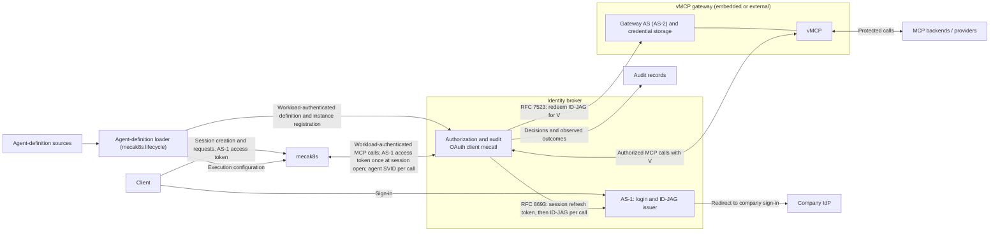

# Agent identity and authority

This document proposes how Mecatl identifies **who is acting** in a multi-user, multi-session deployment: a user starts an agent, the agent delegates to subagents, each delegation stays within its parent's authority, and the resulting actions leave a durable audit trail. The goal is to let an operator trace an action back to the agent and user behind it, with authorization enforced outside the agent loop.

**Workload identity alone cannot answer these questions.** It identifies the Mecatl service, but one service can host many users, agent definitions, and running instances. This architecture gives those agents identities of their own and connects them to the users they act for. It follows an agent from the trusted definition loaded at session creation, through its runs and delegated child instances, to the tool calls made on its behalf, which may use a human user's credentials to access an external service.

*This document describes the intended architecture, not current implementation status.*

## Why this matters

Suppose Alice asks her main agent to review PR 42. It delegates to `code-reviewer`, which calls an MCP tool using Alice's GitHub credentials. GitHub sees access under Alice's account. That alone does not tell an auditor which agent made the call, why it had access, or whether the action stayed within the delegated task.

Four problems follow:

- **An agent name is only a claim until its definition is established.** An audit record naming `code-reviewer` is useful only if we can establish which definition it refers to, where that definition came from, and what was loaded for the session. Those facts need a trusted source outside the agent loop.
- **The user's credentials hide the acting agent.** We need to preserve both identities: whose access was used and which agent exercised it.
- **Access to a user's credentials is not permission to exercise all of their authority.** A reviewer must remain limited to reviewing even if Alice's GitHub credential permits merging. The design needs to bring user permissions and agent permissions together, and delegation must preserve or narrow the resulting authority.
- **The harness cannot be its own independent witness.** Its execution log helps explain what it attempted, but evidence of an external action must come from the component that checked and dispatched it, together with the observed result.

These guarantees also depend on the path an operation takes: a call that bypasses the authorization boundary escapes its checks and audit trail.

The architecture must connect these facts. An auditor should be able to follow Alice's request through the delegation to the tool call, identify the authority under which it was permitted, and distinguish a successful operation from a denied call or an unknown outcome.

## The identity model

A definition describes a kind of agent, such as `code-reviewer`. Its source is part of that identity: a repository's definition and an administrator's definition with the same name are not interchangeable.

An instance is one use of a definition in a session. Alice and Bob can use the same definition but have distinct instances. Restoration preserves an instance; a new session creates another.

A run is one execution by an instance. Reviewing PR 42 and later PR 57 uses the same reviewer identity but separate authorization contexts. A delegated child has its own instance and run, linked to the creating instance and delegating run.

The user is the person on whose behalf the agents act. The workload is the Mecatl service hosting them, potentially serving many users at once.

## Establishing an agent's identity

The [agent-definition loader](agent-definitions.md#loading-definitions-for-a-session) resolves definitions from configured sources, such as administrator-managed files, repositories, or APIs; the loop cannot establish identity by supplying a name. The selected definitions stay fixed for the session. Their sources and revisions must remain available across pauses and restoration, so repository changes cannot silently replace them.

The existing `AgentDef` structure currently combines instructions, execution settings, and tool configuration. This design proposes a split that gives the harness the configuration needed to execute the agent and the broker the definition records and authority ceilings needed to authorize MCP calls. Source and revision records still need a representation. Changing a turn limit should not redefine the agent's identity; loading a definition should not grant access to a user's accounts.

## Where trust lives

The agent loop uses those definitions to perform work, but it cannot decide which identities or permissions the rest of the system should trust. Definition loading, authorization, and audit therefore need trusted responsibilities outside the loop.

The harness hosts the API and agent loop and validates the initiating user's AS-1 access token. An **agent-definition loader** supplies harness execution configuration and broker definition records and authority ceilings. An **identity broker** is a separate trusted service that governs access to protected tools. It issues agent credentials, checks requested operations against policy, and arranges downstream access using credentials it controls. It also records the decisions and actions it observes.

This design scopes broker authorization to MCP tools. Extending that boundary to filesystem operations, Shell, and agent spawning is a [future direction](all-tool-mediation.md); their authorization and routing remain to be designed.

The diagram shows the broker-backed remote architecture's MCP path. Local deployments can retain direct tool access; protected operations in the remote deployment must pass through the broker.

Before the agent loop starts, mecak8s's trusted session lifecycle code [loads and persists the fixed definition selection](agent-definitions.md#loading-definitions-for-a-session), supplies execution configuration, and [registers definitions and the main instance](agent-definitions.md#registering-instances) with the broker under workload authentication. This loader responsibility is outside the untrusted loop, not a separate registrar or an isolation boundary. The registration API, durable schema, verified per-operation binding for reported context, and protection from same-process substitution remain open.

The broker contains the agent trust issuer, authorization and audit logic, and AS-1, Mecatl's login authorization server. The vMCP gateway contains AS-2, provider credential storage, and the vMCP. The gateway can run inside the Mecatl deployment or as an external gateway.

Alice signs in through AS-1, which redirects her to the company IdP. Her client then calls mecak8s with an AS-1 access token. mecak8s validates that token and current session ownership. At session open it passes the token to the broker once, and the broker exchanges it at AS-1 for a refresh token bound to that broker session. On each tool call the broker presents that refresh token and the acting agent's JWT-SVID to AS-1, which returns an ID-JAG naming Alice and the agent. The broker redeems the ID-JAG at AS-2 for the vMCP access token `V`. The broker is a single OAuth client, `mecatl`, at both AS-1 and AS-2, and authenticates with `private_key_jwt`. AS-2 maps the AS-1 subject to its native user; an external gateway also requires a one-time consent link created at AS-2's own login. AS-2 receives neither Alice's AS-1 token nor the agent SVID. See [credentials and lifecycle](credentials-and-lifecycle.md#interactive-execution) for the walkthrough and [MCP gateway modes](mcp-gateway-modes.md) for the gateway side. The tools themselves execute the operations.

AS-1 witnessed Alice's sign-in itself, checks that the acting instance is registered to the broker session, and authorizes the client, subject, actor, and target. It does not prove that the agent registration, ancestry, run, or delegation reported by trusted lifecycle code is genuine. The agent loop must not choose those facts, and distinct agent credentials do not isolate agents sharing one `mecak8s` process.

## Following an action through the architecture

Alice asks her main agent to list pull requests and review PR 42. Once the session's definitions are loaded, the main calls `pull_request_list`, then delegates to `code-reviewer`. The reviewer calls `pull_request_read` for PR 42. Each call requires its own authorization decision.

The broker checks the reviewer's effective server/tool ceiling, its definition ceiling narrowed by the main's, with Cedar. User and connection are enforced downstream: AS-2 redeems only for a mapped, and in external mode linked, user, and vMCP dispatches only with Alice's stored credential. V1 does not evaluate PR-specific delegated bounds or comprehensive enterprise user policy. If all required checks pass, ToolHive dispatches the call through the authorized connection using its native provider credential. That credential stays outside the harness and model; in embedded mode it can reside inside the Mecatl deployment. If denied, no request reaches GitHub.

GitHub sees access under Alice's account. The broker's audit record supplies the rest of the story: which reviewer acted, which agent delegated the work, why the call was permitted, and what result was observed. A missing result is recorded as unknown, not as proof that the operation never happened.

See [Interactive execution](credentials-and-lifecycle.md#interactive-execution) for the detailed credentials sequence.

## Detailed chapters

The proposed chapters develop each part of the architecture.

| Chapter | Focus |
| --- | --- |
| [Audit](audit.md) | Define attribution, correlation, evidence, redaction, and durability requirements. |
| [Agent definitions](agent-definitions.md) | Explain `AgentDef` and separate harness execution configuration from broker-enforced authority. |
| [MCP authorization](mcp-authorization.md) | Explain how user and agent permissions govern MCP calls and how the broker uses ToolHive. |
| [MCP gateway modes](mcp-gateway-modes.md) | Chain the broker's grant issuer to the vMCP gateway's authorization server, so one protocol works with an embedded or an external gateway. |
| [Credentials and lifecycle](credentials-and-lifecycle.md) | Follow one credential-to-outcome walkthrough with validation and audit evidence, then explain renewal and recovery. |
| [All-tool mediation](all-tool-mediation.md) | Develop the broader authorization boundary for filesystem tools, Shell, and spawning. |
| [Credential flow rework](credential-flow-rework.md) | Record the decisions behind the current credential flow and their rationale, the ToolHive gaps, and open questions. |

The [implementation and verification companion](implementation.md) records integration requirements and checks. This broker-centered architecture supersedes the earlier identity model's harness-owned signing and audit responsibilities; the donor documents are retained in Git history.
