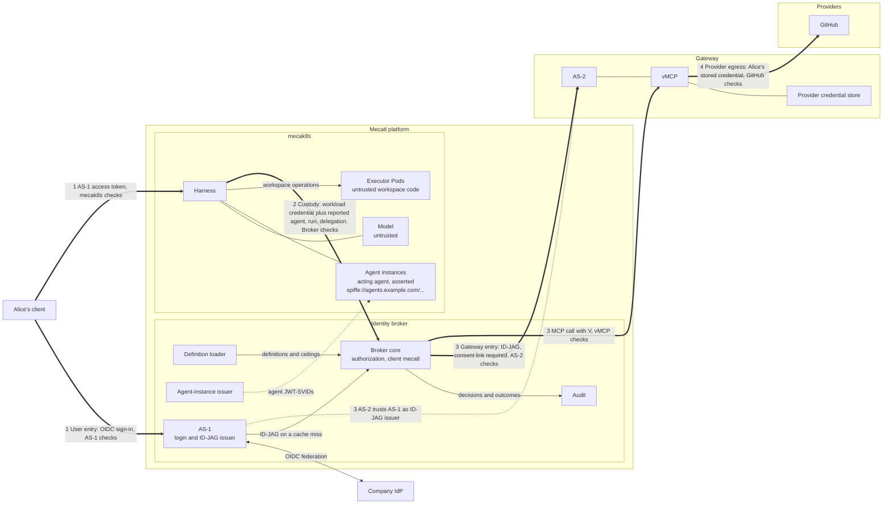

# Agent identity and authority

This document proposes how Mecatl identifies who is acting, and bounds what they may do, in a deployment that serves many users and sessions. A user starts an agent, which may delegate work to subagents. An operator must be able to trace every protected tool call to the agent instance that made it and to the user it acted for. The call must also stay within the agent's purpose: a code-review agent that calls GitHub with its user's token holds everything that user can do, including merging, but it should only read. An agent's authority is therefore the intersection of its user's permissions and its own, and a subagent never gets more than its parent.

The platform's workload identity cannot express this. It names the service, mecak8s, and one mecak8s process hosts many users, agent definitions, and running agents. This design gives each agent instance a credential of its own, ties it to a user sign-in that Mecatl cannot fabricate, and places the checks and the audit trail in an identity broker outside the agent loop.

The document follows one agent from session creation, through delegation, to a tool call that uses the user's credentials to reach an external service. It covers MCP tool calls that pass through the broker. Recording who acts comes first; enforcing each agent's bounds follows (see [order of work](#order-of-work)).

*This document describes the intended architecture, not current implementation status.*

## Why this matters

Suppose Alice asks her main agent to review PR 42. It delegates to `code-reviewer`, which calls an MCP tool using Alice's GitHub credentials. GitHub sees access under Alice's account. That alone does not tell an auditor which agent made the call, why it had access, or whether the action stayed within the delegated task.

Four problems follow:

- An agent name is only a claim until the system establishes its definition. An audit record that names `code-reviewer` is useful only if we know which definition the name refers to, where that definition came from, and what was loaded for the session. A trusted source outside the agent loop must provide these facts.
- The user's credentials hide the acting agent. GitHub sees only Alice. The audit must keep both identities: whose access the call used, and which agent made the call.
- A user's credential can do more than the agent should do. For example, Alice's GitHub credential can merge a PR, but the `code-reviewer` agent must only review. The design combines the user's permissions with the agent's permissions. A child agent can have the same authority as its parent, or less, so a main agent cannot reach tools it lacks by delegating to a child whose definition allows them.
- The harness (the code that runs the agent loop) cannot give independent evidence of its own actions. Its execution log helps explain what it tried to do. Evidence of an external action must come from the component that checked and dispatched the action, together with the result that the component observed.

These guarantees hold only for calls that pass through the broker. A call that goes around the broker skips its checks and its audit trail.

The architecture must connect these facts. An auditor should be able to follow Alice's request through the delegation to the tool call, identify the authority under which it was permitted, and distinguish a successful operation from a denied call or an unknown outcome.

## The identity model

A **definition** describes a kind of agent, such as `code-reviewer`. Its source is part of that identity: a repository's definition and an administrator's definition with the same name are not interchangeable. A definition's **ceiling** is the set of MCP server/tool pairs that an agent built from it may call. Changing an execution setting such as a turn limit does not change a definition's identity, and loading a definition grants no access to a user's accounts.

An **instance** is one use of a definition in a session. Alice and Bob can use the same definition but have distinct instances. Restoring a session preserves its instances; a replacement broker session re-registers the same instances; a new host session creates new ones. A session's **root** is the definition its main agent uses.

A **run** is one execution by an instance. Reviewing PR 42 and later PR 57 uses the same reviewer instance in two runs. A delegated child has its own instance and run, linked to the instance that created it and to the run that delegated to it.

The **user** is the person on whose behalf the agents act. mecak8s, the service that hosts the agents, is the platform **workload**: it serves many users at once and has its own infrastructure identity. Each agent instance also has a name of its own: a SPIFFE ID in a separate agent trust domain, signed by the broker's agent-instance issuer. That name is for attribution, not isolation; every agent runs inside the same mecak8s process.

## Where trust lives

The agent loop uses definitions to do work, but it cannot decide which identities or permissions the rest of the system trusts; otherwise a prompt-injected model or a buggy harness could grant itself access. Definition loading, credential issuance, authorization, and audit therefore live outside the loop.

mecak8s hosts the API and the harness. It validates the AS-1 access token of the user who starts a session, and it authenticates to the broker with its platform workload credential, such as a Kubernetes ServiceAccount token.

The **identity broker** establishes who is acting. It is the existing MCP broker, extended, and one trusted component. Once the authority work is in place, it also bounds what each agent can reach. Its modules are:

- The **definition loader** loads agent definitions from configured sources, records each one's source and revision, and gives the harness the execution configuration. A session's selected definitions stay fixed, so a later change at the source cannot silently replace them. The operator says which definitions may be a session's root, and the broker refuses to register a root instance outside that set. See [agent definitions](agent-definitions.md#loading-definitions).
- The **agent-instance issuer** signs a SPIFFE JWT-SVID for each instance that mecak8s registers, in its own SPIFFE trust domain, separate from the platform's, with a signing key separate from AS-1's and AS-2's; while the broker runs inside mecak8s, its key and AS-1's share one process, and in embedded mode AS-2's does too. It signs on mecak8s's workload-authenticated registration, which is an assertion, not attestation: no evidence about the agent itself is produced or checked.
- **AS-1**, Mecatl's login authorization server, signs users in through the company identity provider (IdP) and issues ID-JAGs (Identity Assertion JWT Authorization Grants). An ID-JAG is a short-lived, single-use signed grant that names the user and the acting agent. It is addressed only to AS-2, the gateway's authorization server, which redeems it for an access token, and only when the broker's client presents it.
- The **authorization and audit** logic checks each protected MCP call and records what it decided and observed.

Downstream, the **vMCP gateway** sends protected calls to MCP backends and providers. It has three parts: AS-2; storage for users' provider credentials, such as GitHub tokens; and the vMCP, ToolHive's virtual MCP server, which dispatches the calls. The gateway runs inside the Mecatl deployment (embedded mode) or outside it (external mode).

Mecatl uses two authorization servers so that it can work with an MCP gateway it does not operate, such as the connector gateway in the Stacklok Enterprise Platform. That gateway holds users' provider connections, such as their GitHub or Google tokens, under its own administration, and its vMCP accepts only access tokens from the gateway's own authorization server; Mecatl can neither mint those tokens nor hold the credentials behind them. So AS-1, Mecatl's server, issues a grant naming the user and the acting agent, and AS-2, the gateway's server, verifies the grant, decides whether to honor it, and issues its own access token. When Mecatl runs the gateway itself (embedded mode), it uses the same two servers and the same protocol, so there is one code path; there the split is a protocol boundary rather than a security boundary, although the two servers still keep separate keys.

The diagram draws each administrative domain as a box and each trust boundary as a numbered thick arrow, labelled with what crosses it and who checks it.

| Boundary | What crosses | Who checks |
| --- | --- | --- |
| 1. User entry | Alice signs in at AS-1 with OIDC, and AS-1 sends her on to the company IdP. Her client then sends the AS-1 access token to mecak8s. | AS-1 at sign-in; mecak8s on each API request. |
| 2. Credential custody | mecak8s calls the broker with its workload credential, which the broker authenticates. The acting agent, run, and delegation are reports from mecak8s, which the broker checks for consistency but cannot verify. mecak8s holds no signing keys or refresh tokens. | The broker. |
| 3. Gateway entry | The broker redeems an ID-JAG from AS-1 at AS-2, which in external mode requires Alice's consent link, and calls the vMCP with the resulting access token `V`. | AS-2 when it redeems the ID-JAG; the vMCP when it validates `V`. |
| 4. Provider egress | The vMCP calls GitHub with Alice's stored GitHub credential. | GitHub. |

AS-1 sits on two boundaries: it signs Alice in at boundary 1 and signs the ID-JAG that AS-2 checks at boundary 3. The agent trust domain is not a boundary; it names agents for attribution, inside mecak8s.

The diagram shows the intended deployment. Today the broker runs inside mecak8s, so credential custody is a module seam and an attacker with code execution in mecak8s holds AS-1's key; and an embedded gateway shares Mecatl's administrative domain, so gateway entry there is a protocol boundary, not a security one. The [threat model](threat-model.md#a-compromised-mecak8s) says what each deployment closes.

This design scopes broker authorization to MCP tools. Local deployments can keep direct tool access, and none of these guarantees apply to them. Extending the boundary to filesystem operations, Shell, and agent spawning is a [future direction](all-tool-mediation.md). The broker does not decide whether agents start or whether runs execute; mecak8s owns agent lifecycle and run execution, and registering an instance records its identity without granting permission to run.

## One request, end to end

Alice asks her main agent to list pull requests and review PR 42. The main agent calls `pull_request_list`, then delegates to `code-reviewer`, which calls `pull_request_read` for PR 42. Each call gets its own authorization decision.

**Sign-in and session open.** Alice signs in at AS-1, which redirects her to the company IdP, and her client calls mecak8s with the AS-1 access token. Sign-in happens at AS-1 rather than in mecak8s so that Mecatl cannot invent a user: mecak8s checks that Alice owns the session and forwards the token to the broker once, and the broker exchanges it at AS-1 for a refresh token bound to that broker session. Every later grant names the user from AS-1's record of that refresh token, never from anything mecak8s sends with a call. The broker holds the refresh token because agents keep working after Alice closes her client. It carries her authority for that one session, has a hard expiry, and is revoked when the session closes or she signs out everywhere. The broker is one OAuth client, `mecatl`, at both AS-1 and AS-2, so a leaked refresh token is useless without the broker's key.

**Each call.** When the broker has no cached access token for this session, agent, gateway, and user, it sends the refresh token and the acting agent's JWT-SVID to AS-1. AS-1 checks that the agent is registered to the session and that the combination of client, user, agent, and gateway is allowed, then returns an ID-JAG naming Alice and the agent in its `act` claim. The JWT-SVID gives the gateway and the audit trail the acting agent; it asserts that agent rather than authenticating it, because agents share one process. The broker redeems the ID-JAG at AS-2 for the vMCP access token `V`. AS-2 maps AS-1's user to its own account for Alice and never receives her AS-1 token or the agent's JWT-SVID. An external gateway also requires a one-time consent link, which Alice creates at AS-2's own login. The link is her own statement, made at the gateway, that Mecatl may act for her, so a compromised AS-1 cannot use the gateway credentials of a user who never chose Mecatl.

**The checks.** During the identity work, the broker checks the session, the workload, that the acting instance is registered to the session, the run and its owner, and the route. Once the [authority work](#order-of-work) is in place, it also uses Cedar, a policy engine, to check the reviewer's effective ceiling: the reviewer's definition ceiling, narrowed by the main agent's. Even then, the design does not evaluate PR-specific bounds or comprehensive enterprise user policy. AS-2 redeems only for a mapped user, and in external mode only for a linked one, and the vMCP dispatches only with Alice's stored GitHub credential, which never reaches the harness or the model. If any check denies the call, no request reaches GitHub. Missing, stale, or revoked identity, consent, connection, or authorization evidence fails closed, with no fallback to a service credential, another user, or a more privileged agent.

**The record.** GitHub sees access under Alice's account. The audit trail supplies the rest: which reviewer acted, which agent delegated the work, why the call was permitted, and what result was observed. A missing result is recorded as unknown, not as proof that the operation never happened. Each record is written by the component that made the decision: the broker, AS-1, AS-2, and the vMCP all record through the toolhive-core audit logger, to a store mecak8s cannot write.

See [credentials and lifecycle](credentials-and-lifecycle.md#interactive-execution) for the full walkthrough and [MCP gateway modes](mcp-gateway-modes.md) for the gateway side.

## Deployment and threats

The broker starts as modules inside the mecak8s process and later moves, as a whole, into a separate service; the protocol and token formats do not change. Starting inside mecak8s ships the protocol sooner. Moving out protects the broker's signing keys, refresh tokens, and audit records against a compromised mecak8s. Hostile workspace code is a different threat, already contained by executor Pods.

Some protections hold in both deployments. Executor Pods get no broker or database credentials. A prompt-injected agent never sees or chooses credentials, because harness code attaches them and the model supplies only tool names and arguments. And correct mecak8s code cannot name a user who did not sign in at AS-1.

Against an attacker with code execution in mecak8s, the split is what matters. While the broker runs inside mecak8s, that attacker holds AS-1's keys and can act as any user connected to the gateway. Once the broker is separate, the attacker holds no keys. It can act only in open sessions bound to its workload, in new sessions opened with fresh tokens from users currently using it, and in sessions opened from live schedule grants until their horizon, and every false report it makes must pass the broker's checks and is recorded where it cannot erase it.

The [threat model](threat-model.md) has the full table, the facts mecak8s reports and how the broker checks them, and what the split requires to be real.

## Standards

The design composes existing OAuth and workload-identity standards rather than inventing a token format. Sign-in is OIDC with the authorization code flow and PKCE, and mecak8s validates AS-1's access token as an RFC 9068 JWT access token. Session open and ID-JAG issuance are RFC 8693 token exchanges, and AS-2 redeems the ID-JAG with the RFC 7523 JWT-bearer grant. The broker authenticates as a confidential client with `private_key_jwt`, so the refresh tokens it holds are useless without its key. That key belongs to the broker, ideally in a key management service; ToolHive's authorization server also accepts a SPIFFE JWT-SVID as client authentication, which could later replace the key with the broker's own workload identity.

The grant format is ID-JAG ([draft-ietf-oauth-identity-assertion-authz-grant](https://datatracker.ietf.org/doc/draft-ietf-oauth-identity-assertion-authz-grant/)), and external mode follows identity chaining ([draft-ietf-oauth-identity-chaining](https://datatracker.ietf.org/doc/draft-ietf-oauth-identity-chaining/)). ID-JAG is scoped to parties in different [administrative domains](credentials-and-lifecycle.md#7-id-jag-from-as-1) (trust domains, in OAuth's term); embedded mode, where all parties share one, reuses the format to keep one protocol path.

Agent credentials are SPIFFE JWT-SVIDs. Each protected call carries two identities, comparable to the layered workload authentication the WIMSE architecture describes, except that only the first is authenticated: the platform workload is authenticated, and the acting agent is asserted by the agent-instance issuer. Registration links the two: the broker accepts an agent only if it was registered to a session bound to that workload. The ID-JAG and the vMCP access token are bearer tokens; short lifetimes, a single audience, and single use of the ID-JAG limit what a stolen one can do.

## Order of work

Mecatl builds this design in two steps. The identity work comes first, and the authority work follows once the identity work is in place. The order follows the dependencies: a ceiling attaches to a definition and to the chain of instances that created each other, so the broker can enforce ceilings only once definitions and registrations are recorded. Recording first also lets attribution ship without committing to a policy model.

The **identity work** establishes who acts and records it:

- the identity broker and its modules, with definitions loaded with their provenance and root eligibility checked at registration;
- instance registration and agent-instance credentials;
- the credential flow, from sign-in at AS-1 to per-user provider credentials at the gateway;
- the [run owner](run-owner.md) on every call, so that shared sessions can come later without a call using the wrong user's credentials;
- sign-out everywhere, which stops every agent and schedule acting for the user, and AS-1's re-check of the user's upstream refresh token, which does the same when the account is disabled;
- audit of who acted, for whom, through which delegation, and what was decided, dispatched, and observed.

The **authority work** decides what each agent may do:

- ceilings resolved by the loader, narrowed on delegation, and checked with Cedar on every call;
- grants scoped to a run the user started, replacing the session's standing refresh token, so that sessions of absent users carry no authority;
- task-specific delegation bounds, and user, resource, and argument policy.

Until the authority work is in place, the only ceiling checks are the harness's delegation restrictions. The identity work already records the definition reference and creation parent at registration, so the authority work adds computation, not a migration. The [implementation companion](implementation.md#work-breakdown) has the full breakdown.

## Open questions

Two questions bear on what the design can promise:

- How the broker could verify the context mecak8s reports with each call, the instance, run, and delegation, rather than only checking it for consistency.
- How to stop code inside the mecak8s process from posing as the trusted lifecycle code or as another agent.

Narrower open points, such as how repository definitions are loaded and the registration API, are listed in the chapters.

## Detailed chapters

These chapters describe each part of the design in detail.

| Chapter | What it covers |
| --- | --- |
| [Audit](audit.md) | Sets the requirements for attribution, correlation, evidence, redaction, and durability of audit records. |
| [Agent definitions](agent-definitions.md) | Describes `AgentDef`. Separates the harness's execution configuration from the authority that the broker enforces. |
| [MCP authorization](mcp-authorization.md) | Describes how user permissions and agent permissions control MCP calls, and how the broker uses ToolHive. |
| [MCP gateway modes](mcp-gateway-modes.md) | Connects the broker's grant issuer to the vMCP gateway's authorization server. One protocol works with an embedded gateway or an external gateway. |
| [Credentials and lifecycle](credentials-and-lifecycle.md) | Follows one request from credential to outcome, with validation and audit evidence. Then explains credential renewal and recovery. |
| [Run owner](run-owner.md) | Records who started each run and checks it against the grant in use. Keeps shared sessions possible later. |
| [Threat model](threat-model.md) | Lists the attackers the design considers, what each can do in each deployment, and what the split from mecak8s requires. |
| [All-tool mediation](all-tool-mediation.md) | Describes how the authorization boundary could extend to filesystem tools, Shell, and spawning. This is a future direction. |

The [implementation and verification companion](implementation.md) records integration requirements and checks. This design replaces an earlier model in which the harness signed agent credentials and wrote its own audit records.
