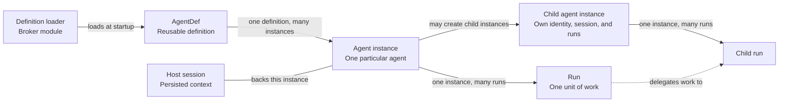

# Agent definitions

*This chapter describes the intended architecture. The vocabulary table marks which terms exist in the code today. The `AgentDef` inventory describes the code. The harness/broker split is proposed.*

## Definitions and executing instances

An agent definition describes how an agent should perform work. Mecatl represents it with `AgentDef`, a value containing metadata and instructions, rather than an executing loop. This chapter uses the following vocabulary:

| Term | Meaning | Exists today? |
| --- | --- | --- |
| Definition | A kind of agent, identified with its source and admitted revision, not just its name. | Yes, as `AgentDef`. It has no source or revision field. |
| Host session | The harness's persisted context for one agent instance, identified by a host session ID such as `hostS42`. A subagent child has its own child session. It links to its parent by `ParentSessionID`, `ParentIncarnation`, and the ID of the call that created it. A root session and its children form a session tree. | Yes. |
| Broker session | The broker's session for one session tree, opened once for the root session, such as `A42`. Every instance in the tree registers to it. | No. Today the in-process broker is keyed by the host session ID. |
| Agent instance | One use of a selected definition, backed by its own host session, with its own identity and any creation-parent association. A delegated child has its own instance. | No. Today a child is a child session, with no instance identity of its own. |
| Run | One execution by an instance, such as `R41` or `R42`. An instance can perform multiple runs. | Yes, as `RunID`. |
| Execution context | The workload, acting instance, broker session, initiating user, run, and any delegation a protected call is made under. The user comes from the broker refresh token AS-1 issued at session open, after Alice signed in through AS-1; AS-1 also checks that the acting instance is registered to the broker session. Run and delegation context remain mecak8s-reported. See [authentication and execution context](mcp-authorization.md#authentication-and-execution-context). | Partly. Runs and the session owner exist. The workload, instance, broker session, and delegation parts are new. |
| Agent-instance incarnation | The durable identity of that instance's lifetime, preserved across restoration and credential renewal. A fresh incarnation identifies a distinct instance. | Yes, as a session incarnation. Using it as the instance identity is new. |
| Workload | The Mecatl service process hosting instances for many users and sessions, with its own infrastructure identity. | Yes. |

The session aggregate mints an [incarnation](../../../engine/session/incarnation.go) when it creates a session, and persists it on every session, including child sessions. The design uses that durable incarnation for agent-instance identity. It is not the host session ID or a run ID. mecak8s persists the incarnation and reports it to the broker. The broker's own session incarnation and attachment binding are separate [recovery concepts](credentials-and-lifecycle.md#pauses-and-restart).

## Relationships and lifetimes

The broker's [definition loader](#loading-definitions) loads definitions up front. An agent definition can be reused by many agent instances. Each instance has its own identity and persisted context, and can perform several runs over its lifetime.

Here, the host session is the persisted context for one agent instance. A child has its own child session. The root session and its children form the session tree, which shares one broker session. Each child follows the same relationships shown for the parent instance, and can use a different selected definition. A root instance has no creation parent; a child has one creation-parent link. Today the authority of a root session allows one delegation hop, so a child cannot create children of its own. The design allows deeper nesting, up to a depth limit that the broker enforces at registration.

Reviewing PR 42 and later reviewing PR 57 can use the same reviewer instance in separate runs. The selected definition stays fixed for the instance. A run that is paused for approval resumes as the same run.

Today, each delegation creates a new child instance. The model can reuse an instance by resuming it with its agent ID. A resumed instance keeps its original definition, and its persisted authority must still fit inside the authority of the parent that resumes it. A turn that was in progress when the process exited is not continued. The session is repaired and returns to idle.

| Event | Instance identity | Run |
| --- | --- | --- |
| Start a new root session | Create a new main instance. | New work starts a run. |
| Assign more work to an existing instance | Keep the same instance and selected definition. | Start another run. |
| Create a child agent | Create a distinct instance with its own Session and a creation-parent link. | The child's work has its own run. |
| Pause and resume unfinished work | Keep the same instance. | Continue the existing run. |
| Restore after a process restart | Recover the original instance, selected definition, and creation-parent link. | Continue a recoverable unfinished run, or fail closed; later work starts a new run. |

Creation ancestry and execution delegation describe different relationships. The creation-parent link records which instance created a child. A delegation links the run assigning work to the run performing it. The child's identity remains stable across its runs; each run supplies its own execution context.

The broker narrows authority along both links. At registration, it stores each instance's effective ceiling: the instance's definition ceiling intersected with its creation parent's effective ceiling. This is the upper bound for the instance's whole life, and it never widens. At each delegation, it records a delegation ceiling: the delegatee's effective ceiling intersected with the delegating run's ceiling. A call made under that delegation is checked against the delegation ceiling. See [registering instances](#registering-instances).

The [domain model](../../architecture/mecatl.modelith.md) provides the broader execution model; this view focuses on agent identity and continuity.

## What AgentDef contains

[`AgentDef`](../../../engine/tool/agentsource.go) combines several concerns:

| Concern | Fields | Purpose |
| --- | --- | --- |
| Naming and routing | `Name`, `Description` | Identify a definition and help the model select it. |
| Instructions and context | `Body`, `Skills`, `Memory` | Supply instructions, preloaded skills, and a memory-tier selection. |
| Model selection | `Model`, `Provider` | Configure the specialist's model and provider. |
| Tool configuration | `Tools`, `DisallowedTools`, `MCPServers` | Filter the specialist's tool catalog and configure its MCP servers. |
| Execution controls | `PermissionMode`, `MaxTurns`, `MaxToolCalls`, `Hooks` | Supply a session permission-mode hint, execution budgets, and lifecycle hooks. |
| Presentation | `Color` | Supply a UI hint. |
| Source tier | `Origin` | Record the admission tier: `explicit`, `project`, `user`, or `driver`. |

`Origin` is not a source location. `AgentDef` has no definition-source identifier or revision field.

The harness does use `Origin` for one authorization decision. Only `explicit` definitions get a ceiling of their own, and a child created from one is labelled `explicit:<name>`. A child from any other tier is not narrowed by its definition. It gets the intersection of its parent's authority and its candidate authority, and it keeps its parent's definition label.

Tool catalog filtering and authority enforcement are separate in the code. Composition registers the tools selected for the specialist. For `explicit` definitions, it also derives a harness-side authority ceiling from the resolved tools and MCP capabilities. Delegation intersects that ceiling with the parent's authority and the candidate's authority. The ceiling is derived separately and is not a field of `AgentDef`. This path is not broker enforcement.

## Harness configuration and broker authority

The proposed split keeps execution configuration in the harness and supplies the broker with the authority ceiling needed for independent MCP authorization. Tool information serves both components for different reasons: the harness configures which tools are available, while the broker decides whether a requested MCP call is allowed. Turn and tool-call budgets remain harness concerns.

The harness uses `Tools`, `DisallowedTools`, and `MCPServers` to configure the agent's available tools. The broker needs an independently established ceiling on permitted MCP operations. A tool appearing in the harness catalog is not sufficient authorization to call it, and a model-supplied tool list cannot establish the broker's ceiling.

The broker ceiling is the set of permitted registered MCP server/tool pairs, resolved from the definition's `Tools`, `DisallowedTools`, and `MCPServers`. That fixed admitted ceiling drives [deterministic Cedar policy generation](mcp-authorization.md#definition-derived-ceiling), tied to the definition source and revision. At registration, the broker narrows it to each instance's [effective ceiling](mcp-authorization.md#delegated-authority). The harness's definition-source snapshot is not broker initialization. The broker loads its own records, as described under [loading definitions](#loading-definitions).

Only definitions that the broker's operator loads get a ceiling of their own. Any other definition, such as a repository definition, registers with an effective ceiling equal to its creation parent's effective ceiling. It is neither widened nor narrowed. The loader must not treat a definition with no tier as one of the operator's definitions.

In broker mode, a definition's inline `MCPServers` entry is not connected. An inline entry names its own server and carries one static credential for every user. It also bypasses the broker. The harness drops such an entry when it admits the definition, reports a diagnostic, and loads the rest of the definition. Every MCP call goes through the broker. Today an inline entry connects its own server directly.

## Loading definitions

The **definition loader** is a module of the identity broker. At broker startup it loads the global agent definitions from sources that the operator configures, such as administrator-managed files or APIs. It records each definition's source and revision in the broker. The operator's loader configuration also says which loaded definitions can be the root of a session, that is, the definition of its main agent. It can say this per user or group. When mecak8s registers an instance that has no parent, the broker refuses it if its definition is not on that list, and records the refusal. The loader also gives the harness the execution configuration. While the broker runs as modules inside mecak8s, the loader runs there too. When the broker becomes a separate service, the loader moves with it.

Once the [authority work](README.md#order-of-work) is in place, the loader also resolves and records each definition's ceiling. A definition from any other source, such as a repository, is not loaded by the broker. mecak8s names it by reference, and the broker accepts it only as a mecak8s report, marked as such in audit. It gets no ceiling of its own. It inherits the ceiling of the instance that creates it, so no agent can exceed the widest ceiling of a definition that can be a session's root. How the broker could load repository definitions itself is an open question.

The harness keeps each session's fixed selection of definitions and persists it. Each registration names its definition to the broker by reference: source, name, and revision. For a definition that the broker loaded, the broker checks the reference against its own record and refuses a mismatch. mecak8s does not supply the content or the ceiling of such a definition. The broker is not given the session's whole selection. Naming any definition can only narrow authority, because an instance's effective ceiling is its definition ceiling intersected with its creation parent's. Today a session persists no definition selection, and the harness resolves definitions from the current source.

For Alice's session `hostS42` in the [walkthrough](credentials-and-lifecycle.md#interactive-execution), the selection includes the main definition and the reviewer definition, `global/code-reviewer`. Here the operator loaded the reviewer definition, so it has a ceiling of its own. Selecting the reviewer definition does not create a reviewer instance. The harness creates the particular child later.

Today the root session has no `AgentDef`. In this design, a session started without a named definition uses the built-in `system/main` definition, and the default anonymous child uses `system/explorer`. Neither needs a definition file. Built-in definitions are registered and ceiling-resolved like any other. The Mecatl release that ships them is their source and revision. `system/main` grants no privilege by its name: Alice's and Bob's default mains share the definition but not instances, users, or authority. A session started with a named definition, such as `global/code-reviewer`, registers that definition as its main agent instead. The harness can build the main loop from a real `AgentDef` or from a built-in equivalent. This is an implementation choice.

Before the main loop starts, mecak8s persists the main's agent-instance incarnation. It then authenticates to the broker with its workload ServiceAccount and registers the main instance with no parent, naming its definition by reference. Broker initialization and registration must finish before execution. A suitable instance SVID can be obtained when needed, before protected calls. The selected definitions stay fixed for the session.

## Registering instances

The broker validates the workload-authenticated registration records and constructs the canonical instance subject. It checks that the workload may act for the session and instance and associates the supplied incarnation with the registered definition, source, revision, ceiling, and creating instance, if any, and stores the effective ceiling computed from them. mecak8s allocates incarnations; the broker does not. A known definition or loop-supplied name alone is insufficient for issuance.

When the main creates the reviewer, mecak8s allocates and persists the child's incarnation. It registers that particular child using the persisted incarnation, the reviewer definition already registered from the session selection, and the registered main-instance reference. The broker validates these records and constructs the child subject. This is a lifecycle assertion authenticated by mecak8s's workload credential, not proof derived from possession of the parent's SVID.

Creation ancestry records who created an instance. Execution delegation separately links parent run `R41`, reviewer run `R42`, and the bounds of delegation `D42`. Registration establishes identity records; it does not authorize spawning, run execution, or a tool call. The harness manages execution, and the broker [authorizes each MCP request](mcp-authorization.md#two-requests-two-authorization-decisions).

The broker explicitly trusts mecak8s's workload-authenticated lifecycle assertions. These responsibilities are outside the untrusted loop, but a ServiceAccount cannot distinguish trusted lifecycle code from compromised code in the same process. This design does not establish same-process isolation. The user side does not rest on mecak8s's reports: AS-1 witnessed Alice's sign-in and names her from the session's broker refresh token, but that does not prove run or delegation context. While the broker runs inside mecak8s, an attacker with code execution in that process also holds AS-1's keys; see [deployment and threats](README.md#deployment-and-threats). Unlike a SPIRE agent, which inspects a workload before issuing it an identity, the broker cannot observe mecak8s's instances. It signs on mecak8s's registration, which is an assertion, not attestation. The [audit evidence table](audit.md#evidence-and-provenance) lists which registration facts the broker verifies and which it accepts as mecak8s assertions.

## Identity continuity across runs and restarts

An instance can perform several runs without changing identity. Its fixed definition selection provides continuity, while each call remains subject to applicable current user permissions and broker policy.

| Event | What remains fixed or must be checked |
| --- | --- |
| New run on the same instance | The incarnation and selected definition stay fixed. The new run has its own execution context and applicable bounds; the instance credential alone does not authorize it. |
| Definition source edited | The session's pinned source and revision selection does not change. Restoration must not substitute whatever is current at the source. |
| Process restart or session restoration | Restore the original incarnation, definition selection, parent association, stored effective ceiling, and harness delegation bounds. Recover the unfinished execution context and its user/actor/connection association or fail closed. |
| Instance credential expires | Renew for the registered identity after the required checks. Renewal grants no new authority and does not widen recovered bounds. |
| Fresh incarnation | Register a distinct identity. Reusing a session or definition name does not inherit the old instance's authority. |

Continuation preserves the unfinished run's original bounds. Current restrictions or withdrawal can constrain it; credential renewal or policy expansion must not automatically widen recovered authority. If the original identity or selection cannot be recovered, restoration must fail closed rather than silently substitute another instance or definition.

Identity continuity is separate from broker attachment recovery. See [pauses and restart](credentials-and-lifecycle.md#pauses-and-restart) for attachment checks, credential and execution recovery, and unknown operation outcomes.

## Definition provenance

Each instance's registration carries a provenance record for the exact definition it uses. The broker's definition loader produces it from source resolution; the model never supplies it, and it is never reconstructed later from whatever is current at the source.

The record has a versioned **profile** and profile-specific metadata. A Git profile might carry repository, path, and full commit; a Kubernetes profile the cluster, object UID, and observed revision; a service-backed profile a tenant namespace, object ID, and revision. Each profile defines its required fields and revision semantics. Operator configuration names the profiles and evidence it accepts; a source cannot weaken that by selecting a more permissive profile.

The record carries two digests:

- **Source content digest:** the bytes read from the source.
- **Accepted definition digest:** the normalized definition mecak8s admitted and constructs the agent from.

Parsing and normalization mean these differ. A commit plus a digest does not prove the bytes came from that commit; a locally modified file is the obvious counterexample.

The broker records provenance as a mecak8s assertion unless it independently verified a fact, and audit marks which. "mecak8s reports loading these bytes from commit X" is distinct from "the broker verified these bytes against commit X"; the design requires only the former for now. Provenance lives in the broker's per-instance registration record, not in instance credentials. It grants no permission by itself; later policy may require approved revisions or particular source authorities.

## Source records and policy representation

The proposal adopts workload-authenticated mecak8s lifecycle assertions, host-allocated durable incarnations, and broker validation and subject construction as its semantic mechanism. The exact registration wire API, durable record schema, and verified per-operation binding for reported context remain unresolved, as does protection from same-process substitution. These are proposed semantics, not implemented contracts.

Cedar is selected for the effective server/tool ceiling. The representation of definition-source and revision records, registration API, and Cedar policies remains an implementation choice. The authority work generates policy only from resolved definition facts; separately managed user, resource, argument, and dynamic delegation policies are deferred. Existing user/connection authorization checks remain required.
