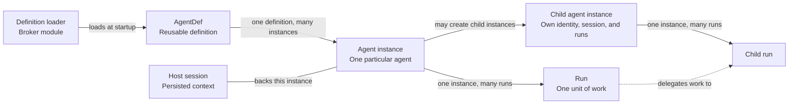

# Agent definitions

*This chapter describes the intended architecture. The vocabulary table shows which terms exist in the code today. The `AgentDef` inventory describes the code. The split between the harness and the broker is a proposal.*

## Definitions and executing instances

An agent definition describes how an agent performs work. Mecatl represents it with `AgentDef`. `AgentDef` is a value that holds metadata and instructions. It is not an executing loop. This chapter uses these terms:

| Term | Meaning | Exists today? |
| --- | --- | --- |
| Definition | A kind of agent. Its source and admitted revision identify it, not just its name. | Yes, as `AgentDef`. `AgentDef` has no source or revision field. |
| Host session | The harness's persisted context for one agent instance. A host session ID identifies it, such as `hostS42`. A subagent child has its own child session. The child session links to its parent by `ParentSessionID`, `ParentIncarnation`, and the ID of the call that created it. A root session and its children form a session tree. | Yes. |
| Broker session | The broker's session for one session tree, such as `A42`. The broker opens it once, for the root session. Every instance in the tree registers to it. | No. Today the in-process broker uses the host session ID as its key. |
| Agent instance | One use of a selected definition. Its own host session backs it. It has its own identity and, if it is a child, a creation-parent link. A delegated child has its own instance. | No. Today a child is a child session. It has no instance identity of its own. |
| Run | One execution by an instance, such as `R41` or `R42`. An instance can perform many runs. | Yes, as `RunID`. |
| Execution context | The context that a protected call is made under: the workload, the acting instance, the broker session, the initiating user, the run, and any delegation. The user comes from the broker refresh token that AS-1 issued at session open, after Alice signed in through AS-1. AS-1 also checks that the acting instance is registered to the broker session. mecak8s still reports the run and delegation context. See [authentication and execution context](mcp-authorization.md#authentication-and-execution-context). | Partly. Runs and the session owner exist. The workload, instance, broker session, and delegation parts are new. |
| Agent-instance incarnation | The durable identity of an instance for its whole lifetime. It stays the same across restoration and credential renewal. A fresh incarnation identifies a distinct instance. | Yes, as a session incarnation. Using it as the instance identity is new. |
| Workload | The Mecatl service process that hosts instances for many users and sessions. It has its own infrastructure identity. | Yes. |

The session aggregate mints an [incarnation](../../../engine/session/incarnation.go) when it creates a session. It persists the incarnation on every session, including child sessions. The design uses that durable incarnation as the agent-instance identity. The incarnation is not the host session ID or a run ID. mecak8s persists the incarnation and reports it to the broker. The broker's own session incarnation and attachment binding are separate [recovery concepts](credentials-and-lifecycle.md#pauses-and-restart).

## Relationships and lifetimes

The broker's [definition loader](#loading-definitions) loads definitions up front. Many agent instances can reuse one agent definition. Each instance has its own identity and persisted context. It can perform several runs over its lifetime.

In the diagram, the host session is the persisted context for one agent instance. A child has its own child session. The root session and its children form the session tree. The tree shares one broker session. Each child follows the same relationships as the parent instance. A child can use a different selected definition. A root instance has no creation parent. A child has one creation-parent link. Today the authority of a root session allows one delegation hop, so a child cannot create children of its own. The design allows deeper nesting, up to a depth limit. The broker enforces the limit at registration.

The same reviewer instance can review PR 42 and later review PR 57, in separate runs. The selected definition stays fixed for the instance. A run that is paused for approval resumes as the same run.

Today, each delegation creates a new child session. The model can reuse a child session by resuming it with its agent ID. A resumed child session keeps its original definition. Its persisted authority must still fit inside the authority of the parent that resumes it. A turn that was in progress when the process exited is not continued. The harness repairs the session and returns it to idle.

The table shows how the design handles each event.

| Event | Instance identity | Run |
| --- | --- | --- |
| Start a new root session | Create a new main instance. | New work starts a run. |
| Assign more work to an existing instance | Keep the same instance and selected definition. | Start another run. |
| Create a child agent | Create a distinct instance with its own host session and a creation-parent link. | The child's work has its own run. |
| Pause and resume unfinished work | Keep the same instance. | Continue the existing run. |
| Restore after a process restart | Recover the original instance, selected definition, and creation-parent link. | Continue a recoverable unfinished run, or fail closed. Later work starts a new run. |

Creation ancestry and execution delegation are different relationships. The creation-parent link records which instance created a child. A delegation links the run that assigns work to the run that performs it. The child's identity stays stable across its runs. Each run supplies its own execution context.

Once the [authority work](README.md#order-of-work) is in place, the broker narrows authority along the creation link. At registration, it stores each instance's effective ceiling. The effective ceiling is the instance's definition ceiling intersected with the effective ceiling of its creation parent. It is the upper bound for the instance's whole life, and it never widens. Narrowing along the delegation link comes later, as a task-specific delegation bound: a delegation ceiling, the delegatee's effective ceiling intersected with the delegating run's ceiling, checked for calls made under that delegation. Until then, the harness's delegation restrictions are the only bound on a delegated task below the instance's effective ceiling. See [registering instances](#registering-instances).

The [domain model](../../architecture/mecatl.modelith.md) gives the broader execution model. This chapter focuses on agent identity and continuity.

## What AgentDef contains

[`AgentDef`](../../../engine/tool/agentsource.go) combines several concerns:

| Concern | Fields | Purpose |
| --- | --- | --- |
| Naming and routing | `Name`, `Description` | Identify a definition. Help the model select it. |
| Instructions and context | `Body`, `Skills`, `Memory` | Supply instructions, preloaded skills, and a memory-tier selection. |
| Model selection | `Model`, `Provider` | Set the model and the provider of the agent. |
| Tool configuration | `Tools`, `DisallowedTools`, `MCPServers` | Filter the tool catalog of the agent. Configure its MCP servers. |
| Execution controls | `PermissionMode`, `MaxTurns`, `MaxToolCalls`, `Hooks` | Supply a hint for the session permission mode, execution budgets, and lifecycle hooks. |
| Presentation | `Color` | Supply a UI hint. |
| Source tier | `Origin` | Record the admission tier: `explicit`, `project`, `user`, or `driver`. |

`Origin` is not a source location. `AgentDef` has no field for a definition-source identifier or a revision.

Today, the harness uses `Origin` for one authorization decision. Only `explicit` definitions get a ceiling of their own. A child created from an `explicit` definition is labelled `explicit:<name>`. A child from any other tier is not narrowed by its definition. It gets the intersection of its parent's authority and its candidate authority. It keeps its parent's definition label.

In the code, tool catalog filtering and authority enforcement are separate. Composition registers the tools selected for the agent. For `explicit` definitions, composition also derives a harness-side authority ceiling from the resolved tools and MCP capabilities. Delegation intersects that ceiling with the parent's authority and the candidate's authority. The ceiling is derived separately. It is not a field of `AgentDef`. This path is not broker enforcement.

## Harness configuration and broker authority

The proposed split keeps execution configuration in the harness. It gives the broker the authority ceiling that it needs for independent MCP authorization. Both components use tool information, for different reasons. The harness configures which tools are available. The broker decides whether a requested MCP call is allowed. Turn and tool-call budgets stay with the harness.

The harness uses `Tools`, `DisallowedTools`, and `MCPServers` to configure the tools that the agent can use. The broker needs a ceiling on permitted MCP operations that it establishes independently. A tool in the harness catalog is not enough authorization to call it. A model-supplied tool list cannot establish the broker's ceiling.

The broker ceiling is the set of permitted registered MCP server/tool pairs. The broker resolves it from the definition's `Tools`, `DisallowedTools`, and `MCPServers`. That fixed admitted ceiling drives [deterministic Cedar policy generation](mcp-authorization.md#definition-derived-ceiling). The same definition source and revision always produce the same policy. At registration, the broker narrows the ceiling to each instance's [effective ceiling](mcp-authorization.md#delegated-authority). The harness's definition-source snapshot is not broker initialization. The broker loads its own records, as [loading definitions](#loading-definitions) describes.

In this design, only definitions that the broker's operator loads get a ceiling of their own. Any other definition, such as a repository definition, registers with an effective ceiling equal to the effective ceiling of its creation parent. The broker neither widens nor narrows it. The loader must not treat a definition with no tier as one of the operator's definitions.

In broker mode, the harness does not connect an inline `MCPServers` entry in a definition. An inline entry names its own server and carries one static credential for every user. It also bypasses the broker. The harness drops such an entry when it admits the definition. It reports a diagnostic and loads the rest of the definition. Every MCP call goes through the broker. Today an inline entry connects its own server directly.

## Loading definitions

The **definition loader** is a module of the identity broker. At broker startup, it loads the global agent definitions from sources that the operator configures, such as administrator-managed files or APIs. It records each definition's source and revision in the broker. The operator's loader configuration also says which loaded definitions can be the root of a session. The root of a session is the definition of its main agent. The configuration can set this per user or group. When mecak8s registers an instance that has no parent, the broker checks its definition against this list. If the definition is not on the list, the broker refuses the registration and records the refusal. The loader also gives the execution configuration to the harness. While the broker runs as modules inside mecak8s, the loader runs there too. When the broker becomes a separate service, the loader moves with it.

Once the [authority work](README.md#order-of-work) is in place, the loader also resolves and records each definition's ceiling. The broker does not load a definition from any other source, such as a repository. mecak8s names that definition by reference. The broker accepts it only as a mecak8s report and marks it as such in audit. It gets no ceiling of its own. It inherits the ceiling of the instance that creates it. So no agent can exceed the widest ceiling of a definition that can be a session's root. How the broker could load repository definitions itself is an open question.

The harness keeps each session's fixed selection of definitions and persists it. Each registration names its definition to the broker by reference: source, name, and revision. For a definition that the broker loaded, the broker checks the reference against its own record. It refuses a mismatch. mecak8s does not supply the content or the ceiling of such a definition. The broker does not receive the session's whole selection. Naming any definition can only narrow authority. The reason is that an instance's effective ceiling is its definition ceiling intersected with the effective ceiling of its creation parent. Today a session persists no definition selection. The harness resolves definitions from the current source.

For Alice's session `hostS42` in the [walkthrough](credentials-and-lifecycle.md#interactive-execution), the selection includes the main definition and the reviewer definition, `global/code-reviewer`. The operator loaded the reviewer definition, so it has a ceiling of its own. Selecting the reviewer definition does not create a reviewer instance. The harness creates that particular child later.

Today the root session has no `AgentDef`. In this design, a session started without a named definition uses the built-in `system/main` definition. The default anonymous child uses `system/explorer`. Neither needs a definition file. Built-in definitions follow the same registration and ceiling resolution as any other definition. The Mecatl release that ships them is their source and revision. `system/main` grants no privilege by its name. Alice's and Bob's default mains share the definition. They do not share instances, users, or authority. A session started with a named definition, such as `global/code-reviewer`, registers that definition as its main agent instead. The harness can build the main loop from a real `AgentDef` or from a built-in equivalent. This is an implementation choice.

Before the main loop starts, mecak8s persists the main's agent-instance incarnation. Then mecak8s authenticates to the broker with its workload ServiceAccount. It registers the main instance with no parent and names its definition by reference. Broker initialization and registration must finish before execution. A suitable instance SVID can be obtained when needed, before protected calls. The selected definitions stay fixed for the session.

## Registering instances

The broker's agent-instance issuer validates the registration records that the workload authenticated. It then constructs the canonical instance subject. The issuer makes these checks:

- The workload can act for the session and the instance.
- If there is a parent, the parent is registered to the same broker session.
- A registration with no parent names a definition that can be a session's root.
- For a definition that the broker loaded, the reference matches the broker's record.
- The subject follows the SPIFFE rules. Each definition category and name uses only `[A-Za-z0-9._-]`, is neither `.` nor `..`, and is at most 63 bytes. The nesting is at most 8 child levels below the root. The whole ID stays within the 2,048 bytes SPIFFE-ID §2.3 says not to exceed. A registration that breaks a rule fails closed; see the [SVID step](credentials-and-lifecycle.md#4-agent-instance-jwt-svid) of the credential flow.

If the checks pass, the issuer associates the supplied incarnation with the registered definition, source, revision, ceiling, and creating instance, if any. It stores the effective ceiling that it computes from them. The session aggregate mints the incarnation. mecak8s persists it and reports it. The broker does not allocate incarnations. A known definition, or a name that the loop supplies, is not enough for issuance.

When the main creates the reviewer, the harness creates the child session, and mecak8s persists the child's incarnation. mecak8s then registers that particular child. The registration carries the persisted incarnation, the reference to the reviewer definition, and the reference to the registered main instance. The issuer validates these records and constructs the child subject. This is a lifecycle assertion that mecak8s's workload credential authenticates. It is not proof derived from possession of the parent's SVID.

Registration establishes identity records. It does not authorize spawning, run execution, or a tool call. The harness manages execution. The broker [authorizes each MCP request](mcp-authorization.md#two-requests-two-authorization-decisions). Creation ancestry and delegation are different links. See [relationships and lifetimes](#relationships-and-lifetimes).

The broker does not admit runs. mecak8s reports the run with every call and reports each delegation when it happens, through the [delegation report](credentials-and-lifecycle.md#delegation-report); the broker records both as [lineage events](audit.md#lineage), marked as reported. A root run starts when a user speaks to the main agent or a schedule fires. Its owner is the owner recorded with the grant the run uses: the company identity, not AS-1's subject. For a child run, mecak8s reports the owner, and the broker refuses a delegation whose reported owner differs from the delegating run's. On every protected call, the broker checks that the reported run owner equals the owner recorded with the grant in use; see [run owner](run-owner.md). Run grants and task-specific delegation bounds would make runs something the broker admits; both are [authority work](README.md#order-of-work).

The broker trusts the lifecycle assertions that mecak8s sends with its workload credential. mecak8s is the registrant. A ServiceAccount cannot tell trusted lifecycle code from compromised code in the same process. This design does not isolate them. The user does not come from a mecak8s report. AS-1 saw Alice sign in. See [deployment and threats](README.md#deployment-and-threats) for what a compromised mecak8s can do. A SPIRE agent inspects a workload before it issues an identity to it. The broker cannot observe mecak8s's instances in this way. It signs on mecak8s's registration. The registration is an assertion, not attestation. The [audit evidence table](audit.md#evidence-and-provenance) lists which registration facts the broker verifies and which it accepts as mecak8s assertions.

## Identity continuity across runs and restarts

An instance keeps its identity across runs and restarts. Its fixed definition reference provides continuity. Each call is still checked against the user's current permissions and the broker's policy.

The table shows how the design handles each event. Today, a turn that was in progress at process exit is not continued. See [relationships and lifetimes](#relationships-and-lifetimes).

| Event | What stays fixed or must be checked |
| --- | --- |
| New run on the same instance | The incarnation and the definition stay fixed. The new run has its own run ID, reported by mecak8s. The instance credential alone does not authorize it. |
| Definition source edited | The instance keeps the revision that it registered with. Restoration never uses the revision that is current at the source. The broker keeps the stored ceiling and the revision record, not the source bytes. If the harness cannot rebuild the registered revision, the instance fails closed and does not resume. The user starts a new instance on the current revision. |
| Process restart or session restoration | Restore the original incarnation, definition reference, creation parent, stored effective ceiling, and each unfinished run's owner. Recover the unfinished execution context and its user, actor, and connection association, or fail closed. An unfinished run whose owner cannot be restored denies calls. |
| Instance credential expires | Renew the credential for the registered identity after the required checks. Renewal does not widen authority. |
| Fork or clear | Register a distinct identity. A fork or a clear creates a new root instance. |
| Fresh incarnation | Register a distinct identity. Reusing a session name or a definition name does not inherit the old instance's authority. |
| Authority work switched on | The broker computes a ceiling once for each live instance, parents before children. It marks the ceiling as backfilled. Until then, an instance with no ceiling is denied every MCP call. An instance whose definition or parent cannot be resolved gets a ceiling that denies every MCP call. That instance must register again. |

A continued run keeps its original bounds. A new restriction can narrow them. So can the withdrawal of a permission. Credential renewal and policy changes must not widen recovered authority. If the original identity or definition cannot be recovered, restoration fails closed. It never substitutes another instance or definition.

Identity continuity is separate from broker attachment recovery. See [pauses and restart](credentials-and-lifecycle.md#pauses-and-restart) for attachment checks, credential and execution recovery, and unknown operation outcomes.

## Definition provenance

The registration of each instance refers to a provenance record for the exact definition that the instance uses. For a definition that the broker loaded, the broker's loader produces the record from source resolution. The model never supplies the record. The broker never rebuilds it later from the current state of the source.

The record has a versioned **profile** and profile-specific metadata. A Git profile can carry the repository, the path, and the full commit. A Kubernetes profile can carry the cluster, the object UID, and the observed revision. A service-backed profile can carry a tenant namespace, an object ID, and a revision. Each profile defines its required fields and its revision rules. The operator's configuration names the profiles and the evidence that it accepts. A source cannot weaken this by selecting a more permissive profile.

The broker computes two digests:

- **Source content digest:** The bytes that the loader read from the source.
- **Accepted definition digest:** The normalized definition that the broker admitted and that the harness builds the agent from.

Parsing and normalization make these two digests differ. A commit plus a digest does not prove that the bytes came from that commit. For example, someone can modify the file locally. The digest then matches the modified bytes, while the commit names the original.

The broker verifies provenance only for definitions that it loaded itself. For any other definition, mecak8s reports the provenance. The broker stores it as a mecak8s report. Audit marks each fact as verified or reported. "mecak8s reports loading these bytes from commit X" is not the same as "the broker verified these bytes against commit X". Provenance lives in the broker's per-instance registration record, not in instance credentials. It grants no permission by itself. Later policy can require approved revisions or particular source authorities.

## Source records and policy representation

The design uses three mechanisms. mecak8s sends lifecycle assertions that its workload credential authenticates. The session aggregate mints durable incarnations. mecak8s persists them and reports them. The broker validates the assertions and constructs the subject. These are proposed semantics, not implemented contracts. The [open questions](README.md#open-questions) list what is not settled.

Cedar is the policy engine for the effective server/tool ceiling. How the broker stores definition-source and revision records, how registration works, and how the Cedar policies are laid out are implementation choices. The authority work generates policy only from resolved definition facts. The design defers separate policies for users, resources, arguments, and dynamic delegation. The user and connection checks at AS-2 and the vMCP remain required.
