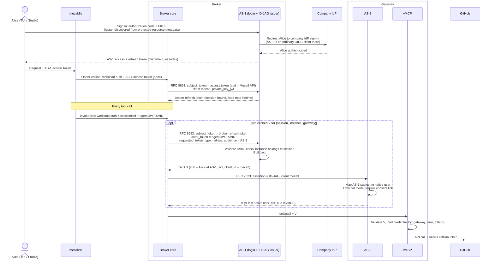

# Credential flow rework

*Decision record, not current behavior. It records the decisions behind the credential flow in [credentials and lifecycle](credentials-and-lifecycle.md) and their rationale. The other chapters describe the resulting design.*

The flow was reviewed right to left, from the vMCP call to a SaaS provider back to the user's login. For each credential the review asked what it must contain, what it proves, and who issues and verifies it. The guiding question is provenance: who first established each fact, and how many signers relayed it before it reached the party that relies on it.

The design must work in two deployments:

- **Standalone Mecatl**, with no Stacklok Enterprise Platform (SEP), no Directory, and no connector gateway.
- **Enterprise**, integrating with Directory and the connector gateway.

Roles are therefore pluggable. Where a role is backed by Directory in enterprise deployments, Mecatl provides a local implementation that can later delegate to SEP.

## Summary of the converged flow



When no credential or consent exists, vMCP or AS-2 refuses and the broker returns the existing `mcp_authorization_pending` outcome. The client opens the authorization URL and rechecks, as both the TUI and Studio already do.

## Decisions

### D1: upstream credential lookup (vMCP to provider)

- Upstream credentials are keyed by **(gateway, native user, provider)**: one record per user and provider, refreshed as a single row with compare-and-swap. The enterprise connector gateway already does this through its user-keyed storage decorator.
- Open-source ToolHive keys credentials by interactive login session, which a delegated `V` does not have, so vMCP would find nothing. Standalone Mecatl needs a per-user lookup in open-source ToolHive; the enterprise decorator is not available there.
- vMCP validates `V`, loads the credential for the route's provider, and calls the provider. A missing credential produces "needs authorization".
- Consent is not checked here. It is checked once, when AS-2 redeems the grant (D2).
- Roles: **identity resolver** (AS-1 subject to native user), **consent store**, **credential store**. Standalone Mecatl provides local implementations; enterprise backs them with Directory and the connector gateway. Nothing in the flow presumes Directory.

### D2: grant redeemed at AS-2

- AS-1 issues an **ID-JAG** ([draft-ietf-oauth-identity-assertion-authz-grant-04](https://datatracker.ietf.org/doc/draft-ietf-oauth-identity-assertion-authz-grant/)). It replaces the bespoke grant `G` and the self-minted association assertion `E`. The broker redeems the ID-JAG at AS-2 with RFC 7523 and receives `V`.
- **Why ID-JAG rather than the original chaining grant `G`.** ID-JAG is a profile of [identity chaining across trust domains](https://www.ietf.org/archive/id/draft-ietf-oauth-identity-chaining-17.html) (ID-JAG §1, §2.2). It reuses that draft's exchange, its RFC 7523 redemption, its no-refresh-token rule, and its discovery metadata. On top, it fixes:
  - an explicit `typ=oauth-id-jag+jwt`;
  - required `client_id`, `jti`, `iat`, and `aud` = the resource AS issuer;
  - redemption checks that bind the redeeming client (§4.4.1);
  - security rules (§9).

  The original `G` would have had to re-specify all of that as a private profile. ToolHive already redeems ID-JAGs with these checks and keeps `act`; its plain JWT-bearer redemption does not. Issuance is new work for either format. One format is used in both modes: the modes differ in AS-2 policy, not in the token.
- **How each mode is described:**
  - **Embedded:** ID-JAG as specified. AS-1 is the SSO IdP that AS-2 trusts (§4.1), and the subject is the shared AS-1 `sub` (§5).
  - **External:** identity chaining across trust domains (chaining §2.1, §2.5) using the ID-JAG token profile. The §4.1 precondition, that the resource AS already trusts the IdP for SSO, does **not** hold, and its consent waiver does not apply. AS-2 trusts AS-1 only as an assertion issuer and resolves subjects only through the explicit consent/identity link (§2.2 deployment-specific resolution). There is no just-in-time provisioning.
  - **Deliberate deviation:** `aud_sub` and `email`, both RECOMMENDED by §3.1, are omitted. AS-1 does not know AS-2's subject, and an email address is not an identity link. Never resolve through `sub_id` (§9.5).
- AS-1 and AS-2 stay **separate issuers with separate keys**, also in embedded mode. ID-JAG §9.3 forbids an IdP from redeeming an ID-JAG it issued itself. Separate issuers are not process isolation when both run in one process.
- One OAuth client ID, `mecatl`, at both AS-1 and AS-2. ID-JAG §4.4.1 requires the ID-JAG's `client_id` to match the client authenticating at AS-2.
- AS-2 does not issue refresh tokens (§4.4.3). When `V` expires, the broker obtains a new ID-JAG.
- **Consent**, so that a compromised AS-1 cannot use the credentials of a user who never chose Mecatl:

  | Mode | Consent |
  | --- | --- |
  | Embedded / standalone | Implicit. Users log in to AS-2 through AS-1, and AS-1, AS-2, and the credential store share one trust domain. |
  | External gateway | A one-time "Allow Mecatl" step at **AS-2's own login**, generated by AS-2. It records the link (native user, AS-1 issuer + AS-1 `sub`, client `mecatl`). AS-2 redeems an ID-JAG only for a linked subject. Revocable in the gateway UI. |

  The link is keyed on the AS-1 `sub` that appears in the ID-JAG, not on `sub_id` (§9.5). Admin pre-consent at AS-2 without an independent witness of the user is rejected: it would let a compromised AS-1 name every user.

- **Requirement (decided).** AS-2 trusts AS-1 as an ID-JAG issuer in every mode, and that trust covers signature, issuer, audience, client, and replay. Mapping an AS-1 subject to a native user is a separate requirement:
  - **External mode:** AS-2 maps an AS-1 subject to a native user only through a link the user establishes once, witnessed by AS-2 itself. A mapping asserted only by AS-1 is not accepted unless an administrator explicitly decides to accept that risk.
  - **Embedded mode:** users already sign in to AS-2 through AS-1, so the mapping exists.
  - **Missing link or connection:** the gateway must give the broker enough to send the user to a URL where they can fix it, and the call can then be retried.

  **Ask of ToolHive:** redeem ID-JAGs to native users through such links, support creating the link, and signal "link or connection missing" with a URL. How the link is created and how the signal is carried are implementation choices.
- **The external consent link.** It does two jobs: it maps AS-1's subject to AS-2's native user, and it is the user's first-hand statement at the gateway that Mecatl may act for them.
  - The link names the native user, the AS-1 issuer and `sub`, and client `mecatl`. AS-2 redeems an ID-JAG only when its `iss`, `sub`, and `client_id` match a link, and the link supplies the native user.
  - The user creates it once per gateway, through AS-2's own login, when the first call comes back as "link required" through the existing `mcp_authorization_pending` path.
  - The link flow must resist link swapping: an attacker must not be able to get a victim to link the victim's gateway account to the attacker's AS-1 subject.
  - A shared company IdP behind AS-1 and AS-2 can make the step silent, but does not remove it. AS-1, not the IdP, signs `sub_id` (§9.5), so a compromised AS-1 could name any user.
  - Dropping the link takes either an administrator's risk decision to trust AS-1 for all users, or a future path where the company IdP itself issues the ID-JAG for AS-2, which needs IdP support and loses `act` at the gateway.

### D3: login and session admission

- mecak8s's protected-resource metadata points at **AS-1**, a ToolHive authserver instance running inside the broker, separate from AS-2, that federates upstream to the company IdP. The TUI and Studio already discover the issuer from that metadata, so neither client changes. Both keep their own AS-1 tokens as today.
- At `OpenSession`, mecak8s passes the user's current AS-1 access token to the broker **once**, in place of the harness-attested `human {issuer, subject}`. The broker exchanges it at AS-1 (RFC 8693, option (i): AS-1 accepts a token with `aud` = the Mecatl API when presented by the broker) and receives a **broker-held refresh token** for that session. AS-1 policy:
  - accept only tokens AS-1 issued, with `aud` = the Mecatl API, still active, with an unused `jti`;
  - accept them only from the authenticated broker client (`private_key_jwt` or mTLS);
  - grant no wider scope than the original;
  - one conversion per session.
- **Broker client authentication.** The subject token is a bearer token and proves nothing about who presents it. The broker therefore authenticates as OAuth client `mecatl` with `private_key_jwt` (OIDC Core §9, RFC 7523 client assertion). On each token-endpoint request it signs a short-lived JWT (`iss` = `sub` = `mecatl`, `aud` = AS-1's issuer identifier, `exp` about 60 seconds, single-use `jti`). AS-1 verifies it against the broker's registered public key or `jwks_uri`.

  ```text
  POST https://broker.example.com/as/oauth/token
  grant_type=urn:ietf:params:oauth:grant-type:token-exchange
  subject_token=<Alice's AS-1 access token, aud=https://mecatl.example.com/api>
  subject_token_type=urn:ietf:params:oauth:token-type:access_token
  requested_token_type=urn:ietf:params:oauth:token-type:refresh_token
  client_id=mecatl
  client_assertion_type=urn:ietf:params:oauth:client-assertion-type:jwt-bearer
  client_assertion=<JWT signed with the broker's private key>
  ```

  This makes "accept only from the broker" enforceable. A leaked access token or broker refresh token is useless without the private key, which never leaves the broker and can live in a KMS or HSM. A refresh token issued to an authenticated confidential client is already sender-constrained (RFC 9449 §5), so DPoP on it is redundant. The same client and key are registered at AS-2; in external mode the gateway administrator registers the broker's `jwks_uri` once. A `client_secret` is rejected because it is shared, replayable once leaked, and rotated by hand. mTLS (RFC 8705) is an equivalent but harder-to-deploy alternative. ToolHive already supports `private_key_jwt`, so v1 needs only configuration.
- **Future option: SPIFFE client authentication.** ToolHive's authserver already accepts a SPIFFE JWT-SVID as client authentication. The broker's workload identity could then serve as its OAuth client credential, with no separate key to manage. It is a place where SPIFFE authenticates a real workload, the broker, rather than an in-process agent.
- What AS-1 issues where: an **access token** only at login (`typ=at+jwt`, `aud` = the Mecatl API), as clients and protected-resource-metadata discovery already expect. An `id_token` is not usable there: its audience is the client, not mecak8s or the broker. Per call AS-1 issues the ID-JAG, which is a grant rather than an access token. AS-1 never issues an access token for AS-2's audience.
- **Alternative to the broker refresh token:** a signed session assertion JWT (`sub` = Alice, `aud` = AS-1, bound to the broker client and session, `jti`), presented as `subject_token_type=jwt`. It needs less ToolHive work, because exchange already issues and accepts JWTs. It is not stateless: one conversion per session, a maximum lifetime, and revocation still require an AS-1 session record looked up by `jti` on every exchange. It does not rotate, and it is a profile extension, since ID-JAG §4.3 lists identity assertions and refresh tokens as subject tokens. Like the refresh token, and unlike `E`, AS-1 issues it only after validating a real login token.
- **Session binding of the broker refresh token.** The refresh token is opaque to the broker. Its meaning lives in an AS-1 record:

  | Field | Purpose |
  | --- | --- |
  | Client `mecatl` | Only the authenticated broker can use it. |
  | User (AS-1 `sub`) | Subject of every ID-JAG issued from it. |
  | Broker session reference (`A42`) | The binding. |
  | Host session and incarnation | Restart and recovery continuity checks. |
  | Source access-token `jti` | One conversion per session. |
  | Issue time and hard expiry | Authority horizon. Rotation does not extend it. |
  | Rotation chain | Reuse detection. |

  Enforcement points:

  1. **OpenSession.** AS-1 creates the record. The broker supplies its session reference, either as an extension token-request parameter or in-process.
  2. **Each ID-JAG exchange.** The refresh token resolves the record. AS-1 checks that the session is open, that the hard expiry has not passed, and that the acting instance belongs to this session in the registry.
  3. **Session close.** The broker revokes the refresh token and AS-1 deletes the record.
  4. **Rotation.** The new refresh token inherits the record.

  The session reference is broker-asserted. The binding contains bugs, such as cross-session confusion and stale sessions. It does not protect against a compromised broker. This fits ToolHive's stored-session model, the same mechanism that carries `tsid` today.

  A token format that carries these claims, a signed session assertion or a refresh token that AS-1 encodes internally as a signed JWT, adds readable copies of the same data. AS-1 must still look up the record for revocation and the one-conversion rule, and must still read the registry for instance membership. That format pays off only if AS-1 must validate without access to the store.
- The broker refresh token is the subject of each ID-JAG exchange (ID-JAG §4.3 allows a refresh token as `subject_token`). It is the standard form of the human authority in `A42`. `A42` keeps only the workload and host-session binding.
- **v1 simplification:** the broker refresh token is not tied to the user's AS-1 login session. It has a hard maximum lifetime and is revoked when the broker session closes. Disabling the company account therefore takes effect at that maximum lifetime at the latest. Binding to the login session (`sid`), so logout revokes it, is later work.
- **Owner identity.** The session owner stays the company identity `(company iss, company sub)`. mecak8s reads it from the validated AS-1 access token's `sub_id`, not from the token's own `iss`/`sub`. Existing owners keep matching, so no migration is needed. The owner remains the human's stable identity across AS-1 user-store rebuilds, and it is the identity the run owner will use later. AS-1 must always set `sub_id`. mecak8s rejects an AS-1 token without it and trusts it because AS-1 ran that sign-in.

### D4: delegation visibility at the gateway

- **Short term (B): single-level `act`.** The ID-JAG and `V` name only the current actor, for example `"act": {"sub": "agent:reviewer-gh56"}`. There is no nested `act`.
  - The identifier is opaque, stable, and per instance: no SPIFFE path, no definition name, and no `act.iss`. The ID-JAG's own `iss` is AS-1.
  - AS-1 derives it from the validated `actor_token`, the calling instance's JWT-SVID. The full SVID stops at AS-1.
  - The delegation, for example that main delegated `D42` to the reviewer, stays in Mecatl's harness and broker records, not in the token.
  - Why not nest now: RFC 8693 §4.1 says prior actors in a nested `act` are informational only and must not drive access decisions, and the gateway only ever used the outer `act.sub`, so dropping the inner level loses no enforcement. The protocol-clean way to get a nested `act` is the chained exchange below. Building the inner level from the registered parent would record creation, not delegation, which is wrong. Building it from a harness-reported delegation would make AS-1 sign a claim it never checked.
- **Later: chained exchange, together with C.** Nesting comes from a second exchange at delegation time:
  1. When main delegates `D42`, the broker exchanges at AS-1 with `subject_token=RT-A42` and `actor_token=mainSVID`.
  2. AS-1 returns a delegation token `T-D42`: `sub` = Alice, `act` = main, narrowed to the task.
  3. The reviewer's calls under `D42` use `subject_token=T-D42` and `actor_token=reviewerSVID`.
  4. AS-1 wraps the existing actor: `act {reviewer, act {main}}` ([RFC 8693 §4.1](https://www.rfc-editor.org/rfc/rfc8693.html#section-4.1)). This matches the pattern in draft-mcguinness-oauth-actor-profile, an individual draft.

  It costs a broker operation at delegation time. The broker holds `T-D42` per delegation and renews it from AS-1 server state. The `V` cache key becomes `(A42, D42, reviewer)`. `T-D42` is revoked when the task ends. `T-D42` is also where per-task narrowing, as scope or RFC 9396 `authorization_details`, would live. The McGuinness profile requires `act.iss`; D4 omits it, which conforms to RFC 8693.
- **Long term (C): rescope each token.** AS-1 writes the instance's effective ceiling into the ID-JAG as scope or `authorization_details` (RFC 9396), AS-2 carries it into `V`, and the gateway enforces it as a second enforcement point. The ID-JAG and `V` formats reserve that slot now.
- Until C, the agent ceiling is enforced by the broker alone; the gateway enforces user and connection. The threat model states this.

### D5: per-agent JWT-SVID stays the actor input

The agent-instance JWT-SVID stays in scope. The harness presents it on `InvokeTool`, and the broker forwards it to AS-1 as `actor_token`. Reasons:

- It gives agent identity its own issuer and trust domain, separate from the OAuth issuers.
- It is a place to carry agent metadata, such as ceiling provenance.
- It keeps open a path to RAR-shaped (RFC 9396) policy and to attestation.

Known limits, recorded so the documents do not overclaim:

- While agents share one harness process, the SVID asserts the agent rather than authenticating it. The issuer is in the broker, the broker presents the SVID, and AS-1 still checks in the registry that the instance belongs to the session.
- AS-1 can also place ceiling metadata and `authorization_details` in the ID-JAG from its registry. The gateway never sees the SVID.
- Recent SPIFFE work does not change this for in-process agents. The [SPIFFE Broker API](https://github.com/spiffe/spiffe/pull/340) (SPIRE 1.15.2, July 2026, experimental) lets a trusted broker obtain SVIDs for a referenced PID or Kubernetes object. With a `KubernetesObjectReference`, per-agent SVIDs would be attested if each agent instance were its own Kubernetes object, such as a CRD or sandbox pod, created by a controller the harness cannot impersonate.

Possible strengthenings, not selected for v1:

- **Session claim.** The SVID names the session it was issued for. AS-1 can then check that the SVID and the subject token belong to the same session, without relying on the broker's pairing. It is still issued on the harness's word.
- **Key binding.** The SVID carries a `cnf` key, and the presenter proves possession. A stolen SVID is useless without the private key. Inside one process, the key proves the process, not the agent.

Out of scope for this version: attesting per-agent identity, for example per-agent Kubernetes objects attested through the SPIFFE Broker API. It requires agents to run in their own pod, sandbox, or object.

Reviewed and not selected: an `InvokeTool` actor field accepting either an instance reference or an SVID.

### D6: the broker does not check provider connections

The broker authorizes the session, workload, actor, ceiling, and route. AS-2 authorizes the user through the mapping and, in external mode, the consent link. vMCP authorizes the connection and dispatches. The provider enforces its own permissions.

The original design required the broker to hold its own authorized-connection evidence before dispatch. Nothing supplies that evidence. In external mode the mapping and connection records belong to the gateway operator, so every call would fail closed. The broker could only copy the gateway's data, which is not an independent check. Each party therefore decides what it knows first-hand.

Future broker Cedar policies stay request-shaped: user and identity-provider attributes from AS-1, agent instance and definition provenance, server and tool, resources named in the arguments, and session and delegation context. If vMCP reports the connection it used, the broker records it as observed. A pre-run connection status query, if added later, is advisory and used for UX only, never as an allow or deny input.

### D7: scheduled runs are pre-authorized

- **Authority.** A schedule has its own delegated authority from the user: created at schedule setup, bound to the schedule rather than a session, with an explicit horizon, and revoked when the schedule is deleted. Session-bound authority cannot serve schedules, because it is revoked when the session closes.
- **Pre-authorization.** At setup, every connector the schedule may use is connected: the gateway link in external mode, and the provider connection in every mode. Gaps are fixed interactively then.
- **At run time,** nothing is interactive. A lapsed link, credential, or authority fails the call. The run ends with "needs owner action", and the owner is notified through a link into Mecatl, never a raw connect URL.
- **Renewal** extends the horizon and reconnects lapsed connectors without recreating the schedule. The owner is notified ahead of the horizon.

## User-visible flow

- **Sign in** once per login session, through AS-1 to the company IdP; usually silent with single sign-on.
- **Connect a provider** once, through the existing `mcp_authorization_pending` path. In external mode the same path first shows the gateway's "Allow Mecatl" step.
- **Everyday use and scheduled runs** need nothing from the user until the broker refresh token's maximum lifetime or a revocation.
- **Revoke** in Mecatl, or, for external gateways, in the gateway UI.

## ToolHive gaps

What each decision asks of ToolHive, and whether it exists today. Current behavior and sizes are in the [ToolHive work list](implementation.md#toolhive-work-list).

| Needed for | Capability | Today |
| --- | --- | --- |
| D3 | Exchange of a self-issued access token presented by another confidential client | Mostly |
| D3 | Refresh token in a token-exchange response | No |
| D3, later | Refresh token bound to the login session | No |
| D2 | Issue ID-JAGs for another AS | No |
| D2 | Refresh token as `subject_token` | No |
| D4 | Single-level `act` from the actor input; nesting later with the chained exchange | Partly |
| D4 | ID-JAG redemption keeps `act` | Yes |
| D2, D1 | Native user and stored credentials after ID-JAG redemption | No |
| D2 | Consent link at AS-2's own login (external mode) | No |
| D1 | Per-user credential lookup in open-source ToolHive | No |
| D3 | `private_key_jwt` for the broker | Yes |
| Later | DPoP issuance and validation | No |
| D4 (C) | Scope or `authorization_details` narrowing enforced per tool, including on `act` | Partly |

## Open

- Whether to adopt either SVID strengthening listed in D5, the session claim or key binding.
