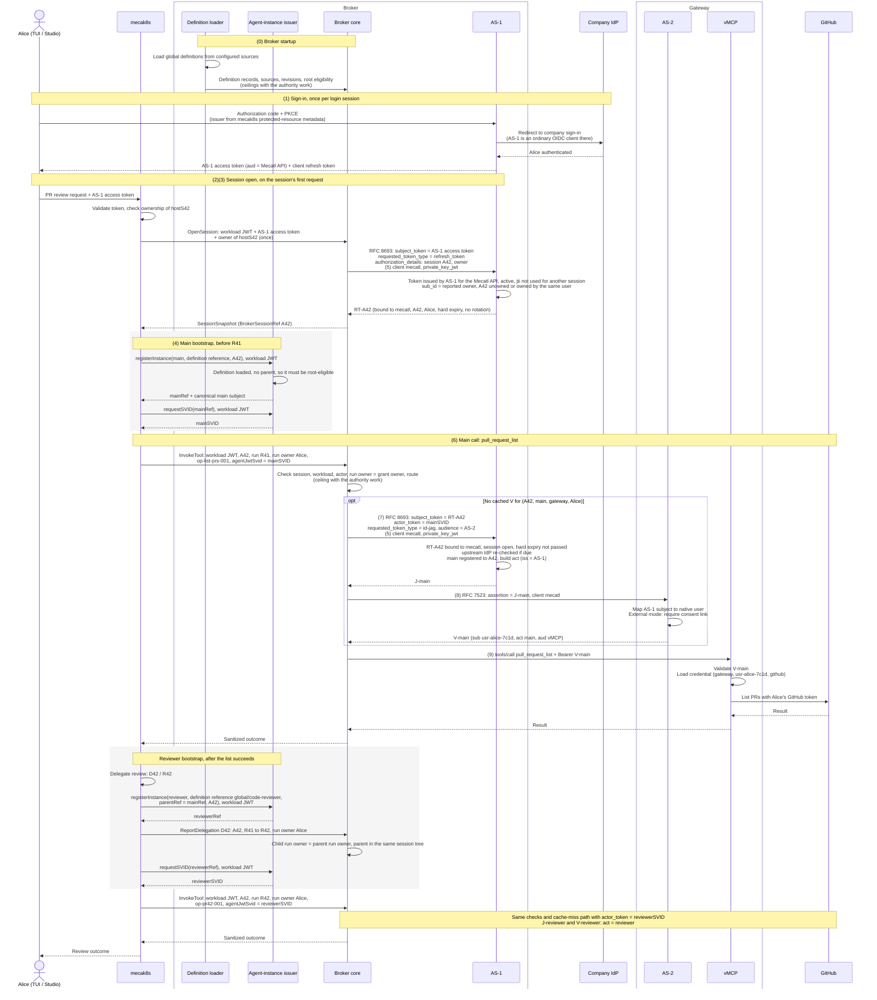

# Credentials and lifecycle

*This chapter describes the intended architecture, not current implementation status.*

An agent instance can participate in multiple runs. Its instance credential identifies it to the broker; presenting that credential does not by itself authorize an MCP tool call. The harness manages run execution. The broker checks the session and execution context. Once the [authority work](README.md#order-of-work) is in place, it also checks the acting instance's effective server/tool ceiling, its definition ceiling narrowed by its parent's, with Cedar. User, resource, argument, and dynamic delegation policies are deferred. Renewing the instance credential does not itself extend or widen permission to call tools.

The human enters the flow once, when Alice signs in through AS-1. AS-1 runs that sign-in itself, so every later statement about the human traces back to a login AS-1 witnessed, not to a report from the harness.

## What the user sees

- **Sign in** once per login session, through AS-1 to the company IdP; usually silent with single sign-on.
- **Connect a provider** once, through the existing `mcp_authorization_pending` path. In external mode, the same path first shows the gateway's "Allow Mecatl" step.
- **Everyday use** needs nothing more until the broker refresh token's hard expiry or a revocation. Scheduled runs draw on their own [authority](#scheduled-runs).
- **Sign out** ends one client's tokens; **sign out everywhere** stops every agent and schedule acting for the user. See [sign-out and revocation](#sign-out-and-revocation).

## Credential roles

| Credential | What it establishes | Issuer → holder → verifier |
| --- | --- | --- |
| **AS-1 access token** | Alice's identity for requests to the Mecatl API. | AS-1 → Alice's client (TUI or Studio) → mecak8s. Passed to the broker once, at session open. |
| **Client refresh token** | The client's ability to renew its own AS-1 access token. | AS-1 → client only. Never leaves the client. |
| **Workload credential** | Which Mecatl service contacts the broker and agent-instance issuer. | Platform → mecak8s → broker and issuer. It identifies neither Alice nor an agent instance. |
| **Agent-instance JWT-SVID** | Which registered agent instance is acting. It can span multiple runs. | Agent-instance issuer → harness → broker, which forwards it to AS-1 as `actor_token`. |
| **Broker refresh token** | Alice's delegated authority for one broker session, usable without her present. | AS-1 → broker → AS-1. Bound to client `mecatl`, the broker session, and the user. Accepted only as the subject of an ID-JAG exchange. |
| **Broker client credential** | That the caller at AS-1 and AS-2 is the broker, OAuth client `mecatl`. | Broker's private key; each request carries a short-lived `private_key_jwt` assertion verified by AS-1 and AS-2. |
| **ID-JAG** | Alice and the acting agent, for one redemption at AS-2. | AS-1 → broker → AS-2. Short-lived, single-use. |
| **AS-2 access token (`V`)** | AS-2's native Alice, the acting agent, and client `mecatl`, for the vMCP resource. | AS-2 → broker → vMCP. Cached per session, instance, gateway, and user. |
| **Upstream provider credential** | Access to Alice's GitHub account. | GitHub → gateway credential store → GitHub. Never leaves the gateway. |
| **Signing keys** | Authority to issue credentials. | AS-1, AS-2, and the agent-instance issuer each keep their own key. Separate keys are not process isolation when components share a process. |

### Example nomenclature

| Kind | Name | Meaning |
| --- | --- | --- |
| Identity | Company Alice `(https://login.example.com, alice-204)` | Alice at the company IdP. AS-1 represents her as subject `u-alice-91`; AS-2 as native user `usr-alice-7c1d`. |
| Identity | `mecatl` | The broker's OAuth client at AS-1 and AS-2. Not a user or an agent. |
| State | `hostS42`, `A42` | Host session ID, and prose alias for the existing opaque `BrokerSessionRef`. Neither is a credential. |
| State | `main`, `reviewer`, `R41`, `R42`, `D42` | Registered agent instances, their runs, and the delegation from main to reviewer. |
| Reference | `op-list-prs-001`, `op-pr42-001` | Correlation IDs for two tool operations. They identify operations, not people, and authorize nothing. |
| Credential | `mainSVID`, `reviewerSVID` | Registered agent-instance credentials. |
| Credential | `RT-A42` | The broker refresh token for session `A42`. |
| Credential | `J-main`, `J-reviewer` | ID-JAGs naming Alice and each acting agent. |
| Credential | `V-main`, `V-reviewer` | AS-2 access tokens naming native Alice and each acting agent. |

No credential value belongs in the model's context.

## Interactive execution

Alice owns harness session `hostS42`. She asks Mecatl to list pull requests in `acme/payments` and review PR 42. Main run `R41` calls `pull_request_list`. After the list returns, main delegates the review through `D42` to reviewer run `R42`, which calls `pull_request_read`. Tool names and arguments are illustrative. The reviewer uses definition `global/code-reviewer`; main both creates it and delegates the task to it, but creation and delegation remain separate facts. In the diagram, `main` and `reviewer` abbreviate the SPIFFE subjects in [example instance identities](#example-instance-identities).

The gateway in this example is external, at `https://gateway.example.com`. Embedded mode follows the same steps with AS-2 and vMCP inside the Mecatl deployment.



The diagram follows the successful path. Other outcomes:

- **No upstream credential.** vMCP finds no stored GitHub credential for Alice and answers "needs authorization". The broker returns the existing `mcp_authorization_pending` outcome; the TUI or Studio opens the authorization URL and rechecks, and the parked run resumes.
- **No consent link (external mode).** AS-2 refuses to redeem the ID-JAG. The broker returns the same pending outcome, and the URL first leads through AS-2's "Allow Mecatl" step.
- **Denial or failure.** Any denial before dispatch prevents the provider call. Retrying requires authorization again.
- **Unknown outcome.** If dispatch may have happened but no completion was observed, the outcome is unknown and is not replayed automatically.

Every later tool call repeats the broker checks, including calls served from the `V` cache. The [failure matrix](#failure-matrix) lists every failure, and [renewal triggers](#renewal-triggers) when each credential is replaced.

Each step below follows the same shape: what arrives, the checks in the order they run, what is issued, how each failure is reported and whether a retry can succeed, why the step exists, what it does not prove, and what is recorded. Checks run in the listed order and stop at the first failure. Error responses never echo a token, an assertion, or a claim value from one. Token-endpoint errors follow RFC 6749 §5.2, RFC 8693 §2.2.2, RFC 7523 §3.1, and RFC 9396 §5; broker calls are gRPC and use gRPC status codes.

### (1) AS-1 access token

AS-1 is Mecatl's login authorization server. mecak8s's protected-resource metadata names AS-1, and the TUI and Studio already discover their issuer there, so neither client changes. AS-1 does not hold passwords: it redirects Alice to the company IdP as an ordinary OIDC client. The company IdP administrator registers one web application, AS-1, with AS-1's callback as redirect URI.

AS-1 asks the company IdP for a refresh token at sign-in, because the [upstream re-check](#sign-out-and-revocation) needs one. How depends on the IdP: the `offline_access` scope, which OIDC Core §11 requires to be sent with `prompt=consent`; `access_type=offline` at Google; or IdP configuration that issues refresh tokens to the AS-1 application.

The client receives an access token for the Mecatl API and keeps its own refresh token: the TUI in the OS keyring, Studio in sealed server-side cookies.

**Input.** Each Mecatl API request carries `Authorization: Bearer <AS-1 access token>`. A fictional decoded access token:

```json
{"typ": "at+jwt", "alg": "ES256", "kid": "as1-key-1"}
{
  "iss": "https://broker.example.com/as",
  "sub": "u-alice-91",
  "sub_id": {"format": "iss_sub", "iss": "https://login.example.com", "sub": "alice-204"},
  "aud": "https://mecatl.example.com/api",
  "client_id": "mecatui",
  "iat": 1799999900,
  "exp": 1800000800,
  "jti": "at-alice-7731"
}
```

**Checks, at mecak8s** (RFC 9068 §4):

1. The header `typ` is `at+jwt`, and `alg` is on the configured allowlist, which excludes `none` and every symmetric algorithm.
2. `kid` selects a key from AS-1's configured JWKS, and the signature verifies. A token never chooses where keys come from.
3. `iss` is exactly AS-1's issuer.
4. `exp` has not passed and `iat` is not in the future, each allowing the configured clock skew.
5. `aud` contains the Mecatl API identifier.
6. `client_id` is the TUI's or Studio's.
7. `sub_id` is present with format `iss_sub`.
8. The company identity in `sub_id` owns `hostS42`.

**Output.** An authenticated request from owner `(https://login.example.com, alice-204)`.

**Failures.** Checks 1–7 return HTTP 401 with `WWW-Authenticate: Bearer error="invalid_token"` (RFC 6750 §3.1); the client refreshes its access token and retries. Check 8 returns 403 and is not retryable.

**Why.** An `id_token` is not accepted here: its audience is the client, not the API. Session ownership is keyed by the company identity in `sub_id`, not by AS-1's own `(iss, sub)`, so existing owners keep matching without migration and the owner stays Alice's stable human identity. The company IdP sees only AS-1 as the application, so per-application IdP policies can no longer distinguish the TUI from Studio.

**Does not prove.** That the caller is the TUI: both clients are public, so `client_id` names the client the token was issued to, not the one presenting it.

**Evidence.** mecak8s accepted request `req-pr42-001` from owner `(https://login.example.com, alice-204)`, authenticated by AS-1 as `u-alice-91`, for `hostS42`. This records API authentication and ownership only.

### (2) Workload credential

**Input.** Every call from mecak8s to the broker and the agent-instance issuer carries a projected ServiceAccount token, over TLS and outside model context:

```json
{
  "iss": "https://kubernetes.example.com",
  "sub": "system:serviceaccount:mecatl:mecak8s",
  "aud": ["https://broker.example.com"],
  "iat": 1799999900,
  "nbf": 1799999900,
  "exp": 1800003500,
  "kubernetes.io": {
    "namespace": "mecatl",
    "serviceaccount": {"name": "mecak8s", "uid": "sa-example-42"},
    "pod": {"name": "mecak8s-worker-7", "uid": "pod-example-7"}
  }
}
```

**Checks, at the broker and the issuer,** offline against the cluster's keys:

1. The token is a projected token. A legacy Secret-based token, with issuer `kubernetes/serviceaccount` and no `exp`, is rejected.
2. `alg` is on the allowlist, and the signature verifies against the cluster's JWKS. The JWKS is pinned in configuration or fetched by OIDC discovery from the configured issuer, never from a URL in the token.
3. `iss` is exactly the configured cluster issuer.
4. `aud` contains the broker's audience. A token with the Kubernetes API server's audience is rejected.
5. `nbf`, `iat`, and `exp` are current within the clock skew, and `exp - iat` does not exceed the configured maximum lifetime. Kubernetes accepts `expirationSeconds` down to 600.
6. `sub` is on the configured allowlist of ServiceAccounts that may contact the broker.

The `kubernetes.io` claims are recorded for audit and never decide anything.

**Output.** The authenticated workload `system:serviceaccount:mecatl:mecak8s`.

**Failures.** Checks 1–5 return `UNAUTHENTICATED`; check 6 returns `PERMISSION_DENIED`. The kubelet rewrites the projected token before it expires, so mecak8s retries with the new file contents.

**Why.** It identifies the mecak8s service, so the broker serves sessions only to the workload they are bound to. [SPIRE alternatives](#workload-authentication) replace this credential without changing its role.

**Does not prove.** That the presenter is that pod: it is a bearer token. Offline validation also does not notice a deleted pod before `exp`; short lifetimes bound that. It identifies neither Alice nor an agent instance.

### (3) Session open and the broker refresh token

At `OpenSession`, mecak8s passes Alice's current AS-1 access token to the broker once, with its workload credential and the owner it holds for `hostS42`. This replaces the harness reporting `human {issuer, subject}` as plain data: the broker now holds a token AS-1 signed for Alice's client, not mecak8s's statement about her. Clients refresh their access token before each new session open, so the token is fresh and not yet used to open a session.

**Input.** The broker exchanges the token at AS-1 with RFC 8693, authenticating as client `mecatl` ([step (5)](#5-broker-client-authentication)). RFC 8693 has no parameter for the broker session or its owner, so the request carries both in an RFC 9396 `authorization_details` entry of type `mecatl_session`. The owner field is deployment-defined context for the owner check, not an authorization the user granted. Form encoding is shown decoded:

```text
POST https://broker.example.com/as/oauth/token
grant_type=urn:ietf:params:oauth:grant-type:token-exchange
subject_token=<Alice's AS-1 access token>
subject_token_type=urn:ietf:params:oauth:token-type:access_token
requested_token_type=urn:ietf:params:oauth:token-type:refresh_token
authorization_details=[{"type": "mecatl_session", "session": "A42",
  "owner": {"iss": "https://login.example.com", "sub": "alice-204"}}]
client_assertion_type=urn:ietf:params:oauth:client-assertion-type:jwt-bearer
client_assertion=<private_key_jwt for mecatl>
```

**Checks, at AS-1:**

1. Client authentication as `mecatl` ([step (5)](#5-broker-client-authentication)).
2. The client may use the token-exchange grant.
3. The request is well formed: the two token types above, no `actor_token`, and exactly one `mecatl_session` entry with a session and an owner.
4. The subject token is an AS-1 access token: signature, `iss`, `exp`, not revoked at AS-1, `aud` is the Mecatl API, and `client_id` is the TUI or Studio. Accepting a Mecatl-API token from `mecatl` is a narrow policy for this one client, not a general audience bypass.
5. No wider scope than the original grant is requested.
6. The company identity in the token's `sub_id` equals the owner in the entry.
7. Session `A42` has no recorded owner yet, or its recorded owner is that same identity. A session that was opened and then closed is refused: session IDs are never reused.
8. The token's `jti` has not opened a session before, or this is a retry: the same `jti`, client, and session, within the source token's `exp`, while `A42` is open and its refresh token has not been revoked.
9. AS-1 writes the record of the converted `jti` and the refresh-token record in one transaction. On a retry, the same transaction revokes the refresh token issued the first time.

**Output.** RFC 8693 returns the issued token in `access_token` even when it is not an access token (§2.2.1). AS-1 echoes the granted `authorization_details` (RFC 9396 §7):

```json
{
  "access_token": "<RT-A42>",
  "issued_token_type": "urn:ietf:params:oauth:token-type:refresh_token",
  "token_type": "N_A",
  "expires_in": 43200,
  "authorization_details": [{"type": "mecatl_session", "session": "A42",
    "owner": {"iss": "https://login.example.com", "sub": "alice-204"}}]
}
```

`expires_in` is illustrative; the hard expiry is not selected. `RT-A42` is opaque to the broker. Its meaning lives in an AS-1 record that binds it to client `mecatl`, to Alice as `u-alice-91`, to her company identity as the session owner, and to session `A42`, with a hard expiry. Every ID-JAG issued from it names that subject. The broker checks that the echoed entry matches the one it sent.

**Failures.**

| Check | Response | Retry |
| --- | --- | --- |
| 1 | 401 `invalid_client` | No; a configuration or key fault. |
| 2 | 400 `unauthorized_client` | No. |
| 3 | 400 `invalid_request`, or `invalid_authorization_details` for a malformed entry | No; a broker bug. |
| 4 | 400 `invalid_request` (RFC 8693 §2.2.2) | After the client refreshes its access token. |
| 5 | 400 `invalid_scope` | No. |
| 6, 7 | 400 `invalid_request`, recorded with the reason | No; mecak8s paired the token with the wrong session. |
| 8, `jti` used for another session | 400 `invalid_request` | After the client refreshes its access token. |
| Lost response | None received | Yes: resend the same request. Check 8 accepts it and replaces the first refresh token. |

mecak8s reports any of these to the client as a failed session open. It answers failures of checks 4 and 8 with 401 `invalid_token`, so the client refreshes its access token and tries again.

**Why.** One conversion per `jti` stops a leaked access token from opening a second session. A retry issues a new refresh token rather than returning the first, because AS-1 stores only a hash of each refresh token and cannot return it again; revoking the first in the same transaction keeps one live refresh token per session. Writing the `jti` record and the refresh-token record together means a crash cannot leave a converted `jti` with no refresh token, or a refresh token whose conversion was not recorded.

`RT-A42` is accepted only as the subject token of an ID-JAG exchange; presented at the refresh-token grant, it returns `invalid_grant`, so the broker cannot mint Mecatl API tokens as Alice. `RT-A42` does not rotate: client authentication already binds it to the broker (RFC 9700 §4.14.2, RFC 9449 §5), and rotation would make concurrent exchanges from several broker replicas look like token reuse.

Checks 6 and 7 exist because the broker supplies `A42`, and only mecak8s checks that Alice owns `hostS42`, so a mecak8s bug could pair her token with another user's session. AS-1 records the owner at the first open and refuses any later open of `A42` for a different user. Both checks compare facts inside Mecatl, so they catch mistakes, not a compromised mecak8s, which could report a consistent lie.

**Does not prove.** That mecak8s paired Alice's token with her own session, only that its reports agree with each other. That Alice is present after the open: the refresh token outlives her access token.

The refresh token is not tied to Alice's AS-1 login session, so signing out of one client does not end it. Signing out everywhere, closing the session, the hard expiry, and AS-1's upstream re-check end it; see [sign-out and revocation](#sign-out-and-revocation).

The existing broker session record under `A42` keeps the workload and host-session binding. The human authority now lives in `RT-A42`, not in a broker-local human record.

**Evidence.** AS-1 records the conversion: client `mecatl`, user `u-alice-91`, owner, source token `jti`, session `A42`, and the hard expiry. It records a refused open with its reason, and a retry with the revoked first refresh token.

**Later: a token bound to the session.** When a session is created, the user's client could silently refresh its AS-1 token with a `mecatl_session` entry naming that session, and use that token for it. AS-1 would then convert only a token bound to the session being opened. The client, not only mecak8s, would witness the pairing, and a stolen access token would work for one session instead of the whole API. It needs `authorization_details` at AS-1's refresh grant, a session-bound token per session in the TUI and Studio, and a two-step session open. It changes nothing downstream of `RT-A42`.

**Later: run grants.** The [authority work](README.md#order-of-work) replaces the session's standing refresh token with a grant for each run, minted when the run starts from a fresh access token that arrives with the user's request. Sessions of users who are not present then carry no authority. Schedules keep their own authority. A compromised mecak8s could still turn any fresh token the user sends into a run of its choosing, one run per token; only a key held by the client and signing each run's start would prevent that.

**Alternative:** AS-1 could return a signed session assertion JWT instead of a refresh token. It needs less authorization-server work but still requires the AS-1 record for revocation and one-conversion checks, and is an extension to the ID-JAG profile.

### (4) Agent-instance JWT-SVID

**Input.** For the diagram's main registration, mecak8s supplies the persisted main agent-instance incarnation and the selected definition reference, with no parent. For the reviewer, it supplies the child's persisted incarnation, the definition reference `global/code-reviewer`, and the registered main-instance reference, not the main's token. Both calls carry the workload credential.

**Registration checks, at the agent-instance issuer:**

1. The workload is authenticated ([step (2)](#2-workload-credential)).
2. The definition reference names a definition the loader recorded, or, for a definition the broker did not load, is accepted as a mecak8s report and marked as such; see [definition provenance](agent-definitions.md#definition-provenance).
3. With no parent, including after a fork or clear, the definition is root-eligible. With a parent, the parent is registered in the same session tree.
4. The definition category and name match `[A-Za-z0-9._-]+` and are neither `.` nor `..`. A name that would need encoding is rejected, not rewritten.
5. The nesting depth and the whole URI stay within the caps. Proposed: names up to 63 bytes and depth up to 8, which keeps the longest subject near 1,100 bytes. The issuer also checks the whole URI against the 2,048 bytes SPIFFE-ID §2.3 says implementations should not exceed.

Registration records identity, not permission to spawn, run, or call tools. The issuer constructs the canonical subject; see the [registration checks](agent-definitions.md#registering-instances).

**Output.** The instance reference, its canonical subject, and, on `requestSVID`, a JWT-SVID signed by the agent-instance issuer. The reviewer's, deliberately using only the claims JWT-SVID requires:

```json
{"alg": "ES256", "kid": "agents-2026-10"}
{
  "sub": "spiffe://agents.example.com/mecatl/agent/system/main/inst/inc_cejrv7re4uy3ubxyzj2gfxfp2u/child/global/code-reviewer/inst/inc_gh56irfcpnupjqgfdw7dhzzw4m",
  "aud": ["https://broker.example.com"],
  "exp": 1800000600
}
```

mecak8s checks that the returned subject is the registered instance. The harness holds the SVID outside model history and presents it to the broker for invocation; the broker forwards it to AS-1 as `actor_token`. AS-2 receives only the actor claim in the ID-JAG.

**SVID checks, at the broker and at AS-1:**

1. `alg` is on the allowlist JWT-SVID §3 permits: RS, ES, or PS with SHA-256 or longer, never `none` or HMAC.
2. `kid` selects a key in the agent trust bundle whose `use` is `jwt-svid`. An unknown `kid` triggers one rate-limited bundle refresh, then rejection.
3. The signature verifies.
4. `sub` is a SPIFFE ID in the agent trust domain `agents.example.com`, the trust domain of the bundle that verified it. A platform SVID with the same audience is rejected, because it belongs to a different trust domain and bundle.
5. `aud` contains the broker's audience.
6. `exp` has not passed, allowing the clock skew, and is no further in the future than the configured maximum SVID lifetime.
7. `sub` matches the full canonical subject of a registered instance byte for byte, and that instance is not deregistered.
8. The instance is registered to the session in use: `A42` from the request at the broker, the session of `RT-A42`'s record at AS-1.

**Failures.** Registration failures return `INVALID_ARGUMENT` for checks 4 and 5 and `PERMISSION_DENIED` otherwise; none is retryable. An SVID that fails at the broker denies the call with `PERMISSION_DENIED`; at AS-1 it returns 400 `invalid_request` (RFC 8693 §2.2.2). An expired SVID is renewed and the call retried; any other SVID failure is not retryable.

**Why.** The SVID gives agent identity its own SPIFFE trust domain and signing key, so verifiers can tell it apart from the OAuth issuers, and leaves a path to attestation and to policy shaped by RFC 9396 `authorization_details`. The SVID carries a single audience, the broker's, as JWT-SVID §7.2 recommends. AS-1 is configured to accept that value as its own SVID audience, because the broker presents the same SVID to both. That holds only while AS-1 is a broker module; an AS-1 outside the broker needs its own audience and a second SVID. JWT-SVID requires `sub`, `aud`, and `exp`, but not `iss` or `jti`. The agent-instance issuer and its trust domain are distinct from OAuth AS-1 and AS-2.

**Does not prove.** This is an assertion, not attestation: the issuer signs on mecak8s's workload-authenticated registration, and no evidence about the agent itself is produced or appraised. While the broker runs inside mecak8s, the issuer shares a process, and therefore its security controls, with AS-1 and the broker. While agents share one harness process, the SVID asserts the agent rather than authenticating it. AS-1's registration check catches pairing bugs in the broker core, not a compromised broker or mecak8s, which write the registry. Two strengthenings are possible but not selected:

- **Session claim.** The SVID names the session it was issued for, so AS-1 can check that the SVID and the subject token belong to the same session without relying on the broker's pairing. It is still issued on mecak8s's word.
- **Key binding.** The SVID carries a `cnf` key, and the presenter proves possession, so a stolen SVID is useless without the private key. Inside one process, the key proves the process, not the agent.

Attesting each agent's identity needs agents in their own pod, sandbox, or Kubernetes object, for example attested through the [SPIFFE Broker API](https://github.com/spiffe/spiffe/pull/340). That is out of scope for this design.

**Evidence.** The issuer records each registration as a [lineage event](audit.md#lineage), marked as reported by mecak8s, and each SVID issuance with the instance and expiry.

See [renewal triggers](#renewal-triggers) for renewal across runs.

### (5) Broker client authentication

The subject tokens the broker presents are bearer tokens: they prove whose authority is used, not who presents them. The broker therefore authenticates as OAuth client `mecatl` on every token-endpoint request, at AS-1 and at AS-2, with `private_key_jwt` (OIDC Core §9, RFC 7523 client assertion).

**Input.** Each request carries `client_assertion_type=urn:ietf:params:oauth:client-assertion-type:jwt-bearer` and a fresh assertion:

```json
{"alg": "ES256", "kid": "broker-2026-10"}
{
  "iss": "mecatl", "sub": "mecatl",
  "aud": "https://broker.example.com/as",
  "jti": "ca-7f3a", "iat": 1800000000, "exp": 1800000060
}
```

**Checks, at AS-1 and AS-2:**

1. `alg` is on the allowlist, and `kid` selects a key registered for `mecatl`, from its `jwks_uri` or static configuration.
2. The signature verifies.
3. `iss` and `sub` are both `mecatl`.
4. `aud` is the authorization server's issuer identifier as its only value, not its token-endpoint URL, as [draft-ietf-oauth-rfc7523bis](https://datatracker.ietf.org/doc/draft-ietf-oauth-rfc7523bis/) requires.
5. `exp` has not passed, and `exp - iat` is within the configured maximum, here 60 seconds.
6. `jti` has not been seen; the server keeps it until `exp`.

**Output.** An authenticated client `mecatl`.

**Failures.** Any failed check returns 401 `invalid_client`. Only a lost response is retryable, with a new assertion and `jti`.

**Why.** It makes "accept only from the broker" enforceable. A leaked `RT-A42` is useless without the key: a refresh token issued to an authenticated confidential client is already sender-constrained (RFC 9449 §5). The private key never leaves the broker and can live in a KMS or HSM. In external mode the gateway administrator registers the broker's `jwks_uri` once. A `client_secret` is rejected: it is shared, replayable once leaked, and rotated by hand. mTLS client authentication (RFC 8705) is an equivalent alternative. One client ID, `mecatl`, is used at both servers, because the ID-JAG's `client_id` must match the client that redeems it at AS-2.

**Does not prove.** Which agent asked: `mecatl` is the broker's registration, not an actor. Nor does it stop a thief with a stolen AS-1 access token from presenting it to the Mecatl API, where mecak8s converts it at session open, once per token.

### (6) Per-operation authorization

Local permissions and hooks run before each call.

**Input.** Trusted harness client code sends `InvokeTool` with the workload credential, `A42`, `call.id=op-pr42-001`, run `R42` with its [run owner](run-owner.md) Alice, and `agentJwtSvid=reviewerSVID`. The model supplies only the tool content:

```json
{
  "tool": "pull_request_read",
  "arguments": {"repository": "acme/payments", "number": 42}
}
```

**Checks, at the broker,** before any exchange or dispatch:

1. The workload is authenticated ([step (2)](#2-workload-credential)).
2. Session `A42` is open and bound to that workload and `hostS42`.
3. The SVID passes the [SVID checks](#4-agent-instance-jwt-svid) and names an instance registered to `A42`.
4. The reported run owner equals the owner recorded with `RT-A42`, the company identity `(https://login.example.com, alice-204)`, not AS-1's subject `u-alice-91`. The run owner never selects the grant.
5. A route to the gateway exists for the tool.
6. Once the authority work is in place, the instance's stored effective ceiling allows this server and tool, with no Cedar evaluation errors.

The broker then looks up `V` under `(A42, reviewer, gateway, Alice)`. A cache hit skips steps (7) and (8), never these checks.

**Output.** An allowed operation, dispatched in [step (9)](#9-vmcp-decision-and-upstream-credential).

**Failures.** Check 1 returns `UNAUTHENTICATED`. Checks 2–6 deny the call with `PERMISSION_DENIED`, record the denial, and dispatch nothing. None is retried automatically: retrying requires authorization again.

**Why.** User, run, and delegation are not inputs to the ceiling check; the reviewer ceiling gives the same result for PR 43. See [two requests, two authorization decisions](mcp-authorization.md#two-requests-two-authorization-decisions). The broker does not check provider connections. It authorizes the session, workload, actor, run owner, route, and, with the authority work, the ceiling. AS-2 authorizes the user: the mapping, and in external mode the consent link. vMCP authorizes the connection and dispatches. The provider enforces its own permissions on the request.

**Does not prove.** That mecak8s reported the right run or run owner: both are mecak8s reports, checked for consistency with the grant. Neither dispatch nor success.

**Delegation report.** When main delegates the review, mecak8s calls `ReportDelegation` with session `A42`, delegation `D42`, the delegating run `R41` and instance `mainRef`, the receiving run `R42` and instance `reviewerRef`, and the receiving run's owner. The broker checks that `R41` belongs to `A42`, that both instances are registered to `A42`, and that the receiving run's owner equals the delegating run's. A mismatch returns `PERMISSION_DENIED`; the receiving run cannot call tools until a consistent report arrives.

**Evidence.** `op-pr42-001` passed the session, workload, actor, and run-owner checks, and, once the authority work is in place, the effective-ceiling check. The [audit chapter](audit.md#auditevent-profile) owns the full evidence shape.

### (7) ID-JAG from AS-1

On a cache miss, the broker asks AS-1 for an ID-JAG ([draft-ietf-oauth-identity-assertion-authz-grant-04](https://datatracker.ietf.org/doc/draft-ietf-oauth-identity-assertion-authz-grant/)).

**Input.** An RFC 8693 token exchange with `RT-A42` as subject token, `reviewerSVID` as actor token, and AS-2 as audience. The operation and attempt IDs travel as request parameters for AS-1's record, as reported trace context:

```text
POST https://broker.example.com/as/oauth/token
grant_type=urn:ietf:params:oauth:grant-type:token-exchange
subject_token=<RT-A42>
subject_token_type=urn:ietf:params:oauth:token-type:refresh_token
actor_token=<reviewerSVID>
actor_token_type=urn:ietf:params:oauth:token-type:jwt
requested_token_type=urn:ietf:params:oauth:token-type:id-jag
audience=https://gateway.example.com
mecatl_operation=op-pr42-001
mecatl_attempt=1
client_assertion_type=urn:ietf:params:oauth:client-assertion-type:jwt-bearer
client_assertion=<private_key_jwt for mecatl>
```

**Checks, at AS-1:**

1. Client authentication as `mecatl`.
2. The request is well formed: the three token types above and an `audience`.
3. `audience` is one of the AS-2 issuers configured for `mecatl`.
4. `RT-A42` resolves to a `mecatl_session` record bound to `mecatl` and not revoked; session `A42` is open; the hard expiry has not passed. A schedule's record is refused here.
5. If the re-check interval has passed, AS-1 refreshes Alice's company-IdP grant first ([upstream re-check](#sign-out-and-revocation)).
6. The SVID passes the [SVID checks](#4-agent-instance-jwt-svid) and names an instance registered to `A42`.
7. AS-1 authorizes the combination of client, subject, actor, and target AS-2.

**Output.**

```json
{
  "access_token": "<J-reviewer>",
  "issued_token_type": "urn:ietf:params:oauth:token-type:id-jag",
  "token_type": "N_A",
  "expires_in": 120
}
```

`J-reviewer`, decoded:

```json
{"typ": "oauth-id-jag+jwt", "alg": "ES256", "kid": "as1-key-1"}
{
  "iss": "https://broker.example.com/as",
  "sub": "u-alice-91",
  "aud": "https://gateway.example.com",
  "client_id": "mecatl",
  "act": {"iss": "https://broker.example.com/as", "sub": "ag_7hq2x9"},
  "jti": "jag-pr42-001",
  "iat": 1800000001,
  "exp": 1800000121
}
```

- `sub` comes from `RT-A42`'s record, never from the request.
- `act` names only the acting instance, with an opaque, stable, per-instance identifier: no SPIFFE path, no definition name, and no colon, so it reads as a plain string rather than a URI. AS-1 generates a random identifier for each registered instance and stores it under the instance's SPIFFE ID, so the identifier survives SVID renewal. Stability lets the vMCP bind a session to the instance and audit correlate its calls. `act.iss` names AS-1, which minted it, so the identifier stays attributable to AS-1 inside `V`, whose own `iss` is AS-2. The full SVID stops at AS-1, so internal structure does not cross into the gateway's domain.
- `act` has one level. That main delegated `D42` to the reviewer is recorded in Mecatl's harness and broker records, not in the token. A nested `act` naming main comes later, from a [chained exchange](mcp-authorization.md#chained-exchange) at delegation time.
- `aud_sub` and `email`, recommended by the draft, are deliberately omitted: AS-1 does not know AS-2's subject, and an email address is not an identity link.

**Failures.**

| Check | Response | Broker outcome and retry |
| --- | --- | --- |
| 1 | 401 `invalid_client` | Call fails; not retryable. |
| 2 | 400 `invalid_request` | Call fails; a broker bug. |
| 3 | 400 `invalid_target` | Call fails; a configuration fault. |
| 4 | 400 `invalid_request` | The session has lost its authority: calls fail closed until a new session open. |
| 5, IdP returns `invalid_grant` | 400 `invalid_request` | AS-1 has revoked Alice's grants, or ended them with "needs owner action"; see [upstream re-check](#sign-out-and-revocation). |
| 5, IdP unreachable or 5xx | 503, nothing revoked | Call fails closed; the next call retries the re-check. |
| 6 | 400 `invalid_request` | Call denied; retried only after the SVID is renewed, if it had expired. |
| 7 | 400 `invalid_request` | Call denied. |
| Lost response | None received | Request a new ID-JAG. An unused ID-JAG expires harmlessly. |

**Why.** ID-JAG leaves actor-token processing undefined and warns that a client could pair a valid subject token with an unrelated actor (§9.7); check 6 is that missing binding. ID-JAG is a profile of [identity chaining across trust domains](https://www.ietf.org/archive/id/draft-ietf-oauth-identity-chaining-17.html). It adds the `typ`, required `client_id` and `jti`, client-binding redemption checks, and security rules that a private chaining profile would otherwise have to define. Both are Internet-Drafts; identity chaining is in the RFC Editor queue, and ID-JAG is a working-group draft.

AS-1 and AS-2 are separate issuers with separate keys, also in embedded mode. The draft's §9.3 scopes the profile to parties in different administrative domains; external mode fits it, and embedded mode reuses the format for one protocol path. See [embedded mode](mcp-gateway-modes.md#embedded-mode).

**Does not prove.** That the reviewer, rather than other code in the harness process, asked for the call: the SVID is an assertion.

**Evidence.** AS-1 records the ID-JAG issuance: user, session `A42`, the validated instance's SPIFFE ID and its `ag_` identifier, target, `jti`, and the reported operation and attempt.

### (8) AS-2 access token

**Input.** The broker redeems the ID-JAG at AS-2 with the [RFC 7523 JWT-bearer grant](https://www.rfc-editor.org/rfc/rfc7523.html#section-2.1), naming the vMCP with an RFC 8707 `resource`:

```text
POST https://gateway.example.com/oauth/token
grant_type=urn:ietf:params:oauth:grant-type:jwt-bearer
assertion=<J-reviewer>
resource=https://gateway.example.com/mcp
client_assertion_type=urn:ietf:params:oauth:client-assertion-type:jwt-bearer
client_assertion=<private_key_jwt for mecatl, aud=https://gateway.example.com>
```

**Checks, at AS-2:**

1. Client authentication as `mecatl`.
2. The ID-JAG's header `typ` is `oauth-id-jag+jwt`; `iss` is a trusted AS-1; `alg` is on the allowlist and the signature verifies against that issuer's keys.
3. `aud` is AS-2's own issuer; `exp` and `iat` are current within the clock skew.
4. `client_id` matches the authenticated client (ID-JAG §4.4.1).
5. `jti` has not been redeemed (RFC 7523 §3). AS-2 keeps used identifiers until they expire.
6. `resource` is a vMCP this client and actor may reach.
7. AS-2 resolves the native user:

| Mode | How AS-2 resolves and authorizes the user |
| --- | --- |
| Embedded | Users log in to AS-2 through AS-1, so the AS-1 subject maps directly. AS-1 is the SSO IdP AS-2 trusts (§4.1). Consent is implicit. AS-1 and AS-2 are distinct issuers with distinct keys, so no issuer redeems its own ID-JAG; embedded mode is still outside §9.3's cross-domain scope. |
| External | Identity chaining across administrative domains. AS-2's users log in through their own IdP, so the §4.1 SSO precondition does not hold. AS-2 redeems only for an AS-1 `(iss, sub)` and client `mecatl` with a consent link to a native user, created once through AS-2's own login. No just-in-time provisioning. |

AS-2 never resolves users through `sub_id` (§9.5), email, or display name.

**Output.** A short-lived access token and no refresh token (§4.4.3):

```json
{"access_token": "<V-reviewer>", "token_type": "Bearer", "expires_in": 115}
```

`V-reviewer`, decoded:

```json
{"typ": "at+jwt", "alg": "RS256", "kid": "gateway-example-key-1"}
{
  "iss": "https://gateway.example.com",
  "sub": "usr-alice-7c1d",
  "act": {"iss": "https://broker.example.com/as", "sub": "ag_7hq2x9"},
  "client_id": "mecatl",
  "aud": "https://gateway.example.com/mcp",
  "iat": 1800000005,
  "exp": 1800000120,
  "jti": "access-pr42-001"
}
```

**Failures.** Check 1 returns 401 `invalid_client`. Checks 2–5 return 400 `invalid_grant` (RFC 7523 §3.1) and are not retryable with the same ID-JAG. Check 6 returns 400 `invalid_target`. An unresolved subject, including a missing consent link in external mode, returns `invalid_grant`; the broker returns the existing pending outcome, and how an external gateway signals "consent required" in a structured way is [open](implementation.md#as-1-grant-and-as-2-user-resolution). A lost response is retried with a new ID-JAG from step (7), because the first one's `jti` may already be spent.

**Why.** Single use is Mecatl policy, stricter than ID-JAG §4.4.3, which lets a client re-submit an ID-JAG; it keeps one redemption per issuance in the audit trail. The consent link stops a compromised AS-1 from using the gateway credentials of a user who never chose Mecatl. Its creation flow, the link-swap attack it must resist, and the shared-IdP shortcut are in the [implementation companion](implementation.md#external-consent-link).

**Does not prove.** Anything about the agent's ceiling: `V` carries no scope for it yet, so a gateway allow says nothing about the ceiling.

**Caching.** The broker caches `V-reviewer` under `(A42, reviewer, gateway, Alice)` and treats it as expired a configurable skew margin before `exp`. On a 401 `invalid_token` from the vMCP, it drops `V` and repeats steps (7) and (8) once. A cache hit still needs a currently valid SVID for the same instance. vMCP binds its session (`Mcp-Session-Id`) to the user and `act.sub`, and the broker stores each session ID under the instance, gateway, and user, so each agent instance has its own vMCP session per user.

**Evidence.** AS-2 records the redemption or denial: ID-JAG `jti`, client `mecatl`, native user, actor, resource, and decision.

### (9) vMCP decision and upstream credential

**Input.** `tools/call` with `Authorization: Bearer <V-reviewer>`, the vMCP session ID, and the operation and attempt IDs in the request's `_meta`, under the proposed keys `dev.mecatl/operation` and `dev.mecatl/attempt`.

**Checks, at the vMCP:**

1. `V`'s `typ` is `at+jwt`, `iss` is AS-2, the signature verifies, `aud` is this vMCP, and `exp` has not passed (RFC 9068 §4).
2. The session ID, if present, is bound to the same `iss`, `sub`, and `act.sub`.
3. Its own operation policy allows the tool.
4. An upstream credential exists under **(gateway, native user, provider)**: here `(gateway.example.com, usr-alice-7c1d, github)`.

**Output.** The GitHub call made with Alice's GitHub token, and its result. One credential record exists per user and provider. A delegated `V` comes from no interactive gateway login, so every gateway, including a standalone one, must find the credential from the user alone.

**Failures.** Check 1 returns 401 `invalid_token`; the broker drops `V` and retries once with a new one. Check 2 rejects the session; the broker opens a new one. Check 3 returns a tool error and is not retried. Check 4 answers "needs authorization"; the user connects GitHub through the existing authorization flow, and a later call passes every check again.

**Does not prove.** Provider-side effects: neither a successful MCP response nor an authorization record proves them.

**Evidence.** vMCP records its decision with the access-token reference `(iss, jti)`, user, actor, tool, outcome, and the reported operation and attempt.

**Correlation.** A cached `V-reviewer` serves several calls, so its `(iss, jti)` leads back through AS-2's redemption record and the ID-JAG `jti` to AS-1's issuance record, but not to one operation. The operation ID in `_meta`, logged by vMCP as reported, unverified trace context, ties a gateway record to a single call. Because `act` names only the reviewer, it is also what lets an investigator reach delegation `D42` from a gateway log.

### Failure matrix

Where each failure is detected, what the user sees, and what it revokes. "Fails closed" means no provider call is made.

| Failure | Detected at | Response | User-visible outcome | Revokes |
| --- | --- | --- | --- | --- |
| Expired or invalid AS-1 access token | mecak8s | 401 `invalid_token` | Client refreshes silently; signs in again if its refresh token is gone | Nothing |
| Not the owner of `hostS42` | mecak8s | 403 | Request refused | Nothing |
| Workload token expired or not allowed | Broker, issuer | `UNAUTHENTICATED`, `PERMISSION_DENIED` | Request fails; an operator fault if it persists | Nothing |
| Owner mismatch or session owned by another user at open | AS-1 | `invalid_request`, recorded | Session open fails | Nothing |
| Access token already opened another session | AS-1 | `invalid_request` | Client refreshes and retries | Nothing |
| Root registration of a non-root-eligible definition | Issuer | `PERMISSION_DENIED` | Session cannot start with that definition | Nothing |
| SVID expired | Broker, AS-1 | `PERMISSION_DENIED`, `invalid_request` | None: renewed and retried | Nothing |
| Run owner differs from the grant's owner | Broker | `PERMISSION_DENIED`, recorded | Call denied | Nothing |
| `RT-A42` revoked, expired, or session closed | AS-1 | `invalid_request` | Calls fail until a new session open | Already revoked |
| Company IdP refuses the refresh before its expiry | AS-1 | `invalid_request` | Every agent and schedule for Alice stops | All of Alice's grants |
| Company IdP refresh token reached its own expiry | AS-1 | `invalid_request` | "Needs owner action": Alice signs in again | All of Alice's grants |
| Company IdP unreachable or 5xx | AS-1 | 503 | This call fails; later calls retry | Nothing |
| No consent link (external) | AS-2 | `invalid_grant` | `mcp_authorization_pending` through "Allow Mecatl" | Nothing |
| ID-JAG replayed | AS-2 | `invalid_grant` | None if the broker re-mints; otherwise call fails | Nothing |
| `V` rejected by vMCP | vMCP | 401 `invalid_token` | None: one retry with a new `V` | Cached `V` dropped |
| No upstream credential | vMCP | "Needs authorization" | `mcp_authorization_pending`; Alice connects GitHub | Nothing |
| Dispatch happened, no completion observed | Broker | Unknown outcome | Reported as unknown; not replayed | Nothing |

### Renewal triggers

| Credential | Renewed when | By | If renewal fails |
| --- | --- | --- | --- |
| AS-1 access token | Before expiry, and before each session open | Client, with its refresh token | Sign in again |
| Workload token | At 80% of its lifetime | Kubelet; mecak8s rereads the file | Calls fail with `UNAUTHENTICATED` |
| Agent-instance SVID | When less than half its lifetime remains, on the next use; the old SVID stays valid until its `exp` | Issuer, for the same registered instance; the `ag_` identifier is unchanged | Calls from that instance fail |
| Client assertion | Every token-endpoint request | Broker | Exchange fails with `invalid_client` |
| `RT-A42` | Never | — | A new session open with a fresh access token |
| Company-IdP refresh token | At most once per re-check interval, when an ID-JAG is requested; single-flight per user, storing the newest token if the IdP rotates it | AS-1 | See [upstream re-check](#sign-out-and-revocation) |
| ID-JAG | Never; one per `V` | — | — |
| `V` | A skew margin before `exp`, or on a 401 from the vMCP, at the next call | Broker, through steps (7) and (8) | The call fails with step (7) or (8)'s outcome |
| Agent and AS-1 key sets | On an unknown `kid`, rate-limited, and periodically | Each verifier | Tokens signed with the new key are rejected until the refresh succeeds |
| Schedule authority | Before its horizon, after a notification | Alice | Runs end with "needs owner action" |

## User identity

AS-1 runs Alice's sign-in through the company IdP and represents her as `u-alice-91`, carrying the company identity in `sub_id`. mecak8s authenticates the API request with the AS-1 token and takes the session owner from its `sub_id`, the company identity. The broker receives Alice's AS-1 token once and converts it into `RT-A42`; every ID-JAG names the subject from that refresh token's record, not from caller input.

No mecak8s code path can name a user who did not sign in at AS-1. An attacker with code execution in mecak8s is another matter. While the broker runs inside mecak8s, that attacker holds AS-1's keys and can act as any user connected to the gateway. Once the broker is a separate service, the attacker can act only in open broker sessions bound to its workload and open new ones with fresh tokens from users currently using it. See [deployment and threats](README.md#deployment-and-threats). A compromised broker or AS-1 can still act for any user whose authority it holds; in external mode the consent link limits that to users who linked Mecatl.

AS-2 resolves `u-alice-91` to native Alice `usr-alice-7c1d` through shared login (embedded) or the consent link (external). The native identifier need not equal either upstream subject. Never infer the mapping from matching names or email addresses.

The agent remains the actor: AS-1 validates its SVID and the registered presenter combination and sets `act`. AS-2 receives neither the AS-1 access token nor the SVID. Run, delegation, and parent facts remain lifecycle and context evidence. Each call also carries the [run owner](run-owner.md), which the broker checks against the owner recorded with the grant it uses; today it equals the session owner.

## Credential custody

The following custody boundaries do not imply a selected persistence implementation or process-isolation boundary.

| Credential | Holder and use | Custody and renewal |
| --- | --- | --- |
| AS-1 access token | Client presents it to mecak8s; mecak8s passes it to the broker once at session open. | Not stored by the server side. |
| Client refresh token | TUI keyring or Studio sealed cookie. | Never leaves the client. |
| Workload credential | Platform-managed; mecak8s presents it to the issuer and broker. | Projected credential or configured SPIRE identity. Authenticates the workload, not a user or agent. |
| Agent-instance JWT-SVID | Harness holds `mainSVID` / `reviewerSVID` outside model context; broker forwards it to AS-1 as `actor_token`. | Agent-instance issuer keeps its signing key. Renewal requires the same registered identity and does not widen authority. |
| Broker session `A42` (state) | Broker owns the workload and host-session binding. | Recovered under workload and continuity checks. Possession of the reference grants nothing. |
| Broker refresh token `RT-A42` | Broker; presented only to AS-1. | Bound to `mecatl`, `A42`, and Alice; does not rotate; hard expiry; revoked when the session closes. |
| Broker private key | Broker; signs client assertions for AS-1 and AS-2. | KMS or HSM where available; public key published through `jwks_uri`. |
| ID-JAG | Broker, from issuance to redemption. | Single-use, short-lived. |
| AS-2 access token `V` | Broker presents it to vMCP. | Cached per session, instance, gateway, and user; per-call checks still apply. No refresh token. |
| Consent link (state) | AS-2, external mode. | Until revoked in the gateway UI or by Mecatl. |
| Upstream provider credential | Gateway credential store. | Keyed by (gateway, user, provider); provider-specific renewal stays at the gateway. |

Keep credential values out of model context, tool arguments, results, transcripts, logs, environment variables, audit records, diagnostics, and errors. Hiding a credential from the model does not protect it from a compromised process that holds it. This protected MCP path does not relocate other harness credentials, such as those used to call an LLM provider.

## Credential lifetimes and renewal

An agent instance keeps its identity across runs. These lifetimes are independent.

| Item | Expiry or loss of authority | Replacement |
| --- | --- | --- |
| AS-1 access token | AS-1 policy; short. Expiry ends API authentication, not the broker session. | The client refreshes with its own refresh token. |
| Client refresh token | AS-1 policy and upstream sign-in status. | Sign in again. |
| Workload JWT | Expired credentials are rejected. | Platform rotation for the same workload. |
| `mainSVID` / `reviewerSVID` | Expiry prevents use as current actor evidence. | The agent-instance issuer renews for the same registered instance; the `ag_` identifier and the ceiling do not change. |
| `RT-A42` | Hard expiry, session close, sign out everywhere, a failed upstream re-check, or revocation. It does not rotate. | A new session open with a fresh AS-1 access token. |
| ID-JAG | Short-lived and single-use. | A new exchange with `RT-A42` and a current SVID. |
| `V` | Short-lived; every cached use still passes broker checks. | A new ID-JAG. |
| Broker private key | Operator rotation. | New key published through `jwks_uri`. |
| Schedule authority | Its horizon, schedule deletion, sign out everywhere, or a failed upstream re-check. | The owner renews it. |
| Consent link | Revocation at AS-2. | The user links again. |
| Upstream provider credential | Provider expiry or revocation. | Refresh at the gateway, or the user connects again. |

The example times are illustrative, not selected defaults: `J-reviewer` is valid `1800000001..1800000121`, `V-reviewer` `1800000005..1800000120`. The values of `RT-A42`'s hard expiry and of a schedule's authority horizon are not selected. They bound how long Mecatl acts without a fresh sign-in, and the company IdP administrator should know them.

Closing or revoking the session revokes `RT-A42` and drops that session's cached ID-JAGs, `V`, and vMCP session IDs. A recipient validating only a self-contained token may still accept an already-issued `V` until it expires.

## Sign-out and revocation

Signing out of one client and stopping Mecatl's agents are different actions.

| User action or event | What ends | What remains |
| --- | --- | --- |
| **Sign out** in the TUI or Studio | That client's own AS-1 tokens, revoked at AS-1. | Running agents and schedules. Their authority is held by the broker, not by the client. |
| **Sign out everywhere** | Every agent acting for Alice: live runs stop, tool calls parked for authorization are cancelled, broker sessions and their refresh tokens are revoked, and the authority of each of her schedules is revoked. | Transcripts. Each schedule stays configured; its next run ends with "needs owner action" until Alice renews it. |
| **The company IdP disables Alice's account or revokes her grants** | The same as sign out everywhere, within one re-check interval. | Transcripts. |
| **Closing a session** | That session's refresh token. | Other sessions and schedules. |

**Sign out everywhere.** The client calls Mecatl before it clears its own tokens. For each of Alice's sessions, mecak8s cancels the live run and any tool call parked for authorization. The broker revokes Alice's grants in those sessions at AS-1, cancels their in-flight tool calls, and drops her cached ID-JAGs, `V`, and vMCP session IDs. Today every session has one owner, so this ends each of her broker sessions. Revocation is by user, so a later [shared session](run-owner.md) would keep running for its other members. The broker also revokes the authority of each of Alice's schedules. Runs and broker state can live on different replicas, so the revocation must reach every replica that serves one of Alice's sessions. Whether a client-driven revoke per session, a durable revocation marker checked when a session lease is renewed, or shared broker state does this is an implementation choice.

**Upstream re-check.** AS-1 keeps the company-IdP refresh token behind each broker refresh token and each schedule's authority; a client signing out does not remove it. AS-1 obtains it at sign-in ([step (1)](#1-as-1-access-token)) and records when it expires: the IdP's `refresh_expires_in` where the IdP sends one, otherwise the configured maximum for that IdP. When the broker exchanges a refresh token for an ID-JAG, AS-1 refreshes the upstream token if it has not done so within the re-check interval. Refreshes are single-flight per user, so concurrent exchanges from several replicas cause one refresh, and AS-1 stores the newest token if the IdP rotates them. The IdP's answer decides what happens:

| IdP answer | AS-1 action | Outcome |
| --- | --- | --- |
| Success | Stores the new token, records the time | The exchange continues. |
| `invalid_grant` before the recorded expiry | Revokes every grant it holds for Alice, including schedule authority | The account was disabled or its grants revoked: the same as sign out everywhere. |
| `invalid_grant` at or after the recorded expiry | Ends every grant it holds for Alice | "Needs owner action": Alice signs in again. Not reported as a disabled account. |
| `invalid_grant` with no recorded expiry | Revokes, as before the expiry | Treated as revocation, because AS-1 cannot tell the two apart. |
| Network error or 5xx | Nothing | That exchange fails closed; the next one retries. |

This works with any IdP that issues refresh tokens and needs no IdP-specific events. It catches account disable and administrator revocation within about one re-check interval; it does not catch a plain sign-out at the company IdP. The interval is not selected; it bounds how long a disabled account can keep acting.

**What remains after revocation.** Issued ID-JAGs and AS-2 access tokens cannot be revoked. The broker stops using them at once, but a `V` already issued stays valid at the gateway until it expires, and the vMCP does not check for revocation. Keep both lifetimes short.

**Later.** Two steps would make revocation faster or broader. AS-1 could receive logout and account events from the company IdP: OIDC Back-Channel Logout from Keycloak, or event hooks from Okta. Entra and Google Workspace send neither to third-party applications. And each broker refresh token could be bound to Alice's AS-1 login session, so that signing out at AS-1 itself ends her agents. Shared Signals (SSF, CAEP, RISC) carry the same events but have little IdP support today.

## Pauses and restart

The broker's session reference and broker session incarnation are separate from the host session ID and [agent-instance incarnation](agent-definitions.md#definitions-and-executing-instances). An existing stable broker session can recover a new process-local attachment through continuity checks. Those references do not combine user, agent, definition, and authority into one record.

Workload-only session access checks the exact authenticated workload and configured deployment. It never takes the owner from a workload's assertion: an owner mecak8s reports is only compared with AS-1's record, and a mismatch refuses. A replacement Pod with the same workload identity can serve the existing partition; a different identity cannot assume access.

An approval wait or provider-connection pause leaves the current run unfinished. Before dispatching the pending operation, the broker checks it against the applicable policy again. Connecting a provider account does not approve the pending operation.

After restart, recovering credentials is not enough to continue safely. Recovery must restore `A42` and its workload and host binding, find `RT-A42`'s AS-1 record still valid, and reestablish the registered actors and the unfinished execution, including each run's owner. If `RT-A42` has expired or been revoked, tool calls fail closed until a new session open supplies fresh authority. The harness decides whether execution resumes; the broker authorizes subsequent calls.

Under the [identity and selection continuity rules](agent-definitions.md#identity-continuity-across-runs-and-restarts), continuation retains the unfinished run's original bounds. With the authority work in place, the broker rechecks the stored effective ceiling; the harness retains its run and delegation restrictions. Credential renewal does not widen recovered authority.

An operation that may have been dispatched but has no recorded completion has an unknown outcome. Restoring credentials does not make replay safe. Reconciliation requires evidence about the original operation, such as provider status or an idempotency mechanism.

## Scheduled runs

A scheduled invocation runs without Alice present. Its recorded owner identifies on whose behalf the work was configured; audit records must distinguish scheduled execution from a fresh human request.

A schedule usually outlives the session that created it, and `RT-A42` is revoked when that session closes. A schedule therefore has its own delegated authority from Alice. Mecatl obtains it when she sets up the schedule, with the same exchange as at [session open](#3-session-open-and-the-broker-refresh-token): her client refreshes its access token first, and the `authorization_details` entry has type `mecatl_schedule` and names the schedule and its owner. The result is a separate kind of record, bound to the schedule rather than a session. A session cannot redeem a schedule's authority, and a schedule cannot redeem a session's refresh token. A scheduled run's owner is checked against the owner recorded with the schedule's authority. It has an explicit horizon. Deleting the schedule, signing out everywhere, and a failed upstream re-check revoke it. Each run draws on that authority.

When Alice sets up the schedule, every connector the schedule may use must be connected: in external mode, the gateway link; in every mode, the provider connection. Anything missing is fixed right then through the existing authorization-pending flow, while she is present.

At run time nothing is interactive. Suppose something has lapsed since setup: a revoked link, a revoked provider credential, or authority past its horizon. Then the call fails closed, the run ends with a "needs owner action" outcome, and Alice is notified. The notification links into Mecatl, which starts a fresh fix flow. It does not carry a connect URL, because those can be single-use and short-lived. A provider token that merely expired but can be refreshed is not a lapse: the gateway refreshes it.

Pre-authorization is renewable without recreating the schedule. Renewing extends the authority horizon and reconnects anything that lapsed. Alice is notified before the horizon is reached.

A saved owner or an available provider connection does not authorize an MCP operation on its own. Each call still passes the broker checks, AS-2 redemption, and vMCP's credential lookup.

## Workload authentication

Workload authentication identifies the Mecatl service contacting the broker. Agent-instance identity distinguishes the agents hosted by that service. The proposed deployment options separate these two roles:

| Workload authentication to the broker | Agent-instance identity |
| --- | --- |
| Kubernetes ServiceAccount bearer over TLS | None: workload-only identification |
| Kubernetes ServiceAccount bearer over TLS | Broker-issued instance JWT-SVID |
| SPIRE workload JWT-SVID over TLS | Broker-issued instance JWT-SVID |
| SPIRE workload X.509-SVID over mTLS | Broker-issued instance JWT-SVID |

These are alternatives, not a required implementation sequence. Broker-issued agent-instance JWT-SVIDs do not require SPIRE.

| SPIRE alternative | Credential example and custody | Broker validation |
| --- | --- | --- |
| Workload JWT-SVID | SPIRE supplies `{"sub":"spiffe://platform.example.com/ns/mecatl/sa/mecak8s","aud":["https://broker.example.com"],"exp":1800003500}` through the Workload API; the harness client holds and presents it. | Check signature against the configured platform JWT bundle, required claims, audience, expiry, and permitted SPIFFE ID. |
| Workload X.509-SVID / mTLS | SPIRE supplies a certificate with URI SAN `spiffe://platform.example.com/ns/mecatl/sa/mecak8s` and illustrative validity `1799999900..1800003500`. The client retains the private key and proves possession in TLS. | Check the chain against the configured platform trust bundle, validity, SPIFFE identity, and permitted workload. TLS termination elsewhere requires trusted identity propagation. |

For SPIRE authentication, audit evidence identifies the configured trust domain/bundle association and verified SPIFFE ID. A stolen bearer remains usable until expiry or an effective revocation check; signature validation alone does not prove possession of a private key.

A workload credential alone cannot distinguish `code-reviewer` from `deployer` when both run in the same Mecatl service. A self-declared agent name does not establish that distinction for broker policy.

A future option is to authenticate the broker as OAuth client `mecatl` with its SPIFFE workload identity instead of a separate private key.

## AS-2 access-token use and actor history

The broker redeems the ID-JAG as described in [step (8)](#8-as-2-access-token). AS-2 issues an access token naming its native user in `sub`, the acting agent in `act`, the OAuth client `mecatl`, and the vMCP resource in `aud`. The broker presents this token to vMCP; the SVID is not an AS-2 input.

The ID-JAG `jti`, AS-2 token `(iss, jti)`, and operation ID are separate references. A token can be reused for multiple authorized calls, so its `jti` cannot replace a per-operation reference. Each recipient records only what it verifies or observes.

`act` identifies the current actor only ([RFC 8693 §4.1](https://www.rfc-editor.org/rfc/rfc8693.html#section-4.1)) and has one level. Actor history stays inside Mecatl: delegation in the harness and broker records, creation ancestry in the SPIFFE path. RFC 8693 treats prior actors in a nested `act` as informational only, so leaving them out removes nothing the gateway enforces. A later [chained exchange](mcp-authorization.md#chained-exchange) would let AS-1 nest the delegating instance as a prior actor. To reach the delegation from a gateway record, follow the propagated operation ID (see [step (9)](#9-vmcp-decision-and-upstream-credential)). Until the agent ceiling is also carried as scope or `authorization_details`, the gateway enforces user and connection, and the broker alone enforces the agent ceiling.

## Provider-connection selection

The vMCP gateway resolves the provider credential from the validated user and the route's provider, keyed by (gateway, native user, provider).

The model cannot select another user's credentials or redirect them by supplying a URL, header, audience, or credential selector. If required identity, link, connection, or authorization evidence is missing, invalid, stale, or revoked, the call fails closed. It does not fall back to a service credential, another user, or a more privileged agent. A denied tool call dispatches no backend operation. Missing credentials or consent surface through the existing `mcp_authorization_pending` flow; how an external gateway reports them to the broker as a structured outcome remains open.

## Instance identity and creation ancestry

The instance JWT-SVID identifies the acting agent instance through its SPIFFE ID. The proposed identity path records the instance's definition category and name, its agent-instance incarnation, and the ancestry of instances that created it.

Creation ancestry is distinct from execution delegation. The same instance can participate in multiple runs, so its SPIFFE ID alone does not identify which parent run delegated the current task. Run and call records supply that context.

A definition category and name are not enough to establish provenance. Two repositories can both define `code-reviewer`. Before selecting definition-specific policy, the broker needs a verified association with the source that supplied the definition.

### Example instance identities

Alice's main instance:

```text
spiffe://agents.example.com/mecatl/agent/system/main/inst/inc_cejrv7re4uy3ubxyzj2gfxfp2u
```

A reviewer instance created by that main:

```text
spiffe://agents.example.com/mecatl/agent/system/main/inst/inc_cejrv7re4uy3ubxyzj2gfxfp2u/child/global/code-reviewer/inst/inc_gh56irfcpnupjqgfdw7dhzzw4m
```

A new root instance after a fork or clear:

```text
spiffe://agents.example.com/mecatl/agent/system/main/inst/inc_45bvtrrrpkekb6336hwe6bvape
```

The reviewer's ID extends its creating instance's path with a child segment. A fork or clear creates a new root instance rather than extending that path. Restoring an existing instance preserves its identity.

These IDs describe instance identity and creation ancestry. The initiating user and the current run's delegation context are recorded separately.

## Sender binding

`RT-A42`, the ID-JAG, and `V` are all presented only by the broker. `RT-A42` and the ID-JAG are usable only together with the broker's client authentication, so they are sender-constrained through `mecatl`'s private key. The agent SVID is a bearer token too; its holder is limited only by the broker's workload-authentication and presenter checks, and at AS-1 by `mecatl`'s client authentication. `V` remains a bearer token presented to vMCP; its signature protects the claims but does not prove the holder. DPoP-binding `V` to a broker key would close that gap; it is later work.

Binding a credential to a worker's key would not establish which agent inside that worker made a call, protect against a compromised worker using its own key, or bind the MCP arguments. Agent-instance identity and tool-call authorization remain separate checks.
