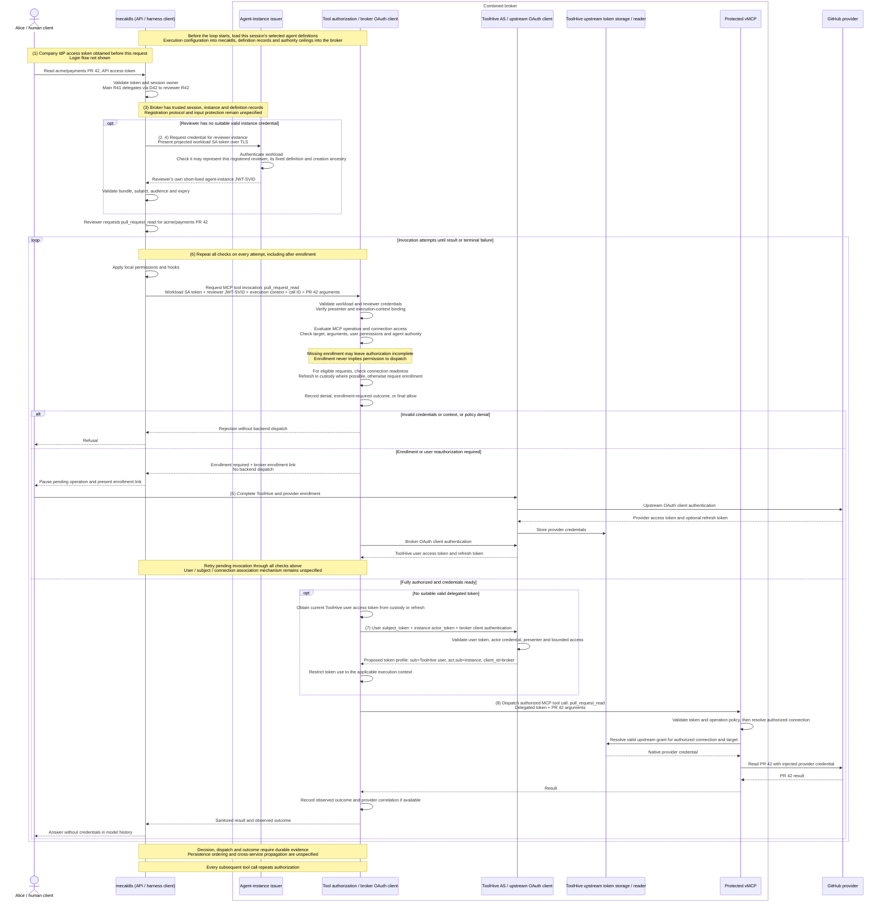

# Credentials and lifecycle

*This chapter describes the intended architecture, not current implementation status.*

An agent instance can participate in multiple runs. Its instance credential identifies it to the broker; presenting that credential does not by itself authorize an MCP tool call. The harness manages run execution, while the broker authorizes MCP tool calls using the acting instance's identity and the applicable user, delegation, and run context. Renewing the instance credential does not itself extend or widen permission to call tools.

## Credential roles

| Credential | What it establishes | Where it is presented |
| --- | --- | --- |
| **Human login token** | The identity of the user making a request to Mecatl. | Human client → Mecatl's API. It is not forwarded as the downstream user token. |
| **Workload credential** | Which Mecatl service is contacting the broker, not which user or agent it represents. | Mecatl → broker. |
| **Agent-instance JWT-SVID** | Which agent instance is acting. It can span multiple runs. | Mecatl → broker; the broker also uses it as the actor token in the proposed ToolHive exchange. |
| **Broker OAuth client credential** | Which OAuth client is requesting access from ToolHive. | Broker → ToolHive authorization server. |
| **ToolHive user grant** | The user's authorization granted through ToolHive. Its access token supplies the user side of the exchange; its refresh token supports renewal. | Held by the broker; the access token is presented to ToolHive as `subject_token`. |
| **Delegated access token** | The user and acting agent together: `sub=user`, `act.sub=instance`, with the protected MCP endpoint as audience. | Broker → protected MCP endpoint. |
| **Native provider credential** | Access to the external provider under the connected account. | ToolHive → provider, such as GitHub. It stays outside Mecatl. |

These are roles, not necessarily seven credentials sent on every call. Enrollment, issuance, and refresh happen when needed.

Run IDs, session attachments, and broker session references are separate from credentials. A broker session reference grants neither run execution nor MCP access; step (3) distinguishes existing references from proposed registration responsibilities.

## Interactive execution

Alice, identified by company issuer `https://login.example.com` and subject `alice-204`, owns harness session `S42`. She asks Mecatl to read PR 42 in `acme/payments`. Her main instance's run `R41` delegates this task through `D42` to reviewer run `R42`, which requests tool `pull_request_read` with repository `acme/payments` and number `42`. The main instance also created the reviewer, but that creation ancestry is distinct from this run's delegation. `reviewer` below always means the exact SPIFFE ID in step (4), under session incarnation `inc_cejrv7re4uy3ubxyzj2gfxfp2u`; `R42` identifies execution, not a credential.

The walkthrough assumes the proposed trusted loader and lifecycle registration described in [agent definitions](agent-definitions.md#registering-instances): the loader fixes definitions, sources, revisions, and ceilings, and the lifecycle component registers instances. Mecatl manages execution; the broker authorizes tool calls. These proposed inputs are not all available through today's broker contract.

Operation `op-pr42-001` follows this one PR read throughout. Times are Unix seconds around `1800000000`, matching the delegated token. Examples are fictional decoded payloads or credential references, never usable bearer values. Audit examples contain only selected metadata; they are not copies of credentials or implemented cross-service events. The common operation ID denotes desired correlation, not an established authenticated propagation mechanism. Audit placement does not specify durable-write ordering.

For this example only, configured workload audience `https://broker.example.com` covers the combined broker's issuance and invocation endpoints. The instance credential has two explicit audiences: that broker and `https://toolhive.example.com/token`. This illustrates a multi-audience deployment so the same actor credential can reach both validators; it does not select the architecture over separately issued credentials. Each recipient requires its own configured audience and trust material, never endpoints chosen by token claims.

Instance credential issuance, provider enrollment, and token exchange occur only when needed. The broker checks every requested operation (see [delegated authority](mcp-authorization.md#delegated-authority) and [operations and resources](mcp-authorization.md#operations-and-resources)).

The numbered markers identify the credential and authorization boundaries discussed below. They group related messages rather than number every network request. The participants are logical roles; grouping them does not establish process isolation.



### (1) Company API access token

The company IdP issues an API access token to Alice's client, which presents it to Mecatl over TLS. The client holds it; it terminates at the API and is not retained for downstream access. This fictional JWT access-token payload is not an ID token.

```json
{
  "iss": "https://login.example.com",
  "sub": "alice-204",
  "aud": "https://mecatl.example.com/api",
  "iat": 1799999900,
  "exp": 1800003500
}
```

This example uses mecak8s with OIDC authentication and session ownership enforcement enabled. Alice submits her request to existing session `S42`, which belongs to her. mecak8s validates her access token and checks that its issuer and subject match the session's stored owner. If either check fails, it rejects the request. Otherwise, main run `R41` delegates the PR read through `D42`, and the harness starts reviewer run `R42`.

**Illustrative API evidence:** mecak8s accepted request `req-pr42-001` from authenticated user `(https://login.example.com, alice-204)` for session `S42`. The user identity comes from the validated token; session ownership comes from server-side state. This records API authentication and session ownership only. The broker has not yet authorized an MCP call to read PR 42.

### (2) Workload credential

Kubernetes supplies mecak8s with a projected ServiceAccount token. mecak8s presents it to the broker over TLS, keeping it outside model context. This fictional decoded payload identifies the calling service:

```json
{
  "iss": "https://kubernetes.example.com",
  "sub": "system:serviceaccount:mecatl:mecak8s",
  "aud": ["https://broker.example.com"],
  "iat": 1799999900,
  "exp": 1800003500,
  "kubernetes.io": {
    "namespace": "mecatl",
    "serviceaccount": {"name": "mecak8s", "uid": "sa-example-42"},
    "pod": {"name": "mecak8s-worker-7", "uid": "pod-example-7"}
  }
}
```

The broker checks the signature using trusted cluster keys, the issuer, allowed signing algorithm, broker audience, and expiry. It then checks that the authenticated ServiceAccount is allowed to contact it. If either check fails, it rejects the request.

**Illustrative broker evidence:** the caller authenticated as `(https://kubernetes.example.com, system:serviceaccount:mecatl:mecak8s)`. This identifies the mecak8s service, not Alice or the reviewer instance, and does not authorize the PR 42 call.

[SPIRE alternatives](#workload-authentication) replace this workload credential without changing its role.

### (3) Broker session and instance registration

The broker session reference identifies broker-owned state; knowing it grants no access. The broker checks the calling service's authenticated identity and deployment. This associates the session with mecak8s, not with Alice, and is separate from harness session `S42`. See [pauses and restart](#pauses-and-restart) for attachment and recovery details.

Under the proposed registration model, the trusted lifecycle component supplies the reviewer's instance and selected definition. Before issuing the credential in (4), the broker checks that this workload may represent that instance and that its definition, revision, and creation ancestry match trusted records. The registration protocol remains unspecified; it does not authorize spawning or run execution.

Alice's identity is a separate API report, not established by the workload credential. Protecting registration and user reports from substitution by a compromised loop in the same process remains unresolved. The issuance example in (4) distinguishes these sources.

### (4) Agent-instance JWT-SVID

The broker's agent issuer signs the registered reviewer's JWT-SVID. The harness client holds it outside model history and presents it to the broker; the broker later presents it as the actor token to ToolHive AS. The issuer retains its private signing key. This decoded example deliberately uses only required JWT-SVID claims:

```json
{
  "sub": "spiffe://agents.example.com/mecatl/agent/system/main/inst/inc_cejrv7re4uy3ubxyzj2gfxfp2u/child/project/code-reviewer/inst/inc_gh56irfcpnupjqgfdw7dhzzw4m",
  "aud": ["https://broker.example.com", "https://toolhive.example.com/token"],
  "exp": 1800000600
}
```

Before issuance, the issuer checks the workload and instance against the trusted registration in step (3); a definition's existence alone is insufficient. The harness checks that the returned subject is the registered reviewer, then validates its signature, allowed algorithm, expiry, and intended audiences against the configured agent trust-domain bundle. The broker and ToolHive AS each require their own audience and a permitted presenter. JWT-SVID requires `sub`, `aud`, and `exp`, but not `iss` or `jti`.

**Illustrative issuance evidence for (3) and (4):** only if the proposed loader and lifecycle registration supply the definition provenance and instance association, and the API supplies its user report, could the broker correlate the issued subject with the following facts. Today's broker contract does not supply these registration/user proofs, and `AgentDef` has no source or revision fields today. This is conditional audit evidence, not implemented behavior, additional JWT claims, or a registration API; protection against same-process substitution remains unresolved.

```json
{
  "issuance_ref": "issue-42",
  "definition": {
    "name": "project/code-reviewer",
    "revision": "review-def-r17",
    "source": "repo://acme/payments/.mecatl/agents/code-reviewer.md",
    "evidence_source": "trusted lifecycle registration"
  },
  "initiating_user": {
    "iss": "https://login.example.com",
    "sub": "alice-204",
    "evidence_source": "API report",
    "request_ref": "req-pr42-001"
  }
}
```

The JWT's `sub` identifies the reviewer. It does not carry Alice's identity or the definition revision; the correlated evidence records those separately and preserves their different sources.

See [credential lifetimes and renewal](#credential-lifetimes-and-renewal) for renewal across runs.

### (5) Enrollment and authorized connection

For this same PR read, `th-user-731` is the ToolHive-side subject associated with Alice **in this example**, not her company-login subject. The example assumes Alice is authorized to use that subject and provider account `github-account-731` through connection `github-conn-42` for `acme/payments`. The association mechanism remains open: referring to the same person, matching names or ID suffixes, and successful OAuth do not prove authorization. `github-account-731` is a distinct provider account ID; its shared suffix with the ToolHive subject has no evidentiary meaning. Model arguments cannot select another user's connection.

If enrollment is needed, Alice completes it before the pending call is reauthorized. The broker holds the ToolHive user grant and uses its access token as `subject_token`; ToolHive holds the native provider grant for this connection. Neither grant reaches the harness or model. Client authentication and credential placeholders are shown once under [credential custody](#credential-custody); see also [provider-connection selection](#provider-connection-selection).

**Illustrative enrollment evidence:** ToolHive records verified client `mecatl-broker`, authenticated subject `th-user-731`, enrollment `enroll-42`, connection `github-conn-42`, and the provider-reported account. The broker records connection readiness with Alice still API-reported. Records exclude tokens, client authentication material, codes, and transaction secrets.

Refresh behavior belongs in [credential lifetimes and renewal](#credential-lifetimes-and-renewal).

### (6) Per-operation authorization

Local permissions and hooks run first. Trusted harness client code then presents the workload and reviewer credentials with operation `op-pr42-001`, run `R42`, delegation `D42`, and this illustrative request:

```json
{
  "tool": "pull_request_read",
  "arguments": {"repository": "acme/payments", "number": 42}
}
```

The broker validates both credentials and requires trusted attribution of the actor, initiating user, run, and delegation; the context-binding mechanism remains unresolved. It checks authorization to use the ToolHive subject and resolved provider connection, then evaluates the complete final request against current user permissions, the fixed definition ceiling, original delegated bounds, and current policy. A transformed request needs another check. A denial dispatches nothing; an allow authorizes this MCP call, not a run or spawn.

**Illustrative broker evidence:** `op-pr42-001` was allowed under `payments-read-policy-r9`, with the request above, `S42`, `R42`, `D42`, verified workload and reviewer, API-reported Alice, revision `review-def-r17`, delegation/ceiling references, and authorized connection `github-conn-42`. A denial records its reason instead; neither decision proves dispatch or success.

Recovered authority remains subject to the original bounds described in [pauses and restart](#pauses-and-restart).

### (7) Token exchange and delegated MCP access token

At marker (7), ToolHive exchanges the user access token and agent-instance JWT-SVID for the access token that the broker presents to vMCP. This example proposes the [RFC 9068 JWT access-token profile](https://www.rfc-editor.org/rfc/rfc9068.html#section-2) with [RFC 8693 delegation claims](https://www.rfc-editor.org/rfc/rfc8693.html#section-4.1). It is a proposed contract, not a claim about existing ToolHive behavior. The exchange output is an OAuth access token, not a JWT-SVID.

Before reading the token: `sub=th-user-731` names Alice's assumed authorized subject in ToolHive's namespace, not `(https://login.example.com, alice-204)` from her company login. `act.sub` names the same reviewer executing `R42`; `client_id=mecatl-broker` names the broker requesting the token, not another agent or user. The token is for the same PR read at `https://mcp.example.com/payments/mcp` through `github-conn-42`; it does not itself establish that connection association.

The decoded header and payload below use fictional values. A real token is signed; its signature and serialized bearer value are omitted here.

**Header:**

```json
{
  "typ": "at+jwt",
  "alg": "RS256",
  "kid": "toolhive-example-key-1"
}
```

**Payload:**

```json
{
  "iss": "https://toolhive.example.com",
  "sub": "th-user-731",
  "act": {
    "sub": "spiffe://agents.example.com/mecatl/agent/system/main/inst/inc_cejrv7re4uy3ubxyzj2gfxfp2u/child/project/code-reviewer/inst/inc_gh56irfcpnupjqgfdw7dhzzw4m"
  },
  "client_id": "mecatl-broker",
  "aud": "https://mcp.example.com/payments/mcp",
  "iat": 1800000000,
  "exp": 1800000300,
  "jti": "d680052b-7081-41aa-b777-147239446ab3"
}
```

ToolHive AS validates the user access token, the instance SVID for its own audience, and the broker's client authentication. It checks that the broker may present this actor and that the requested MCP target and access bounds are authorized before issuing the token.

The audience is vMCP, not GitHub. The token lasts five minutes. No scope was requested in this example; operation policy still bounds access, so omitting `scope` does not grant unrestricted access.

**Illustrative AS evidence:** exchange `exchange-42` records the verified user, actor, client, target, and issued token's `(iss, jti)`. Caller-supplied run context remains reported. The broker holds the bearer outside the harness and limits reuse to the applicable execution context.

See [downstream token exchange](#downstream-token-exchange) for token correlation and actor-history limits, and [sender binding](#sender-binding) for replay protection beyond this bearer example.

### (8) Dispatch and observed outcome

The broker presents the delegated token from step (7) to vMCP with the PR 42 request. vMCP checks the expected token type, trusted issuer, allowed algorithm, signature against configured issuer keys, audience, and expiry before relying on its claims. It then checks the operation and arguments against policy and verifies authorization to use `github-conn-42`.

ToolHive supplies the provider credential from custody for the authorized target. GitHub validates that native credential, not the SVID or delegated MCP token.

**Illustrative vMCP evidence:**

```json
{
  "event": "vmcp.authorization",
  "time": 1800000002,
  "operation_id": "op-pr42-001",
  "provider_connection": "github-conn-42",
  "token_ref": {
    "iss": "https://toolhive.example.com",
    "jti": "d680052b-7081-41aa-b777-147239446ab3"
  },
  "validated_identity": {
    "subject": "th-user-731",
    "actor": "spiffe://agents.example.com/mecatl/agent/system/main/inst/inc_cejrv7re4uy3ubxyzj2gfxfp2u/child/project/code-reviewer/inst/inc_gh56irfcpnupjqgfdw7dhzzw4m",
    "oauth_client": "mecatl-broker"
  },
  "request": {
    "tool": "pull_request_read",
    "arguments": {
      "repository": "acme/payments",
      "number": 42
    }
  },
  "authorization": {
    "decision": "allow",
    "source": "vmcp-policy-evaluation"
  }
}
```

This illustrative record captures validated claims and vMCP's policy decision, not a bearer credential or proof of dispatch.

**Illustrative outcome evidence:** the broker and vMCP record their dispatch attempts and observed responses for `op-pr42-001`. vMCP retains provider reference `provider-request-42` only if returned and safe to store. The broker records the MCP response it received; the API returns a sanitized answer without credentials in model history. A successful response describes what the observer received, not guaranteed provider-side effects or a complete provider audit trail. Missing completion leaves an unknown outcome; see [pauses and restart](#pauses-and-restart).

The [general audit contract](audit.md) requires durable decision, dispatch, and outcome evidence. Persistence ordering and authenticated cross-service propagation remain unspecified; recipients must label propagated context as reported unless independently verified.

## User identity

Mecatl identifies the authenticated user by the issuer and subject of the validated login token, represented by `session.Principal`. The user's association with the acting agent must remain traceable through delegation and audit. This design does not introduce a user SPIFFE path or a separate user SVID; the agent-instance SPIFFE ID identifies the agent, not the user.

The Mecatl user identity and the ToolHive user subject are not necessarily the same identifier. Their association with the authorized provider connection must be established rather than inferred from matching names or subjects.

The authority design proposes trusting Mecatl's authenticated API component to report the initiating user to the broker, rather than forwarding the original login token. The broker authenticates the reporting workload, but this does not independently prove the user's authentication. How the report is protected from substitution by the untrusted agent loop remains to be specified. Audit records must distinguish this reported identity from facts the broker verified itself.

## Credential custody

Human login tokens terminate at Mecatl's API. They are validated for incoming requests, not retained for downstream access or scheduled execution.

Mecatl's client code holds and presents agent-instance credentials without exposing them to the model. They stay out of tool arguments, results, conversation history, logs, and environment variables. Keeping credentials hidden from the model does not protect them from a compromised harness process or isolate agents sharing that process.

The broker's issuer holds the agent signing authority. Mecatl receives signed instance credentials and public verification keys, never the issuer's private signing key.

The broker authenticates as OAuth client `mecatl-broker` to ToolHive AS; ToolHive authenticates separately to the provider. Operators provision each client's authentication material and server-side registration. These references leave the authentication methods open; a client ID alone is not a credential.

| OAuth client | Client ID | Authentication material held by that client |
| --- | --- | --- |
| Broker → ToolHive AS | `mecatl-broker` | `<BROKER_CLIENT_CREDENTIAL_REF>` |
| ToolHive → provider AS | `<TOOLHIVE_PROVIDER_CLIENT_ID>` | `<TOOLHIVE_UPSTREAM_CLIENT_CREDENTIAL_REF>` |

Enrollment yields these opaque credential placeholders; their token formats are not selected:

```json
{
  "toolhive": {
    "access_token": "<TOOLHIVE_USER_ACCESS_TOKEN>",
    "refresh_token": "<TOOLHIVE_USER_REFRESH_TOKEN>"
  },
  "provider": {
    "access_token": "<PROVIDER_ACCESS_TOKEN>",
    "refresh_token": "<PROVIDER_REFRESH_TOKEN_IF_ISSUED>"
  }
}
```

This groups examples for reading, not storage or transport. Each AS validates its OAuth client's authentication against its registration. ToolHive AS validates the ToolHive user grant, subject, intended use, and validity; the provider validates its native access token. Enrollment requires OAuth transaction protections; callbacks and code redemption are omitted. Client credentials and grants stay outside the harness and model.

The broker holds its ToolHive user access and refresh tokens. ToolHive holds, refreshes, and injects native provider credentials for the authorized connection. Neither Mecatl nor the model receives those native provider credentials. This boundary concerns protected tool access; it does not relocate other harness credentials, such as those used to call an LLM provider.

Agent identity does not protect against compromise of the broker's signing authority or provider-credential storage. Separating issuance, authorization, and custody into modules does not create security boundaries against compromise of their shared process or host.

## Credential lifetimes and renewal

An agent instance keeps its identity across runs, while its short-lived instance JWT-SVID can expire and be renewed. Renewing that credential establishes continued use of the same identity; the broker still authorizes each MCP tool call.

A single run may need several delegated access tokens, either for different protected MCP endpoints or because an earlier token expires. Each token has its own audience, expiry, and access limits. Obtaining or refreshing one does not widen permission to call tools.

The broker presents its ToolHive refresh token to ToolHive AS with required client authentication to renew the user access token. ToolHive similarly presents an optional provider refresh token to the provider AS with required upstream client authentication. Each AS validates its refresh grant; custodians must safely store rotated replacements. Without a provider refresh token, renewal requires another supported path or enrollment.

The user's login token, the agent-instance credential, and downstream access tokens have separate lifetimes. Expiry of the login token used to start work does not, by itself, end that work. A provider connection can also remain available after that login token expires. Neither continued connectivity nor successful token refresh authorizes a later tool call without the broker's policy checks.

Ending a run in the harness does not automatically invalidate tokens already issued. A recipient that validates a self-contained bearer token without checking current authorization state may accept it until expiry. The mechanism for communicating cancellation or withdrawal to the broker and downstream recipients remains to be specified.

## Pauses and restart

The broker's session reference and incarnation are separate from harness and agent incarnations. An attachment binding identifies the exact logical attachment incarnation; separate recovery references and continuity checks govern stored-credential recovery. An existing stable broker session can recover a new process-local attachment and binding through those checks. Expired custody withdraws connected authority without necessarily destroying the broker session. Those references do not combine user, agent, definition, and authority into one record.

Workload-only session access checks the exact authenticated workload and configured deployment, rejecting caller-supplied owner assertions. A replacement Pod with the same workload identity can serve that partition; a different identity cannot assume access.

An approval wait or provider-enrollment pause leaves the current run unfinished. Before dispatching the pending MCP operation, the broker checks it against the applicable authorization policy. Connecting a provider account does not approve the pending operation.

After restart, recovering credentials is not enough to continue safely. The system must recover the unfinished execution context and establish the association between the user, acting agent, and provider connection. If that association cannot be established, the tool call must fail closed. The harness determines whether execution resumes; the broker authorizes subsequent MCP calls.

Continuation must preserve the unfinished run's original authorization bounds. The broker checks subsequent MCP calls against those bounds and applicable current policy. Restrictions or withdrawal can constrain continuation; credential renewal or policy expansion must not automatically widen the recovered authority.

An operation that may have been dispatched but has no recorded completion has an unknown outcome. Restoring credentials does not make replay safe. Reconciliation requires evidence about the original operation, such as provider status or an applicable idempotency mechanism.

## Scheduled runs

A scheduled invocation executes without a live interactive user. Its recorded owner identifies on whose behalf the work was configured; audit records must distinguish scheduled execution from a fresh human request.

Human login tokens are not retained for later invocations. Provider credentials remain in broker/ToolHive custody. A saved owner or an available provider connection does not, by itself, authorize an MCP operation.

The harness starts and manages scheduled runs. The broker authorizes their MCP tool calls. The mechanism for establishing unattended authority is a separate design concern.

## Workload authentication

Workload authentication identifies the Mecatl service contacting the broker. Agent-instance identity distinguishes the agents hosted by that service. The proposed deployment options separate these two roles:

| Workload authentication to the broker | Agent-instance identity |
| --- | --- |
| Kubernetes ServiceAccount bearer over TLS | None: workload-only identification |
| Kubernetes ServiceAccount bearer over TLS | Broker-issued instance JWT-SVID |
| SPIRE workload JWT-SVID over TLS | Broker-issued instance JWT-SVID |
| SPIRE workload X.509-SVID over mTLS | Broker-issued instance JWT-SVID |

These are alternatives, not a required implementation sequence. Broker-issued agent-instance JWT-SVIDs do not require SPIRE.

| SPIRE alternative | Credential example and custody | Broker validation |
| --- | --- | --- |
| Workload JWT-SVID | SPIRE supplies `{"sub":"spiffe://platform.example.com/ns/mecatl/sa/mecak8s","aud":["https://broker.example.com"],"exp":1800003500}` through the Workload API; the harness client holds and presents it. | Check signature against the configured platform JWT bundle, required claims, audience, expiry, and permitted SPIFFE ID. |
| Workload X.509-SVID / mTLS | SPIRE supplies a certificate with URI SAN `spiffe://platform.example.com/ns/mecatl/sa/mecak8s` and illustrative validity `1799999900..1800003500`. The client retains the private key and proves possession in TLS. | Check the chain against the configured platform trust bundle, validity, SPIFFE identity, and permitted workload. TLS termination elsewhere requires trusted identity propagation. |

For SPIRE authentication, audit evidence identifies the configured trust domain/bundle association and verified SPIFFE ID. A stolen bearer remains usable until expiry or an effective revocation check; signature validation alone does not prove possession of a private key.

A workload credential alone cannot distinguish `code-reviewer` from `deployer` when both run in the same Mecatl service. A self-declared agent name does not establish that distinction for broker policy.

## Downstream token exchange

To obtain delegated access to a protected MCP endpoint, the broker presents three distinct credentials to ToolHive's authorization server: its ToolHive user access token as `subject_token`, the agent-instance JWT-SVID as `actor_token`, and its own OAuth client authentication.

The instance credential must be valid for presentation to ToolHive's authorization server. Acceptance by the broker alone does not establish that audience.

ToolHive issues a delegated access token identifying the user in `sub`, the acting instance in `act.sub`, and the broker OAuth client in `client_id`. Its audience is the protected MCP endpoint, not the external provider such as GitHub. These identities do not by themselves authorize particular tool arguments; the broker still checks the requested MCP operation.

The protected MCP endpoint validates the delegated token and applies operation policy. ToolHive resolves the authorized provider connection and uses its native credential for the external call. Validated claims identify the user and current actor directly; permissions and account associations can still require authoritative records.

The issuer-qualified `jti` supports token correlation but does not prevent replay or replace a per-operation identifier: several calls can reuse one token. The walkthrough's shared operation ID expresses desired correlation, not an established authenticated join between services.

The token's single `act` object identifies the current actor. RFC 8693 nested `act` objects describe previous actors and are informational for access control. Creation ancestry and current execution delegation remain separate evidence, not actor history inferred from the SPIFFE path or copied into nested claims.

## Provider-connection selection

ToolHive resolves the provider connection from validated identity and authoritative connection records.

The model cannot select another user's credentials or redirect them by supplying a URL, header, audience, or credential selector. The broker and ToolHive resolve the target and credentials within the authorized connection.

If the required identity, connection, or authorization evidence is missing, invalid, stale, or revoked, the call fails closed. It must not fall back to a service credential, another user, or a more privileged agent. A denied tool call dispatches no backend operation.

## Instance identity and creation ancestry

The instance JWT-SVID identifies the acting agent instance through its SPIFFE ID. The proposed identity path records the instance's definition category and name, its session incarnation, and the ancestry of instances that created it.

Creation ancestry is distinct from execution delegation. The same instance can participate in multiple runs, so its SPIFFE ID alone does not identify which parent run delegated the current task. Run and call records supply that context.

A definition category and name are not enough to establish provenance. Two repositories can both define `code-reviewer`. Before selecting definition-specific policy, the broker needs a verified association with the source that supplied the definition.

### Example instance identities

Alice's main instance:

```text
spiffe://agents.example.com/mecatl/agent/system/main/inst/inc_cejrv7re4uy3ubxyzj2gfxfp2u
```

A reviewer instance created by that main:

```text
spiffe://agents.example.com/mecatl/agent/system/main/inst/inc_cejrv7re4uy3ubxyzj2gfxfp2u/child/project/code-reviewer/inst/inc_gh56irfcpnupjqgfdw7dhzzw4m
```

A new root instance after a fork or clear:

```text
spiffe://agents.example.com/mecatl/agent/system/main/inst/inc_45bvtrrrpkekb6336hwe6bvape
```

The reviewer's ID extends its creating instance's path with a child segment. A fork or clear creates a new root instance rather than extending that path. Restoring an existing instance preserves its identity.

These IDs describe instance identity and creation ancestry. The initiating user and the current run's delegation context are recorded separately.

## Sender binding

The walkthrough's delegated token is a bearer without sender binding. Its signature protects the claims from alteration but does not prove which holder presented it.

Workload-level DPoP is follow-on work to bind the broker-facing OAuth credential to a presenting worker's key and reduce replay of stolen access tokens. It does not establish which agent inside that worker made a call, protect against a compromised worker using its own key, or bind the MCP arguments. Agent identity and tool-call authorization remain separate checks.

Key custody, renewal, restart behavior, and replay handling belong in the implementation design.
