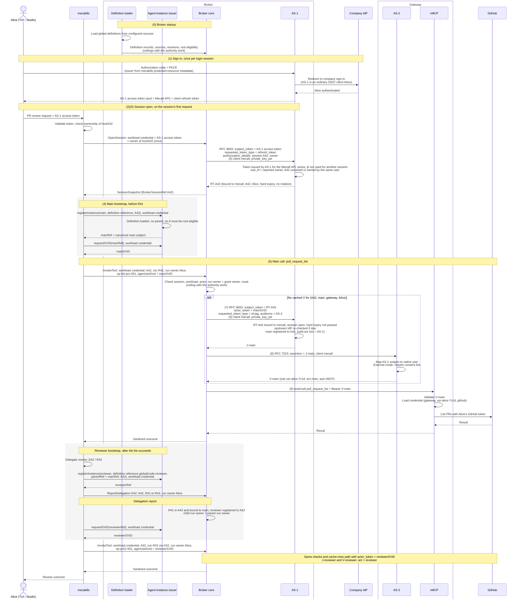

# Credentials and lifecycle

*This chapter describes the intended architecture, not current implementation status.*

An agent instance can participate in multiple runs. Its agent-instance SVID identifies it to the broker; presenting that SVID does not by itself authorize an MCP tool call. The harness manages run execution. On every call the broker checks the workload, the session, the acting instance, the run and its owner, and the route. Once the [authority work](README.md#order-of-work) is in place, it also checks the acting instance's effective server/tool ceiling, its definition ceiling narrowed by its parent's, with Cedar. User, resource, argument, and dynamic delegation policies are deferred. Renewing the agent-instance SVID does not itself extend or widen permission to call tools.

The human enters the flow once, when Alice signs in through AS-1. AS-1 runs that sign-in itself, so every later statement about the human traces back to a login AS-1 witnessed, not to a report from the harness.

## What the user sees

- **Sign in** once per login session, through AS-1 to the company IdP; usually silent with single sign-on.
- **Connect a provider** once, through the existing `mcp_authorization_pending` path. In external mode, the same path first shows the gateway's "Allow Mecatl" step.
- **Everyday use** needs nothing more until the broker refresh token's hard expiry or a revocation. Scheduled runs draw on their own [authority](#scheduled-runs).
- **Sign out** ends one client's tokens; **sign out everywhere** stops every agent and schedule acting for the user. See [sign-out and revocation](#sign-out-and-revocation).

## Credential roles

| Credential | What it establishes | Issuer → holder → verifier | Custody |
| --- | --- | --- | --- |
| **AS-1 access token** | Alice's identity for requests to the Mecatl API. | AS-1 → Alice's client (TUI or Studio) → mecak8s. Passed to the broker once, at session open. | Not stored by the server side. |
| **Client refresh token** | The client's ability to renew its own AS-1 access token. | AS-1 → client only. | TUI keyring or Studio sealed cookie; never leaves the client. |
| **Workload credential** | Which Mecatl service contacts the broker and agent-instance issuer. | Platform → mecak8s → broker and agent-instance issuer. It identifies neither Alice nor an agent instance. | Projected ServiceAccount token or a configured SPIRE identity. |
| **Agent-instance JWT-SVID** (the agent-instance SVID) | Which registered agent instance is acting. It can span multiple runs. | Agent-instance issuer → harness → broker, which forwards it to AS-1 as `actor_token`. | Harness, outside model context. Renewal keeps the registered identity and widens nothing. |
| **Broker refresh token** | Alice's delegated authority for one broker session, usable without her present. | AS-1 → broker → AS-1. Bound to client `mecatl`, the broker session, and the user. Accepted only as the subject of an ID-JAG exchange. | Broker, in shared session storage with the grant's recorded owner and expiry. Does not rotate. |
| **Schedule grant** | Alice's delegated authority for one schedule, until its horizon. | AS-1 → broker → AS-1. Bound to client `mecatl`, the schedule, and the user. Accepted only to open a scheduled run's session. | Broker, in shared storage under the schedule. |
| **Broker client credential** | That the caller at AS-1 and AS-2 is the broker, OAuth client `mecatl`. | Broker's private key; each request carries a short-lived `private_key_jwt` assertion verified by AS-1 and AS-2. | KMS or HSM where available; public key registered at each server as an inline JWKS, again on rotation. |
| **ID-JAG** | Alice and the acting agent, for redemption at AS-2. | AS-1 → broker → AS-2. Short-lived; the broker uses each once. | Broker, from issuance to redemption. |
| **AS-2 access token (`V`)** | AS-2's native Alice, the acting agent, and client `mecatl`, for the vMCP resource. | AS-2 → broker → vMCP. | Broker cache, per session, instance, gateway, and user; per-call checks still apply. |
| **Provider credential** | Access to Alice's GitHub account. | GitHub → gateway credential store → GitHub. | Gateway credential store, keyed by (gateway, user, provider); never leaves the gateway. |
| **Signing keys** | Authority to issue credentials. | AS-1, AS-2, and the agent-instance issuer each keep their own key. | Separate keys are not process isolation when components share a process. |

Two pieces of state matter as much as the credentials: broker session `A42`, whose reference grants nothing on its own, and, in external mode, the consent link at AS-2, which the gateway UI or Mecatl can revoke. The custody column does not select a persistence implementation or a process-isolation boundary. Keep credential values out of model context, tool arguments, results, transcripts, logs, environment variables, audit records, diagnostics, and errors. Hiding a credential from the model does not protect it from a compromised process that holds it. This protected MCP path does not relocate other harness credentials, such as those used to call an LLM provider.

### Example nomenclature

| Kind | Name | Meaning |
| --- | --- | --- |
| Identity | Company Alice `(https://login.example.com, alice-204)` | Alice at the company IdP. AS-1 represents her as subject `u-alice-91`; AS-2 as native user `usr-alice-7c1d`. |
| Identity | `mecatl` | The broker's OAuth client at AS-1 and AS-2. Not a user or an agent. |
| State | `hostS42`, `A42` | Host session ID, and prose alias for the broker session reference, today the opaque `mcpbroker.SessionRef`. Neither is a credential. |
| State | `main`, `reviewer`, `R41`, `R42`, `D42` | Registered agent instances, their runs, and the delegation from main to reviewer. |
| Reference | `op-list-prs-001`, `op-pr42-001` | Correlation IDs for two tool operations. They identify operations, not people, and authorize nothing. |
| Credential | `mainSVID`, `reviewerSVID` | Registered agent-instance credentials. |
| Credential | `RT-A42` | The broker refresh token for session `A42`. |
| State | Grant | AS-1's record of authority Alice delegated. The broker holds an opaque token for each: a broker refresh token or a schedule grant. Each grant records its owner, the company identity, and, once revoked, the reason. |
| Credential | `J-main`, `J-reviewer` | ID-JAGs naming Alice and each acting agent. |
| Credential | `V-main`, `V-reviewer` | AS-2 access tokens naming native Alice and each acting agent. |

## Interactive execution

Alice owns harness session `hostS42`. She asks Mecatl to list pull requests in `acme/payments` and review PR 42. Main run `R41` calls `pull_request_list`. After the list returns, main delegates the review through `D42` to reviewer run `R42`, which calls `pull_request_read`. Tool names and arguments are illustrative. The reviewer uses definition `global/code-reviewer`; main both creates it and delegates the task to it, but creation and delegation remain separate facts. In the diagram, `main` and `reviewer` abbreviate the SPIFFE subjects in [example instance identities](#example-instance-identities).

The gateway in this example is external, at `https://gateway.example.com`. Embedded mode follows the same steps with AS-2 and vMCP inside the Mecatl deployment.



The diagram follows the successful path. Other outcomes:

- **No provider credential.** vMCP finds no stored GitHub credential for Alice and answers "needs authorization". The broker returns the existing `mcp_authorization_pending` outcome; the TUI or Studio opens the authorization URL and rechecks, and the parked run resumes.
- **No consent link (external mode).** AS-2 refuses to redeem the ID-JAG. The broker returns the same pending outcome, and the URL first leads through AS-2's "Allow Mecatl" step.
- **Denial or failure.** Any denial before dispatch prevents the provider call. Retrying requires authorization again.
- **Unknown outcome.** If dispatch may have happened but no completion was observed, the outcome is unknown and is not replayed automatically.

Every later tool call repeats the broker checks, including calls served from the `V` cache. The [failure matrix](#failure-matrix) lists the failures each step returns, and [lifetimes and renewal](#lifetimes-and-renewal) when each credential is replaced.

Each step below follows the same shape: what arrives, the checks in the order they run, what is issued, how each failure is reported and whether a retry can succeed, why the step exists, what it does not prove, and what is recorded. The tests for every step are in the [implementation companion](implementation.md#credential-verification), and what a compromised component can still do is in the [threat model](threat-model.md). Checks run in the listed order and stop at the first failure. Error responses never echo a token, an assertion, or a claim value from one. Token-endpoint errors follow RFC 6749 §5.2, RFC 8693 §2.2.2, RFC 7523 §3.1, and RFC 9396 §8; broker calls are gRPC and use gRPC status codes. Where one error code covers several causes, a reason code tells them apart; see [error reasons](#error-reasons).

### (0) Broker startup

This step runs once when the broker starts, before any request; it is a prerequisite, not part of a call.

**Input.** The operator's configuration names the definition sources for global definitions.

**Checks, at the definition loader:**

1. Each source is configured and reachable.
2. Each definition parses and passes the [definition checks](agent-definitions.md#definition-provenance).

**Output.** A record per definition, with its source, revision, and whether it may be a session's root; with the authority work, also its ceiling. Repository definitions are not loaded; mecak8s names them by reference at registration.

**Failures.** A definition that fails is not loaded and cannot be registered. The broker serves the definitions that loaded.

**Why.** An agent name is only a claim. Loading definitions inside the broker means a definition name in an audit record refers to a known source and revision, and mecak8s cannot supply fake content for a global definition.

**Does not prove.** Anything about repository definitions, which the broker accepts only as mecak8s reports.

**Evidence.** The loader records each load with source and revision ([audit](audit.md#auditevent-profile)).

### (1) AS-1 access token

AS-1 is Mecatl's login authorization server. mecak8s's protected-resource metadata names AS-1, and the TUI and Studio already discover their issuer there, so neither client changes. AS-1 does not hold passwords: it redirects Alice to the company IdP as an ordinary OIDC client. The company IdP administrator registers one web application, AS-1, with AS-1's callback as redirect URI. The company IdP therefore sees only AS-1 as the application, and per-application IdP policies can no longer distinguish the TUI from Studio.

AS-1 asks the company IdP for a refresh token at sign-in, because the [upstream re-check](#upstream-re-check) needs one. How depends on the IdP: the `offline_access` scope, which OIDC Core §11 requires to be sent with `prompt=consent`; `access_type=offline` at Google; or IdP configuration that issues refresh tokens to the AS-1 application.

The client receives an access token for the Mecatl API and keeps its own refresh token: the TUI in the OS keyring, Studio in sealed server-side cookies.

**Input.** Each Mecatl API request carries `Authorization: Bearer <AS-1 access token>`. A fictional decoded access token:

```json
{"typ": "at+jwt", "alg": "ES256", "kid": "as1-key-1"}
{
  "iss": "https://broker.example.com/as",
  "sub": "u-alice-91",
  "sub_id": {"format": "iss_sub", "iss": "https://login.example.com", "sub": "alice-204"},
  "https://toolhive.dev/upstream_subject": {"iss": "https://login.example.com", "claim": "sub", "value": "alice-204"},
  "aud": "https://mecatl.example.com/api",
  "client_id": "mecatui",
  "iat": 1799999900,
  "exp": 1800000800,
  "jti": "at-alice-7731"
}
```

**Checks, at mecak8s** (RFC 9068 §4):

1. The header `typ` is `at+jwt` or `application/at+jwt`, and `alg` is on the configured allowlist, which excludes `none` and every symmetric algorithm.
2. `kid` selects a key from AS-1's configured JWKS, and the signature verifies. A token never chooses where keys come from.
3. `iss` is exactly AS-1's issuer.
4. `exp` has not passed and `iat` is not in the future, each allowing the configured clock skew.
5. `aud` contains the Mecatl API identifier.
6. `client_id` is the TUI's or Studio's.
7. `sub_id` is present with format `iss_sub`.
8. The company identity in `sub_id` owns `hostS42`.

**Output.** An authenticated request from owner `(https://login.example.com, alice-204)`.

**Failures.** Checks 1–7 return HTTP 401 with `WWW-Authenticate: Bearer error="invalid_token"` (RFC 6750 §3.1). The client refreshes its access token and retries once; a second failure is shown to the user. Check 8 returns 404 with the Mecatl API's `session_not_found` error body, the same response as for a session that does not exist, and is not retryable. A 403 would confirm that another user's session exists, so an ownership failure is deliberately indistinguishable from absence; for the same reason, deleting another user's session succeeds and deletes nothing.

**Why.** An `id_token` is not accepted here: its audience is the client, not the API. Session ownership is keyed by the company identity in `sub_id`, not by AS-1's own `(iss, sub)`, so existing owners keep matching without migration and the owner stays Alice's stable human identity. That holds only when the IdP gives the same issuer and subject across application registrations: an IdP with pairwise subjects per application (for example Microsoft Entra ID) gives AS-1 a different `sub`, so owners must be remapped.

**Does not prove.** That the caller is the TUI: both clients are public, so `client_id` names the client the token was issued to, not the one presenting it.

**Evidence.** mecak8s accepted request `req-pr42-001` from owner `(https://login.example.com, alice-204)`, authenticated by AS-1 as `u-alice-91`, for `hostS42`. This records API authentication and ownership only.

### (2) Workload credential

**Input.** Every call from mecak8s to the broker and the agent-instance issuer carries the workload credential, a projected ServiceAccount token, over TLS and outside model context:

```json
{
  "iss": "https://kubernetes.example.com",
  "sub": "system:serviceaccount:mecatl:mecak8s",
  "aud": ["https://broker.example.com"],
  "iat": 1799999900,
  "nbf": 1799999900,
  "exp": 1800003500,
  "kubernetes.io": {
    "namespace": "mecatl",
    "serviceaccount": {"name": "mecak8s", "uid": "sa-example-42"},
    "pod": {"name": "mecak8s-worker-7", "uid": "pod-example-7"}
  }
}
```

**Checks, at the broker and the agent-instance issuer,** offline against the cluster's keys:

1. The token carries the `kubernetes.io` `pod` claim, which only a projected, pod-bound token has. A legacy Secret-based token is rejected.
2. `alg` is on the allowlist, and the signature verifies against the cluster's JWKS. The JWKS is pinned in configuration or fetched by OIDC discovery from the configured issuer, never from a URL in the token.
3. `iss` is exactly the configured cluster issuer.
4. `aud` contains the broker's audience. A token with the Kubernetes API server's audience is rejected.
5. `nbf`, `iat`, and `exp` are current within the clock skew, and `exp - iat` does not exceed the configured maximum lifetime. Kubernetes accepts `expirationSeconds` down to 600.
6. `sub` is on the configured allowlist of ServiceAccounts that may contact the broker.

The `kubernetes.io` claims are recorded for audit and never decide anything.

**Output.** The authenticated workload `system:serviceaccount:mecatl:mecak8s`.

**Failures.** Checks 1–5 return `UNAUTHENTICATED`; check 6 returns `PERMISSION_DENIED`. Only an expired token is retryable: the kubelet rewrites the projected token before it expires, and mecak8s retries with the new file contents. Every other failure is a configuration fault.

**Why.** It identifies the mecak8s service, so the broker serves sessions only to the workload they are bound to. [SPIRE alternatives](#workload-authentication) replace this credential without changing its role.

**Does not prove.** That the presenter is that pod: it is a bearer token. Offline validation also does not notice a deleted pod before `exp`; short lifetimes bound that. Kubernetes TokenReview, called on each request, would notice it; it is not selected. The credential identifies neither Alice nor an agent instance.

**Evidence.** The broker and the agent-instance issuer record the authenticated ServiceAccount and pod with each decision they make.

### (3) Session open and the broker refresh token

At `OpenSession`, mecak8s passes Alice's current AS-1 access token to the broker once, with its workload credential and the owner it holds for `hostS42`. This replaces the harness reporting `human {issuer, subject}` as plain data: the broker now holds a token AS-1 signed for Alice's client, not mecak8s's statement about her. Clients refresh their access token before each new session open, so the token is fresh and not yet used to open a session. The broker runs at most one `OpenSession` per broker session at a time. It keeps at most one open broker session for each root host session, and mecak8s finds it by that host session. An open that repeats the host session, incarnation, and owner returns `A42`. An open with another owner fails with `session_owned`, and one with another incarnation fails with `ALREADY_EXISTS`. A session bound to another workload gets the same `PERMISSION_DENIED` as an unknown session ID, at open too, and a lookup by host session finds none, so a workload cannot learn that another workload's session exists. A scheduled run opens its session from the schedule grant instead; see [scheduled runs](#scheduled-runs).

**Input.** The broker exchanges the token at AS-1 with RFC 8693, authenticating as client `mecatl` ([step (5)](#5-broker-client-authentication)). RFC 8693 has no parameter for the broker session or its owner, so the request carries both in an RFC 9396 `authorization_details` entry of type `mecatl_session`. RFC 9396 does not mention token exchange; Mecatl applies its §3, which allows `authorization_details` wherever `scope` is used, by analogy. The owner field is deployment-defined context for the owner check, not an authorization the user granted. The `mecatl_session` type requires AS-1 to echo the entry unchanged. Form encoding is shown decoded:

```text
POST https://broker.example.com/as/oauth/token
grant_type=urn:ietf:params:oauth:grant-type:token-exchange
subject_token=<Alice's AS-1 access token>
subject_token_type=urn:ietf:params:oauth:token-type:access_token
requested_token_type=urn:ietf:params:oauth:token-type:refresh_token
authorization_details=[{"type": "mecatl_session", "session": "A42",
  "owner": {"iss": "https://login.example.com", "sub": "alice-204"}}]
client_assertion_type=urn:ietf:params:oauth:client-assertion-type:jwt-bearer
client_assertion=<private_key_jwt for mecatl>
```

**Checks, at AS-1:**

1. Client authentication as `mecatl` ([step (5)](#5-broker-client-authentication)).
2. The client may use the token-exchange grant.
3. The request is well formed: the two token types above, no `actor_token`, no `scope`, and exactly one `mecatl_session` entry with a session and an owner.
4. The subject token is an AS-1 access token: signature, `iss`, `exp`, not revoked at AS-1, `aud` is the Mecatl API, and `client_id` is the TUI or Studio. It was issued after the user's last user-wide revocation, if any; see [the revocation time](#sign-out-and-revocation). Accepting a Mecatl-API token from `mecatl` is a narrow policy for this one client, not a general audience bypass.
5. The company identity in the token's `sub_id` equals the owner in the entry.
6. Session `A42` has never been closed, and has no recorded owner yet or its recorded owner is that same identity. Session IDs are never reused.
7. The token's `jti` has not opened a session before, or this is a retry: the same `jti`, client, and session, within the source token's `exp`, while `A42` is open.

**Output.** In one transaction, AS-1 records the converted `jti`, records the owner of `A42` if this is the first open, writes the refresh-token record, and revokes `A42`'s previous refresh token if it has one. A retry, or a later open by the same owner, therefore replaces the session's refresh token and never adds a second one. An exchange still holding the replaced token gets reason `superseded`. RFC 8693 returns the issued token in `access_token` even when it is not an access token (§2.2.1), and AS-1 echoes the `mecatl_session` entry (RFC 9396 §7):

```json
{
  "access_token": "<RT-A42>",
  "issued_token_type": "urn:ietf:params:oauth:token-type:refresh_token",
  "token_type": "N_A",
  "expires_in": 43200,
  "authorization_details": [{"type": "mecatl_session", "session": "A42",
    "owner": {"iss": "https://login.example.com", "sub": "alice-204"}}]
}
```

`expires_in` is illustrative; the hard expiry is not selected. `RT-A42` is opaque to the broker. Its meaning lives in an AS-1 record, a [grant](#example-nomenclature), that binds it to client `mecatl`, to Alice as `u-alice-91`, to her company identity as the grant's recorded owner, and to session `A42`, with a hard expiry. Every ID-JAG issued from it names that subject.

The broker checks that the echoed entry equals the one it sent, then stores `RT-A42` with the echoed owner and its expiry in its shared session storage, so any replica can use it and run the [run-owner check](#6-per-operation-authorization) without asking AS-1. If the echo differs, the broker revokes `RT-A42` (RFC 7009, or in process while AS-1 is a broker module), which closes `A42`, and fails the open. The existing broker session record under `A42` keeps the workload and host-session binding; the human authority lives in `RT-A42`, not in a broker-local human record.

**Failures.** The reasons are listed under [error reasons](#error-reasons).

| Check | Response | Retry |
| --- | --- | --- |
| 1 | 401 `invalid_client` | No; a configuration or key fault. |
| 2 | 400 `unauthorized_client` | No. |
| 3 | 400 `invalid_request`, `invalid_scope` for a `scope` parameter, or `invalid_authorization_details` for a malformed entry | No; a broker bug. |
| 4 | 400 `invalid_request` with `subject_invalid` (RFC 8693 §2.2.2), or with the user-wide revocation's reason for a token issued before it | `subject_invalid`: after the client refreshes its access token. A revocation reason: after Alice signs in again. |
| 5 | 400 `invalid_request` with `owner_mismatch`, recorded | No; mecak8s paired the token with the wrong session. RFC 8693 calls a subject token unacceptable by policy `invalid_request`. |
| 6 | 400 `invalid_authorization_details` (RFC 9396 §5) with `session_owned`, recorded | No; the session belongs to someone else or is closed. |
| 7 | 400 `invalid_request` with `token_used` | After the client refreshes its access token. |
| Lost response | None received | Yes: resend the same `subject_token` and `authorization_details` with a new client assertion. Check 7 accepts it as a retry. |

mecak8s reports any of these to the client as a failed session open. It answers `subject_invalid` and `token_used` with 401 `invalid_token`, so the client refreshes its access token and tries once more.

If the broker crashes after AS-1 issued `RT-A42` but before storing it, nothing holds that refresh token. mecak8s retries the open when the broker returns, and the retry, or any later open of `A42` by the same owner with a fresh token, replaces the orphan.

**Why.** One conversion per `jti` stops a leaked access token from opening a second session. A retry issues a new refresh token rather than returning the first, because AS-1 stores only a hash of each refresh token and cannot return it again. Revoking the previous one in the same transaction keeps one live refresh token per session, and writing all the records together means a crash cannot leave a converted `jti` with no refresh token, or a refresh token whose conversion was not recorded.

`RT-A42` is accepted only as the subject token of an ID-JAG exchange; presented at the refresh-token grant, it returns `invalid_grant`, so the broker cannot mint Mecatl API tokens as Alice. `RT-A42` does not rotate, because [client authentication](#5-broker-client-authentication) already binds it to the broker, and rotation would make concurrent exchanges from several broker replicas look like token reuse.

Checks 5 and 6 exist because the broker supplies `A42`, and only mecak8s checks that Alice owns `hostS42`, so a mecak8s bug could pair her token with another user's session. AS-1 records the owner at the first open and refuses any later open of `A42` for a different user. Both checks compare facts inside Mecatl, so they catch mistakes, not a compromised mecak8s, which could report a consistent lie.

**Does not prove.** That mecak8s paired Alice's token with her own session, only that its reports agree with each other. That Alice is present after the open: the refresh token outlives her access token.

**Evidence.** AS-1 records the conversion: client `mecatl`, user `u-alice-91`, owner, source token `jti`, session `A42`, and the hard expiry. It records a refused open with its reason, and each refresh token a later open replaced.

**Session end.** `RT-A42` is not tied to Alice's AS-1 login session, so signing out of one client does not end it. Deleting `hostS42` closes `A42`. Releasing `hostS42`, a client disconnecting, or a replica losing its lease leaves `A42` open, because agents keep working after Alice closes her client. Deleting the session, signing out everywhere, the hard expiry, and AS-1's upstream re-check revoke it. Losing `RT-A42` for any of these reasons closes `A42`. On Alice's next request, mecak8s opens a new broker session for `hostS42` with a fresh access token, registers its live instances into it again, parents first, with their existing incarnations ([step (4)](#4-agent-instance-jwt-svid)), and reports the open delegations again, parents first ([delegation report](#delegation-report)). A closed session leaves a record, its ID, owner, and closing time, so check 6 can refuse to reopen it. The converted `jti` is kept until the source token's `exp` plus the clock skew.

### (4) Agent-instance JWT-SVID

**Input.** For the diagram's main registration, mecak8s supplies session `A42`, the persisted main agent-instance incarnation, and the selected definition reference, with no parent. For the reviewer, it supplies `A42`, the child's persisted incarnation, the definition reference `global/code-reviewer`, and the registered main-instance reference, not the main's token. Both calls also report the instance's host session and owner, and carry the workload credential.

**Registration checks, at the agent-instance issuer:**

1. The workload is authenticated ([step (2)](#2-workload-credential)).
2. Session `A42` is open, bound to that workload, and owned by the reported owner: one session tree has one owner.
3. The definition reference names a definition the loader recorded, or, for a definition the broker did not load, is accepted as a mecak8s report and marked as such; see [definition provenance](agent-definitions.md#definition-provenance).
4. With no parent, including after a fork or clear, the definition is root-eligible, the host session is `A42`'s root host session, and the incarnation is the one `A42` was opened with. With a parent, the parent is registered to `A42`.
5. The definition category and name match `[A-Za-z0-9._-]+` and are neither `.` nor `..` (SPIFFE-ID §2.2). A name that would need encoding is rejected, not rewritten. The incarnation is exactly `inc_` and 26 lowercase base32 characters, or `legacy_` and 64 hex characters.
6. The name and the nesting depth stay within the caps. Proposed: the definition category and name each up to 63 bytes, and up to 8 child levels below the root, which keeps the longest subject under 2,000 bytes, even with `legacy_` incarnations. The agent-instance issuer also checks the whole URI against the 2,048 bytes SPIFFE-ID §2.3 says implementations should not generate beyond.
7. If the SPIFFE ID was registered before, in any session, that registration had the same host session, owner, definition reference and revision, and parent; only the broker session may differ.

Registration records identity, not permission to spawn, run, or call tools. The agent-instance issuer constructs the canonical subject; see the [registration checks](agent-definitions.md#registering-instances). In the same transaction the agent-instance issuer gives the instance its **`ag_` identifier**: a random, opaque value such as `ag_7hq2x9`, created only if the SPIFFE ID has none yet and reused otherwise. Both directions are unique, one `ag_` identifier per SPIFFE ID and one SPIFFE ID per `ag_` identifier, and an identifier is never reassigned. Registering the same instance into a new session therefore keeps its `ag_` identifier. AS-1 later writes it into `act`.

**Output.** The instance reference, its canonical subject, and, on `requestSVID`, a JWT-SVID signed by the agent-instance issuer. The reviewer's, deliberately using only the claims JWT-SVID requires:

```json
{"alg": "ES256", "kid": "agents-2026-10"}
{
  "sub": "spiffe://agents.example.com/mecatl/agent/system/main/inst/inc_cejrv7re4uy3ubxyzj2gfxfp2u/child/global/code-reviewer/inst/inc_gh56irfcpnupjqgfdw7dhzzw4m",
  "aud": ["https://broker.example.com"],
  "exp": 1800000600
}
```

mecak8s checks that the returned subject is the registered instance. The harness holds the SVID outside model history and presents it to the broker for invocation; the broker forwards it to AS-1 as `actor_token`. AS-2 receives only the actor claim in the ID-JAG.

**SVID checks, at the broker and, for AS-1, in Mecatl's actor-token validator.** See [step (7)](#7-id-jag-from-as-1).

1. `sub` parses as a SPIFFE ID in the agent trust domain `agents.example.com`.
2. The verifier selects that trust domain's bundle and, in it, the keys whose `use` is `jwt-svid`. The header must carry `kid`, which selects one of them; JWT-SVID §2.2 makes `kid` optional, so requiring it is Mecatl policy. An unknown `kid` triggers one rate-limited bundle refresh, then rejection. A platform SVID with the same audience fails here, because it belongs to another trust domain and bundle.
3. `alg` is on the allowlist JWT-SVID §2.1 permits: RS, ES, or PS with SHA-256 or longer, never `none` or HMAC.
4. The signature verifies.
5. `aud` is exactly the broker's audience, as its only value. JWT-SVID §3.2 only requires the verifier's own value to be present; the single value is Mecatl policy.
6. `exp` has not passed, allowing the clock skew, and is no further in the future than the configured maximum SVID lifetime.
7. `sub` matches the full canonical subject of a registered instance byte for byte.
8. The instance is registered to the session in use: `A42` from the request at the broker, the session of `RT-A42`'s record at AS-1. The SVID was issued while the instance was registered to that session, so an SVID issued before a session closed does not verify in the session that replaces it.

**Failures.**

| Check | Response | Retry |
| --- | --- | --- |
| Registration 1 | Step (2)'s codes | Only an expired workload credential. |
| Registration 2 | The session's closing reason with its status from [error reasons](#error-reasons), or `PERMISSION_DENIED` for a session bound to another workload, the same as for an unknown session ID, or for an owner that is not the session's owner | After a new session opens. |
| Registration 3, 4 | `PERMISSION_DENIED` | No. |
| Registration 7 | `ALREADY_EXISTS` | No. |
| Registration 5, 6 | `INVALID_ARGUMENT` | No. |
| Registration repeated | The same instance reference for the same session and content; `ALREADY_EXISTS` for the same SPIFFE ID with different content | A lost response is retried safely. |
| SVID 6, expired | `UNAUTHENTICATED` with `svid_expired` at the broker; 400 `invalid_request` with `svid_expired` at AS-1 | mecak8s renews the SVID, one renewal per instance at a time, and retries once. |
| Any other SVID check | `PERMISSION_DENIED` at the broker; 400 `invalid_request` with `denied` at AS-1 (RFC 8693 §2.2.2) | No. |

**Why.** The SVID gives agent identity its own SPIFFE trust domain and signing key, so verifiers can tell it apart from the OAuth issuers, and leaves a path to attestation and to policy shaped by RFC 9396 `authorization_details`.

**Signing keys.** The agent-instance issuer and the broker client `mecatl` each use their own key ([one key per role](implementation.md#modulith-constraints)). Where SPIFFE client authentication is enabled, no client's registered SPIFFE ID may fall in `agents.example.com`, or an SVID could pass as a client assertion.

The SVID carries a single audience, the broker's, as JWT-SVID §7.2 recommends. AS-1 does not validate the SVID itself. Mecatl's actor-token validator, a broker component, runs the checks and accepts the broker's audience. An AS-1 outside the broker needs SVIDs with its own audience. It also needs either a remote registry call or the [session claim](#later-work).

JWT-SVID requires `sub`, `aud`, and `exp`, but not `iss` or `jti`. The agent-instance issuer and its trust domain are distinct from OAuth AS-1 and AS-2.

**Does not prove.** This is an assertion, not attestation: the agent-instance issuer signs on mecak8s's workload-authenticated registration, and no evidence about the agent itself is produced or appraised. While the broker runs inside mecak8s, the agent-instance issuer shares a process, and therefore its security controls, with AS-1 and the broker. AS-1's registration check catches pairing bugs in the broker core, not a compromised broker or mecak8s, which write the registry. Two strengthenings and per-agent attestation are [later work](#later-work).

**Evidence.** The agent-instance issuer records each registration as a [lineage event](audit.md#lineage), marked as reported by mecak8s, with the instance's `ag_` identifier, and each SVID issuance with the instance and expiry.

See [lifetimes and renewal](#lifetimes-and-renewal) for renewal across runs.

### (5) Broker client authentication

The subject tokens the broker presents are bearer tokens: they prove whose authority is used, not who presents them. The broker therefore authenticates as OAuth client `mecatl` on every token-endpoint request, at AS-1 and at AS-2, with `private_key_jwt` (OIDC Core §9, RFC 7523 client assertion).

**Input.** Each request carries `client_assertion_type=urn:ietf:params:oauth:client-assertion-type:jwt-bearer` and a fresh assertion. The `typ` follows draft-ietf-oauth-rfc7523bis, which says client-authentication JWTs should be explicitly typed; servers do not reject an untyped one:

```json
{"typ": "client-authentication+jwt", "alg": "ES256", "kid": "broker-2026-10"}
{
  "iss": "mecatl", "sub": "mecatl",
  "aud": "https://broker.example.com/as",
  "jti": "ca-7f3a", "iat": 1800000000, "exp": 1800000060
}
```

**Checks, at AS-1 and AS-2:**

1. `alg` is on the allowlist, and `kid` selects a key in the inline JWKS registered for `mecatl`.
2. The signature verifies.
3. `iss` and `sub` are both `mecatl`.
4. `aud` is the authorization server's issuer identifier as its only value, not its token-endpoint URL, as [draft-ietf-oauth-rfc7523bis](https://datatracker.ietf.org/doc/draft-ietf-oauth-rfc7523bis/) requires.
5. `exp` has not passed, allowing the configured clock skew, and `exp - iat` is within the configured maximum, here 60 seconds.
6. `jti` has not been seen. The server keeps it until `exp` plus the clock skew, in storage shared by all its replicas.

**Output.** An authenticated client `mecatl`.

**Failures.** Any failed check returns 401 `invalid_client`. Only a lost response is retryable, with a new assertion and `jti`.

**Why.** It makes "accept only from the broker" enforceable. A leaked `RT-A42` is useless without the key: a refresh token issued to an authenticated confidential client is already sender-constrained (RFC 9449 §5) and usable only by that client (RFC 9700 §4.14.2).

The private key never leaves the broker and can live in a KMS or HSM. In mecak8s the key is held in a Kubernetes Secret, later a KMS. In external mode the gateway administrator registers the broker's public key as an inline JWKS, and registers it again when the key rotates; ToolHive does not fetch a `jwks_uri`. A `client_secret` is rejected: it is shared, replayable once leaked, and rotated by hand. mTLS client authentication (RFC 8705) is an equivalent alternative.

One client ID, `mecatl`, is used at both servers, because the ID-JAG's `client_id` must match the client that redeems it at AS-2.

This makes `RT-A42`, the schedule grant, and the ID-JAG usable only with the broker's key. The agent-instance SVID is a bearer token; at AS-1 it is usable only alongside `mecatl`'s client authentication. At the broker, the SVID's holder is limited only by workload authentication and the presenter checks. `V` stays a bearer token at the vMCP: its signature protects its claims but does not prove who holds it.

**Does not prove.** Which agent asked: `mecatl` is the broker's registration, not an actor. Nor does it stop a thief with a stolen AS-1 access token from presenting it to the Mecatl API, where mecak8s converts it at session open, once per token.

**Evidence.** AS-1 and AS-2 record the authenticated client and the assertion's `kid` with each token-endpoint decision.

### Delegation report

**Input.** When main delegates the review, mecak8s calls `ReportDelegation` with the workload credential, session `A42`, delegation `D42`, the delegating run `R41` and instance `mainRef`, the receiving run `R42` and instance `reviewerRef`, and the receiving run's owner.

**Checks, at the broker:**

1. The workload is authenticated ([step (2)](#2-workload-credential)).
2. `A42` is open and bound to that workload.
3. `R41` belongs to `A42` and is bound to `mainRef`. If `R41` has no run record yet, the broker records it as a root run of `mainRef` with the reported owner, which needs `mainRef` to be a root instance, as [step (6)](#6-per-operation-authorization) check 4 would. If `R41` was itself delegated, its delegation was reported in `A42` with `R41` as the receiving run.
4. `reviewerRef` is registered to `A42`.
5. The reported owner of `R42` equals the owner of `R41`.
6. `D42` has not been reported in `A42`, or was reported in it with exactly the same content. Delegation records are kept per session.

**Output.** A recorded delegation and a run record for `R42`, bound to `reviewerRef` and its owner, which lets `R42` pass [check 4](#6-per-operation-authorization) of every later call.

**Failures.**

| Check | Response | Retry |
| --- | --- | --- |
| 1 | Step (2)'s codes | Only an expired workload credential. |
| 2 | The session's closing reason with its status from [error reasons](#error-reasons), or `PERMISSION_DENIED` | After a new session opens, mecak8s reports the delegation again. |
| 3–5 | `PERMISSION_DENIED` | No. Until a consistent report arrives, `R42` cannot call tools. |
| 6, different content | `ALREADY_EXISTS` | No. |
| 6, same content | Success | A lost response is retried safely. |

**Why.** The broker sees delegations only through these reports. Checking each one when it arrives keeps a later call from naming a run the broker never heard of, or a run whose owner changed on the way down.

**Does not prove.** That main actually delegated to the reviewer: it is a mecak8s report, checked for consistency.

**Evidence.** The broker records each accepted or refused report as a [delegation lineage event](audit.md#lineage), marked as reported by mecak8s.

### (6) Per-operation authorization

Local permissions and hooks run before each call.

**Input.** Trusted harness client code sends `InvokeTool` with the workload credential, `A42`, `call.id=op-pr42-001`, run `R42` with its delegation `D42` and its [run owner](run-owner.md) Alice, and `agentJwtSvid=reviewerSVID`. A root run names no delegation. The model supplies only the tool content:

```json
{
  "tool": "pull_request_read",
  "arguments": {"repository": "acme/payments", "number": 42}
}
```

**Checks, at the broker,** before any exchange or dispatch:

1. The workload is authenticated ([step (2)](#2-workload-credential)).
2. Session `A42` is open and bound to that workload, and `RT-A42`'s hard expiry, stored at open, has not passed.
3. The SVID passes the [SVID checks](#4-agent-instance-jwt-svid).
4. The run belongs to `A42` and is bound to the SVID's instance. The broker keeps a run record of session, run, instance, owner, and delegation, created the first time the run appears and compared on every later call; two replicas racing to create it keep one and compare against it. A new run naming no delegation is a root run and needs a root instance, one with no parent. A run naming a delegation needs that delegation already [reported](#delegation-report) in `A42`, with this run and the SVID's instance as its receiving run and instance.
5. The reported run owner equals the run record's owner and the grant's recorded owner, the company identity `(https://login.example.com, alice-204)` the broker stored with `RT-A42`, not AS-1's subject `u-alice-91`. The run owner never selects the grant.
6. A route to the gateway exists for the tool.
7. Once the authority work is in place, the instance's stored effective ceiling allows this server and tool, with no Cedar evaluation errors.

The broker then looks up `V` under `(A42, reviewer, gateway, Alice)`. A cache hit skips steps (7) and (8), never these checks. Concurrent misses for one key share a single exchange.

**Output.** An allowed operation, dispatched in [step (9)](#9-vmcp-decision-and-provider-credential).

**Failures.**

| Check | Response | Retry |
| --- | --- | --- |
| 1 | Step (2)'s codes | Only an expired workload credential. |
| 2, session closed | The reason AS-1 recorded, with that reason's status from [error reasons](#error-reasons) | mecak8s acts on the reason; see [error reasons](#error-reasons). |
| 2, other workload | `PERMISSION_DENIED` | No. |
| 3, expired | `UNAUTHENTICATED` with `svid_expired` | mecak8s renews and retries once. |
| 3 otherwise, 4–7 | `PERMISSION_DENIED`, recorded; nothing is dispatched | No; retrying requires authorization again. |

**Why.** User, run, and delegation are not inputs to the ceiling check; the reviewer ceiling gives the same result for PR 43. See [two requests, two authorization decisions](mcp-authorization.md#two-requests-two-authorization-decisions). The broker does not check provider connections. It authorizes the session, workload, actor, run, run owner, route, and, with the authority work, the ceiling. AS-2 authorizes the user: the mapping, and in external mode the consent link. vMCP authorizes the connection and dispatches. The provider enforces its own permissions on the request.

**Does not prove.** That mecak8s reported the right run or run owner: both are mecak8s reports, checked for consistency with the grant and the reported delegations. That AS-2 can resolve Alice or that a provider connection exists: later steps check those. Neither dispatch nor success.

**Evidence.** `op-pr42-001` passed the session, workload, actor, run, and run-owner checks, and, once the authority work is in place, the effective-ceiling check. The [audit chapter](audit.md#auditevent-profile) owns the full evidence shape.

### (7) ID-JAG from AS-1

On a cache miss, the broker asks AS-1 for an ID-JAG ([draft-ietf-oauth-identity-assertion-authz-grant-04](https://datatracker.ietf.org/doc/draft-ietf-oauth-identity-assertion-authz-grant/)).

**Input.** An RFC 8693 token exchange with `RT-A42` as subject token, `reviewerSVID` as actor token, AS-2 as audience, and the vMCP as `resource`. The ID of the operation whose cache miss caused the exchange travels as a request parameter for AS-1's record, as reported trace context. Concurrent misses share one exchange, so it names the first of them:

```text
POST https://broker.example.com/as/oauth/token
grant_type=urn:ietf:params:oauth:grant-type:token-exchange
subject_token=<RT-A42>
subject_token_type=urn:ietf:params:oauth:token-type:refresh_token
actor_token=<reviewerSVID>
actor_token_type=urn:ietf:params:oauth:token-type:jwt
requested_token_type=urn:ietf:params:oauth:token-type:id-jag
audience=https://gateway.example.com
resource=https://gateway.example.com/mcp
mecatl_operation=op-pr42-001
client_assertion_type=urn:ietf:params:oauth:client-assertion-type:jwt-bearer
client_assertion=<private_key_jwt for mecatl>
```

ID-JAG makes a refresh token as subject token optional (§4.3: an IdP "MAY additionally accept" them); AS-1 must support it.

**Checks, at AS-1:**

1. Client authentication as `mecatl`.
2. The request is well formed: the three token types above, an `audience`, and a `resource`.
3. `audience` is one of the AS-2 issuers configured for `mecatl`, and `resource` is a vMCP configured for that AS-2.
4. `RT-A42` resolves to a `mecatl_session` grant bound to `mecatl` and not revoked; session `A42` is open; the hard expiry has not passed. A schedule grant is refused here.
5. Alice's upstream refresh token exists and its recorded expiry has not passed. If the re-check interval has passed, AS-1 refreshes it first ([upstream re-check](#upstream-re-check)).
6. The SVID passes the [SVID checks](#4-agent-instance-jwt-svid).
7. AS-1 authorizes the combination of client, subject, actor, and target.

**How AS-1 runs check 6.** AS-1 does not know Mecatl's instance registry. For client `mecatl`, AS-1 calls its pluggable actor-token validator ([stacklok/toolhive#6899](https://github.com/stacklok/toolhive/issues/6899)). AS-1 passes the SVID, the client, and the session ID from `RT-A42`'s record. Mecatl's validator runs in the broker. It runs the SVID checks, and check 8 compares against that session ID. It returns the `ag_` identifier, the SPIFFE ID, and the SVID's `exp`. AS-1 puts the identifier in `act.sub` and caps the ID-JAG's `exp` at the SVID's `exp`. AS-1 never falls back to its built-in actor-token handling.

**Output.**

```json
{
  "access_token": "<J-reviewer>",
  "issued_token_type": "urn:ietf:params:oauth:token-type:id-jag",
  "token_type": "N_A",
  "expires_in": 120
}
```

`J-reviewer`, decoded:

```json
{"typ": "oauth-id-jag+jwt", "alg": "ES256", "kid": "as1-key-1"}
{
  "iss": "https://broker.example.com/as",
  "sub": "u-alice-91",
  "aud": "https://gateway.example.com",
  "resource": "https://gateway.example.com/mcp",
  "client_id": "mecatl",
  "act": {"iss": "https://broker.example.com/as", "sub": "ag_7hq2x9"},
  "jti": "jag-pr42-001",
  "iat": 1800000001,
  "exp": 1800000121
}
```

- `sub` comes from `RT-A42`'s grant, never from the request.
- `act.sub` is the instance's `ag_` identifier, created at registration: no SPIFFE path, no definition name, and no colon, so it reads as a plain string rather than a URI. It stays the same across SVID renewals, so the vMCP can bind a session to the instance and audit can correlate its calls. `act.iss` names AS-1, which minted `act`, so the identifier stays attributable to AS-1 inside `V`, whose own `iss` is AS-2. The full SVID stops at AS-1, so internal structure does not cross into the gateway's domain.
- `act` has one level and names the current actor only (RFC 8693 §4.1). RFC 8693 treats prior actors in a nested `act` as informational, so leaving them out removes nothing the gateway enforces. That main delegated `D42` to the reviewer is recorded in Mecatl's harness and broker records, not in the token. A nested `act` naming main comes later, from a [chained exchange](mcp-authorization.md#chained-exchange) at delegation time.
- `resource` is signed by AS-1, so AS-2 checks the redemption's `resource` against a claim, not only against a broker parameter.
- `aud_sub` and `email`, recommended by the draft, are deliberately omitted: AS-1 does not know AS-2's subject, and an email address is not an identity link.
- The ID-JAG also carries the user's company IdP identity as `upstream_subject`, which AS-2 uses to find the local user in both modes ([identifying claim](#identifying-claim); [#6898](https://github.com/stacklok/toolhive/issues/6898)).

**Failures.**

| Check | Response | Broker outcome and retry |
| --- | --- | --- |
| 1 | 401 `invalid_client` | Call fails; not retryable. |
| 2 | 400 `invalid_request` | Call fails; a broker bug. |
| 3 | 400 `invalid_target` | Call fails; a configuration fault. |
| 4, revoked | 400 `invalid_request` with the grant's revocation reason | mecak8s acts on the reason; see [error reasons](#error-reasons). |
| 4, a schedule grant | 400 `invalid_request` with `denied` | Call fails; a broker bug. |
| 5, IdP refuses the refresh | 400 `invalid_request` with `upstream_revoked` or `owner_action_required` | AS-1 has revoked all of Alice's grants; see [upstream re-check](#upstream-re-check). |
| 5, recorded expiry reached, or no upstream refresh token | 400 `invalid_request` with `owner_action_required` | AS-1 has revoked all of Alice's grants; she must sign in again. |
| 5, IdP unreachable, 5xx, or refresh lease timed out | 503 with `Retry-After`, nothing revoked | Call fails closed as a retryable infrastructure error. A 503 is plain HTTP, not an OAuth error, and never means revocation. |
| 6, expired | 400 `invalid_request` with `svid_expired` | mecak8s renews the SVID and retries once. |
| 6, otherwise | 400 `invalid_request` with `denied` | Call denied. |
| 6, validator failure | 503 or `server_error` | A retryable infrastructure failure. Nothing is revoked. |
| 7 | 400 `invalid_request` with `denied` | Call denied. |
| Lost response | None received | Request a new ID-JAG with a new client assertion. An unused ID-JAG expires harmlessly. |

**Why.** ID-JAG leaves actor-token processing undefined and warns that a client could pair a valid subject token with an unrelated actor (§9.7); SVID check 8 is that missing binding. ID-JAG is a profile of [identity chaining across domains](https://www.ietf.org/archive/id/draft-ietf-oauth-identity-chaining-17.html). It adds the `typ`, required `client_id` and `jti`, client-binding redemption checks, and security rules that a private chaining profile would otherwise have to define. Both are Internet-Drafts; identity chaining is in the RFC Editor queue, and ID-JAG is a working-group draft.

AS-1 never issues an access token for AS-2's audience, and the ID-JAG's issuer, audience, and `typ` keep the vMCP from accepting it as `V`.

AS-1 and AS-2 are separate issuers with separate keys, also in embedded mode. The draft's §9.3 scopes the profile to parties in different trust domains, in the OAuth sense of a security and administrative boundary (§2.2). This design calls those administrative domains, to keep "trust domain" for SPIFFE. External mode fits §9.3, and embedded mode reuses the format for one protocol path. See [embedded mode](mcp-gateway-modes.md#embedded-mode).

**Does not prove.** That the reviewer, rather than other code in the harness process, asked for the call: the SVID is asserted, not attested. Nor delegation or run context: those are mecak8s reports the broker checked in step (6). Nor that the agent belongs to the session independently of the broker: check 8 runs in Mecatl's validator against the broker's own registry.

**Evidence.** AS-1 records the ID-JAG issuance: user, session `A42`, the validated instance's SPIFFE ID and its `ag_` identifier, target, `jti`, and the reported operation.

### (8) AS-2 access token

**Input.** The broker redeems the ID-JAG at AS-2 with the [RFC 7523 JWT-bearer grant](https://www.rfc-editor.org/rfc/rfc7523.html#section-2.1), naming the vMCP with an RFC 8707 `resource`. The parameter comes from RFC 8707, not the ID-JAG profile; without it, AS-2 uses the ID-JAG's `resource` claim:

```text
POST https://gateway.example.com/oauth/token
grant_type=urn:ietf:params:oauth:grant-type:jwt-bearer
assertion=<J-reviewer>
resource=https://gateway.example.com/mcp
client_assertion_type=urn:ietf:params:oauth:client-assertion-type:jwt-bearer
client_assertion=<private_key_jwt for mecatl, aud=https://gateway.example.com>
```

**Checks, at AS-2:**

1. Client authentication as `mecatl`.
2. The ID-JAG's header `typ` is `oauth-id-jag+jwt`; `iss` is a trusted AS-1; `alg` is on the allowlist and the signature verifies against that issuer's keys.
3. `aud` is AS-2's own issuer; `exp` and `iat` are current within the clock skew.
4. `client_id` matches the authenticated client (ID-JAG §4.4.1).
5. `jti` has not been redeemed before: the embedded AS-2 is configured for single use for AS-1's issuer and keeps used `jti`s until `exp` plus the clock skew, in storage shared by all its replicas. External gateways are recommended to do the same, which costs Mecatl nothing because the broker never re-submits; a gateway that allows re-submission until `exp` (§4.4.3) still re-checks the approval on every redemption.
6. The requested `resource` is the ID-JAG's `resource` claim, and this client and this actor's issuer may reach it.
7. AS-2 maps the ID-JAG's `(iss, sub)` to a native user. It uses the subject mode configured for that issuer; see [how AS-2 resolves the user](mcp-gateway-modes.md#how-as-2-resolves-the-user). AS-2 never maps through `sub_id` alone, email, or display name.
8. In external mode, an unrevoked approval exists for this gateway, that native user, client `mecatl`, and an `actor_iss` equal to the current actor's issuer. The actor is the top-level `act` only (RFC 8693 §4.1). If that `act` has no `iss`, the actor's issuer is the token's `iss` (a Mecatl rule). If there is no `act`, there is no actor, and an approval that names an actor issuer does not match. Mecatl's approvals name AS-1, because `act.sub` changes with every agent instance and means nothing to AS-2. See [how AS-2 resolves the user](mcp-gateway-modes.md#how-as-2-resolves-the-user).

**Output.** A short-lived access token and no refresh token (§4.4.3):

```json
{"access_token": "<V-reviewer>", "token_type": "Bearer", "expires_in": 115}
```

`V-reviewer`, decoded:

```json
{"typ": "at+jwt", "alg": "RS256", "kid": "gateway-example-key-1"}
{
  "iss": "https://gateway.example.com",
  "sub": "usr-alice-7c1d",
  "act": {"iss": "https://broker.example.com/as", "sub": "ag_7hq2x9"},
  "client_id": "mecatl",
  "aud": "https://gateway.example.com/mcp",
  "iat": 1800000005,
  "exp": 1800000120,
  "jti": "access-pr42-001"
}
```

`V` also carries a **delegated-access marker**. AS-2 emits this claim only after an approved redemption, on this grant or on RFC 8693 token exchange. A wildcard delegate client or `may_act` never earns it. `V` is terminal. In token exchange, AS-2 refuses a token that carries the marker, as subject token or as actor token. So `V` cannot be exchanged for a native-subject token, and it cannot act as native Alice for someone else. The vMCP reads provider credentials only for a token that carries the marker.

`V`'s lifetime does not exceed the ID-JAG's. It also limits how stale an approval can be, because AS-2 checks the approval record only at redemption. Revoking an approval stops new `V`s at once. A `V` already issued keeps working until it expires. Keep `V` short. Disconnecting a provider takes effect at once, because the vMCP reads the credential on every call.

The approval-continuation profile is a convention that AS-2 advertises in its metadata. Under it, a refused redemption carries `consent_required` and an `error_uri`. The `error_uri` names a pending approval that the user can open.

**Failures.**

| Check | Response | Broker outcome and retry |
| --- | --- | --- |
| 1 | 401 `invalid_client` | Call fails; not retryable. |
| 2–5 | 400 `invalid_grant` (RFC 7523 §3.1) with `invalid_assertion` | Not retryable with the same ID-JAG. |
| 6 | 400 `invalid_target` | Call fails; a configuration fault. |
| 7, 8, external | 400 `invalid_grant` with `consent_required` and an `error_uri` for a pending approval, under the approval-continuation profile | The existing `mcp_authorization_pending` outcome, with that link. The broker shows the `error_uri` only if the gateway advertises the profile and the `error_uri` is `https` on AS-2's issuer origin. Otherwise the call ends as pending with Mecatl's own text and no link. |
| 7, embedded | 400 `invalid_grant` with `invalid_assertion` | A plain failure. |
| Any `invalid_grant` with no reason code, or with an `error_uri` but no `consent_required` | — | Retry once with a new ID-JAG. If AS-2 refuses again, fail the call as a configuration or gateway error. Show no prompt. |
| Store unavailable | 503 or `server_error` | A retryable infrastructure failure, never a prompt. |
| Lost response | None received | Request a new ID-JAG from step (7). The broker never re-submits. |

**Why.** AS-2 sends reason codes in `error_description`, as AS-1 does, so the broker can tell a missing approval from a bad assertion. The broker never re-submits an ID-JAG; it mints a new one. Single use costs nothing, and it turns a stolen ID-JAG redeemed first by a holder of the broker key into a visible failure of the broker's own redemption. RFC 6749 §5.2 defines `error_uri` as human-readable error information, so it means a pending approval only together with `consent_required`, from a gateway that advertises the approval-continuation profile; outages and bugs then never train users to approve. Mapping and approval are separate facts, and the approval stops a compromised AS-1 from using the gateway credentials of a user who never chose Mecatl; see [gateway modes](mcp-gateway-modes.md#how-as-2-resolves-the-user) and the [implementation companion](implementation.md#external-consent-link).

**Does not prove.** Anything about the agent's ceiling: `V` carries no scope for it yet, so a gateway allow says nothing about the ceiling.

**Caching.** The broker caches `V-reviewer` under `(A42, reviewer, gateway, Alice)` and treats it as expired a configurable skew margin before `exp`; at startup it checks that the margin is shorter than the `V` lifetime AS-2 issues.

- On a 401 `invalid_token` from the vMCP, the broker drops the cached `V`, but only if it is still the one that failed, and repeats steps (7) and (8) once within the same call.
- A cache hit still needs a currently valid SVID for the same instance.

**Evidence.** AS-2 records the redemption or denial: ID-JAG `jti`, client `mecatl`, native user, actor, resource, and decision.

### (9) vMCP decision and provider credential

**Input.** `tools/call` with `Authorization: Bearer <V-reviewer>`, the vMCP session ID, and the operation and attempt IDs in the request's `_meta`, under the proposed keys `dev.mecatl/operation` and `dev.mecatl/attempt`. The attempt number increases with each dispatch attempt of the same operation. The run ID travels in trace headers.

**Checks, at the vMCP:**

1. `V`'s `typ` is `at+jwt` or `application/at+jwt`, `iss` is AS-2, the signature verifies, `aud` is this vMCP, and `exp` has not passed (RFC 9068 §4); a request that names a `resource` is checked against it (RFC 8707).
2. The session ID, if present, is bound to the same `iss`, `sub`, `client_id`, `act.iss`, and `act.sub`, and the delegated-access marker.
3. Its own operation policy allows the tool.
4. `V` carries the delegated-access marker from [step (8)](#8-as-2-access-token). A token without it gets no delegated credential lookup.
5. A provider credential exists under **(gateway, native user, routed provider)**: here `(gateway.example.com, usr-alice-7c1d, github)`. The provider comes from the tool's route, never from the request. The stored row's owner must equal `V`'s native user.

**Output.** The GitHub call made with Alice's GitHub token, and its result. One credential record exists per user and provider, refreshed as a single row with compare-and-swap; the enterprise connector gateway already stores credentials this way. A delegated `V` comes from no interactive gateway login, so every gateway, including a standalone one, must find the credential from the user alone.

**Failures.**

| Check | Response | Broker outcome and retry |
| --- | --- | --- |
| 1 | 401 `invalid_token` | The broker drops `V` and retries once with a new one. |
| 2 | 404 for the session | The broker opens a new vMCP session and retries once. |
| 3 | Tool error | Returned as a denial; not retried. |
| 4 | Tool error | A broker or gateway bug: fail the call, do not retry. |
| 5, access token expired | — | The gateway refreshes it with the stored refresh token and continues. |
| 5, no row, or refresh no longer possible | "Needs authorization" | The existing `mcp_authorization_pending` outcome; after Alice connects GitHub, a later call passes every check again. A row owned by another user is refused and recorded. |
| 5, refresh or storage failure | 5xx | A retryable infrastructure failure. |

**Why.** The vMCP is the only component that holds the provider credential, so it makes the last check before the provider call and looks the credential up from the validated user alone. The model cannot select another user's credential by supplying a URL, header, audience, or credential selector. If identity, link, connection, or authorization evidence is missing, stale, or revoked, the call fails closed; it never falls back to a service credential, another user, or a more privileged agent.

**Does not prove.** Provider-side effects: neither a successful MCP response nor an authorization record proves them. GitHub sees only Alice's GitHub token, not the ID-JAG, the SVID, or `V`, so the design claims no audit trail from the gateway to the provider.

**Evidence.** vMCP records its decision with the access-token reference `(iss, jti)`, user, actor, tool, outcome, and the reported operation and attempt.

**Correlation.** A cached `V-reviewer` serves several calls, so its `(iss, jti)` leads back through AS-2's redemption record and the ID-JAG `jti` to AS-1's issuance record, but not to one operation. The operation ID in `_meta`, logged by vMCP as reported, unverified trace context, ties a gateway record to a single call. Because `act` names only the reviewer, it is also what lets an investigator reach delegation `D42` from a gateway log. Each recipient records only what it verifies or observes.

## Scheduled runs

A scheduled invocation runs without Alice present. Its recorded owner identifies on whose behalf the work was configured; audit records must distinguish scheduled execution from a fresh human request.

A schedule usually outlives the session that created it, and `RT-A42` is revoked when that session closes. A schedule therefore has its own grant from Alice, with an explicit horizon. A scheduled run's owner is checked against the owner recorded with the schedule grant. Deleting the schedule, signing out everywhere, and the upstream re-check revoke it.

### Schedule setup

**Input.** When Alice sets up the schedule, her client refreshes its access token, and the broker exchanges it at AS-1 as at [session open](#3-session-open-and-the-broker-refresh-token), with a `mecatl_schedule` entry instead of a `mecatl_session` one:

```text
authorization_details=[{"type": "mecatl_schedule", "schedule": "sch-nightly-7",
  "owner": {"iss": "https://login.example.com", "sub": "alice-204"}}]
```

**Checks, at AS-1:** session-open checks 1 to 5 and 7, with the `mecatl_schedule` entry in place of the `mecatl_session` one. Instead of check 6, AS-1 records the schedule's owner at first setup and keeps it after any revocation; a later setup must name the same owner, or is refused with `invalid_authorization_details` and `session_owned`. A setup for a schedule whose grant is live moves that grant's horizon; after a revocation, it creates a new grant.

**Output.** A schedule grant bound to `mecatl`, the schedule, and Alice, with the horizon. The broker stores it under the schedule. Presented at the refresh-token grant, it returns `invalid_grant`, as `RT-A42` does.

**Failures.** As session open's, with `session_owned` for a schedule recorded for another owner.

**Why.** Setup is the last moment Alice is present, so it is when Mecatl obtains her authority for runs she will not watch.

**Evidence.** AS-1 records the conversion, as at session open, naming the schedule instead of a session.

### Scheduled-run session open

**Input.** When the schedule fires, mecak8s calls `OpenSession` with the schedule ID in place of an access token, and the broker allocates a session ID for the run. The broker exchanges the stored schedule grant:

```text
POST https://broker.example.com/as/oauth/token
grant_type=urn:ietf:params:oauth:grant-type:token-exchange
subject_token=<schedule grant for sch-nightly-7>
subject_token_type=urn:ietf:params:oauth:token-type:refresh_token
requested_token_type=urn:ietf:params:oauth:token-type:refresh_token
authorization_details=[{"type": "mecatl_session", "session": "A57",
  "owner": {"iss": "https://login.example.com", "sub": "alice-204"}}]
client_assertion_type=urn:ietf:params:oauth:client-assertion-type:jwt-bearer
client_assertion=<private_key_jwt for mecatl>
```

**Checks, at AS-1:**

1. Client authentication as `mecatl`.
2. The request is well formed: the token types above and exactly one `mecatl_session` entry.
3. The subject token resolves to a schedule grant bound to `mecatl`, not revoked, and before its horizon. A broker refresh token for a session is refused here.
4. Alice's upstream refresh token passes the [upstream re-check](#upstream-re-check), as in step (7) check 5.
5. The entry's owner equals the schedule grant's recorded owner.
6. Session `A57` has never been opened, or this is a retry: the same schedule grant, client, and session, while `A57` is open. A retry revokes the previous refresh token in the same transaction.

**Output.** A broker refresh token for `A57`, with the same response shape as session open, whose expiry is no later than the schedule's horizon. AS-1 records which schedule grant it came from, so revoking the schedule grant revokes it. From here the run is an ordinary session: instances register to `A57`, and steps (6) to (9) apply unchanged, including the `V` cache key. When the run ends, mecak8s closes `A57`, which revokes its refresh token.

**Failures.**

| Check | Response | Retry |
| --- | --- | --- |
| 1 | 401 `invalid_client` | No. |
| 2 | 400 `invalid_request` or `invalid_authorization_details` | No; a broker bug. |
| 3, revoked | 400 `invalid_request` with the grant's revocation reason; `schedule_ended` if the schedule was deleted | No; the run does not start. |
| 3, past the horizon | 400 `invalid_request` with `owner_action_required` | No; Alice is notified to renew. |
| 3, a broker refresh token | 400 `invalid_request` with `denied` | No; a broker bug. |
| 4 | As step (7) check 5 | As step (7) check 5. |
| 5 | 400 `invalid_request` with `owner_mismatch` | No. |
| 6 | 400 `invalid_authorization_details` with `session_owned` | No. |
| Lost response | None received | Yes: the same parameters with a new client assertion. |

When Alice sets up the schedule, every connector the schedule may use must be connected: in external mode, the gateway link; in every mode, the provider connection. Anything missing is fixed right then through the existing authorization-pending flow, while she is present.

At run time nothing is interactive. Suppose something has lapsed since setup: a revoked link, a revoked provider credential, or authority past its horizon. Then the call fails closed, the run ends with a "needs owner action" outcome, and Alice is notified. The notification links into Mecatl, which starts a fresh fix flow. It does not carry a connect URL, because those can be single-use and short-lived. A provider token that merely expired but can be refreshed is not a lapse: the gateway refreshes it.

Pre-authorization is renewable without recreating the schedule. Renewing a live schedule grant moves its horizon; after a revocation, Alice sets up a new grant. Either way, renewal reconnects anything that lapsed. Alice is notified before the horizon is reached.

A saved owner or an available provider connection does not authorize an MCP operation on its own. Each call still passes the broker checks, AS-2 redemption, and vMCP's credential lookup.

## Failure matrix

The failures each step can return: where each is detected, what the user sees, and what it revokes. "Fails closed" means no provider call is made. Configuration faults, such as `invalid_client`, `unauthorized_client`, and `invalid_target`, fail every affected call until an operator fixes them, and are not listed again.

| Failure | Detected at | Response | User-visible outcome | Revokes |
| --- | --- | --- | --- | --- |
| Expired or invalid AS-1 access token | mecak8s | 401 `invalid_token` | Client refreshes silently once; signs in again if that fails | Nothing |
| Not the owner of `hostS42` | mecak8s | 404 `session_not_found` | Request refused as if the session did not exist | Nothing |
| Workload credential expired | Broker, agent-instance issuer | `UNAUTHENTICATED` | None: mecak8s rereads the rotated token | Nothing |
| Workload not allowed | Broker, agent-instance issuer | `PERMISSION_DENIED` | Every request fails; an operator fault | Nothing |
| Owner mismatch at open | AS-1 | `invalid_request` with `owner_mismatch`, recorded | Session open fails | Nothing |
| Session owned by another user, or closed | AS-1 | `invalid_authorization_details` with `session_owned`, recorded | Session open fails | Nothing |
| Access token already opened a session | AS-1 | `invalid_request` with `token_used` | Client refreshes and retries once | Nothing |
| Access token issued before a user-wide revocation | AS-1 | `invalid_request` with that revocation's reason | Alice signs in again | Nothing more |
| Echoed entry differs | Broker | Open fails | Session open fails | The new `RT-A42`, closing `A42` |
| Registration into a closed or foreign session | Agent-instance issuer | The closing reason's status, or `PERMISSION_DENIED` | Agent cannot start until a new session opens | Nothing |
| Re-registration with a different owner, host session, or parent | Agent-instance issuer | `ALREADY_EXISTS` | Agent cannot start | Nothing |
| Root registration of a non-root-eligible definition | Agent-instance issuer | `PERMISSION_DENIED` | Session cannot start with that definition | Nothing |
| Definition name or depth beyond the caps | Agent-instance issuer | `INVALID_ARGUMENT` | Child agent cannot start | Nothing |
| SVID expired | Broker, AS-1 | `UNAUTHENTICATED`, `invalid_request` with `svid_expired` | None: renewed and retried once | Nothing |
| SVID invalid or instance not registered to the session | Broker, AS-1 | `PERMISSION_DENIED`, `invalid_request` with `denied` | Call denied | Nothing |
| Run bound to another instance, a root run from a child instance, or delegation not reported | Broker | `PERMISSION_DENIED` | Call denied | Nothing |
| Run owner differs from the grant's recorded owner | Broker | `PERMISSION_DENIED`, recorded | Call denied | Nothing |
| No route, or ceiling denies the tool | Broker | `PERMISSION_DENIED` | Call denied | Nothing |
| Inconsistent delegation report | Broker | `PERMISSION_DENIED`, `ALREADY_EXISTS` | Delegated task cannot call tools | Nothing |
| Session closed or past its hard expiry | Broker, AS-1 | `invalid_request` with `session_closed`; the broker returns its status from error reasons | A new session opens on Alice's next request | Already revoked |
| Grant revoked by sign out everywhere | Broker, AS-1 | `invalid_request` with `signed_out`; the broker returns its status from error reasons | Run stops; Alice is signed out | Already revoked |
| Schedule grant presented to an ID-JAG exchange, or a broker refresh token used to open a scheduled run | AS-1 | `invalid_request` with `denied` | Call or run fails; a broker bug | Nothing |
| Company IdP refuses the refresh | AS-1 | `invalid_request` with `upstream_revoked` | Every agent and schedule for Alice stops; she is signed out | All of Alice's grants and client refresh tokens |
| Upstream refresh token past its recorded expiry, missing, or refused after an ambiguous refresh | AS-1 | `invalid_request` with `owner_action_required` | "Needs owner action": Alice signs in again | All of Alice's grants and client refresh tokens |
| Company IdP unreachable or 5xx, or the refresh lease timed out | AS-1 | 503 | This call fails as retryable; later calls retry | Nothing |
| AS-1 refuses the combination | AS-1 | `invalid_request` with `denied` | Call denied | Nothing |
| No consent link (external) | AS-2 | `invalid_grant` with `consent_required` | `mcp_authorization_pending` through "Allow Mecatl" | Nothing |
| ID-JAG reused where the issuer requires single use | AS-2 | `invalid_grant` with `invalid_assertion` | Call fails; a broker bug or a stolen ID-JAG | Nothing |
| `V` rejected by vMCP | vMCP | 401 `invalid_token` | None: one retry with a new `V` | Cached `V` dropped |
| vMCP session rejected | vMCP | 404 | None: one retry with a new session | Stored session ID dropped |
| vMCP policy denies the tool | vMCP | Tool error | Call denied | Nothing |
| No provider credential | vMCP | "Needs authorization" | `mcp_authorization_pending`; Alice connects GitHub | Nothing |
| Dispatch happened, no completion observed | Broker | Unknown outcome | Reported as unknown; not replayed | Nothing |

## Error reasons

RFC 8693 §2.2.2 requires `invalid_request` for any subject or actor token that is invalid or unacceptable by policy, so the error code alone cannot tell the broker what to do. AS-1 and AS-2 therefore start `error_description` with a reason code, either alone or followed by a colon and text: `error_description=session_closed`, or `error_description=session_closed: session ended`. RFC 6749 §5.2 limits `error_description` to the characters `%x20-21 / %x23-5B / %x5D-7E`, so the text never contains `"` or `\`; reason codes are lowercase letters and underscores. The broker carries the reason in a gRPC `google.rpc.ErrorInfo` detail, and mecak8s maps it to an outcome.

| Reason | Returned by | Broker gRPC status | mecak8s outcome |
| --- | --- | --- | --- |
| `subject_invalid` | AS-1, session open | `UNAUTHENTICATED` | Ask the client to refresh its access token and retry once. |
| `token_used` | AS-1, session open | `UNAUTHENTICATED` | The same. |
| `owner_mismatch` | AS-1, session open | `PERMISSION_DENIED` | Fail the open; a mecak8s pairing bug. |
| `session_owned` | AS-1 or broker, session open | `PERMISSION_DENIED` | Fail the open; a mecak8s pairing bug or a closed session ID reused. |
| `session_closed` | AS-1, broker | `FAILED_PRECONDITION` | Open a new broker session on the user's next request. |
| `signed_out` | AS-1, broker | `FAILED_PRECONDITION` | Stop the run; the client shows the user as signed out. At session open: 401, and the client signs in again. |
| `upstream_revoked` | AS-1, broker | `PERMISSION_DENIED` | Stop the run; the client shows the user as signed out. At session open: 401, and the client signs in again. |
| `schedule_ended` | AS-1, broker | `FAILED_PRECONDITION` | The schedule was deleted; its run does not start. |
| `owner_action_required` | AS-1, broker | `FAILED_PRECONDITION` | New outcome `mcp_owner_action_required`, next to `mcp_authorization_pending`: the user must sign in again. |
| `superseded` | AS-1 | `ABORTED` | A later open replaced the session's refresh token; the broker rereads the stored one and retries once. |
| `svid_expired` | AS-1, broker | `UNAUTHENTICATED` | Renew the SVID and retry once; not shown to the user. |
| `denied` | AS-1, broker | `PERMISSION_DENIED` | Deny the call. |
| `consent_required` | AS-2 | `FAILED_PRECONDITION` | The existing `mcp_authorization_pending` outcome, using the `error_uri` AS-2 returned, when the gateway advertises the approval-continuation profile. |
| `invalid_assertion` | AS-2 | `INTERNAL` | Fail the call; a broker bug. |
| HTTP 503, or 429, 502, or 504 from a proxy or rate limiter | AS-1, AS-2 | `UNAVAILABLE` | Fail the call as a retryable infrastructure error, not a denial or a configuration fault. |
| `invalid_client`, `unauthorized_client`, `invalid_target`, or no reason | AS-1, AS-2 | `INTERNAL` | Fail the call; a configuration fault or broker bug. For an AS-2 `invalid_grant` with no reason code, see [step (8)](#8-as-2-access-token). |

A scheduled run has no client to show anything to: for every revocation reason except `schedule_ended`, it ends with "needs owner action" and Alice is notified.

## Lifetimes and renewal

An agent instance keeps its identity across runs. Each credential's lifetime is independent:

| Credential | Ends when | Renewed or replaced | By |
| --- | --- | --- | --- |
| AS-1 access token | AS-1 policy; short. Expiry ends API authentication, not the broker session. | Before expiry and before each session open, with the client refresh token. | Client |
| Client refresh token | AS-1 policy, sign out everywhere, or an upstream revocation or owner-action outcome. | Sign in again. | Alice |
| Workload credential | Expiry. | Before it expires. | Kubelet; mecak8s rereads the file |
| Agent-instance SVID | Expiry. | When less than half its lifetime remains, on the next use; the old one stays valid until its `exp`, while the instance stays registered to the same session. One renewal per instance at a time; the `ag_` identifier and the ceiling do not change. | Agent-instance issuer |
| Client assertion | After one use. | Every token-endpoint request. | Broker |
| `RT-A42` | Hard expiry, session close, sign out everywhere, or the upstream re-check. Losing it closes `A42`. | Never renewed; a new broker session for `hostS42`, opened with a fresh access token. | mecak8s and broker |
| Schedule grant | Its horizon, schedule deletion, sign out everywhere, or the upstream re-check. | Before the horizon, renewal moves it; after a revocation, setup creates a new grant. Alice is notified before the horizon. | Alice |
| Upstream refresh token | IdP expiry or revocation. | At most once per re-check interval, at an ID-JAG exchange or scheduled-run open; one refresh per user at a time. | AS-1 |
| ID-JAG | Short lifetime. | Never renewed or re-submitted; one per `V`. | Broker |
| `V` | Short lifetime. | A skew margin before `exp` at the next call, or within the same call after a 401; one exchange per cache key at a time. | Broker, through steps (7) and (8) |
| Key sets: AS-1's, AS-2's, the agent trust bundle, the cluster JWKS, and the broker client's inline JWKS | Operator rotation; the broker client's key is registered again at each server. | On an unknown `kid`, rate-limited, and periodically. | Each verifier |
| Consent link | Revocation in the gateway UI or by Mecatl. | The user links again. | Alice |
| Provider credential | Provider expiry or revocation. | Refresh at the gateway, or the user connects again. | Gateway, or Alice |

When a renewal fails, the credential's users fail closed: a workload credential with `UNAUTHENTICATED`, an agent-instance SVID by failing that instance's calls, `V` with step (7) or (8)'s outcome, and tokens signed with a rotated key are rejected until the verifier's key-set refresh succeeds.

The example times are illustrative, not selected defaults: `J-reviewer` is valid `1800000001..1800000121`, `V-reviewer` `1800000005..1800000120`. `RT-A42`'s hard expiry and a schedule grant's horizon bound how long Mecatl acts without a fresh sign-in; the company IdP administrator should know them.

Closing or revoking the session revokes `RT-A42` and drops that session's cached ID-JAGs and `V`. vMCP sessions belong to the instance and user, not the broker session: they survive a replacement broker session and end when the instance ends or the user's grants are revoked. A recipient validating only a self-contained token may still accept an already-issued `V` until it expires.

## Sign-out and revocation

Signing out of one client and stopping Mecatl's agents are different actions.

| User action or event | What ends | What remains |
| --- | --- | --- |
| **Sign out** in the TUI or Studio | That client's own AS-1 tokens, revoked at AS-1. | Running agents and schedules. Their authority is held by the broker, not by the client. |
| **Sign out everywhere** | Every agent acting for Alice: live runs stop, tool calls parked for authorization are cancelled, broker sessions and their refresh tokens are revoked, each of her schedule grants is revoked, and every client's AS-1 refresh tokens and her AS-1 login sessions are revoked. | Transcripts. Each schedule stays configured; its next run ends with "needs owner action" until Alice renews it. |
| **The company IdP disables Alice's account or revokes her grants** | The same as sign out everywhere, within one re-check interval: AS-1 triggers the broker's sign-out-everywhere path. | Transcripts. |
| **Alice's upstream refresh token expires or needs her action** | The same, with "needs owner action" as the reason. | Transcripts. |
| **Closing a session** | That session's refresh token, revoked at AS-1 (retried until confirmed); local use stops at once. | Other sessions and schedules. |

**Sign out everywhere.** The steps, whether the client starts them or AS-1 does:

1. AS-1 records Alice's revocation time and reason, revokes every grant it holds for her with that reason, revokes every client's AS-1 refresh tokens, and ends her AS-1 login sessions, all in one transaction. From then on, session open and schedule setup refuse any access token whose `iat` is not later than that time. Issued access tokens still authenticate API requests until they expire, but can no longer open sessions or set up schedules. For `upstream_revoked` and `owner_action_required`, the next sign-in must go through the company IdP and bring a new upstream refresh token.
2. The broker cancels the in-flight tool calls of Alice's sessions and drops her cached ID-JAGs, `V`, and vMCP session IDs.
3. mecak8s cancels each session's live run and any tool call parked for authorization. When the client starts sign-out, it calls Mecatl before clearing its own tokens. When AS-1 starts it, the broker tells mecak8s: in process while the broker is a modulith, through a revocation event once it is a separate service.

Today every session has one owner, so this ends each of her broker sessions. Revocation is by user, so a later [shared session](run-owner.md) would keep running for its other members. Runs and broker state can live on different replicas, so the revocation must reach every replica that serves one of Alice's sessions. Whether a durable revocation marker checked when a session lease is renewed, or shared broker state, does this is an implementation choice.

### Upstream re-check

AS-1 keeps one upstream refresh token per user, from her most recent sign-in at the company IdP, and re-checks it on behalf of every grant it holds for her; a client signing out does not remove it. AS-1 obtains it at sign-in ([step (1)](#1-as-1-access-token)) and records when it expires: the IdP's `refresh_expires_in` where the IdP sends one, otherwise the configured maximum for that IdP. Every ID-JAG exchange and scheduled-run session open compares the current time with that recorded expiry, which needs no call to the IdP. Reaching it ends Alice's authority with reason `owner_action_required`, through the sign-out-everywhere path above. If the IdP issued no refresh token at sign-in, every exchange ends the same way, unless the operator has turned off the re-check for that IdP ([configuration](#configuration)).

At an ID-JAG exchange or a scheduled-run session open, when the re-check interval has passed, AS-1 refreshes the upstream token first:

1. AS-1 takes a lease on Alice's upstream token and records that a refresh is in flight before calling the IdP. Other exchanges for Alice wait for the lease; if it times out, they fail closed with a 503 and retry later. A waiter that resumes re-reads its grant first, so it returns the grant's revocation reason if the lease holder revoked it.
2. AS-1 calls the IdP, then stores the new token, rotated or not, and clears the in-flight record.
3. If AS-1 crashed or lost the response while a refresh was in flight, it cannot know whether the IdP rotated the token. The next refresh's `invalid_grant` is then treated as "needs owner action", never as revocation.

The IdP's answer decides what happens:

| IdP answer | AS-1 action | Outcome |
| --- | --- | --- |
| Success | Stores the new token, records the time | The exchange continues. |
| `invalid_grant` before the recorded expiry, after a clean previous refresh | Runs the sign-out-everywhere path with reason `upstream_revoked`, and discards the upstream refresh token | The account was disabled or its grants revoked: the same as sign out everywhere. |
| `invalid_grant` at or after the recorded expiry, or after an ambiguous previous refresh (this row wins when both apply) | Runs the sign-out-everywhere path with reason `owner_action_required`, and discards the upstream refresh token | "Needs owner action": Alice signs in again. Not reported as a disabled account. |
| Network error or 5xx | Nothing | That exchange fails closed with a 503; the next one retries. |

A revoked grant stays revoked whatever its reason: signing in again starts a new session or sets up the schedule's grant again, and never revives the old grant. The reason only decides what Alice is told. Until she signs in again, AS-1 holds no upstream refresh token for her, so any exchange fails closed.

This works with any IdP that issues refresh tokens and needs no IdP-specific events. It catches account disable and administrator revocation within about one re-check interval; it does not catch a plain sign-out at the company IdP. The interval is not selected; it bounds how long a disabled account can keep acting.

**What remains after revocation.** Issued ID-JAGs and AS-2 access tokens cannot be revoked. The broker stops using them at once, but a `V` already issued stays valid at the gateway until it expires, and the vMCP does not check for revocation. Keep both lifetimes short.

## Sessions at the vMCP

Each agent instance has its own vMCP session (`Mcp-Session-Id`) for each user it acts for. The broker creates it on the instance's first MCP call and closes it when the instance ends or the user's grants are revoked, so backend state such as an open page or a selected repository carries across that instance's runs.

- Sessions are never shared between instances.
- The vMCP binds each session to the user and the acting instance: `V`'s `iss`, `sub`, `client_id`, `act.iss`, `act.sub`, and delegated-access marker. A token naming another instance in its `act` cannot use the session.
- The run is not part of the session or token; the run ID travels in trace headers.
- The broker stores each session ID under the instance, gateway, and user, not the broker session, so a [shared session](run-owner.md) never hands one user's backend state to another, and a replacement broker session keeps the instance's vMCP sessions. After a restart it reattaches. When the vMCP reports the session gone, the broker creates a new one. A wedged session can be reset explicitly.
- An instance has at most one active run at a time; Mecatl rejects a second concurrent run on the same session or child. Runs of one instance therefore never share a vMCP session concurrently. If that rule ever changes, session assignment must be revisited.

## Pauses and restart

The broker's session reference is separate from the host session ID. A broker session has no incarnation of its own: it carries its root host session's [incarnation](agent-definitions.md#definitions-and-executing-instances), which is also the main agent-instance incarnation. An existing stable broker session can recover a new process-local attachment through continuity checks. Those references do not combine user, agent, definition, and authority into one record.

Workload-only session access checks the exact authenticated workload and configured deployment. It never takes the owner from a workload's assertion: an owner mecak8s reports is only compared with AS-1's record, and a mismatch refuses. A replacement Pod with the same workload identity can serve the existing partition; a different identity cannot assume access.

An approval wait or provider-connection pause leaves the current run unfinished. Before dispatching the pending operation, the broker checks it against the applicable policy again. Connecting a provider account does not approve the pending operation.

After restart, recovering credentials is not enough to continue safely. Recovery must restore `A42` and its workload and host binding, find `RT-A42`'s AS-1 record still valid, and reestablish the registered actors and the unfinished execution, including each run's owner. If `RT-A42` has expired or been revoked, tool calls fail closed until a new session open supplies fresh authority. The harness decides whether execution resumes; the broker authorizes subsequent calls.

Under the [identity and selection continuity rules](agent-definitions.md#identity-continuity-across-runs-and-restarts), continuation retains the unfinished run's original bounds. With the authority work in place, the broker rechecks the stored effective ceiling; the harness retains its run and delegation restrictions. Credential renewal does not widen recovered authority.

An operation that may have been dispatched but has no recorded completion has an unknown outcome. Restoring credentials does not make replay safe. Reconciliation requires evidence about the original operation, such as provider status or an idempotency mechanism.

## Identifying claim

Two claims identify Alice. They answer different questions.

- **Session ownership** uses `sub_id`: the issuer and subject the company IdP gave AS-1. mecak8s's owner key, AS-1's session-open owner check (check 5 in [step (3)](#3-session-open-and-the-broker-refresh-token)), the broker's run-owner check, and audit's owner fields all read it. Only AS-1's application registration is involved, so a per-application `sub` is enough.
- **The gateway** uses `upstream_subject`. AS-2 finds the local user from the ID-JAG's `upstream_subject` and compares it with the user who approves Mecatl. AS-1 and AS-2 are different application registrations, so the claim must be the same in both. Before deployment, choose it for each company IdP and configure it as ToolHive's subject claim at AS-1 and AS-2: `oid` for Entra; `sub` for an IdP whose `sub` is the same across applications, such as Okta or Google.

On Okta, Google, and Keycloak both claims carry the same value. On Entra they differ, because Entra gives each application registration its own `sub`. If AS-1's Entra registration is replaced, every user gets a new `sub` and loses access to their sessions until the owners are remapped. The data is not deleted and no access is exposed. With ToolHive's subject claim set to `oid`, AS-1's own subjects survive the change, so owners can be remapped through them. Rotating the registration's secret or certificate does not change `sub`.

## Configuration

None of these values is selected. Each bounds a risk the operator should know:

- **Lifetimes:** `RT-A42`'s hard expiry, a schedule grant's horizon, the ID-JAG lifetime, and the maximum SVID, workload-credential, and client-assertion lifetimes.
- **Clock skew**, and the margins derived from it: the `V` skew margin and how long used `jti` values are kept past `exp` where single use is configured.
- **Upstream re-check:** the re-check interval, the maximum upstream refresh-token lifetime per IdP when the IdP sends no `refresh_expires_in`, and the lease timeout for a refresh in flight.
- **Key refresh:** the rate limit on refreshing a key set after an unknown `kid`.
- **Closed sessions:** how long closed-session records are kept. Session IDs must be unguessable and never reused, so a record kept for less than forever relies on the ID space alone.
- **IdPs without refresh tokens:** a per-IdP setting that skips the upstream re-check. It is off by default; with it on, a disabled account keeps acting until each refresh token's hard expiry.
- **IdP outage:** with no tolerance, every exchange fails closed once the re-check interval has passed while the company IdP is down. A grace period would keep agents working through a short outage, at the cost of a disabled account acting for that much longer.

## Later work

These are not part of the identity work. Run grants and the agent ceiling at the gateway come with the authority work; the rest are options, not selected.

**Ownership on `upstream_subject`.** mecak8s's `--oidc-owner-identity` would take `upstream_subject`, with an `(iss, claim)` allowlist; AS-1's owner check and the run owner follow. Owners stay the same where the claim is `sub` and move from `sub` to `oid` on Entra, a one-time remap. Owners would then survive replacing AS-1's Entra registration.

**Session-bound access token.** When a session is created, the user's client could silently refresh its AS-1 token with a `mecatl_session` entry naming that session, and use that token for it. AS-1 would then convert only a token bound to the session being opened. The client, not only mecak8s, would witness the pairing, and a stolen access token would work for one session instead of the whole API. It needs `authorization_details` at AS-1's refresh grant, a session-bound token per session in the TUI and Studio, and a two-step session open. It changes nothing downstream of `RT-A42`.

**Run grants.** The [authority work](README.md#order-of-work) replaces the session's standing refresh token with a grant for each run, minted when the run starts from a fresh access token that arrives with the user's request. Sessions of users who are not present then carry no authority. Schedules keep their own authority. A compromised mecak8s could still turn any fresh token the user sends into a run of its choosing, one run per token; only a key held by the client and signing each run's start would prevent that.

**Signed session assertion.** AS-1 could return a signed session assertion JWT instead of a refresh token. It needs less authorization-server work but still requires the AS-1 record for revocation and one-conversion checks, and is an extension to the ID-JAG profile.

**Stronger agent-instance SVIDs.** Two strengthenings:

- **Session claim.** The SVID names the session it was issued for, and the `ag_` identifier, so AS-1 can check that the SVID and the subject token belong to the same session without relying on the broker's pairing. It is still issued on mecak8s's word. Deregistration then takes effect only at the SVID's `exp`.
- **Key binding.** The SVID carries a `cnf` key, and the presenter proves possession, so a stolen SVID is useless without the private key. Inside one process, the key proves the process, not the agent.

**Per-agent attestation.** Attesting each agent's identity needs agents in their own pod, sandbox, or Kubernetes object, for example attested through the [SPIFFE Broker API](https://github.com/spiffe/spiffe/pull/340). That is out of scope for this design.

**DPoP for `V`.** Binding `V` to a broker key would make a stolen `V` useless at the vMCP. Binding a credential to a worker's key would still not establish which agent inside that worker made a call, protect against a compromised worker using its own key, or bind the MCP arguments.

**Faster revocation.** Two steps would make revocation faster or broader. AS-1 could receive logout and account events from the company IdP: OIDC Back-Channel Logout from Keycloak, or event hooks from Okta. Entra and Google Workspace send neither to third-party applications. And each broker refresh token could be bound to Alice's AS-1 login session, so that signing out at AS-1 itself ends her agents. Shared Signals (SSF, CAEP, RISC) carry the same events but have little IdP support today.

**SPIFFE client authentication.** The broker could authenticate as OAuth client `mecatl` with its SPIFFE workload identity instead of a separate private key.

**Delegation in the token.** A [chained exchange](mcp-authorization.md#chained-exchange) at delegation time would let AS-1 nest the delegating instance as a prior actor in `act`.

**Tighter approvals.** RFC 7662 introspection, with RFC 9701 signed responses, would let the vMCP ask AS-2 whether `V` is still active, so a revoked approval stops even an issued `V`; it puts AS-2 on every dispatch path. Carrying the approved connections in `V` as an RFC 9396 `authorization_details` entry would let the gateway refuse a provider Alice did not approve; every gateway must understand the entry first.

**The agent ceiling at the gateway.** Until AS-1 carries the instance's effective ceiling in the ID-JAG as scope or RFC 9396 `authorization_details`, and AS-2 carries it into `V`, the broker alone enforces the ceiling; the gateway enforces user and connection.

## Reference

The following sections are reference material for the steps above.

### Workload authentication

Workload authentication identifies the Mecatl service contacting the broker. Agent-instance identity distinguishes the agents hosted by that service. The proposed deployment options separate these two roles:

| Workload authentication to the broker | Agent-instance identity |
| --- | --- |
| Kubernetes ServiceAccount bearer over TLS | None: workload-only identification |
| Kubernetes ServiceAccount bearer over TLS | Agent-instance JWT-SVID |
| SPIRE workload JWT-SVID over TLS | Agent-instance JWT-SVID |
| SPIRE workload X.509-SVID over mTLS | Agent-instance JWT-SVID |

These are alternatives, not a required implementation sequence. Broker-issued agent-instance JWT-SVIDs do not require SPIRE.

| SPIRE alternative | Credential example and custody | Broker validation |
| --- | --- | --- |
| Workload JWT-SVID | SPIRE supplies `{"sub":"spiffe://platform.example.com/ns/mecatl/sa/mecak8s","aud":["https://broker.example.com"],"exp":1800003500}` through the Workload API; the harness client holds and presents it. | Check signature against the configured platform JWT bundle, required claims, audience, expiry, and permitted SPIFFE ID. |
| Workload X.509-SVID / mTLS | SPIRE supplies a certificate with URI SAN `spiffe://platform.example.com/ns/mecatl/sa/mecak8s` and illustrative validity `1799999900..1800003500`. The client retains the private key and proves possession in TLS. | Check the chain against the configured platform trust bundle, validity, SPIFFE identity, and permitted workload. TLS termination elsewhere requires trusted identity propagation. |

For SPIRE authentication, audit evidence identifies the configured trust domain/bundle association and verified SPIFFE ID. A stolen bearer remains usable until expiry or an effective revocation check; signature validation alone does not prove possession of a private key.

A workload credential alone cannot distinguish `code-reviewer` from `deployer` when both run in the same Mecatl service. A self-declared agent name does not establish that distinction for broker policy.

### Instance identity and creation ancestry

The agent-instance SVID identifies the acting agent instance through its SPIFFE ID. The proposed identity path records the instance's definition category and name, its agent-instance incarnation, and the ancestry of instances that created it.

Creation ancestry is distinct from execution delegation. The same instance can participate in multiple runs, so its SPIFFE ID alone does not identify which parent run delegated the current task. Run and call records supply that context.

A definition category and name are not enough to establish provenance. Two repositories can both define `code-reviewer`. Step (0) gives the broker that association for global definitions. For repository definitions, which mecak8s only names, it remains open.

#### Example instance identities

Alice's main instance:

```text
spiffe://agents.example.com/mecatl/agent/system/main/inst/inc_cejrv7re4uy3ubxyzj2gfxfp2u
```

A reviewer instance created by that main:

```text
spiffe://agents.example.com/mecatl/agent/system/main/inst/inc_cejrv7re4uy3ubxyzj2gfxfp2u/child/global/code-reviewer/inst/inc_gh56irfcpnupjqgfdw7dhzzw4m
```

A new root instance after a fork or clear:

```text
spiffe://agents.example.com/mecatl/agent/system/main/inst/inc_45bvtrrrpkekb6336hwe6bvape
```

The reviewer's ID extends its creating instance's path with a child segment. A fork or clear creates a new root instance rather than extending that path. Restoring an existing instance preserves its identity.

These IDs describe instance identity and creation ancestry. The initiating user and the current run's delegation context are recorded separately.
