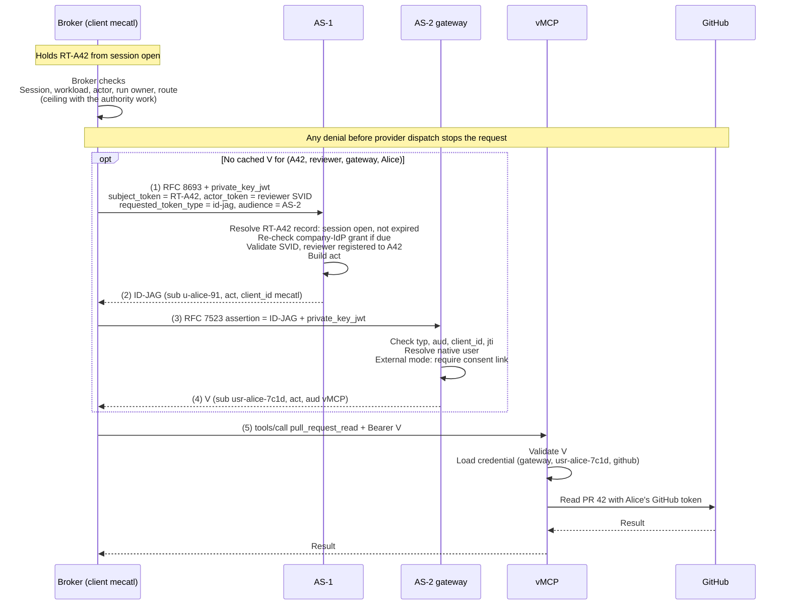

# MCP gateway modes

*This chapter describes the intended architecture, not current implementation status.*

Mecatl can reach protected MCP tools through a vMCP gateway in two ways. In **embedded mode**, the vMCP and its authorization server run inside the Mecatl deployment. In **external mode**, Mecatl points at an external gateway. Both modes use the same protocol, roles, and token formats; they differ in how AS-2 resolves and authorizes the user. Co-location does not create an isolation boundary.

This chapter covers the protocol between AS-1 and AS-2 and how the two modes differ. The full walkthrough, from Alice's sign-in through session open to the vMCP call, is in [credentials and lifecycle](credentials-and-lifecycle.md#interactive-execution).

## Who holds what

| | Embedded mode | External mode |
| --- | --- | --- |
| Broker authorization and audit | Mecatl | Mecatl |
| Agent-instance identities | Mecatl (separate agent issuer) | Mecatl (separate agent issuer) |
| Login and ID-JAG issuer (AS-1) | Mecatl, inside the broker | Mecatl, inside the broker |
| Gateway authorization server (AS-2) | Mecatl, separate issuer and key | Gateway operator |
| Provider credentials | Mecatl's gateway store, keyed by (gateway, native user, provider) | Gateway operator, keyed the same way |
| Trust in AS-1 | Local configuration; AS-1 is the SSO IdP AS-2 trusts | Gateway administrator registers AS-1 as an assertion issuer only |
| User consent | Implicit | One-time consent link at AS-2's own login |

The design works in two deployments: standalone Mecatl, with no Stacklok Enterprise Platform, Directory, or connector gateway, and enterprise deployments that integrate with them. Three roles are therefore pluggable: the **identity resolver**, which maps an AS-1 subject to a native user; the **consent store**; and the **credential store**. Standalone Mecatl provides local implementations, and enterprise deployments back them with Directory and the connector gateway. Nothing in the flow presumes Directory.

## Two authorization servers

Mecatl uses two authorization servers so that it can work with an MCP gateway it does not operate, such as the connector gateway in the Stacklok Enterprise Platform. That gateway holds users' provider connections, such as their GitHub or Google tokens, under its own administration, and its vMCP accepts only access tokens from the gateway's own authorization server; Mecatl can neither mint those tokens nor hold the credentials behind them. So AS-1, Mecatl's server, issues a grant naming the user and the acting agent, and AS-2, the gateway's server, verifies the grant, decides whether to honor it, and issues its own access token. When Mecatl runs the gateway itself (embedded mode), it uses the same two servers and the same protocol, so there is one code path; there the split is a protocol boundary rather than a security boundary, although the two servers still keep separate keys.

**AS-1** is Mecatl's login authorization server, running inside the broker. Alice signs in through AS-1, which redirects her to the company IdP as an ordinary OIDC client. Her client receives an AS-1 access token for the Mecatl API. At `OpenSession`, mecak8s passes that token to the broker once. The broker exchanges it at AS-1 with RFC 8693 for a session-bound broker refresh token, `RT-A42`. The [session-open step](credentials-and-lifecycle.md#3-session-open-and-the-broker-refresh-token) describes that exchange and the AS-1 record behind `RT-A42`.

**AS-2** is the gateway's authorization server. The vMCP accepts only access tokens AS-2 issued. On each MCP request, the vMCP validates the token and loads the user's provider credential.

Between them, per call and on a cache miss, the broker runs two steps:

1. It exchanges `RT-A42` at AS-1 (RFC 8693), with the agent-instance JWT-SVID as `actor_token`, and receives an **ID-JAG** ([draft-ietf-oauth-identity-assertion-authz-grant-04](https://datatracker.ietf.org/doc/draft-ietf-oauth-identity-assertion-authz-grant/)) addressed to AS-2.
2. It redeems the ID-JAG at AS-2 with the RFC 7523 JWT-bearer grant and receives the AS-2 access token `V`.

The broker authenticates at both servers as one OAuth client, `mecatl`, with `private_key_jwt`. ID-JAG §4.4.1 requires the ID-JAG's `client_id` to match the client that redeems it, so one client ID is used at both. `mecatl` is the broker's client registration, not an identity of the acting agent. The [broker client authentication step](credentials-and-lifecycle.md#5-broker-client-authentication) shows the client assertion.

AS-2 receives neither Alice's AS-1 access token, `RT-A42`, nor the SVID. It receives only the ID-JAG.

AS-1 and AS-2 have separate issuer identities, keys, and storage, also in embedded mode. ID-JAG §9.3 says the profile is intended for parties in different administrative domains, and that an IdP must not issue access tokens in response to an ID-JAG it issued itself in the same domain, because that could broaden authorization. External mode fits that scope. Embedded mode does not: AS-1, AS-2, and the credential store share one administrative domain, and separate keys do not create a boundary. See [embedded mode](#embedded-mode). The agent-instance issuer is a third identity role. RFC 8693 standardizes token-exchange input and output in [§§2.1 and 2.2.1](https://www.rfc-editor.org/rfc/rfc8693.html#section-2), token-type identifiers in [§3](https://www.rfc-editor.org/rfc/rfc8693.html#section-3), and `act` in [§4.1](https://www.rfc-editor.org/rfc/rfc8693.html#section-4.1). ID-JAG is a profile of [identity chaining across trust domains, revision 17](https://www.ietf.org/archive/id/draft-ietf-oauth-identity-chaining-17.html): it reuses that draft's exchange, RFC 7523 redemption, and no-refresh-token rule, and adds an explicit `typ`, required `client_id`, `jti`, `iat`, and `aud`, client-binding redemption checks, and security rules. Both are Internet-Drafts, not RFCs.

## Following one call

Alice, AS-1 subject `u-alice-91`, owns harness session `hostS42`. Her session is already open: the broker holds `RT-A42` for broker session `A42`. Her reviewer agent instance asks to read PR 42 in `acme/payments`. The broker checks the session, workload, actor, run owner, route, and, with the authority work, the effective ceiling. With no cached `V` for `(A42, reviewer, gateway, Alice)`, it exchanges `RT-A42` and the reviewer SVID at AS-1 for an ID-JAG, redeems the ID-JAG at AS-2 for `V`, and calls the vMCP. The gateway in this example is external, at `https://gateway.example.com`.



A cache hit skips steps (1) through (4), not the broker checks or the vMCP's own validation and credential lookup.

The broker checks run before any exchange. They establish that the session is open and bound to the authenticated workload, that the SVID names an instance registered to `A42`, and that the instance's effective ceiling allows this server and tool. They do not establish that AS-2 can resolve Alice or that a provider connection exists. AS-2 redeems only for a mapped user, and in external mode only for a linked one; the vMCP dispatches only with a stored credential for that user. No denial at the broker, AS-1, AS-2, or vMCP permits a provider call.

### (1) RFC 8693 token exchange at AS-1

The broker asks AS-1 for an ID-JAG. The subject token is the broker refresh token from session open, which ID-JAG §4.3 allows as `subject_token`. The actor token is the registered reviewer JWT-SVID. Neither token authenticates the client; the `private_key_jwt` assertion does.

```text
POST https://broker.example.com/as/oauth/token
grant_type=urn:ietf:params:oauth:grant-type:token-exchange
subject_token=RT-A42
subject_token_type=urn:ietf:params:oauth:token-type:refresh_token
actor_token=<REVIEWER_JWT_SVID>
actor_token_type=urn:ietf:params:oauth:token-type:jwt
requested_token_type=urn:ietf:params:oauth:token-type:id-jag
audience=https://gateway.example.com
client_id=mecatl
client_assertion_type=urn:ietf:params:oauth:client-assertion-type:jwt-bearer
client_assertion=<JWT signed with the broker's private key>
```

AS-1 checks:

- **The client.** The assertion verifies against `mecatl`'s registered key.
- **The subject token.** `RT-A42` resolves to its AS-1 record, is bound to `mecatl`, its session `A42` is open, and its hard expiry has not passed. The record supplies the subject `u-alice-91`; the broker cannot name a different user through this request. AS-1 runs in the same process as the broker core, so this guards against broker bugs, not against a compromised broker.
- **The upstream grant.** If the re-check interval has passed, AS-1 refreshes Alice's company-IdP grant first; see [upstream re-check](credentials-and-lifecycle.md#sign-out-and-revocation).
- **The actor.** AS-1 validates the SVID against the configured agent trust bundle, registered subject, `sub`, `aud`, and `exp`, and checks in the registry that the reviewer is registered to `A42`.
- **The target.** `gateway.example.com` is an allowed AS-2 for this client.

AS-1 authorizes the client, subject, actor, and target as one combination, not any set of valid signatures. Token validation alone does not prove agent registration, delegation, or run context; those depend on trusted lifecycle and request context.

AS-1 returns the ID-JAG in the standard token-exchange response ([RFC 8693 §2.2.1](https://www.rfc-editor.org/rfc/rfc8693.html#section-2.2.1)):

```json
{
  "access_token": "<ID_JAG>",
  "issued_token_type": "urn:ietf:params:oauth:token-type:id-jag",
  "token_type": "N_A",
  "expires_in": 120
}
```

Here `access_token` carries the grant for AS-2; it is not an access token the vMCP accepts. The broker holds it only until redemption. AS-1 never issues an access token for AS-2's audience.

### (2) The grant

```json
{"typ": "oauth-id-jag+jwt", "alg": "ES256", "kid": "as1-key-1"}
{
  "iss": "https://broker.example.com/as",
  "sub": "u-alice-91",
  "aud": "https://gateway.example.com",
  "client_id": "mecatl",
  "act": {"iss": "https://broker.example.com/as", "sub": "ag_7hq2x9"},
  "jti": "jag-pr42-001",
  "iat": 1800000001,
  "exp": 1800000121
}
```

This fictional decoded ID-JAG is not a usable credential. `iss` is AS-1 and `sub` is Alice's AS-1 subject, from the `RT-A42` record. `aud` is AS-2's issuer identifier. `client_id` names `mecatl`, the client that must redeem it.

`act` follows [RFC 8693 §4.1](https://www.rfc-editor.org/rfc/rfc8693.html#section-4.1) and names only the acting instance, the reviewer. It carries an opaque, stable, per-instance `ag_` identifier: no SPIFFE path and no definition name, so Mecatl's internal structure does not cross into the gateway's domain. `act.iss` is AS-1's issuer: it names who minted the `agent:` identifier, so the identifier stays attributable to AS-1 after AS-2 copies `act` into `V`. AS-1 derives the identifier from the validated reviewer SVID; the full SVID stops at AS-1. `act` has one level: it does not name main, which delegated the task. That delegation is recorded in Mecatl's harness and broker records. A nested `act` comes later, from a [chained exchange](mcp-authorization.md#chained-exchange) at delegation time.

`aud_sub` and `email`, both RECOMMENDED by ID-JAG §3.1, are deliberately omitted. AS-1 does not know AS-2's subject, and an email address is not an identity link. The ID-JAG carries no `sub_id` for AS-2 to resolve: a `sub_id` would be AS-1's claim about the company identity, not the IdP's (§9.5).

The ID-JAG's AS-1 issuer, AS-2 audience, and `typ` distinguish it from `V`. The vMCP validates its configured AS-2 issuer and resource audience and rejects the ID-JAG.

### (3) JWT-bearer grant at AS-2

The broker authenticates to AS-2 as `mecatl` with `private_key_jwt` and redeems the ID-JAG with the [RFC 7523 §2.1 JWT-bearer grant](https://www.rfc-editor.org/rfc/rfc7523.html#section-2.1):

```text
grant_type=urn:ietf:params:oauth:grant-type:jwt-bearer
assertion=<ID_JAG>
resource=https://gateway.example.com/mcp
client_id=mecatl
client_assertion_type=urn:ietf:params:oauth:client-assertion-type:jwt-bearer
client_assertion=<JWT signed with the broker's private key, aud = AS-2>
```

The `resource` value identifies the vMCP using [RFC 8707](https://www.rfc-editor.org/rfc/rfc8707.html). AS-2 checks, following ID-JAG §4.4.1: `typ` is `oauth-id-jag+jwt`; the signature verifies against the trusted AS-1 issuer's keys; `aud` is AS-2's own issuer; `client_id` matches the authenticated client `mecatl`; and the lifetime is current. It rejects a reused `jti` ([RFC 7523 §3](https://www.rfc-editor.org/rfc/rfc7523.html#section-3)), as Mecatl policy. It also applies its actor and resource policy. [RFC 7523 §3](https://www.rfc-editor.org/rfc/rfc7523.html#section-3) defines the base JWT-bearer validation.

AS-2 then resolves the native user. This is where the two modes differ:

| Mode | How AS-2 resolves and authorizes the user |
| --- | --- |
| Embedded | ID-JAG as specified. Users log in to AS-2 through AS-1, so AS-1 is the SSO IdP AS-2 trusts (§4.1) and the subject is the shared AS-1 `sub` (§5). `u-alice-91` maps directly to native user `usr-alice-7c1d`. Consent is implicit: AS-1, AS-2, and the credential store share one administrative domain. |
| External | Identity chaining across administrative domains ([chaining §§2.1, 2.5](https://www.ietf.org/archive/id/draft-ietf-oauth-identity-chaining-17.html#section-2.1)) using the ID-JAG token profile. AS-2's users log in through the gateway's own IdP, so the §4.1 precondition, that the resource AS already trusts the IdP for SSO, does not hold, and its consent waiver does not apply. AS-2 trusts AS-1 only as an assertion issuer. It redeems only when the ID-JAG's `(iss, sub)` and `client_id` match a consent link, which supplies the native user (chaining §2.2, deployment-specific resolution). No just-in-time provisioning. |

The external consent link records (native user, AS-1 issuer, AS-1 `sub`, client `mecatl`, grant time, and scope or providers). Alice creates it once per gateway, through AS-2's own login, by approving "Allow Mecatl" on a consent screen AS-2 generates. It is keyed on the AS-1 `sub` in the ID-JAG, never on a `sub_id` (§9.5). It stops a compromised AS-1 from using the gateway credentials of a user who never chose Mecatl. Admin pre-consent without an independent witness of the user is rejected for the same reason. The link's creation flow, the link-swap attack it must resist, and the shared-IdP shortcut are in the [implementation companion](implementation.md#external-consent-link). The gateway UI can revoke the link.

An unresolved or unlinked subject fails closed. AS-2 must not create an unlinked user as a side effect of lookup. Resolving the user does not establish that a provider connection exists; the vMCP's credential lookup remains a separate check.

### (4) Access token

```json
{"typ": "at+jwt", "alg": "RS256", "kid": "gateway-example-key-1"}
{
  "iss": "https://gateway.example.com",
  "sub": "usr-alice-7c1d",
  "aud": "https://gateway.example.com/mcp",
  "client_id": "mecatl",
  "act": {"iss": "https://broker.example.com/as", "sub": "ag_7hq2x9"},
  "iat": 1800000005,
  "exp": 1800000120,
  "jti": "access-pr42-001"
}
```

This fictional [RFC 9068](https://www.rfc-editor.org/rfc/rfc9068.html) JWT access token omits its signature. AS-2 issues its own `iss`, puts its native user ID in `sub`, and copies `act` unchanged. Its lifetime does not exceed the ID-JAG's. AS-2 issues no refresh token (ID-JAG §4.4.3); when `V` expires, the broker obtains a new ID-JAG from `RT-A42`. The broker caches `V` per session, instance, gateway, and user, and runs its checks before every use of a cached token.

### (5) Dispatch

The broker sends the checked `pull_request_read` request with `V` to the vMCP. The vMCP validates `V` against AS-2's keys, `typ`, audience, and expiry, applies its own operation policy, and loads the upstream credential keyed by **(gateway, native user, provider)**: here `(gateway.example.com, usr-alice-7c1d, github)`. GitHub sees Alice's GitHub token, not the ID-JAG, the SVID, or `V`. If no credential is stored, the vMCP answers "needs authorization" and the broker returns the existing `mcp_authorization_pending` outcome. The design does not claim that downstream credentials establish a backend-to-SaaS audit trail.

AS-1 issuance, AS-2 redemption, and vMCP authorization are separate decisions. Their audit references distinguish ID-JAG `jti` `jag-pr42-001` from access-token `jti` `access-pr42-001`, and neither replaces operation `op-pr42-001`. The broker propagates `op-pr42-001` with the MCP request, in its `_meta`, and the vMCP logs it as reported trace context; this is required for correlation. Audit requirements and evidence limits are described in [Audit](audit.md).

## Gateway administrator configuration

In external mode, the gateway administrator configures AS-2 with:

- AS-1's issuer and signing keys, trusted as an ID-JAG issuer only, not as an SSO IdP, for any subject AS-1 names; the mapping or consent link, not a list of subjects, decides who is redeemed;
- the `mecatl` OAuth client, with the broker's `jwks_uri` registered once for `private_key_jwt`;
- the consent-link flow and its revocation in the gateway UI;
- permitted actors and allowed vMCP resources;
- ID-JAG lifetime and `jti` replay handling.

Mecatl's operator configures AS-1 with the `mecatl` client, the accepted agent trust domain and audience, and the allowed AS-2 targets. Embedded mode uses the same roles and checks with local configuration, and AS-2 trusts AS-1 as its SSO IdP. Co-location does not create isolation.

## Sessions at the vMCP

Each agent instance has its own vMCP session (`Mcp-Session-Id`) for each user it acts for. The broker creates it on the instance's first MCP call and closes it when the instance ends, so backend state such as an open page or a selected repository carries across that instance's runs.

- Sessions are never shared between instances.
- The vMCP binds each session to the user and the acting instance: `V`'s `iss`, `sub`, and `act.sub`. A token naming another instance in its `act` cannot use the session.
- The run is not part of the session or token. The run ID travels in trace headers.
- The broker stores each session ID under the instance, gateway, and user, so a [shared session](run-owner.md) never hands one user's backend state to another. After a restart it reattaches. When the vMCP reports the session gone (idle timeout or eviction), the broker creates a new one. A wedged session can be reset explicitly.
- An instance has at most one active run at a time; Mecatl rejects a second concurrent run on the same session or child. Runs of one instance therefore never share a vMCP session concurrently. If that rule ever changes, session assignment must be revisited.

## Embedded mode

Embedded mode runs AS-1, AS-2, and the vMCP in one deployment. It uses the same ID-JAG exchange at AS-1 and RFC 7523 redemption at AS-2, with the same token formats, validation, and client authentication as external mode. Only AS-2's subject resolution differs: AS-1 is AS-2's SSO IdP, and consent is implicit. Implementations can co-locate protocol handlers or reuse them as libraries; the design does not require a separate network service or a private issuance interface. The two authorization servers keep separate issuer URLs, signing keys, and storage namespaces.

This keeps one protocol path for both modes. It does not add isolation: anyone who compromises the process holds both keys.

Embedded mode is outside the cross-domain scope that ID-JAG §9.3 states, because all three parties share one administrative domain. It reuses the ID-JAG format so both modes share one protocol, not to claim a trust boundary. The section's requirement still holds: AS-1 never issues an access token from its own ID-JAG, because AS-2 issues `V`. The scope broadening §9.3 guards against is bounded because AS-2 issues `V` only for the vMCP resource and issues no refresh token. Distinct issuers, audiences, and `typ` values keep the ID-JAG from being used as an AS-2 access token.

## Outside this chapter

- **Revocation.** Sign-out and account revocation are covered in [credentials and lifecycle](credentials-and-lifecycle.md#sign-out-and-revocation). Issued ID-JAGs and access tokens are not revoked; they expire.
- **Structured gateway outcomes.** How an external gateway reports "needs authorization" or "consent required" to the broker as a structured outcome remains open. So does whether the "Allow Mecatl" step and the provider's consent screen can be one redirect chain.
- **Gateway authorization on `act`**, such as Cedar policies that consider the acting agent. Until the agent ceiling is carried in the ID-JAG and `V` as scope or `authorization_details` (RFC 9396), the broker alone enforces it; the gateway enforces user and connection.

## Integration requirements and evidence limits

AS-1 must accept `RT-A42` as `subject_token` and the registered agent JWT-SVID as `actor_token` from client `mecatl` authenticated with `private_key_jwt`. It resolves the subject only from the refresh token's record, checks session state and hard expiry, re-checks the company-IdP grant when due, checks the actor's registration to the broker session, authorizes client, subject, actor, and AS-2 target together, and returns an ID-JAG whose single-level `act` holds the actor's opaque `ag_` identifier.

AS-2 must authenticate `mecatl`, validate the ID-JAG under ID-JAG §4.4.1, reject a reused `jti` (RFC 7523 §3), and resolve the native user: directly in embedded mode, and only through a consent link in external mode. It must issue an access token for the native user that preserves `act` and `client_id`, and no refresh token. Unresolved or unlinked subjects fail closed.

The vMCP must validate `V`, bind its session to the user and `act.sub`, and load provider credentials keyed by (gateway, native user, provider). Do not add a callback or response fields that expose AS-2's private native mappings to the broker. The design does not claim a backend-to-SaaS audit trail.

Embedded and external deployments implement the same protocol roles and token formats. Embedded wiring uses local configuration, separate issuer keys and storage namespaces, and implicit consent; external wiring uses gateway-administrator trust and the consent link. Co-location is not isolation.
