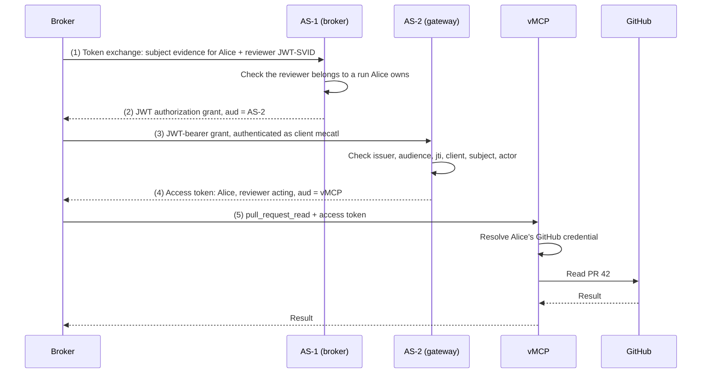

# MCP gateway modes

*This chapter describes the intended architecture, not current implementation status.*

Mecatl can reach protected MCP tools through a ToolHive vMCP gateway in two ways. In **embedded mode**, the vMCP and its authorization server run inside the Mecatl deployment. In **external mode**, Mecatl points at a gateway that someone else runs, such as an enterprise connector gateway. This chapter describes one protocol that works in both modes, so the broker's authorization and audit stay the same wherever the gateway runs.

## Who holds what

| | Embedded mode | External mode |
| --- | --- | --- |
| Broker authorization and audit | Mecatl | Mecatl |
| Agent-instance JWT-SVIDs | Mecatl (broker issuer) | Mecatl (broker issuer) |
| Grant issuer (AS-1) | Mecatl, inside the broker | Mecatl, inside the broker |
| Gateway authorization server (AS-2) | Mecatl, separate issuer and key | Gateway operator |
| Provider credentials (GitHub, Google) | Mecatl's AS-2 storage | Gateway operator |
| Trust in AS-1 | Local configuration | Gateway administrator's configuration |

## Two authorization servers

The vMCP accepts only access tokens issued by its own authorization server. It finds the user's provider credentials through that token, so whichever server holds Alice's GitHub token must also issue the token the vMCP accepts. That server is **AS-2**.

AS-2 cannot authenticate Mecatl's users or agents by itself: it does not know which agent instance is acting or which session it belongs to. That knowledge lives in the broker. So the broker runs a second authorization server, **AS-1**, whose only job is to vouch for "this user, with this agent acting" in a form AS-2 can verify.

The two servers do not share sessions or storage. AS-1 signs a short-lived grant addressed to AS-2, and AS-2 redeems it. This is [OAuth Identity and Authorization Chaining Across Domains](https://datatracker.ietf.org/doc/draft-ietf-oauth-identity-chaining/) (`draft-ietf-oauth-identity-chaining-17`): a token exchange at the first server produces a JWT authorization grant, and the client presents that grant to the second server with the RFC 7523 JWT-bearer grant.

## Following one call

Alice, identified by company issuer `https://login.example.com` and subject `alice-204`, asks Mecatl to read PR 42 in `acme/payments`. The broker has already authorized the reviewer's `pull_request_read` call (see [per-operation authorization](credentials-and-lifecycle.md#6-per-operation-authorization)). The gateway in this example is external, at `https://gateway.example.com`.



Steps (1) to (4) run only when the broker has no valid cached access token for this user, instance, and vMCP.

### (1) Token exchange at AS-1

The broker asks AS-1 for a grant addressed to AS-2. The decoded form parameters:

```text
grant_type=urn:ietf:params:oauth:grant-type:token-exchange
requested_token_type=urn:ietf:params:oauth:token-type:jwt
audience=https://gateway.example.com
subject_token=<evidence for Alice; see "Subject evidence">
subject_token_type=<depends on phase>
actor_token=<reviewer JWT-SVID from step (4) of the credentials walkthrough>
actor_token_type=urn:ietf:params:oauth:token-type:jwt
```

`audience` names AS-2, not the vMCP: the chaining draft (§2.3.1) uses it to identify the second authorization server. The vMCP resource appears in step (3).

Before issuing, AS-1 checks more than token validity. It confirms that the reviewer instance belongs to a run whose owner is the subject. A valid user token paired with an unrelated agent's credential is rejected (`actor_unauthorized` in `draft-mcguinness-oauth-actor-profile-01` §6.6.2).

The broker issued the reviewer's JWT-SVID and presents it to its own AS-1. The actor in the grant therefore rests on the broker's records, not on independent evidence.

### (2) The grant

```json
{
  "iss": "https://broker.example.com/as",
  "sub": "alice-204",
  "sub_id": {
    "format": "iss_sub",
    "iss": "https://login.example.com",
    "sub": "alice-204"
  },
  "aud": "https://gateway.example.com",
  "client_id": "mecatl",
  "act": {
    "iss": "spiffe://agents.example.com",
    "sub": "spiffe://agents.example.com/mecatl/agent/system/main/inst/inc_cejrv7re4uy3ubxyzj2gfxfp2u/child/project/code-reviewer/inst/inc_gh56irfcpnupjqgfdw7dhzzw4m"
  },
  "jti": "grant-pr42-001",
  "iat": 1800000000,
  "exp": 1800000120
}
```

The grant is a plain JWT, as in the chaining draft's own example. Neither the draft nor RFC 7523 defines a `typ` value for it. It cannot be confused with an access token: its issuer is AS-1 and its audience is AS-2, so the vMCP rejects it, and the vMCP accepts only `at+jwt` tokens (RFC 9068).

- `sub_id` (RFC 9493) states the company identity as an issuer and subject pair. AS-2 resolves the user from it, never from `sub` alone. RFC 9493 allows these members to differ from the grant's own `iss` and `sub`, as long as both name the same user.
- `client_id` is Mecatl's client identifier at AS-2, which may differ from its identifier at the company IdP. The claim and its check come from ID-JAG (§3.1, §4.4.1): AS-2 must match it against the authenticated client.
- `act` (RFC 8693) names the reviewer instance. `act.iss` is the SPIFFE trust domain, because JWT-SVIDs carry no `iss` (actor-profile §6.4).
- The grant lives for two minutes and can be redeemed once.

### (3) JWT-bearer grant at AS-2

```text
grant_type=urn:ietf:params:oauth:grant-type:jwt-bearer
assertion=<grant from (2)>
resource=https://gateway.example.com/mcp
```

The broker authenticates to AS-2 as client `mecatl`, for example with `private_key_jwt`. AS-2 checks:

- the grant's issuer is a trusted AS-1, with its key pinned or fetched from AS-1's configured `jwks_uri`
- `aud` is AS-2, and `exp - iat` is at most 300 seconds
- `jti` has not been seen before, using a replay store shared by all AS-2 replicas
- `client_id` matches the authenticated client
- `sub_id` resolves to an existing, active user, through the same directory lookup that the company SSO login uses
- `act.iss` and `act.sub` match the actor allowlist configured for AS-1

### (4) Access token

```json
{
  "typ": "at+jwt",
  "iss": "https://gateway.example.com",
  "sub": "usr-alice-7c1d",
  "aud": "https://gateway.example.com/mcp",
  "client_id": "mecatl",
  "act": {
    "iss": "spiffe://agents.example.com",
    "sub": "spiffe://agents.example.com/mecatl/agent/system/main/inst/inc_cejrv7re4uy3ubxyzj2gfxfp2u/child/project/code-reviewer/inst/inc_gh56irfcpnupjqgfdw7dhzzw4m"
  },
  "iat": 1800000005,
  "exp": 1800000120
}
```

`typ` is shown in the payload for readability; it belongs in the JOSE header. `sub` is AS-2's own identifier for Alice, the same one her enrollment produced. AS-2 issues no refresh token (chaining §5.4), and the access token expires no later than the grant. The broker caches it per user, instance, and vMCP. Where the vMCP verifies DPoP (RFC 9449), the token is bound to a broker key.

### (5) Dispatch

The broker sends `pull_request_read` with the access token. The vMCP validates it, looks up Alice's GitHub credential by user, and injects it into the backend request. GitHub sees Alice's account. The access token records which agent acted, and the broker's audit record holds the rest of the story.

## Subject evidence

AS-2 trusts AS-1's word about which user is acting. The evidence AS-1 requires determines what the gateway administrator is trusting.

**Stepping stone (A2).** AS-1 trusts the session owner that mecak8s verified, presented as a JWT that the mecak8s workload signs. No company token is involved. A compromised Mecatl could act as any user that AS-2's policy allows. This phase exists only to bring the chain up before A1, and requires the AS-2 checks below.

**Target (A1).** The broker holds Alice's company refresh token, uses it only at the company IdP, and presents one of the following to AS-1:

- an access token from the company IdP with `aud` set to AS-1, where the IdP can issue one (preferred)
- a fresh ID token whose `aud` is Mecatl's client identifier (fallback)

AS-1 validates it against the company IdP. A user deactivated at the IdP can no longer refresh, so AS-1 stops issuing grants for them. The broker never sends a company access token addressed to another audience, or the refresh token itself, to AS-1.

## What the gateway administrator configures

In external mode, the administrator decides how much to trust AS-1:

- AS-1's issuer and `jwks_uri`, or pinned keys
- the Mecatl client registration and its authentication method
- the company issuers and users AS-1 may assert, and the actor prefix it may assert, such as `spiffe://agents.example.com/mecatl/*`
- the vMCP resources Mecatl may request
- rate limits per user and per actor
- a switch to revoke trust in AS-1

Every redemption is audited at AS-2 with `jti`, the resolved user, `act`, `client_id`, `resource`, and the decision.

## Why identity chaining and not ID-JAG

The [Identity Assertion JWT Authorization Grant](https://datatracker.ietf.org/doc/draft-ietf-oauth-identity-assertion-authz-grant/) (ID-JAG, "Cross App Access") has the same message shape, but `-04` requires three things AS-1 cannot provide:

- the grant's issuer must be the IdP that AS-2 already trusts for SSO (§4.1)
- the `subject_token` must have been issued by that IdP (§4.3)
- `sub` must be in the issuer's namespace (§3.1)

AS-2 logs users in through the company IdP, not through AS-1. The chaining draft has none of these constraints and allows the first server to add or transcribe claims (§2.3.2, §2.5), which covers `act` and `sub_id`.

A company IdP that issues ID-JAGs can later serve as a second, parallel path for calls that only need the user's identity. Okta's documented implementation does not name the acting agent and limits ID-JAG volume per user, so it does not replace AS-1.

## Sessions at the vMCP

Each agent instance has its own vMCP session (`Mcp-Session-Id`). The broker creates it on the instance's first MCP call and closes it when the instance ends, so backend state such as an open page or a selected repository carries across that instance's runs.

- Sessions are never shared between instances.
- The vMCP binds each session to the user and the acting instance (`iss`, `sub`, `act.iss`, `act.sub`). A token naming another instance cannot use the session.
- The run is not part of the session or token. The run ID travels in trace headers.
- The broker stores each instance's session ID. After a restart it reattaches. When the vMCP reports the session gone (idle timeout or eviction), the broker creates a new one. A wedged session can be reset explicitly.
- An instance has at most one active run at a time; Mecatl rejects a second concurrent run on the same session or child. Runs of one instance therefore never share a vMCP session concurrently. If that rule ever changes, session assignment must be revisited.

## Embedded mode

Embedded mode runs AS-1, AS-2, and the vMCP in one deployment and uses the same messages over loopback. The two authorization servers keep separate issuer URLs, signing keys, and storage namespaces, and AS-2 trusts AS-1 through local configuration.

This keeps one code path for both modes. It does not add isolation: anyone who compromises the process holds both keys. Distinct issuers and audiences are what keep a grant from being used as an access token.

## Outside this chapter

- **Missing provider connections.** In external mode, the gateway is the only party that knows Alice has not connected GitHub. How it reports that, and how the broker shows Alice a connection link, is a separate design.
- **Revocation** beyond short lifetimes and IdP refresh failure.
- **Gateway authorization on `act`**, such as Cedar policies that consider the acting agent.

## Required ToolHive changes

- AS-1: token exchange that issues a JWT grant for another authorization server, accepting a SPIFFE JWT-SVID as `actor_token`.
- AS-2: a per-issuer policy on the JWT-bearer grant path for chaining grants, with real client authentication, `client_id` binding, single-use `jti`, and `act` preserved and validated.
- AS-2: resolve grant subjects from `sub_id` through the same user directory as SSO login, replacing the `issuer#subject` form and the exact `subject_bindings` list.
- vMCP: find provider credentials by user, gated by grant issuer, client, resource, and provider, not by `sub` alone. Tokens that carry `act` must still be able to receive provider credentials.
- vMCP: include the acting instance in the session binding.
- Connector gateway: expose trusted-issuer and inbound-grant configuration.
- Two authorization servers in one process: separate storage prefixes and persistent keys.

## Pending changes to credentials and lifecycle

The [credentials and lifecycle](credentials-and-lifecycle.md) walkthrough still describes a single ToolHive authorization server, with the broker holding a ToolHive user grant. It needs these changes to match this chapter:

- **Instance credential audience.** The intro and step (4) give the JWT-SVID two audiences, the broker and the ToolHive token endpoint. It needs only the broker's, because AS-1 runs inside the broker.
- **Sequence diagram and legend.** The single exchange at ToolHive AS becomes the two hops in [following one call](#following-one-call): a token exchange at AS-1, then a JWT-bearer grant at AS-2. Both run only when no cached access token is valid.
- **Step (5), enrollment.** Alice enrolls at AS-2 through company SSO. AS-2 links the grant to her by resolving `sub_id` through the same directory lookup, which settles the association that step (5) leaves open. The broker no longer holds a ToolHive user grant.
- **Step (7).** It becomes a short version of the two hops and the access token, which now carries `act.iss` and `client_id=mecatl`. Grant details link here rather than being repeated.
- **Step (8).** Only the example values for the OAuth client and token issuer change.
- **Credential roles, custody, and lifetimes.** The ToolHive user grant role and its refresh path go away. They are replaced by subject evidence (see [subject evidence](#subject-evidence)) and the chaining grant. AS-2 issues no refresh token; the broker requests a new grant instead.
- **Retained login tokens (open decision).** Step (1) and scheduled runs say human login tokens are not retained. Under A1, the broker keeps the company refresh token in custody and uses it only at the company IdP. That principle needs rewording, or A1 needs revisiting.
