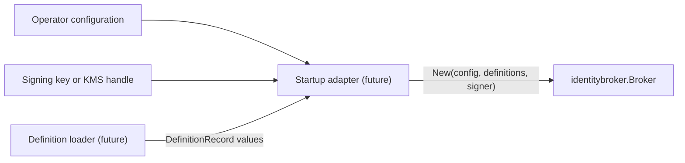

# Identity broker startup foundation

This work record describes the first implemented piece of the agent identity
broker: [`internal/identitybroker`](../../internal/identitybroker/broker.go), an
in-process core that validates its startup inputs and holds them as an immutable
snapshot. It is the starting point for the broker proposed in the
[agent identity and authority design](https://github.com/stacklok/mecatl/pull/2121)
(PR #2121, under review). That design, not this page, describes the target
architecture; this page records what the code does today and why.

## What is implemented

`identitybroker.New(config, definitions, signer)` performs the first three
startup steps and returns a `*Broker` or an error:

1. It validates the identity configuration and the signing capability.
2. It validates the already-loaded definition records and builds a snapshot
   keyed by definition reference.
3. It returns a broker holding that snapshot, ready for instance registration
   to be added.

The broker exposes one read operation, `Definition(ref)`, which returns a copy
of a loaded record. It gives callers outside the package, such as mecak8s
lifecycle code that names a session's definitions to the broker by reference, a
way to check that a reference was loaded without exposing the snapshot itself.

Nothing calls the package yet. It has no transport, persistence, or logging,
and it is not wired into mecak8s, mecated, or any other binary.

## What the package owns

PR #2121 uses "identity broker" for the whole trusted component: Mecatl's
existing MCP broker, extended with a definition loader, an agent-instance
issuer, AS-1, and the broker core. Despite its name, this package covers one
part of that component, the agent-instance issuer, together with the loaded
definitions that issuer checks registrations against. Its configuration
reflects that: the trust domain prefixes agent SPIFFE IDs, the audiences and
lifetime shape agent JWT-SVIDs, and the signer is the issuer's own key.

| Belongs here, now or later | Belongs elsewhere |
| --- | --- |
| Loaded definition records (implemented) | Loading definitions from sources: the definition loader |
| Instance registration: incarnation, definition reference, creation parent, and session | MCP invocation, routing, and gateway tokens: the broker core in `internal/mcpbroker` |
| Constructing agent SPIFFE IDs and enforcing their name grammar | Sign-in, session conversion, and ID-JAG issuance: AS-1, a ToolHive authorization server |
| Signing and renewing agent JWT-SVIDs | Workload authentication: the transport adapter, before it calls this package |
| Publishing the public keys that verify agent JWT-SVIDs | Cedar policy evaluation and audit storage |

Two responsibilities are not yet placed. Both the broker core and AS-1 verify
agent JWT-SVIDs, so a shared verification function could live here or each
verifier could implement the checks itself. The authority work computes each
instance's effective ceiling once, at registration, which suggests storing it
here, while per-call Cedar evaluation belongs to the broker core.

## Vocabulary

The design distinguishes several identities that are easy to conflate. Only the
first exists in code.

| Term | Meaning | In this package |
| --- | --- | --- |
| Definition | A kind of agent, identified by source, name, and selected revision. | `DefinitionRef` and `DefinitionRecord` |
| Instance | One use of a definition, with a durable incarnation allocated by the harness. | Not yet |
| Host session | The harness's persisted context for one instance. | Never; it stays in Mecatl |
| Broker session | The broker's session for one host session tree, opened once at the root. | Not yet |
| Credential | A short-lived agent-instance credential the broker signs. | Configuration and signer only |

A definition grants no identity by itself. Loading `project/code-reviewer`
creates no reviewer; an instance appears only when the harness creates one and
registers it under a definition reference. The
[domain model](../architecture/domain-model.md) describes the harness side of
sessions and agents.

## Definition records and AgentDef

The existing [`AgentDef`](../../engine/tool/agentsource.go) combines naming,
instructions, model selection, tool configuration, and execution budgets. It has
no source identifier or revision, and its `Origin` field is an admission-tier
label, not a locator.

`DefinitionRecord` carries what the identity core needs and nothing the harness
needs to execute an agent:

- `DefinitionRef` names the configured source, the definition name, and the
  source's own revision identifier, such as a Git commit.
- `Provenance` names a profile, such as `git/v1`, profile-specific metadata, and
  two SHA-256 digests: one of the bytes read from the source and one of the
  normalized definition the loader accepted.

Revisions and digests answer different questions. A revision says which version
the source claims to have served; a digest says which bytes were read or
accepted. A commit plus a digest does not prove the bytes came from that commit,
which is why they are separate fields and neither substitutes for the other.

The package does not parse `AgentDef` files and does not copy instructions, tool
lists, budgets, or hooks into its records. In the proposed architecture the
definition loader reads the configured sources at broker startup, gives the
harness execution configuration, and gives this package its records as plain
values, so loading can change without touching it.

## Why the core has no Mecatl dependencies

Production code in the package imports only the Go standard library, enforced by
the `internal-identitybroker` depguard rule in [`.golangci.yml`](../../.golangci.yml).
It also denies `os`, `net`, `log`, `syscall`, `crypto/tls`, and `plugin`, each
with all of its subpackages, so file, environment, process, network, and logging
access stay in adapters. The rule lists only parent packages because depguard
checks an import against the nearest deny entry that sorts before it: an entry
for `os/exec` would let `os/user` through.

The design plans to move the broker from mecak8s into its own service. A core
that imported `engine/session`, `engine/tool`, or generated contracts would
couple the broker's trust decisions to the harness it is meant to check, and
would make that move a redesign. Keeping the core free of I/O also keeps its
tests offline and deterministic, and leaves every side effect visible in the
adapter that performs it.

## Startup flow and ownership



The caller owns resolution: reading configuration files, obtaining a key,
discovering sources, and loading definitions. The broker owns validated copies.
`New` copies the configuration's audience slice and every record's metadata map
before validating, so the values it checks are the values it keeps, and later
caller changes cannot reach the snapshot. `Definition` returns a fresh copy for
the same reason.

The signer is a capability, not data. A raw `*ecdsa.PrivateKey` is copied,
because it is caller-owned memory. Any other `crypto.Signer`, such as a KMS
handle, is retained as supplied, because sharing the handle is the point.

## Validation

All validation happens in `New`, in a fixed order: configuration, signer, then
records in input order. The first failure is returned.

**Configuration.** The trust domain must follow the SPIFFE-ID trust domain
grammar without the `spiffe://` scheme. At least one audience is required, and
audiences must be unique printable text without spaces. The credential lifetime must
be positive and at most `MaxCredentialLifetime`, one hour. A JWT-SVID is a
bearer token, and the [specification](https://github.com/spiffe/spiffe/blob/main/standards/JWT-SVID.md#33-expiration-time)
encourages validity periods as short as practical without setting a limit; the
cap bounds how long a stolen credential stays usable and rejects unit mistakes.
It is an interim choice, and PR #2121 does not set a value.

**Signer.** The signer's public key must be an ECDSA P-256 key, for ES256
signatures. Agent credentials are planned as JWT-SVIDs, and the
[JWT-SVID specification](https://github.com/spiffe/spiffe/blob/main/standards/JWT-SVID.md#21-algorithm)
permits only RSA and ECDSA algorithms; validators must reject anything else,
which rules out Ed25519. P-256 is the smallest permitted key and is widely
available in key services. Other algorithms are rejected until a use for them
exists. Accepting a `crypto.Signer` rather than key bytes follows the design's
"one key per role behind a signer interface" constraint, so a file, a Kubernetes
Secret, or a key service can supply the key without changing this package. `New`
checks the key type but does not sign a probe message. For a raw key it rejects
missing fields and a stored public key that does not match the private key. A
signer that panics while reporting its public key, such as a typed nil pointer,
is rejected with an error.

**Records.** Sources and names must match `[A-Za-z0-9._-]+` and must not be `.`
or `..`, because both are expected to appear in SPIFFE paths. Invalid values are
rejected, never rewritten. Revisions, profiles, and metadata keys are opaque but
must be non-empty printable text without spaces, which excludes control
characters and invisible format characters such as zero-width spaces, so two
values that look the same compare the same. Metadata values must be valid UTF-8.
Source and name lengths are not yet bounded; a bound that keeps agent SPIFFE IDs
within the 2048-byte limit belongs with SPIFFE ID construction. Digests must use
`sha256` with a lowercase hexadecimal value, so that comparing two digests by
value compares the digests themselves.

## Duplicates and equality

Two references are equal when source, name, and revision are byte-identical.
`project/code-reviewer` and `admin/code-reviewer` are therefore different
definitions, as are two revisions of the same definition. Holding several
revisions is allowed, because which revisions to load is the loader's decision;
see [restoring sessions after a definition changes](#restoring-sessions-after-a-definition-changes).

A record that repeats a reference with identical provenance collapses into one
snapshot entry; loaders that merge overlapping sources produce these routinely.
A record that repeats a reference with any provenance difference is rejected as
a conflict: two different contents claiming the same revision is exactly the
substitution the design exists to prevent. Nil and empty metadata are treated as
identical.

## Errors

Every error from `New` wraps exactly one sentinel: `ErrInvalidConfig`,
`ErrInvalidSigner`, `ErrInvalidDefinition`, or `ErrConflictingDefinition`. A
transport adapter can map them with `errors.Is`, for example to gRPC
`InvalidArgument` or `FailedPrecondition`. Messages name the offending field or
record index and contain no key material.

## How adapters will wrap the package

A startup adapter in a binary such as mecak8s will read operator settings, open
the signing key, run the definition loader, and call `New`. A gRPC adapter will
hold the returned broker and translate requests into method calls. The sketch
below is illustrative only; neither the RPC nor the registration method exists.

```go
// Illustrative; not an implemented contract.
func (s *server) RegisterInstance(ctx context.Context, req *pb.RegisterInstanceRequest) (*pb.RegisterInstanceResponse, error) {
	caller, err := s.authenticateWorkload(ctx)
	if err != nil {
		return nil, status.Error(codes.Unauthenticated, "workload authentication failed")
	}
	inst, err := s.broker.RegisterInstance(caller, toInstanceRequest(req))
	if err != nil {
		return nil, mapBrokerError(err)
	}
	return toResponse(inst), nil
}
```

The modulith constraint in the design applies here too: an in-process caller
must go through the same contract and checks as a remote one, so the gRPC
adapter is a translation layer, not a place for additional policy.

## Future work

The following are designed in PR #2121 but not implemented here, and the package
contains no interfaces or placeholders for them:

- instance registration, incarnations, creation-parent links, and broker sessions;
- credential issuance, a token format, verification, renewal, and key rotation;
- operator-approved provenance profiles and verification of provenance facts;
- authority ceilings, Cedar policy, and per-call authorization;
- persistence, audit records, and recovery after restart;
- the definition loader, startup and gRPC adapters, and mecak8s lifecycle
  integration;
- key-service signers (KMS, Vault, or an HSM) behind `crypto.Signer`. A file or
  Kubernetes Secret key needs no adapter. A key-service adapter should check at
  startup that its key matches the public key it reports, and the chosen service
  must support ECDSA P-256 signing.

The smallest next step is instance registration: an in-memory method that
accepts a definition reference, an incarnation, and an optional parent, checks
the reference against the snapshot, and records the instance. It needs a mutex
and its own validation, and it remains useful before any credential exists.

### Restoring sessions after a definition changes

PR #2121 requires a session to keep the definition revision it selected, and to
fail closed on restoration if that revision cannot be recovered. It does not say
whether the startup snapshot keeps older revisions. If the broker restarts after
a source moves from revision A to revision B and loads only B, a session pinned
to A cannot be restored from the snapshot.

The proposed answer keeps two kinds of state apart:

| State | Holds | Answers |
| --- | --- | --- |
| Startup snapshot | Whatever the loader supplies now | What can a new session select? |
| Session and instance records | A copy of each definition record a session selected or an instance uses | What did this session pin, and what is each instance? |

Restoration reads the session and instance records, never the snapshot, so a
source change cannot make a pinned revision disappear. The PR already places
provenance and the effective ceiling in the per-instance registration record;
this extends the same idea to the session's selection, which covers a pinned
definition that had no instance yet when the broker restarted.

The work falls into existing steps:

- The snapshot needs no change. It holds whatever revisions the loader supplies,
  keyed by the full reference, and imposes no retention policy.
- Instance registration copies the full definition record into the instance
  record instead of keeping only the reference.
- Persistence stores session selections and instance records so they survive a
  restart.

Restricting the snapshot to one revision per source and name was rejected,
because it would make restoration fail by design whenever a source changes.
