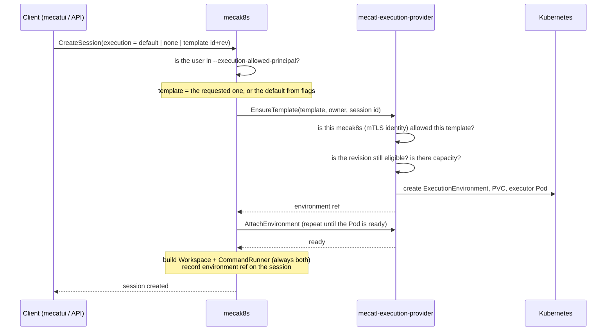
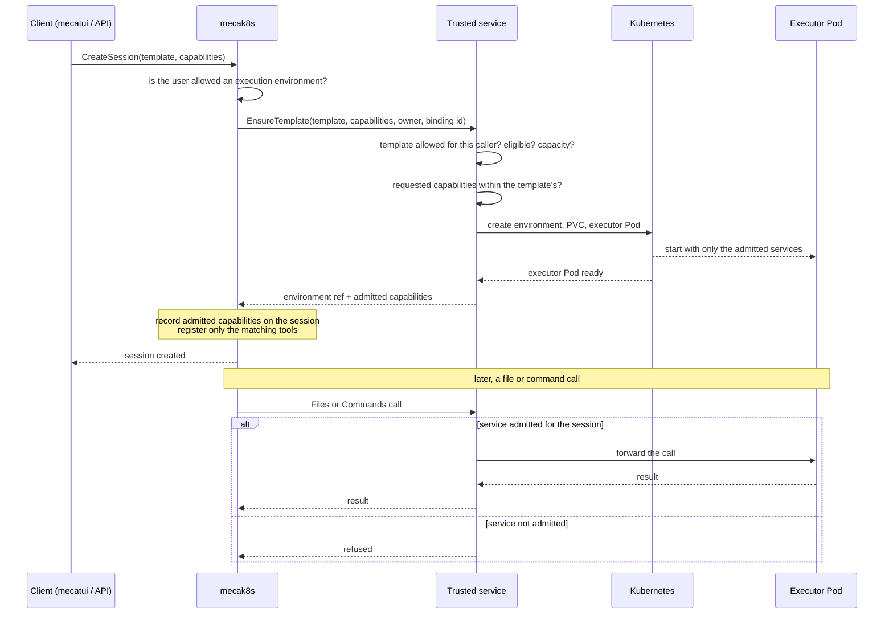

# Admission and session binding

*This chapter describes the intended design, not current implementation status.*

When a client creates a session, Mecatl decides whether the session may have an execution environment, which template
it uses, and which capabilities it gets: file access, `Shell`, or both. This chapter describes how the agent loop
requests those capabilities, how the trusted service admits them, and how the session is bound to its environment.

## How it works today

A session's environment is decided in two places. When the client creates the session, it can name the template it wants
in `CreateSessionRequest.execution`; if it does not, mecak8s falls back to the default template configured in its flags.
Before going further, mecak8s makes sure the user is one of the principals allowed to have an execution environment at
all. It then hands the request to the provider, which decides whether that particular mecak8s may use the template,
whether the template revision is still eligible rather than [deprecated or revoked][template-policy], and whether the
template has room for another environment. Only when all of that holds does the provider create the environment.

mecak8s generates the session ID before it calls `EnsureTemplate` and passes it as the binding ID. The provider keys
the allocation by caller, owner, and binding ID, so a retried `EnsureTemplate` returns the same environment instead of
creating a second one. The environment also records which bindings refer to it, and every later call carries the
binding ID.

Capabilities play no part in this flow. Every template reports files and commands, nothing requests or enforces them,
and the agent loop always attaches both a workspace and a command runner. The session's reported capabilities are
derived afterwards from the tools that happen to be registered.

## Capabilities

A capability is a kind of access an execution environment provides to the agent loop. Two exist:

- `filesystem`: the file service and the file tools;
- `foreground-command`: the command service and `Shell`.

These are the names templates already report today.

Capabilities are declared in two places, and admission combines them:

- **The template declares the maximum.** Each template revision lists the capabilities its environments can provide.
  The list is part of the template definition, so changing it creates a new revision.
- **The session requests a subset.** The session-creation request lists the capabilities the session needs. If the
  request lists none, the session requests every capability its template declares.

Admission succeeds only if every requested capability is declared by the template and allowed by the caller's policy.
The admitted set is fixed for the session: adding `Shell` to a running session needs a separate transition contract or
a new session.

This lets a session without `Shell` use the same template, image, and resources as one with it, instead of requiring a
separate template for every combination.

The first implementation admits only sessions with both capabilities. The request field exists from the start, so
file-only sessions can be added later without changing the API.

## The new flow

The request carries the requested capabilities through each step, and each component enforces the admitted set:

1. The client lists the capabilities it needs in `CreateSessionRequest`, or omits them.
2. mecak8s checks that the user may have an execution environment, as today, and passes the requested capabilities to
   the trusted service with the template and binding ID.
3. The trusted service checks the template and the caller's policy as today, checks the requested capabilities against
   the template's declared capabilities, and records the admitted set on the environment.
4. The trusted service creates the environment and starts the executor with only the admitted services enabled; the
   [executor protocol](executor-protocol.md#the-server) describes the per-service switches.
5. Once the executor Pod is ready, the trusted service returns the environment reference and the admitted set.
6. mecak8s records the admitted set on the session and registers only the matching tools. Without `foreground-command`
   it registers no `Shell` tool and attaches no command runner.

On every later file or command call, the trusted service forwards the call to the executor only if the session was
admitted for that service, and refuses it otherwise, so a misbehaving agent loop cannot reach the command service of a
file-only environment.

## What the session records

The session already records its environment reference and, for an explicitly selected template, the template ID and
revision. It also gains the admitted capabilities. Today the session's `ExecutionCapabilities` is derived from the
registered tools and is reporting only; after this change it records what admission granted.

Resuming a session reattaches the recorded environment and uses the recorded capabilities; it does not re-run
admission against the current template.

Successors created by `/clear` and fork request the source session's capabilities and template, but they are not
admitted automatically. Today both share the source environment, so no new environment is created. In the proposed
design, `/clear` binds a fresh environment and fork clones the source's storage (see the
[open questions](implementation.md#open-questions)); either way the successor needs a new environment and goes through
admission again, including the template's capacity check. A successor can therefore be refused when the template has
no capacity left, even though its source session is running.

## API changes

- `CreateSessionRequest` gains a list of requested capabilities.
- `EnsureTemplateRequest` gains the same list, and its response returns the admitted set.
- The template definition gains a capabilities field, which replaces the hard-coded list templates report today.

These change remote-observable APIs and need the
[wire API compatibility assessment](../../architecture/api-surface.md#wire-api-compatibility). Because the request field
is optional and an empty list means the template's full set, existing clients keep today's behavior.

## Open questions

- **Caller policy.** Whether the trusted service's per-caller policy restricts capabilities, in addition to templates.
- **Capability transitions.** Whether a running session can ever gain or lose a capability, and how.

[template-policy]: ../../../user-docs/features/security-and-execution/execution-environments.md#template-policy
