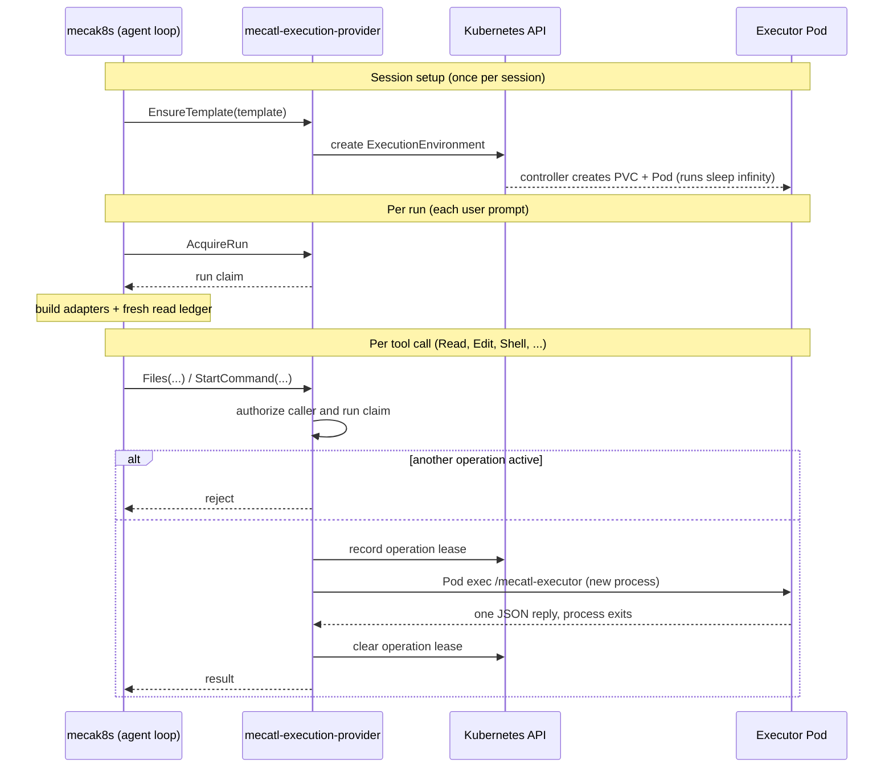

# Implementation

This companion records the gap analysis between the [Kubernetes execution design](README.md) and the native Kubernetes
provider on `main` at `15672f00a316`, the decisions taken from it, and existing mechanisms the implementation must
account for. It is not a claim about behavior beyond what was reviewed.

## Current system

All three components of the design already exist in a first form:

| Component | Today | Main code |
| --- | --- | --- |
| Agent loop | mecak8s with `--execution-enabled` | `internal/adapter/executionclient` |
| Trusted service | `mecatl-execution-provider` (the provider), today's implementation of the trusted service, serving `ExecutionProviderService` over mTLS gRPC | `internal/adapter/executioncontroller`, `internal/executionenv` |
| Executor | `mecatl-executor`, started inside the executor Pod for each operation | `internal/executionexecutor`, `internal/adapter/osfs` |

The contract between the loop and the trusted service is `contracts/proto/mecatl/execution/v1/execution.proto`. The
contract between the trusted service and the executor is a private JSON envelope over Kubernetes Pod exec.

## How a tool call flows today

The Pod exec transport ties each operation's lifetime to the provider's exec connection, and the executor keeps no
state between operations. Several mechanisms below exist only to compensate for that.

## Gaps by component

### Agent loop

Already in place: file tools and `Shell` use remote `Workspace` and `CommandRunner` adapters over gRPC, and the loop Pod
mounts no workspace. Reattachment requires an exact `EnvironmentRef` match and fails closed. Each call carries the full
request context, gRPC retries are disabled, and a command with an unknown outcome is not retried. Project instructions
are not loaded under remote execution, so the execution template cannot change the agent's instructions.

The agent loop still lacks the following:

- **Read ledger scope.** The remote adapter builds a fresh [ledger][workspace-contract] after every `AcquireRun`, so the
  ledger lasts one run: one user prompt and every turn until the agent answers. The agent must re-read every file before
  editing it on each prompt. Locally the ledger lasts for the session binding (`internal/app/placement.go`). The ledger
  only enforces read-before-edit; the executor's conditional replacement still rejects stale writes, so a session-scoped
  ledger is safe.
- **Capabilities.** `ExecutionCapabilities` is filled in after binding from what the environment offers; it is never
  requested or admitted. `Shell` is always attached. File-only operation exists only as the deployment-wide
  `--no-shell` flag, which Helm values cannot express.
- **Foreground-only commands.** `StartCommand` holds one call open until the command finishes and returns buffered
  output. There is no streaming, no background job, and no way to query a command after the connection drops.

### Trusted service

Already in place: retained storage (the PVC has no owner reference, a recorded PVC that disappears is never replaced,
and deletion is a separate operation checked against the PVC UID), executor replacement with epoch fencing, and
credential isolation (no ServiceAccount token in the executor Pod, deny-all egress by default, minimal command
environment).

The provider still lacks the following:

- **Admission.** Admission is a per-caller [template][template-config] allowlist checked by `EnsureTemplate`. Templates
  have no capabilities field: capabilities are hard-coded to files and commands, and `StartCommand` checks none.
- **One operation per environment.** The store rejects any operation, reads included, while another is active, using a
  lease in the `ExecutionEnvironment` status. The design's visibility requirement does not depend on this: file tools
  and shell programs see the same files because they use one filesystem. The lease exists for the Pod exec model; see
  [Kubernetes API writes](#kubernetes-api-writes).
- **Withdrawal.** [Revocation][revocation] and policy changes take effect when the provider dispatches or renews an
  operation. If the provider crashes, a running command continues until its timeout because nothing stops it at the
  executor.

### Executor

Already in place: the full `Workspace` contract runs inside the executor on `osfs` rooted at `/workspace`, including
create-only writes and conditional replacement, plus rename, list, remove, and copy. Commands run through `/bin/sh -c`
in their own process group, as a non-root user with a read-only root filesystem and all capabilities dropped; the
executor becomes a child subreaper and kills every descendant when a command ends.

The executor still lacks the following:

- **No server.** The Pod runs `sleep infinity`; each operation starts a new `/mecatl-executor` process through Pod exec.
  `osfs`'s per-path lock therefore lasts one operation, there is no streaming, and nothing outlives a command.
- **No Shell switch.** The executor always enables command execution.
- **Durability.** `osfs` replaces files in place without `fsync`, so a crash during replacement can leave a torn file.
  Durability is an executor implementation choice; see [live files and recovery](README.md#live-files-and-recovery).

## Kubernetes API writes

Every write is a read followed by `UpdateStatus` on the session's `ExecutionEnvironment`, retried on conflict.

| Frequency | Writes | Target design |
| --- | --- | --- |
| Every tool call | Set the operation lease, renew it every 10 seconds while the operation runs, clear it; plus the Pod exec call itself | None. The executor server tracks its own in-flight operations. |
| Every run | `AcquireRun`, periodic `RenewRun`, `ReleaseRun` | Probably kept: the claim carries the epoch and grant generation used for fencing. See [open questions](#open-questions). |
| Environment lifecycle | Create the resource, reconcile the PVC and Pod, receipt ledgers in a ConfigMap, retire, replace, delete | Kept. Kubernetes is the source of truth for the PVC and Pod. |

The operation lease has three jobs today: mutual exclusion between provider replicas, crash detection (an expired lease
fences the environment as `FenceUnknown` because an orphaned process may still be running), and fencing an operation
whose authority changed while it ran.

## The microVM guest agent

The local microVM backend already has the executor shape this design needs: a long-running guest agent serving file
operations and commands to an authenticated, multiplexed connection with streaming and cancellation. Its file
replacement writes a temporary file and renames it after re-checking the version.

Several parts of the guest agent do not depend on the VM, so the Kubernetes executor can reuse them:

- the framing and multiplexer in `environment/microvm/control`, which run over any byte stream;
- the workspace service in `environment/microvm/workspace` and the exec service in `environment/microvm/guestexec`;
- `guestagent.Server.Serve` on the executor side and `guestagent.Connect`, which returns a ready `Workspace` and
  `CommandRunner`, on the client side.

The rest is specific to the VM and is not reused: the guest dialing out over vsock, the boot-key handshake, virtiofs
mounts, the repository registration table, the host daemon `mecatl-microvmd`, and the capture of the checkout into a Git
worktree. In Kubernetes, `/workspace` is the PVC.

The guest's file API also does less than the current executor: it has no rename, list, or delete, and it caps files at
512 KiB. Those operations need porting before the guest agent can replace `mecatl-executor`.

## Decisions

- Drop Pod exec and the one-process-per-operation model. The executor becomes an RPC server, built from the microVM
  guest agent's services. File operations and command execution stay separate services that can be started
  individually.
- Add a switch that disables command execution in the executor.
- Admission accepts a list of capabilities.
- Start with sessions that have both files and `Shell`; file-only sessions are postponed.
- Scope the remote read ledger to the session.

## Open questions

- **`/clear`.** Today the new session shares the source environment through `ReserveSuccessor`. The proposed design
  binds it to a fresh environment instead.
- **Fork.** Today the forked session shares the source environment through `ReserveSuccessor`. The proposed design
  clones the source environment's storage, which needs a storage-level copy that the provider does not have.
- **Run claims.** Whether run claims stay as they are, and whether they stay in the `ExecutionEnvironment` status, which
  costs Kubernetes API writes on every run. No change is needed for this work.
- **Claim ID and epoch.** `AcquireRun` both generates a claim ID and gives the environment a new epoch, and every call
  is checked against both, so the claim ID may be redundant. Every check compares the epoch for equality and none
  orders it, so an epoch only needs to be unique within its environment: an opaque value would work, and a counter only
  makes runbooks and logs easier to read. Neither is documented outside the code; whichever stays needs documenting.
- **Owner attestation.** The provider trusts the calling mecak8s to state the session owner. Whether the owner should be
  verified end to end belongs with the [agent identity](../agent-identity/README.md) work.

Once `Files` and `Commands` move to the shared services (see the [executor protocol](executor-protocol.md)), the rest
of `ExecutionProviderService` stays unchanged as a lifecycle service that only the trusted service implements. The
request context fields are an open question in that chapter.

## Existing mechanisms to account for

The design overview does not describe these provider mechanisms, but the implementation must preserve or deliberately
replace them:

- [run claims][run-fencing] (`AcquireRun`, `RenewRun`, `ReleaseRun`) and per-operation leases, fenced by epoch and
  holder;
- the reference lifecycle (`CommitReference`, `AbortReference`, `ReserveSuccessor`, and the delete steps), through which
  an environment outlives the session that created it;
- [template revocation][template-policy], which force-deletes the executor, and replacement, which requires the retained
  template revision;
- [administrative operations][admin-ops] that compare the expected epoch, Pod UID, and PVC UID, and are idempotent per
  operation ID;
- the hot-reloaded [security manifest][policy-rotation] with its generation ledger, and per-client RPC concurrency
  limits;
- per-template capacity quotas.

## Deferred

- Background `Shell` jobs and streaming output: local execution supports background jobs; remote execution does not.
  This is a larger decision outside this work.
- Atomic replacement in `osfs`; `fsync` remains an executor implementation choice.
- Withdrawal and task cancellation, to be designed in the withdrawal chapter.
- Owner attestation by the client, the PVC UID missing from `EnvironmentRef`, and administrator-only recovery; to be
  settled in the relevant chapters. The provider's namespace-wide `pods/exec` permission goes away with Pod exec.

## Work breakdown

The work splits into three streams that can proceed in parallel once the executor protocol is defined. Each step must
ship on top of the existing mecak8s deployment. This breakdown is preliminary and will be refined with the chapters.

- **Executor:** an RPC server built from the guest agent's services, implementing the shared file and command
  services; the command-execution switch; running it as the microVM guest.
- **Trusted service:** proxy the shared services to the executor server, replacing Pod exec, the per-operation lease,
  and the one-operation limit; capability lists in templates and admission.
- **Agent loop:** a session-scoped read ledger; capability requests at session creation; a direct client for local
  execution without the trusted service.

[workspace-contract]: ../../architecture/ports.md#environment-workspace-and-the-read-ledger
[template-config]: ../../../user-docs/operating/mecak8s/native-execution.md#configure-the-provider-and-execution-templates
[revocation]: ../../../user-docs/features/security-and-execution/execution-environments.md#revocation
[run-fencing]: ../../../user-docs/features/security-and-execution/execution-environments.md#run-ownership-and-fencing
[template-policy]: ../../../user-docs/features/security-and-execution/execution-environments.md#template-policy
[admin-ops]: ../../../user-docs/operating/mecak8s/execution-provider-lifecycle.md#run-an-administrative-lifecycle-operation
[policy-rotation]: ../../../user-docs/features/security-and-execution/execution-environments.md#policy-rotation-and-readiness
