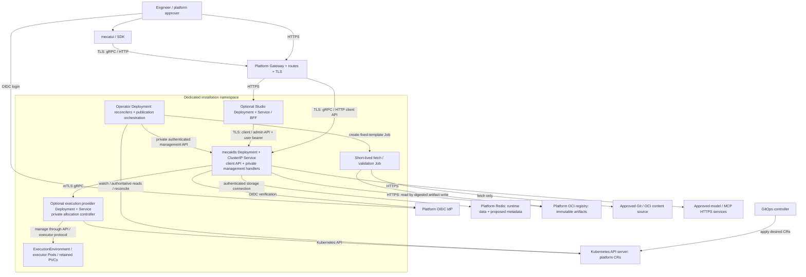

# Mecatl operator design proposal

Keep `mecak8s` as the runtime. Add an operator that installs the service and
publishes approved service offerings. Kubernetes holds desired configuration
and manages infrastructure. Runtime backing stores hold sessions, approvals,
publication metadata, private memory, and schedule execution state. A
platform-provided OCI registry holds immutable content artifacts.

This architecture is **proposed and subject to review**. The operator,
profiles, publication protocol, and management handlers described below do
not ship today. It serves platform engineers who offer Mecatl to trusted
teams with different guidance, models, and tools. Team maintainers assemble
those offerings. Engineers use them without Kubernetes access. The operator
does not process agent turns or provide hostile-tenant isolation.

For fixed configurations, Helm remains sufficient. The first operator release
adds dependency checks, drift repair, and coordinated drain, retention, and
status for the existing runtime. This establishes safe lifecycle control
before delegated publication. It is not yet a self-service profile platform;
profiles and per-session revision binding belong to a distinct second release.

## An incident-investigation offering

A platform administrator installs a `Harness` and approves a model endpoint,
a read-only incident tool connection, and a workspace execution template.
The platform owns endpoint trust, credentials, and security limits. A team
maintainer then proposes incident guidance and a `HarnessProfile` that uses
those approved resources. The profile is the service offering, not a Pod
configuration or a named chat agent.

After publication, an engineer signs in through Studio, `mecatui`, or an SDK
without a kubeconfig. The engineer selects the incident offering, investigates
an alert with its guidance and authorized tools, and later resumes the same
session. In the target design, that session retains its configuration
revision. Current permissions still control every new action.

```text
Harness: installation, identity, storage
  └─ HarnessProfile: incident-investigation
       ├─ ContextBundle + Skill: guidance and procedures
       ├─ ModelProvider: approved endpoint and model choices
       ├─ MCPConnection: approved incident tools
       ├─ AccessPolicy + ToolPolicy: who can use what
       └─ ExecutionTemplate: optional workspace recipe
                    │
          resolve, validate, approve
                    ↓
          immutable profile revision
                    ↓ runtime acknowledgement
          session binding in runtime DB
```

The graph shows references, not cascading deletion ownership. The platform
administrator controls the available integrations and limits. The team
maintainer assembles an offering within those limits. The end user consumes
it through runtime APIs. Neither the maintainer nor the user needs authority
to change platform credentials or executor Pods.

## Cluster deployment and ownership

The proposed initial topology uses one dedicated namespace per independent
installation. All public platform CRs, the runtime, and its optional execution
provider stay in that namespace. There is one execution provider per namespace.
External dependencies bind by approved endpoints, not arbitrary cross-namespace
CR references. The diagram shows processes and network paths; the CRs below it
are configuration, not additional services.



| Owner | Installed or managed objects |
|---|---|
| Cluster administrator | CRDs and their upgrades; operator Deployment, ServiceAccount, and scoped Roles/bindings. CRD lifecycle remains separate from installation deletion. |
| Operator, per `Harness` | `mecak8s` Deployment and ClusterIP Service, immutable nonsecret ConfigMaps, runtime ServiceAccount and Lease RBAC, and NetworkPolicies. Optional Studio Deployment/Service and, only when selected, execution provider Deployment/Service/ServiceAccount/RBAC. |
| Existing private execution controller | `ExecutionEnvironment` allocations, executor Pods, and retained PVCs. No second allocation controller. Retained resources have no cascading owner reference to the platform CRs. |
| External platform | Namespace, Gateway/routes/TLS certificates, provider credentials, Redis, OCI registry, IdP, and ToolHive MCP services. |

The operator references the platform's public route address and reports its
backend Service. It does not own the route or external dependencies. Its
single Deployment contains publication orchestration as well as reconcilers.
This avoids another service but shares capacity and rollout between those
functions. There is no separate authority-service Deployment.
Runtime management handlers live inside `mecak8s` and stay private. Network
rules and authentication separate operator publication calls from client and
human administration calls, even where they share a runtime process.

For initial setup, the administrator supplies the namespace, Redis endpoint,
OIDC configuration, and credential references. The publication release also
requires the OCI registry. The administrator installs the CRDs and operator,
then applies a `Harness` that references these dependencies.

The operator validates the bindings and creates the serving workloads. It
reports the backend Service so the administrator can connect the public route.
The administrator checks deployment availability and login through that route
before giving its address to users. Later, profile readiness confirms that the
runtime has prepared the approved revision; Pod readiness alone does not.

## Resources follow ownership

The target inventory separates resources that have different owners or update
cycles. It is not a mandatory set for the first installation.

| Resources | Purpose |
|---|---|
| `Harness`, `HarnessProfile` | Define an installation and an approved offering within it. |
| `ContextBundle`, `Skill`, `AgentDefinition` | Publish typed guidance, reusable procedures, and delegated specialists. |
| `ModelProvider`, `MCPConnection` | Bind approved model endpoints and external tool connections to trust and authentication. |
| `AccessPolicy`, `ToolPolicy` | Set runtime entitlements and enforce tool permission limits. |
| `LearningPolicy` | Govern private learning and the separate path to shared publication. |
| `ExecutionProvider`, `ExecutionTemplate` | Optionally manage a provider and publish workspace recipes. |
| `Automation` | Bridge a platform schedule definition into the runtime scheduler. |

Resources start namespaced, under the provisional group
`platform.mecatl.dev/v1alpha1`. Each profile belongs to one `Harness`.
References stay within the namespace initially, but still require permission
to use the target. A later cross-namespace contract needs target-owner consent
as well as consumer authorization, following the idea behind
[Gateway reference grants](https://gateway-api.sigs.k8s.io/geps/gep-709/).

There is no CR per tool, model, memory record, or turn. Routing starts as typed
profile configuration. One profile selects one shared persona from Mecatl's
existing soul configuration; private user memory remains separate. These CRs
describe offerings within one runtime service, not one runtime per profile.

## Guidance does not grant authority

A `ContextBundle` supplies typed instructions, prompt rules, and commands. It
can also reference independently published skills and agent definitions.
The runtime's five content kinds remain distinct. Commands are prompt
templates, not deterministic workflows. Rules guide the model; runtime policy
enforces restrictions. Skills provide procedures and assets, not tool grants.
An `AgentDefinition` currently describes a specialist child. Publishing one
does not make it a top-level assistant.

The operator's publication logic preserves source order, combine or replace
behavior, exclusions, and collision rules from [context composition](../../internal/app/harness_context.go).
It records provenance and trust for each contribution. An acquisition URL is
not a trusted runtime source identity. Mounting content at a platform-owned
path does not raise its trust, and a bundle cannot import adjacent settings.
Existing project guidance and command templates also have different loading
lifetimes; a common publisher does not imply per-run reload for every kind.

Content can be inline, in Git at a full commit, or in OCI at a digest. Small
declarations stay in CRs; bodies and assets stay outside etcd and status. The
operator normalizes content into immutable bundles and manifests in the
platform OCI registry. It retains both source artifacts and the compiled
bundle digest. The proposed Mecatl package format is distinct from the
[ToolHive skill media type](https://github.com/stacklok/toolhive-core/blob/v0.0.52/oci/skills/mediatypes.go),
whose root `SKILL.md` applies only to `Skill` sources. Flux integration is optional.

The operator creates fixed-template, short-lived fetch and validation Jobs.
Each Job gets only approved source credentials and a scoped output-artifact
credential. It gets no Kubernetes API token or author-supplied Pod template.
Acquisition restricts origins and checks redirects and authentication
challenges before sending credentials. It blocks unauthorized internal
endpoints, bounds extraction size and file count, and rejects unsafe paths
and links. Content never executes: no scripts, hooks, or implicit submodule
downloads. Credentials stay separate from artifacts. A failure cannot select
another backend, tag, or revision silently.

A signature proves provenance under a trust policy, not safety or approval.
Platform approval covers the exact body, assets, and dependencies for a stated
scope. Delegated authors cannot supply host-executed hooks, Secret selectors,
arbitrary integration URLs, or Pod overrides. Approved references select any
permitted hooks or connections. Platform administrators bind credentials to
specific destinations and purposes. These limits matter because current
[agent definitions](../../internal/app/agentdefs.go) can contain privileged host integrations.

## From a proposal to an active revision

The proposed private management API in `mecak8s` accepts an authenticated
publisher identity for candidate registration, policy synchronization, and
activation (including preparation) and status only. The operator cannot approve
its own candidate. The existing public client path stays unchanged; these new
handlers require a compatibility design before implementation.

A human platform approver reviews the candidate through a proposed Studio
admin view or an admin API client. The view shows the content and dependency
digest, affected offering, and changes. Studio's BFF passes the actual user's
verified OIDC bearer token to separately authorized runtime admin operations;
it cannot assert an identity of its own. Service transport authentication does
not establish the human approver. The runtime checks approver permission in
platform-owned `AccessPolicy` and stores approval bound to the verified
approver, resource UID, full content/dependency digest, scope, and policy
revision. Only the authenticated approval handler can create that record.
Activation checks the stored record and the current approval policy.
A writer's `approved: true` field or GitOps identity proves no
approval. An admin API client needs private network access; the public Gateway
exposes no publisher management route.

Platform-owned `AccessPolicy` grants attachment rights from selected profile
UIDs in the installation namespace to selected resource UIDs. Kubernetes RBAC
controls which maintainers can edit those profiles. Runtime consumer grants
are distinct from attachment rights and write permissions. The runtime
validates both attachment rights and publication approval. Content or
dependency changes require reapproval; initial publication uses manual review.
An explicit trusted-publisher policy would need separate platform approval.
A per-tool Ask or learning acceptance never substitutes for publication approval.

The delivery sequence is proposed:

1. A team maintainer submits a profile or content PR to the team's GitOps repo.
   GitOps applies the merged CRs to the Kubernetes API server. This stages a
   candidate; it does not authorize publication.
2. The operator reads the reference graph, rejects cycles, and starts a fetch
   and validation Job. The Job writes source artifacts and normalized bundles
   to the OCI registry by digest, with provenance and typed validation results.
3. The operator registers that candidate through the runtime management API.
   The runtime verifies its digest, required dependencies, and attachment
   rights against synchronized platform policy. Missing or unsupported required
   dependencies fail the candidate; optional omissions have explicit reasons.
4. The platform approver reviews the candidate and submits approval to the
   runtime admin API. The runtime verifies the human identity and current
   permission, then persists the bound approval record.
5. The operator requests preparation. The runtime rechecks approvals and
   reference rights, reads the immutable bundle from OCI, and loads verified
   logical sources. It acknowledges preparation of that specific revision.
   Content is not a mutable mounted directory; skill assets never become
   workspace or execution roots.
6. The operator requests activation. The runtime checks current policy again
   and atomically changes the active-profile pointer in its metadata store.
   Only then, after the required runtime acknowledgements, does the operator
   report the applied revision and readiness in CR status.
7. New sessions atomically bind the active revision and record the current
   entitlement decision. The maintainer sees a failed candidate's reason and
   old active revision in CR conditions and the proposed admin view. An
   unpublished profile is never offered; a failed update keeps the old active
   revision only while current policy permits it.

The proposed metadata capability uses the existing Redis backend first,
subject to the transactions and compare-and-swap (CAS) needed for these
operations. It adds publication and approval records, active pointers, session
revision bindings, and garbage-collection references. These records are not
shipped storage support. Artifact bytes stay in OCI; there is no proposed
arbitrary-database abstraction. OCI adds registry availability and retention
duties, but separates large immutable content from mutable authority records.

The following YAML illustrates the incident offering's relationships. It is
proposed syntax, not an installable API. The referenced resources are assumed
to exist in the same namespace and to have passed approval and use checks.
The platform attaches its access limits separately so the author cannot
remove them.

```yaml
apiVersion: platform.mecatl.dev/v1alpha1
kind: HarnessProfile
metadata:
  name: incident-investigation
  namespace: operations
spec:
  harnessRef: operations
  contextBundleRefs: [incident-guidance]
  skillRefs: [incident-triage]
  models:
    providerRef: approved-models
    choices: ["<APPROVED_MODEL_ID>"]
    default: "<APPROVED_MODEL_ID>"
  mcpConnectionRefs: [incident-read-only]
  toolPolicyRef: incident-read-only
  learningPolicyRef: learning-off
  execution:
    templateRef: investigation-workspace
  requiredCapabilities: [remote-execution]
```

The example uses remote execution without specialist children. A later variant
that requires both must be rejected while that combination is unsupported.
The declaration does not itself establish availability.

## Starting and resuming a session

The target user path needs no kubeconfig:

1. The engineer signs in with the platform IdP. Studio, `mecatui`, or an SDK
   sends the user's OIDC token through the Gateway to the runtime client API.
   The runtime verifies issuer and subject.
2. The runtime lists only published offerings that current policy allows.
   The proposed client profile selector appears only when a choice is needed;
   one available default suppresses selection.
3. On create, the runtime atomically binds the active revision in Redis with
   the current entitlement decision. It loads and validates the OCI artifact
   by digest, or verifies a cached copy, before serving that session. The
   runtime also persists the allocated environment and template identity.
4. The runtime checks live permissions before model requests, MCP calls, or
   mTLS gRPC execution-provider calls. The incident offering uses its remote
   workspace and read-only incident tools, without specialist children.
5. On resume, the runtime reads the saved revision and exact execution
   environment from the database. It reloads the retained artifact if needed
   and reattaches that environment, or fails explicitly. It never substitutes
   the latest profile or a new workspace. The engineer can inspect the bound
   revision and environment; private memory remains independent of that binding.
6. A pending Ask continuation requires fresh policy and current permission.
   Missing tool enrollment produces an explicit re-enrollment prompt, not a
   silent run restart. The current broker still needs re-enrollment after a
   broker restart and remains limited to one runtime replica.

Routine source updates leave existing session bindings intact. Credentials
rotate independently; binding content never freezes credentials or grants.
On startup or restart, the runtime uses a read-only output-registry identity
to load retained artifacts, without Git source credentials. Database references
from sessions, schedules, children, and execution allocations protect revisions
from collection. Collection removes only unreferenced revisions under an
explicit retention policy. Retained content permits resume, not continued
authorization.

The initial target has one runtime replica. An acknowledgement from it does
not prove that every future replica is prepared. The database active pointer
is authoritative, and any replica must load and validate a revision before
serving a bound session. Multi-replica activation needs a routing and warming
handshake; global high availability remains deferred.

The installation-only release cannot provide this sequence. It mounts existing
configuration and restarts the Deployment; resumed sessions use deployment-wide
configuration, without independent profile selection or immutable bindings.

## Identity and current permission checks

Platform CRs are authoritative desired policy. The operator sends a versioned,
complete policy snapshot to the runtime management API; the runtime persists
it in the metadata store. Freshness renews only after a fresh authoritative
Kubernetes API read. A heartbeat from stale informer data cannot renew it.
The protocol rejects stale or older policy revisions without treating opaque
Kubernetes `resourceVersion` values as ordered numbers. Persisted freshness
survives runtime restart; a restart cannot reset its age.

The runtime checks synchronized current policy before runs, model requests,
tool calls, child admission, schedule fires, and approval continuation. During
operator or API outage, configured grants remain usable until the maximum
freshness age. After that, new protected work fails closed, including pending
Ask continuation. Previously admitted external effects are not undone. The
initial design has no independent authority-service escape hatch: bounded
revocation trades availability for fail-closed behavior. The exact maximum age
is an operational decision required before production.

A shared production service needs verified caller OpenID Connect (OIDC) for
caller isolation. Kubernetes RBAC governs CR access; service mutual TLS (mTLS)
identifies a service. Neither replaces caller identity, and a shared bearer
token cannot distinguish users. Private memory needs ownership checks and
caller-partitioned storage. The separate [agent identity
proposal](agent-identity-model.md) explores delegation, not a shipped guarantee.

The platform attaches `AccessPolicy` limits that a profile author cannot
remove. A caller can use only capabilities allowed by every applicable policy.
`ToolPolicy` preserves deny-dominant permissions and configured Ask. Plan mode
blocks mutations before ordinary permission evaluation. When policies set
numeric ceilings, the lower ceiling wins. The existing [Cedar
adapter](../../internal/adapter/cedarauthority/cedar.go) can only narrow the
tool capabilities already granted to a child; it is not a group-entitlement
service.

Defaults, learning, and retention have separate policy rules. The owning
policy must permit a default override. Lower scopes can tighten learning
limits, but cannot relax them. Conflicting retention obligations need
resolution rather than a generic merge. Posture alone does not establish
project trust.

## Models and external tools

Model inventory reports what a provider offers. A profile selects choices and
routing defaults; entitlements decide which choices a caller can use.
`ModelProvider` binds an endpoint, protocol, trust configuration, and separate
authentication reference. The target runtime checks the final provider and
model after alias resolution, including main, plan, child, and auxiliary calls
such as classification, compaction, checking, and reflection. Schedules follow
the same rules. Fallback stays within the permitted set and fails explicitly
when that set is empty.

The current [`models.allowlist` setting](../../internal/adapter/permconfig/schema.go)
is inert, and unlisted model IDs pass through. Filtering a catalogue cannot
enforce model access. Token caps are runaway brakes, not money caps or global
descendant budgets. Kubernetes quotas do not limit inference spending.
Shared code supports deployment OIDC credentials for providers, but `mecak8s`
does not load them. The first release uses supported service credential paths;
per-user provider OAuth is separate, unsupported work.

`MCPConnection` consumes an approved external streamable-HTTP endpoint or a
ToolHive `MCPServer` or `VirtualMCPServer` endpoint. It does not deploy servers.
ToolHive references need explicit Kubernetes integration and readiness for
the referenced generation; local workload discovery is insufficient.
Direct mode and the embedded broker remain exclusive. An external virtual
endpoint does not replace the embedded broker's session authority.

Each connection declares service authentication or per-user enrollment.
Upstream approval, user consent, and per-call Ask remain separate decisions.
The current broker has process-local attachment state, so deployments need
one replica, `Recreate` updates, and callback routing. Users must re-enroll
after restart. The [deployment guidance](../../user-docs/operating/mecak8s/scale-recover-and-upgrade.md)
explains these limits; adding replicas does not remove them.

## Workspaces and execution ownership

An optional `ExecutionProvider` installs or references a compatible provider.
`ExecutionTemplate` publishes immutable workspace recipes. The existing
private `ExecutionEnvironment` allocation controller remains the sole owner
of allocations and claims. The operator manages its configuration and lifecycle,
not a competing allocation loop.

One installation binds storage identity, Lease coordination, and execution
ownership coherently. Redis uses fixed prefixes, so separate Lease namespaces
do not isolate runtimes that share its keyspace. The
[metadata index](../../adapters/redisstore/metadata_index.go) also constrains Redis
Cluster use. Dedicated state and execution boundaries prevent collisions.
Identity changes require migration that fences old executors before new owners
start mutations; ordinary updates cannot change those identity fields.

[Recipes load at provider startup](../../internal/adapter/executioncontroller/templates.go).
Updates therefore require a maintenance window that stops new work and drains
active mutations. Provider and executor protocols must match. Retain recipe
revisions while allocations use them. Reattachment selects the exact prior
allocation, workspace, and template revision or fails closed. Retained PVCs
have no cascading ownership from disposable resources.

Current remote execution excludes Subagent, Team, Parallel, and repository
source ingestion. It also cannot allocate an independent scheduled workspace.
Required combinations that depend on these features fail publication or
schedule acceptance. An offering label cannot imply support that the runtime
lacks. These limits come from [runtime construction](../../internal/app/build.go).

## Private memory and learning

Memory is structured `tool.MemoryStore` data with revision history and CAS,
not `MEMORY.md` or CR guidance. The [memory contract](../architecture/memory.md)
defines tombstones, compensating undo, and retention. In the target, a verified
issuer and subject identify private user state across profiles; project memory
also binds the exact server-owned workspace. A profile cannot export or
silently repartition it. Memory remains untrusted data, never authority.

Runtime backing stores must enforce those caller boundaries. Session Redis
does not make user-model and learning files durable. `mecak8s` supplies
`UserModelDir`, but not project `MemoryDir`; scheduled-result delivery also
has an in-memory queue. Owner-enforced configurations reject unsupported
remote memory and learning combinations. An unpartitioned directory is not
a safe substitute for a caller-scoped backend.

The proposed `LearningPolicy` defaults to `off`; `review` requires approval,
and `auto` accepts private learning only within approved limits. Validation,
evaluation, and acceptance stay distinct, with evidence and resource budgets
in private records. Learned skills can change their body, not add assets,
tools, or authority. Automatic fact promotion requires supported explicit
user intent and cannot overwrite conflicting or user-explicit facts.
Organization-wide publication separately requires owner consent, redaction,
review, and publication approval. Auto learning never publishes private
records as shared instructions.

## Platform automation uses the runtime scheduler

`Automation` maps a platform definition to the existing runtime scheduler,
never a second CronJob loop. Database claims and fire records stay authoritative;
reconciliation never calls `FireNow`. Personal schedules use runtime APIs.

The bridge derives a deterministic schedule key from installation identity and
CR UID so a lost create response recovers the same schedule. The runtime
verifies the service principal and bridge management identity; neither a name
match nor `spec.owner` authorizes takeover. Owned-field metadata, CAS, and
concurrency fencing require extensions to the current schedule APIs.

Acceptance pins an exact profile revision. Only an authorized definition
update selects a new revision; active fires keep their binding and check live
permissions. Proposed defaults prohibit overlap, skip missed fires, disable
automatic retry, and require an explicit time zone. They do not guarantee
exactly-once external effects. Suspension stops new fires; cancellation is
separate. Deletion suspends first, resolves active or ambiguous fires, and
preserves execution evidence before releasing management metadata.

## Installation, recovery, and operational visibility

A `Harness` records dependency bindings and health without taking over the
database, PKI, or ToolHive. New installations use direct server-side apply
with explicit field ownership. Helm adoption needs an inventory, rollback
criteria, and a planned transfer that preserves service and installation
identity. Stop the previous Helm and GitOps writers before adoption; only one
manager owns a field at a time.

Deletion retains databases and workspaces by default. Decommissioning suspends
automation, stops new work, drains execution, and preserves authority metadata
before explicit disposal. Finalizers cannot protect against namespace or CRD
loss. Backups, PVC reclaim policy, and restore procedures must independently
cover sessions and approvals, publication indexes, private history, schedules,
workspaces, and enrollment state. Secret recovery follows separate controls.

Kubernetes API loss also affects Leases and allocation, beyond the policy
freshness limit described above. Recovery fences old executors before admitting
mutations and checks paused sessions and pending approvals. Routing, storage,
credentials, and process-local enrollment state constrain recovery.

Controllers reconcile configuration idempotently, never each agent turn.
Structural schemas and CEL validate local rules; external downloads and
provider checks run asynchronously, outside admission. Dependency indexes
identify affected profiles. List fields declare apply semantics, and separate
field managers own generated resources and status. Conditions report observed
generation so an old success cannot imply current readiness. Status separates
requested generation, accepted revision, and active runtime-acknowledged
revision. Resource readiness has a specific meaning: available skill content
is not proof that a runtime activated it.

Diagnostics explain failures, tool audit records describe tool execution, and
durable events preserve runtime history. Approval records separately identify
publication decisions. Status contains digests and bounded reasons, not user
content or secrets. Logs exclude content, credentials, and authentication
headers; metrics use bounded labels. CRD evolution needs conversion tests and
storage migration before version removal. Runtime rollout also checks protocol
compatibility and any required execution maintenance.

## Delivery and decisions still needed

**Installation comes first.** Deliver `Harness`, dependency checks, drift
repair, retention/status, and coordinated drain and maintenance for existing
runtime configuration. Qualify OIDC login and cross-caller session, schedule,
and memory denial before claiming isolation. This release keeps deployment-wide
restoration and offers lifecycle control, not delegated profile self-service.

**Approved offerings form a second release.** Implement the proposed runtime
management/admin schemas, policy snapshot protocol, Redis transactions, OCI
package format, and compatible session binding before delegated publication.
Then add typed content, integrations, and policies. Demonstrate an incident
session that survives update and restart on its original revision. Reject
unauthorized references, altered content, unsafe acquisition, and unsupported
dependencies. Exercise final-model checks, fallback, Ask, and expired policy.

**Execution lifecycle follows.** Qualify exact reattachment through upgrade,
fencing after Lease loss, retained PVCs, and rejection of unsupported remote
combinations. These checks require real-cluster recovery, not only controller
tests or healthy Pod counts.

**Automation and learning complete the later stages.** Recover one schedule
after a crash between creation and mapping persistence, without a duplicate
fire. Verify that definition updates preserve active-fire bindings and that
concurrent writes cannot take over ownership. Prove that private memory or
learned content cannot publish without owner consent and review. These are
future acceptance scenarios, not completed qualification.

The architecture choices above remain proposals. Scoped prerequisites still
need review before their delivery phase:

- **Interfaces and approval UX:** Define management/admin schemas, token
  forwarding, review/diff presentation, approval invalidation, and attachment
  selectors. Implement runtime-verified approval
  records rather than trusting CR metadata.
- **Policy synchronization:** Specify monotonic snapshot acceptance, fresh-read
  evidence, persisted expiry, and race handling at authorization boundaries.
  Choose the maximum freshness age before production.
- **Metadata and artifacts:** Prove Redis transaction/CAS semantics for approval,
  activation, session binding, and GC references. Specify OCI manifests,
  cache verification, retention/restore, and schema migrations. Select durable
  caller-scoped memory and learning backends separately.
- **Compatibility and later lifecycle:** Define protocol negotiation and safe
  failure between runtime/operator versions, then schedule fencing and exact
  execution reattachment. Multi-replica warming/routing remains deferred.
- **Names and identity:** Confirm the API group and resource names. Delegation,
  financial quotas, and hostile tenancy require separate designs.

This document changes no current wire API, Go API, or stored data. Future
profile selection and binding need capability negotiation and a
[wire compatibility assessment](../architecture/api-surface.md#wire-api-compatibility).
`CreateSessionRequest` reserves field 6 and the name `profile`; neither is
available for reuse. Enforcing restrictions on unlisted models can break
existing clients and needs an explicit upgrade assessment and operator approval
before implementation. Go source compatibility and stored-data migration need
separate assessments. Additive CRDs alone do not establish compatibility.

## Design references

The linked implementation sources constrain this proposal. These additional
references explain the principal boundaries and controller conventions:

- [Governance](../architecture/governance.md) and [deployment hardening](../architecture/deployment-and-hardening.md) describe the runtime's security boundaries.
- [Session contract](../../contracts/proto/mecatl/v1/harness.proto), [schedule contract](../../contracts/proto/mecatl/v1/schedule.proto), and [schedule ownership](../../internal/adapter/server/schedule_manager.go) show where runtime extensions belong.
- [Kubernetes custom resources](https://kubernetes.io/docs/concepts/extend-kubernetes/api-extension/custom-resources/) and [API conventions](https://github.com/kubernetes/community/blob/main/contributors/devel/sig-architecture/api-conventions.md) inform the configuration boundary and status design.
