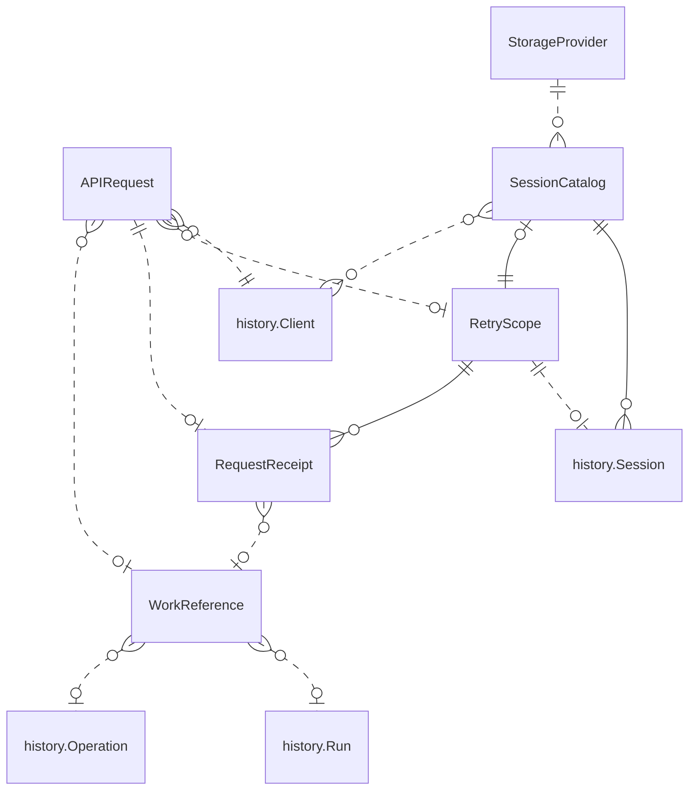

{/* Generated by `modelith render`. Do not edit by hand; edit the .modelith.yaml source and re-render. */}

# Session catalogs and command protocol

Catalog ownership and API command decisions are distinct from session execution and history. Optional retry identities have bounded receipts; genuinely asynchronous work exposes existing durable lifecycles through a common observation contract. The companion [proposal](session-commit-history.md) owns rationale and delivery scope.

## Imports

Items defined in these models are referenced below as `scope.Name`.

- **`history`** — `./session-commit-history.modelith.yaml` ([rendered](./session-commit-history.modelith.md))

## Entities

### `APIRequest`

One externally submitted mutation command, separate from the work it targets and the transport attempt carrying it. A caller can opt into bounded retry protection using an opaque token and original creation timestamp; normal durable mutation semantics do not depend on opting in.

**Relationships**

- [history.Client](./session-commit-history.modelith.md#client) — n:1
- `RetryScope` — n:0..1
- `RequestReceipt` — 1:0..1
- `WorkReference` — n:0..1

**Attributes**

| Name | Type | Description |
| --- | --- | --- |
| `retryToken` | string | Optional nonempty opaque exact value of at most 128 bytes; no UUID syntax or token interpretation is required. |
| `createdAt` | timestamp | Original creation time paired with the retry token and unchanged across attempts. |

**Invariants**

- **optional-retry-pair** — An `APIRequest` supplies both retry token and creation timestamp or neither; a partial pair is invalid, and absence creates no retry receipt or general deduplication guarantee while accepted mutations remain durable.
- **opaque-request-identity** — A retry token is bounded, nonempty, and compared exactly without normalization; token and original timestamp identify one submission rather than a run, operation, commit position, or ownership epoch.
- **immutable-retry-command** — Retried `APIRequest` identity and complete command remain unchanged, including method, target, parameters, and content; conflicting reuse within the retained scope is rejected rather than executed.
- **retry-authority-rechecked** — Every `APIRequest` attempt is authorized independently; possession of a token or receipt grants neither control nor access to another caller's results.
- **validate-retry-time** — Retry creation time is validated against the one-hour maximum age, durable rejection cutoff, and bounded clock-skew allowance; implausible future values cannot unboundedly advance retention or a cutoff.
- **synchronous-command-default** — An `APIRequest` returns its typed committed decision synchronously unless independently progressing work justifies asynchronous completion; asynchronous acknowledgement is not itself permission to create a separate job.

### `RequestReceipt`

A compact immutable admission decision for a retry-protected `APIRequest`, including the command fingerprint, original resolved target, and relevant durable result or work references. It answers what happened to that submission, not whether subsequent changes still preserve its effects.

**Relationships**

- `WorkReference` — n:0..1

**Invariants**

- **receipt-atomic-with-decision** — A `RequestReceipt` commits atomically with the mutation decision it protects; receipt bookkeeping can share the existing commit rather than requiring another acceptance gate.
- **retry-original-resolved-decision** — A valid retained retry returns the original `RequestReceipt` decision and resolved target, never resolves session-current cancellation against newer work or starts a second destination or run.
- **receipt-safe-compact-content** — A `RequestReceipt` retains only necessary decision, fingerprint, and reference information, never unreleased sensitive tool bytes or payload-bearing hook evidence; it is not a duplicate transcript or full-response archive.
- **receipt-not-work-lifetime** — Expiring a `RequestReceipt` does not expire the run or operation it references, reverse its accepted mutation, or erase retained historical evidence.

### `RetryScope`

A bounded authoritative retry-eligibility domain containing retained receipts and a nondecreasing creation-time rejection cutoff. Each session has its own scope across mutation kinds and concurrent clients; catalog mutations use a distinct catalog-owned scope.

**Relationships**

- [history.Session](./session-commit-history.modelith.md#session) — 1:0..1 — A session scope belongs to one session; a catalog scope has no session owner.
- `RequestReceipt` — 1:n — owned

**Attributes**

| Name | Type | Description |
| --- | --- | --- |
| `rejectionCutoff` | timestamp | Durable nondecreasing boundary at or before which request identities are rejected without execution. |

**Invariants**

- **independent-scope-budgets** — Every session `RetryScope` and each separate catalog `RetryScope` retain at most 256 receipts and accept identities at most one hour old; capacity pressure can shorten that horizon independently in each scope.
- **session-wide-retry-namespace** — Concurrent clients share a session's `RetryScope` across mutation types and connections; token collisions cannot silently overwrite a different command, and ownership changes do not reset the namespace.
- **expire-with-durable-cutoff** — Receipt eviction advances the durable cutoff as needed and rejects all identities at or before it, including never-seen delayed requests and every timestamp tie; eviction is creation-time ordered rather than LRU, and cutoff advancement commits atomically with affected mutation and receipt decisions.
- **cutoff-never-reopens** — Recovery and ownership movement reconstruct the current cutoff and all still-admissible receipts before admitting mutations; clock rollback or retention changes cannot reopen a discarded interval.
- **bounded-retry-lookup** — Active `RetryScope` lookup and checkpoints need not retain every historical receipt or scan arbitrary old history for expired retries; expired requests fail explicitly and never become fresh mutations.
- **scope-owned-not-caller-cache** — A `RetryScope` belongs to exactly one session or catalog, survives transport reconnection through durable state, and is not a replica-local or caller-local cache.

### `SessionCatalog`

A stably identified ownership and authorization scope for session listing, creation, publication, and deletion within exactly one `StorageProvider`. Display metadata and any search index are derived views rather than a second continuation authority. A catalog's identity does not depend on its current replica, connection, or display name.

**Relationships**

- [history.Session](./session-commit-history.modelith.md#session) — 1:n — owned
- `RetryScope` — 0..1:1 — owned — Catalog mutation receipts are separate from each session's retry scope.
- [history.Client](./session-commit-history.modelith.md#client) — n:n — Catalog membership and each requested action are independently authorized.

**Invariants**

- **catalog-one-provider** — Each `SessionCatalog` belongs to exactly one `StorageProvider`; a catalog does not federate multiple storage authorities.
- **catalog-lifecycle-authority** — Creation identity, fork destination publication, and logical deletion decisions commit through the `SessionCatalog`; derived listing or search metadata cannot admit execution or override authoritative session history.
- **catalog-budget-isolation** — Catalog-scoped `RetryScope` capacity and cutoff belong to the `SessionCatalog`, not its caller; traffic in another catalog cannot evict these receipts or advance this cutoff.
- **catalog-deletion-survives-session** — Deletion fences session reads, activation, and writes and retains a minimal deletion identity independent of receipt expiry; creation or deletion retries cannot resurrect a deleted session or reuse its identity.

### `StorageProvider`

One configured storage authority backing catalog lifecycle decisions and session history. A provider declares its durability and atomic acceptance guarantees; multiple catalogs may use the same provider.

**Relationships**

- `SessionCatalog` — 1:n

**Invariants**

- **provider-honest-acceptance** — A `StorageProvider` acknowledges durable acceptance only under its declared operating guarantees; an in-memory queue or inner savepoint does not satisfy a commit gate.
- **provider-no-cross-catalog-transaction-requirement** — A `StorageProvider` can aggregate physical writes without requiring atomic transactions across independent sessions or catalogs; batching preserves each affected decision's ordering and acceptance guarantees.

### `WorkReference`

A stable authorized reference exposing genuinely asynchronous work through common status, waiting, and subscription conventions. Its typed progress and outcome project an existing durable lifecycle rather than creating a second operation state machine or an enumerable universal jobs collection.

**Relationships**

- [history.Run](./session-commit-history.modelith.md#run) — n:0..1
- [history.Operation](./session-commit-history.modelith.md#operation) — n:0..1

**Invariants**

- **common-typed-work-observation** — A `WorkReference` observation consistently distinguishes pending and terminal state, typed progress and outcomes, structured errors, and explicit unavailable or expired references; authorization applies on every read, wait, and subscription.
- **reuse-authoritative-work-lifecycle** — A `WorkReference` projects the authoritative run, extension operation, or catalog creation lifecycle; a separate operation exists only where existing resource state cannot express independently progressing work, and no universal operations collection is required.
- **accepted-not-completed** — A cancellation command's accepted `RequestReceipt` proves admission and signaling against its resolved run; the run's `WorkReference` separately reports bounded terminal settlement without claiming uncertain external effects have stopped.
- **observe-without-retry-token** — An asynchronous command returns its durable `WorkReference` whether or not the initiating `APIRequest` opted into retry protection; a lost initial response without retry identity requires reconciliation rather than an automatic resubmission.

## Relationships

## Scenarios

### Concurrent clients retry against a recovered session

**Steps**

1. Two clients send `APIRequest` mutations for the same session with different opaque tokens and original creation timestamps.
2. Each accepted decision and compact `RequestReceipt` shares its mutation commit, while ordinary session history remains the execution authority.
3. A replica loses its response after accepting session-current cancellation; another replica reconstructs the session `RetryScope`, cutoff, and retained receipts.
4. The authorized retry receives the original resolved run and decision instead of canceling a newly started run.
5. Its `WorkReference` tracks the affected run through the common observation contract without creating a cancel job; a partial pair or conflicting command reuse is rejected.

**Invariants touched**

- **optional-retry-pair** — An `APIRequest` supplies both retry token and creation timestamp or neither; a partial pair is invalid, and absence creates no retry receipt or general deduplication guarantee while accepted mutations remain durable.
- **opaque-request-identity** — A retry token is bounded, nonempty, and compared exactly without normalization; token and original timestamp identify one submission rather than a run, operation, commit position, or ownership epoch.
- **immutable-retry-command** — Retried `APIRequest` identity and complete command remain unchanged, including method, target, parameters, and content; conflicting reuse within the retained scope is rejected rather than executed.
- **retry-authority-rechecked** — Every `APIRequest` attempt is authorized independently; possession of a token or receipt grants neither control nor access to another caller's results.
- **receipt-atomic-with-decision** — A `RequestReceipt` commits atomically with the mutation decision it protects; receipt bookkeeping can share the existing commit rather than requiring another acceptance gate.
- **retry-original-resolved-decision** — A valid retained retry returns the original `RequestReceipt` decision and resolved target, never resolves session-current cancellation against newer work or starts a second destination or run.
- **session-wide-retry-namespace** — Concurrent clients share a session's `RetryScope` across mutation types and connections; token collisions cannot silently overwrite a different command, and ownership changes do not reset the namespace.
- **cutoff-never-reopens** — Recovery and ownership movement reconstruct the current cutoff and all still-admissible receipts before admitting mutations; clock rollback or retention changes cannot reopen a discarded interval.
- **accepted-not-completed** — A cancellation command's accepted `RequestReceipt` proves admission and signaling against its resolved run; the run's `WorkReference` separately reports bounded terminal settlement without claiming uncertain external effects have stopped.
- **common-typed-work-observation** — A `WorkReference` observation consistently distinguishes pending and terminal state, typed progress and outcomes, structured errors, and explicit unavailable or expired references; authorization applies on every read, wait, and subscription.

### Receipt pressure rejects an unseen late request

**Steps**

1. One session `RetryScope` reaches its 256-receipt bound before the oldest request reaches one hour of age.
2. A new admitted decision atomically advances the cutoff and retires the entire old timestamp boundary, including tied receipts.
3. Another client's never-seen delayed `APIRequest` at that boundary fails expired without executing, and LRU access cannot restore eligibility.
4. A recovered owner preserves the cutoff even if its wall clock moves backward, validates future skew, and does not scan old history to reinterpret an expired retry as new.
5. Existing work handles and historical mutation facts survive receipt expiry, while unreleased tool bytes are never added to `RequestReceipt` data.

**Invariants touched**

- **independent-scope-budgets** — Every session `RetryScope` and each separate catalog `RetryScope` retain at most 256 receipts and accept identities at most one hour old; capacity pressure can shorten that horizon independently in each scope.
- **expire-with-durable-cutoff** — Receipt eviction advances the durable cutoff as needed and rejects all identities at or before it, including never-seen delayed requests and every timestamp tie; eviction is creation-time ordered rather than LRU, and cutoff advancement commits atomically with affected mutation and receipt decisions.
- **cutoff-never-reopens** — Recovery and ownership movement reconstruct the current cutoff and all still-admissible receipts before admitting mutations; clock rollback or retention changes cannot reopen a discarded interval.
- **bounded-retry-lookup** — Active `RetryScope` lookup and checkpoints need not retain every historical receipt or scan arbitrary old history for expired retries; expired requests fail explicitly and never become fresh mutations.
- **validate-retry-time** — Retry creation time is validated against the one-hour maximum age, durable rejection cutoff, and bounded clock-skew allowance; implausible future values cannot unboundedly advance retention or a cutoff.
- **receipt-not-work-lifetime** — Expiring a `RequestReceipt` does not expire the run or operation it references, reverse its accepted mutation, or erase retained historical evidence.
- **receipt-safe-compact-content** — A `RequestReceipt` retains only necessary decision, fingerprint, and reference information, never unreleased sensitive tool bytes or payload-bearing hook evidence; it is not a duplicate transcript or full-response archive.
- **scope-owned-not-caller-cache** — A `RetryScope` belongs to exactly one session or catalog, survives transport reconnection through durable state, and is not a replica-local or caller-local cache.

### Catalog lifecycle decisions outlive a destination session

**Steps**

1. Two `SessionCatalog` scopes use one `StorageProvider`, each with independent authorized membership, receipt budget, and cutoff.
2. A catalog-owned `RetryScope` records a retry-protected creation or fork-admission `APIRequest` and its destination decision before publication.
3. A retry returns the same admitted destination or `WorkReference`; asynchronous creation is used only when actual work justifies it.
4. A deletion commits suppression and fencing, and its `RequestReceipt` remains in the catalog after destination history is unavailable.
5. Receipt expiration cannot remove the deletion gate or resurrect the old identity; catalog display and search projections cannot bypass authoritative decisions.
6. The provider may aggregate physical writes while acknowledging only declared durable acceptance and requiring no cross-catalog transaction.

**Invariants touched**

- **catalog-one-provider** — Each `SessionCatalog` belongs to exactly one `StorageProvider`; a catalog does not federate multiple storage authorities.
- **catalog-lifecycle-authority** — Creation identity, fork destination publication, and logical deletion decisions commit through the `SessionCatalog`; derived listing or search metadata cannot admit execution or override authoritative session history.
- **catalog-budget-isolation** — Catalog-scoped `RetryScope` capacity and cutoff belong to the `SessionCatalog`, not its caller; traffic in another catalog cannot evict these receipts or advance this cutoff.
- **catalog-deletion-survives-session** — Deletion fences session reads, activation, and writes and retains a minimal deletion identity independent of receipt expiry; creation or deletion retries cannot resurrect a deleted session or reuse its identity.
- **provider-honest-acceptance** — A `StorageProvider` acknowledges durable acceptance only under its declared operating guarantees; an in-memory queue or inner savepoint does not satisfy a commit gate.
- **provider-no-cross-catalog-transaction-requirement** — A `StorageProvider` can aggregate physical writes without requiring atomic transactions across independent sessions or catalogs; batching preserves each affected decision's ordering and acceptance guarantees.
- **synchronous-command-default** — An `APIRequest` returns its typed committed decision synchronously unless independently progressing work justifies asynchronous completion; asynchronous acknowledgement is not itself permission to create a separate job.
- **receipt-atomic-with-decision** — A `RequestReceipt` commits atomically with the mutation decision it protects; receipt bookkeeping can share the existing commit rather than requiring another acceptance gate.
- **reuse-authoritative-work-lifecycle** — A `WorkReference` projects the authoritative run, extension operation, or catalog creation lifecycle; a separate operation exists only where existing resource state cannot express independently progressing work, and no universal operations collection is required.
- **independent-scope-budgets** — Every session `RetryScope` and each separate catalog `RetryScope` retain at most 256 receipts and accept identities at most one hour old; capacity pressure can shorten that horizon independently in each scope.

### A command omits retry protection without losing durable work tracking

**Steps**

1. An authorized client sends an `APIRequest` with neither retry token nor timestamp; its mutation still follows normal durable session admission.
2. A synchronous mutation returns its typed committed decision without adding a `RequestReceipt`.
3. Genuinely asynchronous work instead returns a `WorkReference` backed by its existing authoritative lifecycle and typed outcome.
4. A broken connection does not permit blind mutation replay; the client reconciles state while the work remains observable without an operation registry.

**Invariants touched**

- **optional-retry-pair** — An `APIRequest` supplies both retry token and creation timestamp or neither; a partial pair is invalid, and absence creates no retry receipt or general deduplication guarantee while accepted mutations remain durable.
- **synchronous-command-default** — An `APIRequest` returns its typed committed decision synchronously unless independently progressing work justifies asynchronous completion; asynchronous acknowledgement is not itself permission to create a separate job.
- **observe-without-retry-token** — An asynchronous command returns its durable `WorkReference` whether or not the initiating `APIRequest` opted into retry protection; a lost initial response without retry identity requires reconciliation rather than an automatic resubmission.
- **common-typed-work-observation** — A `WorkReference` observation consistently distinguishes pending and terminal state, typed progress and outcomes, structured errors, and explicit unavailable or expired references; authorization applies on every read, wait, and subscription.
- **reuse-authoritative-work-lifecycle** — A `WorkReference` projects the authoritative run, extension operation, or catalog creation lifecycle; a separate operation exists only where existing resource state cannot express independently progressing work, and no universal operations collection is required.

