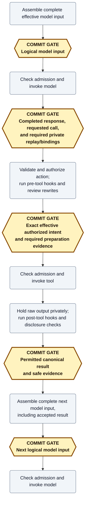

# Session-history contracts: execution, recovery, and observable behavior

**Status:** Contract-design working draft, not finalized interfaces or shipped behavior.
**Scope:** Execution and recovery model, lifecycle and persistence boundaries, observable reload behavior, and the contracts to be derived from them.

Read the [execution and recovery model](#execution-and-recovery-model) first, then use the lifecycle tables, worked sequences, and acceptance cases as contract references.
The [proposal](session-commit-history.md) owns architecture and delivery scope; the [history/execution model](session-commit-history.modelith.md) and [catalog/command model](session-command-protocol.modelith.md) own domain definitions.
This document specifies required behavior before finalizing interfaces or implementation tasks.
Items labeled **candidate** and the [open contract mechanics](#open-contract-mechanics) remain subject to review; this reorganization does not settle their representations.

## Execution and recovery model

Mecatl coordinates model requests, tool calls, hooks, and client controls using an authoritative committed history.
The established pattern is **durable orchestration**: retain the decisions and outcomes needed to reconstruct coordination state after failure, and require durable prerequisites before allowing dependent execution.
State transitions define what is allowed; committed history records what was accepted.
This design applies that pattern through narrow coordination inside Mecatl, without requiring or recreating a general-purpose workflow platform.

The central distinction is between **reconstructing what the harness knows** and **performing work in the outside world**.
After a restart, replay applies retained facts to rebuild state and client views.
It does not call the model, run a tool, or invoke a hook merely to reproduce an earlier result.
Checkpoints accelerate that reconstruction; they are derived from committed history rather than a second authority.
An interrupted run requires explicit recovery, not automatic continuation inferred from the reconstructed state.

A requested action and an established outcome are different facts.
For example, retaining an LLM's request for a tool does not authorize execution, retaining authorized intent does not prove execution, and retaining a result does not prove the next model request consumed it.
The contract must preserve those distinctions when a process fails between steps.

### One model turn and its tool call

The ordinary path below shows one tool call between two model requests.
`[C ...]` means the system must establish that the listed facts are committed before crossing the following execution boundary.
It does not mean every bracket needs a separate storage write.

In the diagram, **COMMIT GATE** nodes are amber hexagons with thick borders; work steps are gray rounded boxes.
The shape and explicit label distinguish gates even without color.



An **execution admission** is the final eligibility decision immediately before invocation; it still checks cancellation, ownership, and the relevant authorization contract after intent is committed.
Invoking the tool is also called **dispatch**; neither admission nor invocation means the tool completed.
Hooks and approvals can add commit gates when exact inputs or decisions must first be retained; the [required commit gates by phase](#required-commit-gates-by-phase) table specifies them.
The [named phases](#named-phases) distinguish the work between these committed facts.

The ordering follows established log-based recovery principles: durably admit nondeterministic observations before dependent execution uses them, and retain the causal state needed before allowing external effects.
It does not make a tool invocation atomic with the history append.
The [recovery literature and runtime comparisons](session-commit-history-durable-execution-prior-art.md) explain the foundations and their limits.

### Recovery preserves knowledge, not the outside world

Consider a tool that changes a file and then returns a result.
If the process dies after the file changes but before outcome evidence commits, recovery cannot infer from the missing result that the change failed.
It also cannot assume the current file proves exactly what that invocation did.
The safe recovery state can be an unknown outcome, not another automatic attempt.

| Accepted evidence at recovery | What can be established |
| --- | --- |
| Requested call without effective intent | The tool was not invoked by the protocol. Pre-intent hooks can still have effects, and a reconstructible execution ask can remain pending. |
| Effective intent without an established outcome | The tool might not have started, might still be running, or might have completed. Never automatically rerun an uncertain ordinary tool. |
| Safe evidence of returned output, but lost unreleased bytes | Preserve the established execution evidence and settle output unavailable; do not recreate the bytes through tool re-execution. |
| Canonical result | Reconstruct that result and its permitted projections without invoking the tool again. |

Retried storage appends, reconstructed state, and repeated external execution are separate operations.
A lost storage response can leave an append's acceptance uncertain; resolve its identity before relying on it or retrying it.
Neither storage uncertainty nor missing effect evidence permits dependent execution to cross its required gate.
The [failure-evidence reference](#failure-evidence-and-dependent-work-gates) covers the individual boundaries, including interrupted model requests and hooks.

#### Persistence failure without generic rollback

A storage outage reduces execution availability: dependent work pauses until its prerequisite acceptance is established.
Already-started work can finish into bounded in-memory buffers, and permitted provisional progress can remain visible, but neither is a confirmed durable outcome.
Ownership loss stops the current engine; a successor reconstructs accepted history rather than repairing it from the former owner's memory.

The contract requires no generic tentative aggregate, rollback layer, or universal prepare/accept/apply mechanism.
For an individual transition, committing before changing authoritative in-memory state can be sufficient.
Speculative execution with reversible effects would need an enhanced tool contract, including concurrent external-edit hazards; it is outside this design even for file edits.

### Cancellation coordinates separate lifecycles

A run's execution lifecycle and a call's result disposition can finish at different times.
Cancellation closes new execution admission and promptly signals admitted work, descendants, and extensions.
A confirmed acknowledgement waits for the cancellation decision to commit; it means accepted/signaled, not proven external cessation or rollback.
Already-produced output still follows the normal bounded processing and disclosure pipeline.

For example, cancellation can leave a terminal run with one result awaiting release approval.
The exact ask and safe evidence are durable; the unreleased payload remains only in memory.
Approving release later commits that call's canonical result without reopening the run or requesting another model response in it.
Process loss instead closes the ask unavailable; successor-run admission invalidates remaining holds and late decisions.
This is a valid combination of lifecycle states, not a reason to rewrite a previously final result.

The [cancellation transition table](#coordinated-state-machine-with-cancellation) defines guards and winning races.
Concrete record types and whether predecessor result closure shares the successor-admission commit remain open representation questions.

## Contract vocabulary and ownership

A **storage adapter** is the implementation that reads and appends the authoritative session history in a particular storage backend.
A **commit** occurs when that storage adapter accepts an append to the authoritative history, enforcing the expected history head, current ownership, and its declared durability contract.
An event emission, aggregate mutation, buffered write, or successful inner transaction does not establish commitment.

A **commit gate**, also called a **durability barrier** here, is an execution boundary where a specified step must wait until the system establishes that its prerequisite history facts are committed.
It constrains dependent execution, rather than naming the storage checks required to accept the append.
Steps include tool and model invocation, applicable hooks, and publication of confirmed results or actionable asks; ordinary internal computation does not automatically require a commit.
If acceptance fails or remains uncertain, the dependent step cannot proceed; independent work remains subject to its own gates.

Facts can be coalesced into one commit as long as establishing them does not require crossing a commit gate between them.
For example, independent ready tool results can share a commit, while a tool's intent and result cannot: the tool must execute between those boundaries.
Completed pre-tool hook evidence can share the intent commit when all required facts are ready.

### Owning scopes

Durable command decisions have two kinds of owning scope:

| Scope | What it owns |
| --- | --- |
| **Session catalog** | Session membership and lifecycle decisions, including creation, publication, deletion, and fork admission. Catalog authority remains available when the affected session does not yet exist or is no longer accessible. |
| **Session** | Conversation and execution history, runs, tool calls/results, asks, steers, hooks, and session-owned extension operations. |

Each catalog and each session has its own bounded request-receipt scope; concurrent clients share that scope rather than owning separate retry caches.
A run or extension operation is a resource within its session scope, not a third peer kind of owning scope.
These are domain ownership scopes, distinct from the replica currently authorized to drive execution or append history.

### Responsibility boundaries

| Boundary | Responsibility | Must not imply |
| --- | --- | --- |
| API command admission | Authorize the caller, validate optional retry identity and targeting, and return the committed decision or an explicit uncertain/rejected outcome. | Request identity is permission, work identity, or proof of completion. |
| Engine/domain execution | Preserve original/effective values, authorization and call/result pairing; prepare semantic transitions and enforce acceptance gates. | Publishing live output makes it durable, or a tool error proves no external effects. |
| Session coordinator | Order transitions and controls, coordinate bounded batching and recovery, and distinguish prompt cancellation signaling from committed acceptance. | A process-local mutex fences another replica. |
| Storage acceptance | Atomically enforce append preconditions, accept immutable facts, assign positions, and support bounded reads and ambiguity resolution. | Storage executes or authorizes tools, interprets provider replay, or independently decides batching policy. |
| Projection and observation | Project authorized committed facts and explicitly provisional observations; expose common work-tracking conventions over existing run, extension-operation, and catalog-creation lifecycles. | Display completeness gives access to private continuation or proves external resources remain available; common work observation adds a universal operations collection. |
| Execution environment | Own workspace/artifact availability, preservation, and cleanup under its lifecycle contract. | Retaining a history reference extends the environment's lifetime. |

## Tool-call lifecycle and commit gates

The tool-call lifecycle covers the model's requested call, execution or nonexecution, and canonical result settlement.
On the ordinary continuation path, that result then enters a later model request; cancellation can end execution without any later model consumption.
A **phase** names work or waiting in that lifecycle; entering a phase in memory does not itself commit anything.
Labels such as **request accepted**, **intent accepted**, **result accepted**, and **input accepted** mean the corresponding facts have been committed to authoritative history.
They name what a commit established, not a separate kind of lifecycle object or an additional write.
One commit can establish several ready facts when no commit gate separates them; a phase can also require intermediate commits, such as an execution ask and its resolution.
Live boundaries such as execution admission and tool return do not require separate commits unless a specific gate says otherwise.
The terms below are **candidate terminology** for shared use in contracts, code, diagnostics, and tests; they do not prescribe Go types, enum encodings, or one record per phase.

### Named phases

```text
Request capture
  -> Action preparation [can await execution approval]
  -> Tool execution
  -> Result processing
  -> Result release [can await release approval]
  -> Result acceptance
  -> Model-input assembly
  -> Model continuation
```

This is the ordinary successful path, not a requirement that denied, canceled, or interrupted calls execute every phase.
Result release is the disclosure decision after required processing; it requires a human answer only when existing policy requires an ask.

| Phase | Work and exit condition |
| --- | --- |
| **Request capture** | Accept the completed model response, requested calls, and required replay/bindings together. Committing the request establishes call identity and original call position; streamed fragments alone do not. |
| **Action preparation** | Validate the requested arguments, authorize, run applicable pre-tool hooks, authorize rewrites, and resolve required execution asks. Committing the intent retains the exact effective authorized action and permitted preparation evidence. |
| **Tool execution** | Check dispatch eligibility against that accepted intent, then admit and invoke the tool under existing dispatch barriers. The live **execution admitted** boundary is distinct from intent acceptance. A return establishes available execution evidence and output, not disclosure permission or durable result acceptance. |
| **Result processing** | Hold raw output privately in memory and apply normal post-tool hooks, UTF-8 repair, and inbound review under existing failure semantics. Preserve established execution evidence independently of processing success. |
| **Result release** | Determine whether processed content can be disclosed, must be withheld, or awaits an exact release decision. Unreleased payloads remain memory-only. Denial or lost output yields an explicit synthetic result without claiming the tool did not execute. |
| **Result acceptance** | Commit the permitted canonical result or explicit recovery outcome under the original call identity, with safe evidence and any corresponding ask resolution. Committing the canonical result completes that call's canonical pairing. |
| **Model-input assembly** | Assemble all required accepted results in canonical/provider order, with effective instructions, eligible input, transformations, and replay. Commit the complete logical input before dependent model execution. |
| **Model continuation** | Recheck eligibility to advance the run and submit the accepted logical input to the model. Submission is distinct from input acceptance and does not by itself prove provider consumption or a completed response. |

Execution approval suspends action preparation at its recorded continuation point; result-release approval suspends result release after the tool has executed.
They are different asks with different recovery consequences.
Model-input assembly and continuation belong to the model turn and can cover several calls; they are not repeated model requests for each call.
A result accepted after cancellation can enter a later explicitly started run, but cannot cause continuation of the canceled run.

### Required commit gates by phase

Phases describe work or waiting; the rows below identify the required commit gates within or at the end of that work.
A phase can contain several gates, and not every phase transition requires a commit.
Hook-anchor and approval gates apply only when the corresponding hook-input capture or ask is needed.
Each gate waits for authoritative storage acceptance before allowing the specified dependent step; it does not require a separate physical write, synchronous I/O API, or identical backend flush mechanism.
An append submitted or buffered optimistically remains unresolved until the adapter establishes acceptance under its declared durability contract.
A **provisional observation** can describe permitted live progress before that confirmation; it grants no execution authority and can disappear on reload.
Only disclosure-permitted content can appear in a provisional preview.

| Phase | Commit gate | What must be accepted | What waits for confirmation | Recovery if confirmation or process is lost |
| --- | --- | --- | --- | --- |
| Request capture | Request accepted | Completed response, requested calls, required replay and occurrence bindings. | Dependent call preparation/execution. | Resolve ambiguous append identity first. Unaccepted response fragments grant no call authority. |
| Action preparation | Hook-input anchor accepted, if needed | Otherwise-unavailable reconstructible hook definition/input anchor. | Recoverably retryable hook invocation. | Reuse committed hook completion; retry an incomplete hook only with exact reconstructible inputs and authorized recovery. |
| Action preparation | Execution ask accepted, if needed | Exact ask and permitted continuation. | Publication of an actionable execution ask. | Preserve a reconstructible execution ask rather than classifying it as ordinary not-started work. |
| Action preparation | Execution verdict accepted, if needed | Exact authorized ask resolution and its recorded continuation point. | Resumption from that point, including hooks or dispatch preparation dependent on approval. | Reuse the accepted verdict without repeating committed hook work; cancellation and remaining eligibility checks still apply. Bundle with intent only when both are ready. |
| Action preparation | Intent accepted | Exact effective authorized intent and completed required preparation evidence. | Tool dispatch, followed by live dispatch-eligibility checks. | With no accepted intent, the tool was not dispatched by the protocol. With intent but no established outcome, execution is uncertain; never automatically rerun the tool. Pre-intent hook effects remain possible. |
| Result release | Release ask accepted, if needed | Exact release ask and safe correlation/processing evidence, excluding unreleased payloads. | Publication of an actionable release ask. | A lost memory-only hold closes unavailable under the original call identity; retained ask metadata cannot restore the bytes. |
| Result acceptance | Result accepted | Permitted canonical result or explicit recovery outcome, safe evidence, and applicable ask resolution. | Confirmed result publication and use in dependent model input. | Resolve an ambiguous append before retrying acceptance. An accepted result survives notification loss and does not require redispatch. |
| Model-input assembly | Input accepted | Complete effective logical input and required compatible replay. | Dependent model request. | Accepted input alone does not establish whether the provider received it. Preserve explicit interruption/recovery semantics rather than inferring safe automatic continuation. |

Tool return, entry into processing, and dispatch admission do not each require an additional hard write.
Safe evidence can share the next eligible commit; a crash before that commit can leave less knowledge than the live owner had.
In particular, a tool return lost before result acceptance can leave an unknown execution outcome or unavailable output, depending on the evidence actually retained.
Storage ambiguity pauses dependent work while already-started work can still return into bounded process-local buffers.
Readiness-driven batching can group independent ready results without waiting indefinitely for an earlier call.

### Coordinated state machine with cancellation

The **candidate state-machine structure** separates the run's execution lifecycle from each call's execution evidence, result disposition, and committed facts.
Cancellation is an event affecting those dimensions, not a single terminal tool-call state that erases them.
For cancellation, the run moves from **open** to **stopping** to **terminal**; normal completion, failure, and owner-loss recovery are additional run transitions, not synonyms for cancellation.
A live stopping transition can precede its durable cancellation acceptance because prompt local interruption must not wait for storage.

| Event and guard | Run transition | Call/result transition and required acceptance |
| --- | --- | --- |
| Authorized cancellation targets an open run. | Close local admission and enter stopping; promptly signal active work, descendants, and extensions. Commit the resolved cancellation target and all pending-source cancellations before confirmed acknowledgement. | Calls not yet admitted cannot cross execution admission. Preserve accepted results and established execution evidence; signal admitted work without asserting rollback. |
| Cancellation precedes execution admission, including during an execution ask or preparation. | Remain stopping. | Fence the continuation and settle not-started under the original call identity once non-admission is established. Close the outstanding execution ask; preserve any hook-effect uncertainty. |
| Execution admission precedes cancellation. | Remain stopping while bounded shutdown/settlement proceeds. | Tool effects can exist. A return follows normal bounded result processing; missing established outcome is recorded as unknown rather than failed or safe to retry. |
| Produced output reaches a release ask while stopping. | No return to open. | Accept the exact ask and safe evidence; keep output memory-only. No further model inference or dependent dispatch is permitted. |
| Bounded shutdown and active result processing finish, or their settlement deadline is reached. | Accept terminal run disposition with honest unresolved obligations. | An optional release ask can remain pending. Do not fabricate a canonical withheld result solely to mark the run terminal. A deadline does not establish external cessation or permit bypassing disclosure checks. |
| Exact release or denial wins while its hold is live, including after run termination. | Run remains stopping or terminal; never reopens. | Accept canonical released/withheld result with the ask resolution. Complete pairing once; do not replace an already canonical result. |
| Hold is lost through process loss. | Recovery uses accepted run evidence; loss is not a release decision. | Close the ask and accept an unavailable/withheld result under the original call identity. Do not reconstruct prohibited bytes or rerun the tool. |
| A successor run is admitted after bounded predecessor settlement. | Predecessor remains terminal; successor has a distinct identity. | At admission, invalidate outstanding holds, expire their asks, discard bytes, and fence late answers/processing, ordered against release decisions. Accept corresponding withheld results before successor model input. Atomic bundling of those result records with successor admission remains an open representation choice. |
| A late release answer or processing completion arrives after invalidation or canonical result acceptance. | No reopening or retargeting. | Reject stale/conflicting advancement; retain the accepted disposition. A protected retry can return its original decision without applying it again. |

Dispatch admission and cancellation must be ordered so exactly one wins the admission race; accepting intent alone does not win it.
The same ordering requirement applies to model-request admission: if cancellation wins, no new request is admitted; if request admission wins, cancellation signals that admitted request rather than retroactively preventing it.
Accepted model input alone does not win model-request admission.
A terminal run with a pending release ask is a valid state, as is a terminal run whose call result is accepted later.
A successor model request with an unresolved required predecessor call/result pairing is invalid.
Accepted history cannot establish two canonical results for the same call or two winning dispositions for the same ask.
These guards constrain the concrete transition API; they do not mandate a generic tentative aggregate or rollback layer.

## Observable reload matrix

These requirements concern a new client process reading authorized committed state, not reconstructing a view from its own cached events.
They apply through compaction and checkpoint-plus-suffix replay.
Completed committed facts are distinct from streamed observations that never committed.
The exact field budgets and several display representations remain open below.

| Item | Required observable behavior | Honest absence or limitation | Acceptance case |
| --- | --- | --- | --- |
| Conversation | Restore complete authorized retained conversation through pinned C, including material outside the current compacted model context; follow changes after C without a gap. | Uncommitted streamed response fragments can disappear after failure. | A01 |
| Human-visible reasoning | Restore completed committed display summaries associated with the producing response. | Never substitute provider-private reasoning/replay; representation of absent/interrupted summaries remains open. | A02 |
| Tool calls and outcomes | Restore admitted calls, effective dispatch facts, and permitted canonical or explicit recovery outcomes under stable call identities. | Intent alone means the tool might have started; unknown is not failure. | A03 |
| Tool detail | Make admitted arguments and permitted result content available through bounded reads, with explicit previews/truncation. | A preview is not the complete canonical result; unreleased bytes are unavailable to history reads. | A04 |
| File-change history | Preserve tool-reported change evidence and distinguish unconfirmed attempts. | An Edit/Write target alone proves intent, not success; this is neither exhaustive Shell/external change detection nor the current workspace/Git diff. | A05 |
| Usage and confirmed metadata | Restore committed reported usage and confirmed metadata without double-counting retries; preserve attribution. | Unknown usage is not zero, and inherited facts are not new spend. Exact inherited/new presentation remains open. | A06 |
| Subagent | Restore parent-owned inventory, status, model, reported usage, approved bounded activity, and canonical parent request/result without fetching the child. | Child transcript access is separately authorized; missing detail does not erase the parent summary. | A07 |
| Parallel | Restore branch inventory, outcomes, actual winner decision, approved activity, and canonical joined result. | Do not infer a winner from branch index or result prose; artifact availability follows the execution environment. | A08 |
| Team | Restore session-owned roster, member links/outcomes, approved activity, task/finding views, and canonical deliverable. | Parent display does not gain private mailbox bodies or full member transcripts. | A09 |
| Controls | Restore pending source slots/revisions and exact asks with committed dispositions across clients. | A persisted release ask cannot restore lost memory-only output. Unsent drafts remain local. | A10 |
| Notices/deliveries | Give retained meaningful notice/delivery categories stable identity and an explicit restore/refetch/unavailable classification. | Exact category inventory remains open; focus, scroll, spinners, and token animation are not durable facts. | A11 |
| Extension projection gaps | Retain approved parent items already committed and explicitly surface unresolved child-to-parent gaps. | Do not backfill private child content or present a partial view as complete. | A12 |

The source pass distinguishes current implementation from these requirements.
For example, message-based reload currently rebuilds conversation and top-level calls/results, while much delegation display is event-derived; the changed-file appendix records Edit/Write targets before successful completion.
See `internal/adapter/server/transcript.go:61` and `cmd/mecatui/ui/sessions_surface.go:1195` for message-based reload, `cmd/mecatui/ui/update.go:1929` and `cmd/mecatui/ui/update.go:1947` for delegation event projections, and `cmd/mecatui/ui/update.go:1331` for target-path tracking.
The product requirements are tracked in [#2114](https://github.com/stacklok/mecatl/issues/2114) and [#2079](https://github.com/stacklok/mecatl/issues/2079).

## Worked execution sequences

### Ordinary tool call and trusted rewrite

```text
[C completed model response + requested calls + required replay/bindings]
ordinary authorization
[C permitted hook definition/input anchor, if not already reconstructible]
PreToolUse
if arguments changed: authorize effective arguments
existing contextual action review and final authorization checks
[C effective authorized intent + completed pre-dispatch evidence]
dispatch under existing read-parallel/mutate-serial discipline
raw return held privately in memory
PostToolUse -> UTF-8 repair -> inbound review
[C permitted canonical result + safe processing/execution evidence]
eligible next model request, with its own committed logical input
```

The durable requested call and effective authorized intent are different facts.
A side-effecting hook can affect an integration before tool intent commits; absent intent proves no tool dispatch, not absence of hook effects.
Hook inputs must remain exactly reconstructible for a same-identity retry where retention permits.
Sensitive unreleased result inputs remain memory-only; losing them ends that retry opportunity.
The sequence preserves existing permission rechecks after rewrites and existing hook/guardrail failure semantics.
It does not make a post-hook block retroactively undo a tool or introduce a new result-release approver.

### Exact effective arguments across policy, execution, and history

Preserve the shared argument semantics merged on `origin/main` in [PR #2265, commit `dbec473f9`](https://github.com/stacklok/mecatl/pull/2265).
`governance.CheckToolArgs` rejects ambiguous duplicate or case-variant keys before policy, hooks, approval, or execution can interpret them differently.
`governance.DecodeToolArgs` and `session.ParseArgs` share decoding rules, and built-in permission patterns select the operands the tool actually uses rather than an ignored decoy field.
This applies to fresh calls, hook-rewritten calls, and calls resumed after approval.
See the [dispatch gate](https://github.com/stacklok/mecatl/blob/dbec473f9fde003fe0bd8fbb4e04fa7b222fa1e2/engine/agent/dispatch.go#L1206-L1224) and [shared execution decode](https://github.com/stacklok/mecatl/blob/dbec473f9fde003fe0bd8fbb4e04fa7b222fa1e2/engine/session/toolcall.go#L51-L71).

That change guarantees consistent interpretation; it does not introduce a single persisted decoded-argument snapshot or eliminate authorization checks on approval resumption.
The history contract records the exact effective authorized call at its intent boundary and execution consumes those same values.
Later inspection/reconstruction uses the retained effective values and permitted provenance, not today's hook configuration, schema interpretation, defaults, or resource extraction to invent what ran.
A trusted rewrite produces a different effective action that must be validated and authorized before its own dispatch intent is accepted.
C9 checks whether that exact action remains eligible; it never silently substitutes newly evaluated arguments after the intent commit.

### Cache-stable history reconstruction

The [cache-stability contract](session-commit-history.md#cache-stable-reconstruction-across-reload) applies when history and effective request configuration are unchanged across reload.
Accepted logical input and provider replay must retain the representation needed to reconstruct the same cache-relevant historical prefix, including nested tool-argument key order, string content, canonical identities, and occurrence-specific provider bindings.
Do not substitute decoded-map equality for an order-sensitive comparison.
The guarantee is stable reconstruction, not a cache hit or raw HTTP byte equality across all providers.

Compare the real storage round trip and actual provider request construction with fresh adapters, not just a serializer or hand-built request object.
Check full replay and checkpoint-plus-suffix reconstruction; retain stored-replay and replay-free cases, including deterministic fallback pairing tokens.
A provider-specific comparison can allow established formatting/escaping equivalences while still detecting key reordering, string-content changes, and identity/order drift.
The [supplemental live evidence](session-commit-history-prior-art.md#provider-cache-stability-across-session-reload) establishes tolerances only for the tested Sprout/model paths; it does not verify prompt/tool/configuration stability or justify paid live requests in offline tests.

### Dispatch eligibility and authorization freshness

Intent acceptance is necessary for tool dispatch, but is not an irrevocable instruction to execute.
At dispatch admission, check local cancellation, current ownership, exact effective intent binding, and known authority invalidation.
Preserve the existing contextual-review linearization rule: principal changes observed before admission can invalidate a decision, while changes after admission do not retroactively revoke an already in-flight action.
See [`admitPrincipalRevisions`](https://github.com/stacklok/mecatl/blob/e17d8394d/engine/agent/actionreview.go#L179-L195).
Cancellation still signals admitted work under the tool's interruption contract; it does not roll back effects.
Bind the authorization decision to the effective action and arguments, environment, and relevant principal/policy context.
Respect each authorization integration's existing freshness, expiry, version, and invalidation contract rather than assuming evaluation is cheap.
Do not dispatch using an expired or known-invalid decision; refresh remotely when that provider contract requires it.

This does not mandate a second full provider evaluation after every commit, a universal authorization cache, or instantaneous discovery of external policy changes.
An integration using a remote policy service can have substantial latency, cost, and failure dependencies; repeated evaluation alone cannot eliminate the interval between authorization and execution.
Rechecking authorization must not repeat side-effecting hooks merely to refresh the decision.
Concrete decision-binding and provider-freshness representations remain interface work.

The result-to-model gate is separate from tool dispatch.
It preserves the normal disclosure pipeline and its existing failure semantics; storage latency does not automatically rerun every completed hook or require another blanket external authorization call.
Cancellation and known invalidation still prevent ineligible advancement under the relevant contract.

### Execution approval at its actual phase

```text
authorization or existing review behavior requires an exact ask
[C pending ask + permitted reconstructible continuation]
ask becomes actionable to authorized clients
exact authorized verdict
[C approval decision; bundle with later facts only when already ready]
continue from the recorded phase without repeating committed hook work
[C effective authorized intent, if not included above]
dispatch
```

An ordinary permission ask can precede `PreToolUse`; rewritten arguments can require another authorization decision.
A hook-originated ask must retain its origin and continuation point rather than accidentally repeating the hook that caused it.
First valid committed resolution wins across clients.
An execution approval can survive unloading when its exact continuation is reconstructible.
It never overrides cancellation or the remaining authorization/dispatch checks.

### Result-release approval and process loss

```text
tool already executed; normal result pipeline requires release approval
exact output remains in a bounded process-local hold
[C pending release ask + safe evidence, excluding payload-bearing content]
exact release verdict or deny
[C approved canonical result OR synthetic withheld result + resolution]
```

Denial destroys held bytes without undoing tool effects.
A crash or lost hold instead causes recovery to close the ask and commit an explicit withheld/unavailable result under the original call identity.
An intact filesystem does not restore memory-only output.
Never recover the bytes through hook traces, checkpoints, provider replay, diagnostics, receipts, or tool reexecution.
Recording that output is unavailable does not claim that execution failed.

### Cancellation with produced output

```text
order session-current cancel and resolve its actual target
promptly close local execution admission and signal descendants/extensions
[C cancellation + pending-source cancellations + optional receipt]
finish normal bounded result processing for output already available
[C permitted outcomes or explicit safe unresolved dispositions]
report terminal run settlement without another model request
```

The ordinary cancellation action does not require a reload to discover a newer active run.
A protected retry returns its original resolved target; an explicitly run-qualified control never retargets a successor.
Local signaling does not wait for the ordinary batching delay or a durable write; confirmed acknowledgement still requires accepted cancellation.
An acknowledgement means accepted/signaled, not proven process termination or rolled-back effects.

Optional result-release decisions can remain after run cancellation while their memory-only holds survive.
Clients choose whether to show release UI; the server does not require a new interrupting prompt.
New run admission waits for bounded shutdown/result settlement, not an optional release decision.
At that admission boundary, discard remaining holds, expire their asks, and fence late release answers and old processing.
Approved settled output can enter a later explicitly started run; the canceled run never resumes inference.
The run's execution lifecycle can be terminal while a particular call separately awaits output release.
Do not fabricate a final withheld result solely to make the run terminal and then rewrite that result on release.
Release or denial commits the call's canonical result without reopening the run.
Before a new run's model request, every required call/result pairing is complete: admission closes unresolved holds with an explicit withheld result, discards their bytes, and invalidates late answers.
Concrete record and aggregate representations of these independent lifecycles remain interface work.

### Concurrent read results

For model calls `[A, B]`, B may finish and pass disclosure checks while A is still running or held.
Execution readiness, durable result acceptance, client publication, and model-message assembly are separate concerns.

B's established permitted result becomes eligible for acceptance without waiting solely for A's request position, retaining both call identity and original model-call position.
Readiness does not require an immediate physical write: the coordinator can combine A and B if both are ready within the bounded batching window, or flush B when its delay/size bound requires.
Do not let unresolved A postpone B indefinitely; B becomes confirmed to clients only after acceptance, with any disclosure-approved earlier preview remaining provisional.
Reconstruct the model-facing bundle in the required canonical/provider order and do not continue inference while required outcomes or approvals are unresolved.
Existing read-parallel/mutate-serial dispatch barriers remain unchanged; readiness-driven durable result acceptance is not speculative execution.

### One steer operation with an optional run constraint

Source identity selects a slot, not delivery lifetime.
Clients share the user slot; each registered extension controls only its own slot.
The same operation accepts or replaces a revision with an optional exact-run constraint and the same expected-revision checks.

| Situation | Unconstrained session input | Input constrained to run R |
| --- | --- | --- |
| Admission | Request eligible execution under common admission rules. | Reject stale if R is not an eligible target; never retarget another run. |
| Eligible model-input boundary | Consume the exact pending revision with all other eligible slots. | Consume only for R; use the same revision/provenance machinery. |
| Normal target completion before consumption | Continue eligible execution or admit one follow-up. | Commit `not delivered: target ended`, retain accepted text as history, and clear runnable pending input. |
| Explicit user cancellation | Cancel pending revisions from every source and signal active extensions/descendants. | Same cancellation rule; no promotion. |
| Failure, shutdown, or owner loss | Preserve accepted unconsumed input for explicit recovery. | Preserve evidence for an explicit recovery decision without silently relaxing its run constraint. |

Exact wire fields and recovery commands are not fixed here.
Explicitly carrying input into a new run is a new authorized decision, not pretending the old run consumed it.
Cancellation still fences late extension notifications; this design adds no independent cross-run execution.

## Failure evidence and dependent-work gates

Execution, processing, disclosure, and durable acceptance are independent evidence dimensions.
The labels below describe facts, not final enum names.

| Last established boundary | Safe conclusion | Required response |
| --- | --- | --- |
| Model response acceptance unresolved | No accepted dispatch authority for its calls. | Resolve append identity or stop; no tool dispatch. |
| Requested call, no intent, no actionable execution ask | Tool not dispatched by the protocol; pre-intent hooks may have effects. | After fencing, settle not-started under the original identity. |
| Durable execution ask | Exact execution decision is pending. | Preserve/rehydrate reconstructible continuation; do not close as ordinary not-started. |
| Intent accepted, no established outcome | Tool might have started or still be running. | After fencing and evidence checks, settle unknown-outcome; never automatically rerun. |
| Output returned, processing incomplete | Execution and disclosure can have different certainty. | Continue bounded normal processing while live; preserve safe execution/processing evidence without storing prohibited payloads. |
| Post-tool hook failure | Tool may already have established effects. | Preserve current hook failure semantics; do not turn processing failure into tool nonexecution. |
| Enforcing inbound check incomplete/failed | Applicable existing failure policy determines release. | Do not bypass required disclosure checks because of cancellation or timeout. |
| Release ask, live hold lost | Produced output cannot be released or reconstructed. | Close ask and settle withheld/unavailable, without tool retry. |
| Result append ambiguous | Tool effects are not undone; result acceptance is uncertain. | Resolve transition identity before storage retry or dependent work. |
| Result accepted, notification lost | Committed outcome survives. | Catch up from authoritative history; no redispatch or duplicate usage. |
| Cancellation deadline reached | Local settlement bound expired; external cessation may remain unknown. | Record unresolved obligations honestly and do not report proven termination. |

The ordinary baseline remains one completed-response gate plus intent/result gates per call, or `1 + 2N` before eligible grouping.
Approval and otherwise-unavailable hook-input anchors can add gates; receipts share their protected mutation's commit.
This is not a physical-write estimate.

## Built-in extension reconstruction boundary

Every Team has a session owner, including a Team started through the existing direct API rather than a tool call.
The direct entry point must identify that owner without pretending an absent parent tool call exists.
Teams independent of sessions are a different feature.

Only trusted registered reducers interpret continuation-critical family state.
The common envelope carries identities, correlation, type/version, criticality, bounded child links, and active obligations; it does not make every family lifecycle a core record type.
No checkpoint persists engines, mutexes, channels, cancellation functions, environments, or cleanup closures.

| Family | Continuation/recovery evidence | Approved display and canonical result | Lifecycle distinction |
| --- | --- | --- | --- |
| Subagent | Effective admitted request and execution choices, child/materialization identity, drive/validation decisions, terminal evidence, and background collection/disposition. | Parent-owned full admitted request/result plus existing approved inventory, status, model, reported usage, and bounded activity. | A started-result is not completion; child text alone may not reproduce validated/salvaged parent output. |
| Parallel | Branch inventory and identities, actual completion/selection decisions, join/judge evidence, and merge/resource dispositions where relevant. | Branch outcomes and winner facts plus exact canonical joined result; no winner reconstruction from prose. | Child success does not prove auto-merge success; execution environment owns retained winner artifacts and cleanup. |
| Team | Session owner, coordination mutations, scheduling/round decisions, task/message/finding state, synthesis choices, and terminal/member dispositions required to explain execution. | Existing approved roster/activity/tasks/findings and canonical deliverable; private mailboxes are not new display fields. | Summary payloads are not continuation checkpoints; direct API and tool entry share the session-owned contract without requiring identical call correlation. |

This inventory identifies required classes of evidence, not an instruction to serialize every runtime field or duplicate canonical parent payloads.
Concrete record granularity and critical/display-only classification still need review against the behavior each fact enables.
First-cutover crash recovery settles interrupted work rather than automatically replaying children, judging, merging, scheduling rounds, or synthesizing another answer.
Missing critical interpreters fail closed for dependent execution while safe core inspection/deletion remain available.
An unavailable environment or artifact is an explicit availability result, not proof that retained history is missing or permission to recreate external work.

## Acceptance scenarios

The contract will be checked through real engine/host/client composition with offline fixtures, not source-text assertions or a single fake reducer agreeing with itself.
No implementation tests are added by this document.

| Cases | Required experiment and negative control |
| --- | --- |
| A01, A02 | Read with a fresh client at pinned C after compaction; follow commits after C. Disable the optional activity log. Verify complete committed conversation and display summaries, exclude private replay, and lose only deliberately uncommitted fragments. |
| A03, A04 | Fail response, intent, and result acceptance separately; lose accepted acknowledgements. Assert no premature dispatch/continuation, no repeated tool effects, stable identities, and explicit unknown/withheld dispositions. Plant sensitive output to detect leakage through previews and traces. |
| A05 | Contrast confirmed tool-reported changes, requested-but-rejected edits, uncertain effects, and a later unrelated workspace change. Historical display must neither invent success nor become a current diff. |
| A06 | Retry accepted transitions and reload inherited history. Distinguish reported/unknown usage and origin; no retry double counting or attribution of inherited spend as new work. |
| A07, A08, A09 | Replay full history and checkpoint-plus-suffix through the same C, then reload without child reads. Compare approved inventory/activity and canonical outcomes. Deny deeper access; remove a critical handler; expire an environment/artifact independently. |
| A09 | Start a Team through both entry points. Require explicit session ownership and equivalent durable lifecycle/recovery guarantees without inventing a parent tool call for the direct API. |
| A10 | Race clients on prompt admission, slot revision, exact approval, cancellation, and release versus new-run admission. Test both steer constraints through the same semantics and preserve committed dispositions. |
| A10 | Cancel while a tool has returned and its result hook is blocked. Verify prompt interruption of further execution, bounded normal processing, no resumed inference, no forced release UI, and invalidation of unreleased holds on a new run or process loss. |
| A11, A12 | Lose notifications, overflow bounded catch-up, and create a child-to-parent projection gap. Require authoritative catch-up or an explicit reload/gap outcome, never silent loss or unauthorized backfill. |
| Cache-stable reload | Restore real persisted history and construct requests through newly built real provider adapters using offline HTTP fixtures. Compare full replay and checkpoint-plus-suffix with stored and absent replay bindings, repeated provider keys across turns, nested nonlexicographic argument keys, string whitespace, and escaping. Preserve historical canonical IDs and deterministic fallback pairing. Deliberately reorder an argument object or change string content as negative controls; decoded-map equality must not hide the difference. Allow formatting/escaping equivalences only under the comparison's stated provider contract. |
| Cache-prefix configuration | With history fixed, rebuild the effective system prompt, tool definitions/order, model settings, cache-key configuration, and breakpoint placement before/after reload. Assert equivalent reconstruction under unchanged effective configuration; deliberately change each dimension to prove the fixture detects drift. Do not interpret unchanged requests as a guarantee about TTL, eviction, routing, or live provider hits. |
| Lifecycle gates | Interrupt before and after each hard gate in the named lifecycle, including accepted appends with lost acknowledgements. Compare live observations with fresh replay; provisional phase progress must not invent durable execution evidence or permit dependent work. Lose a tool return before its evidence commits as a negative control for claims of proven completion. |
| Cancellation transitions | Race cancellation separately against execution approval, execution admission after intent acceptance, result acceptance, and next-model-request admission. Exercise terminal-run/pending-release, release versus successor admission, and a settlement deadline with unresolved external effects. Assert one winning ask/result disposition and complete required pairing before successor model input. Approval never overrides cancellation; cancellation winning admission prevents new execution/model requests, while admission winning first permits interruption of already-admitted work. |
| API receipt bounds | Exercise 255, 256, and 257 distinct protected submissions in each scope; after admission at capacity, assert at most 256 retained receipts and a committed cutoff that retires every timestamp tie. Test identities just inside, on, and outside the one-hour age boundary under the reviewed precision/skew rules; none older than the allowed age can execute. Pressure one session/catalog without changing another scope's budget or cutoff. |
| API retry recovery | Use equal timestamps and out-of-order clients; lose a response, change owner, and roll the clock back. Reject expired/unseen old requests, preserve original cancellation targets, and reject changed-command reuse. Unprotected ambiguous requests are not blindly replayed. |

## Open contract mechanics

The following are design questions, not permission to weaken agreed behavior:

1. **Transition representation:** concrete record and aggregate APIs for enforcing commit gates, pausing on ambiguous acceptance, and keeping confirmed projections honest; no generic rollback layer or universal prepare/accept/apply scheme is required.
2. **Authorization binding:** exact effective-action/principal/environment representation and preservation of existing argument-decoding, execution-admission, and provider-freshness contracts without blanket remote rechecks.
3. **Result settlement representation:** concrete records for independently terminal execution and pending disclosure, with complete pairing before later model input and serialized release/new-run invalidation.
4. **Concurrent result assembly:** readiness-driven acceptance through bounded batching is settled; define canonical/provider ordering and correlation across independently accepted results without changing dispatch barriers.
5. **Hook occurrence/evidence:** registration identity/version/configuration, stable invocation-ID delivery, and a safe evidence allowlist that cannot quote withheld input through arbitrary messages or errors.
6. **Lifetimes and bounds:** settlement/deadline ownership, late-completion fencing, batching/backpressure settings, retained detail budgets, and environment/artifact lifecycle references.
7. **Projection details:** reasoning representation, notice/delivery categories, inherited/new usage presentation, and explicit truncation/absence/gap states.
8. **API/storage representations:** request comparison, clock precision/skew, catalog ownership mapping, claim/append/read primitives, typed work observation, cursor validity, and creation/deletion/fork ordering.

These questions should be closed with worked sequences and conformance cases before finalizing interfaces or writing an implementation breakdown.

## Related information

- [Design proposal](session-commit-history.md)
- [History/execution model](session-commit-history.modelith.md)
- [Catalog/command model](session-command-protocol.modelith.md)
- [Durable-execution and recovery foundations](session-commit-history-durable-execution-prior-art.md)
- [Harness prior-art comparisons](session-commit-history-prior-art.md)
