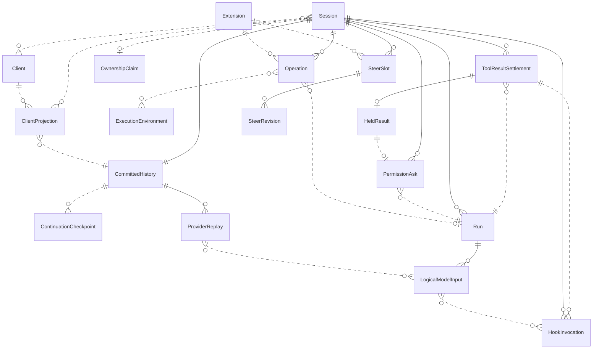

{/* Generated by `modelith render`. Do not edit by hand; edit the .modelith.yaml source and re-render. */}

# Committed session history and shared interaction

A `Session` retains authoritative `CommittedHistory`, admits one active `Run`, and exposes authorized `ClientProjection` views. `Client` and `Extension` actions share admission semantics; source-scoped `SteerSlot` input and `PermissionAsk` resolutions remain ordered and recoverable. The companion [proposal](session-commit-history.md) owns rationale, open questions, and scope.

## Entities

### `Client`

An authenticated API consumer observing or acting on a `Session` under caller-specific authorization. An interactive attachment can request eligible work; a read-only observation cannot activate execution.

**Relationships**

- `ClientProjection` — 1:n

**Invariants**

- **observe-does-not-activate** — Reading `ClientProjection` history or subscribing to committed changes does not load an engine, acquire ownership, or start work.
- **drafts-stay-local** — Unsubmitted composer text and approval responses remain `Client` local; submitted pending controls belong to server state.

### `ClientProjection`

The authorized display view of `CommittedHistory` at a known position, including shared pending controls and their committed dispositions. Provisional observations may accompany the view but have no committed resume position until confirmed.

**Derived:** Authorized session facts and timeline items are projected from committed records at the requested position.

**Relationships**

- `CommittedHistory` — n:1

**Invariants**

- **complete-view-then-follow** — A `ClientProjection` loads complete authorized history through C in bounded pages, then follows committed changes after C without a silent gap.
- **authorization-not-token** — Every `ClientProjection` page, subscription, and detail read rechecks authority; private continuation material is not exposed by possession of a cursor.
- **reflect-pending-controls** — Authorized `ClientProjection` reloads and committed updates reflect shared pending steer content, revision, and disposition, plus pending asks and their resolutions.
- **file-change-evidence** — Historical file-change `ClientProjection` distinguishes tool-reported effects from requested or unconfirmed mutations; a target path alone proves no successful change, and retained facts are not an exhaustive external-change inventory or current workspace diff.

### `CommittedHistory`

The private, versioned, append-only ordered facts of a `Session`. An accepted position establishes commitment under the storage adapter's declared durability guarantee; transient observations are not history.

**Relationships**

- `ContinuationCheckpoint` — 1:n
- `ProviderReplay` — 1:n — owned

**Invariants**

- **single-history-authority** — Continuation and retained display facts derive from `CommittedHistory`; summaries, checkpoints, and optional diagnostic logs are not separate authorities.
- **fenced-append** — An append to `CommittedHistory` checks the expected head and rejects stale writers under the backend's declared operating mode; distributed appends atomically check the current epoch and unexpired `OwnershipClaim`, while single-process local storage enforces write serialization and available file-lock protection.
- **retained-compaction-history** — Compaction changes model continuation but preserves earlier `CommittedHistory` for authorized display and forks.
- **lost-commit-fails-closed** — Missing previously acknowledged `CommittedHistory` stops writes and confirmed projections; local memory cannot overwrite history to repair it.
- **commit-before-confirmed-publication** — Confirmed `ClientProjection` updates and notifications follow successful outermost acceptance into `CommittedHistory`; a savepoint or failed append is not a committed boundary.
- **capture-obeys-disclosure** — `CommittedHistory` capture of `LogicalModelInput`, `ProviderReplay`, and `HookInvocation` evidence obeys secret scrubbing and withholding or destruction rules; transformation evidence cannot preserve prohibited bytes through another path.

### `ContinuationCheckpoint`

Materialized continuation state derived through a known position in `CommittedHistory`. A checkpoint accelerates loading and may lag the head; it is not an independently writable source of session truth.

**Invariants**

- **checkpoint-plus-replay** — Loading at position C applies every `CommittedHistory` record after the `ContinuationCheckpoint` position P through C; missing or incompatible records fail explicitly.

### `ExecutionEnvironment`

The execution context whose lifecycle governs workspace and artifact availability, preservation, and cleanup. Retained operation references describe its known dispositions without owning or extending that lifetime.

**Invariants**

- **environment-owns-artifact-lifetime** — An `ExecutionEnvironment` owns workspace and artifact lifetime under its lifecycle contract; retained `Operation` selection facts and references cannot guarantee continued resource availability.
- **artifact-loss-not-history-loss** — Unavailable `ExecutionEnvironment` artifacts are reported explicitly without erasing retained history, claiming external cleanup succeeded, or authorizing recreation of work.

### `Extension`

A trusted registered interpreter for namespaced, versioned session records and derived state. An `Extension` owns its operation semantics and can submit small steer hints through authorized session actions.

**Relationships**

- `Operation` — 1:n
- `SteerSlot` — 0..1:n — Each extension slot names exactly one registered extension. The user slot has no extension, and each extension has at most one slot per session even when it manages several operations.

**Invariants**

- **trusted-extension-registration** — Only trusted registered `Extension` handlers declare record type, version, continuation criticality, and safe-point metadata; payload text cannot register authority.
- **critical-extension-fails-closed** — Missing or incompatible continuation-critical `Extension` handlers block dependent execution, while core management and logical deletion remain possible.
- **extension-slot-authority** — An `Extension` controls only its own `SteerSlot`; notification submission grants neither user-slot authority nor permission to answer asks or bypass execution gates.
- **small-retrievable-hints** — An `Extension` steer is a size-capped hint pointing to authorized tools for full canonical results; replacement covers outstanding work without deleting `Operation` outcomes.

### `HeldResult`

Process-local tool output awaiting an exact authorized release decision. Its pending ask and safe processing evidence can be durable while the unreleased bytes and payload-bearing evidence remain exclusively in memory.

**Relationships**

- `PermissionAsk` — 1:0..1

**Invariants**

- **held-bytes-memory-only** — Unreleased `HeldResult` bytes never enter durable history, checkpoints, hook traces, provider replay, or diagnostic and client projections; only approved content can enter normal retained history after required processing.
- **lost-hold-closes-ask** — Process loss makes a `HeldResult` unavailable and recovery closes its release ask with an explicit synthetic withheld/unavailable result; intact storage does not recover its bytes or authorize tool reexecution.
- **canceled-release-client-choice** — A release decision may remain actionable after cancellation while its `HeldResult` survives; client presentation is optional, and release commits output without resuming the canceled run.
- **new-run-expires-held-release** — Starting a new `Run` discards unreleased `HeldResult` bytes and expires their release decisions, fences late answers, and prevents old result processing from creating a new actionable release ask; denial also discards held bytes.

### `HookInvocation`

One logical hook execution anchored to a durable session action, model turn, or tool call. Its stable identity covers the hook registration, phase, and occurrence, with captured definition, input, parameters, and output or failure evidence where retention permits. Physical attempts can repeat under the same identity when the invocation is reconstructible; they are not ordinary tool-execution retries.

**Invariants**

- **hook-at-least-once** — `HookInvocation` execution is at least once under authorized admission and recovery; missing completion permits repeated execution only when the same invocation remains reconstructible, using the same logical identity despite possible prior effects; committed completion is reused.
- **stable-hook-retry-identity** — Retries of a `HookInvocation` reconstruct the same definition, input, and parameters and retain its identity; changed invocations receive distinct identities, and current configuration or ephemeral ordering cannot redefine an old invocation.
- **hook-output-before-dependent-execution** — Required completed `HookInvocation` evidence commits before dependent model or ordinary tool execution; transformations may batch with logical input or authorized intent without a separate write for every hook phase.
- **hook-retry-not-tool-retry** — Repeating a `HookInvocation` does not authorize repeating an uncertain ordinary tool, bypassing an approval, or starting work without current `OwnershipClaim` authority.
- **sensitive-hook-evidence-memory-only** — Unreleased sensitive input, output, and payload-bearing `HookInvocation` evidence remain memory-only; lost inputs cannot be reconstructed through traces or provider replay, guessed for retry, or recreated by rerunning the tool.
- **canceled-result-pipeline** — Available tool output follows the normal bounded post-tool `HookInvocation` and disclosure pipeline under a settlement lifetime distinct from canceled execution; cancellation introduces neither a hook-criticality classification nor new guardrail approval authority and preserves existing processing-failure semantics.

### `LogicalModelInput`

The complete effective logical request submitted to a model within a `Run`. It includes effective instructions, ordered messages and media, tool declarations, model selection and behavior-affecting parameters, and relevant private provider continuation state. Its retained values or immutable references reconstruct the request without current templates or configuration; raw transport framing and credentials are excluded.

**Relationships**

- `HookInvocation` — n:n — Transformations contributing to the effective logical request.

**Invariants**

- **complete-logical-input** — `LogicalModelInput` preserves complete admitted effective values and transformation provenance, subject to capture policy; request-local changes cannot silently escape `CommittedHistory`.
- **logical-input-before-model** — Dependent model execution uses committed `LogicalModelInput`; any permitted provisional request during ownership uncertainty uses already committed input without new uncommitted transformations.

### `Operation`

Session-scoped work with durable identity distinct from any originating tool call and `Run`. An `Operation` records lifecycle and canonical results through its `Extension`; its identity can span run boundaries. An entry point without a parent tool call still has a session owner.

**Relationships**

- `Run` — n:0..1 — An originating run, when present, is correlation rather than the operation's lifetime boundary.
- `ExecutionEnvironment` — n:n — An operation can reference several branch environments, each owning its workspace and artifact lifetime.

**Invariants**

- **operation-history-authority** — Continuation-relevant `Operation` state and canonical admitted results are reconstructible from committed extension records, not an independent mutable plugin snapshot.
- **outcome-not-notification** — Coalescing an `Extension` steer or losing a run-admission race cannot erase a committed `Operation` outcome.
- **active-operation-claim** — Active `Operation` execution and writes remain under the root `OwnershipClaim`, even without a foreground `Run`.
- **operation-session-owner** — Every `Operation`, including team coordination admitted through a direct API, has one owning `Session`; absent parent call correlation does not imply session-independent work or justify inventing a parent tool call.

### `OwnershipClaim`

The renewable backend-authoritative right of one replica to execute and append for a root `Session` and its delegation tree. Its epoch fences stale writers; expiry determines authority, not whether external work stopped.

**Attributes**

| Name | Type | Description |
| --- | --- | --- |
| `epoch` | integer |  |
| `expiry` | timestamp |  |

**Invariants**

- **claim-not-connection** — An `OwnershipClaim` follows executing work rather than `Client` connection count; idle or parked sessions may release it while readers remain connected.
- **expiry-is-not-quiescence** — Expired `OwnershipClaim` authority does not prove tools or the former replica stopped; reacquisition advances the epoch and reconciles the durable head.

### `PermissionAsk`

A durable request for an exact authorized decision controlling execution or disclosure associated with a `Run`. Multiple clients can answer the same ask without an exclusive responder; release decisions can outlive run cancellation only while their process-local held output remains valid.

**Relationships**

- `Run` — n:1

**Invariants**

- **first-committed-approval-wins** — The first valid authorized committed `PermissionAsk` resolution wins; later conflicting answers receive the authoritative already-resolved outcome and cannot reverse it.
- **durable-ask-is-not-execution** — A pending execution `PermissionAsk` can survive unloading and ownership release, and resolution rehydrates its exact continuation; a durable release ask cannot restore lost memory-only output or activate a canceled run.

### `ProviderReplay`

A private versioned provider-owned representation of ordered output items and occurrence-specific bindings to canonical conversation, calls, and results in `CommittedHistory`. It preserves item boundaries and opaque payloads without assuming one canonical assistant message equals one provider message or reasoning item. The LLM boundary owns interpretation and compatibility; public projections and executable tool objects do not.

**Relationships**

- `LogicalModelInput` — n:n — Compatible private replay incorporated into subsequent logical input.

**Invariants**

- **provider-replay-ordered-opaque** — Accepted `ProviderReplay` preserves ordered item boundaries and opaque signed or encrypted payloads byte-exact under capture policy; core cannot flatten or interpret their private meaning.
- **replay-binding-occurrence** — `ProviderReplay` binds globally unique engine-owned canonical call identities to distinct provider pairing-key and item-ID namespaces within the producing session and request/turn occurrence; repeated provider keys cannot alias calls or results from another occurrence.
- **replay-consistent-acceptance** — Canonical accepted outputs, calls, and results and their required `ProviderReplay` payloads and bindings share a consistent acceptance boundary; missing or mismatched replay state cannot authorize tool dispatch or dependent continuation.
- **replay-immutable-compatible** — Accepted `ProviderReplay` owns immutable payloads and producer/version provenance; restart, forks, compaction, and provider changes require compatible LLM-boundary interpretation rather than mutable aliases or silent reuse of incompatible continuation-critical metadata.
- **replay-not-public-authority** — A `ClientProjection` cannot reconstruct uncaptured private `ProviderReplay` or grant access to it, and provider keys cannot be reinterpreted as canonical engine call identity.

### `Run`

A sequence of model turns within a `Session`, continued through requested tool calls and their results. In the normal course, the model ends the `Run` with a terminal response rather than requesting more tools; cancellation, failure, limits, and interruption can also end it. A `Run` has stable identity distinct from session identity and is server-owned rather than owned by the connection that requested it.

**Relationships**

- `LogicalModelInput` — 1:n — owned

**Invariants**

- **explicit-prompt-conflict** — A competing prompt receives an explicit conflict identifying the active `Run`; it is neither silently queued nor reinterpreted as a steer.
- **exact-run-no-promotion** — A steer qualified by `Run` identity cannot start or retarget another run; an unqualified steer may request eligible execution when idle.
- **disconnect-not-cancel** — A `Client` disconnect does not cancel the `Run` or transfer control rights.
- **intent-before-dispatch** — A `Run` commits the assistant tool request and each call's effective authorized intent after trusted rewrites, including required `HookInvocation` evidence, before tool dispatch, and commits the canonical result before dependent model continuation.
- **no-uncertain-tool-retry** — Recovery distinguishes requested-not-dispatched tools from intent-with-unknown-outcome tools and never automatically reruns an uncertain ordinary tool; absent intent excludes tool dispatch but does not prove pre-intent hooks had no effects.
- **cancellation-ack-is-not-completion** — Cancellation acknowledgement identifies acceptance and signaling, not stopped execution; bounded terminal settlement distinguishes established outcomes from external effects that remain unknown or may still be running.
- **canceled-run-no-continuation** — Bounded result processing may finish after `Run` cancellation, but cannot submit another model request or dispatch dependent work; permitted committed results become available to a later explicitly started run.
- **bounded-terminal-admission** — A new `Run` waits for bounded execution shutdown and result settlement of its predecessor, but not for optional output-release approval; a deadline does not turn unresolved external execution into proven termination.

### `Session`

The durable conversation and unit of interaction. A `Session` survives individual `Run` and `Client` lifetimes; its current continuation and retained display facts derive from its `CommittedHistory`.

**Relationships**

- `CommittedHistory` — 1:1 — owned
- `Run` — 1:n — owned
- `SteerSlot` — 1:n — owned
- `PermissionAsk` — 1:n — owned
- `Operation` — 1:n — owned
- `HookInvocation` — 1:n — owned
- `ToolResultSettlement` — 1:n — owned
- `OwnershipClaim` — n:0..1 — An active delegation tree shares its root claim. Separately owned peer sessions have separate claims.
- `Client` — n:n
- `ClientProjection` — 1:n

**Invariants**

- **one-active-run** — A `Session` admits at most one active `Run`, regardless of the producer requesting it.
- **shared-control** — Multiple authorized `Client` callers may operate on one `Session`; each action is independently authorized and serialized, without an exclusive controller.
- **deletion-gate** — Logical deletion denies `Session` reads and activation, fences writes, and prevents identity reuse, independently of physical purge timing.
- **session-current-cancellation** — Ordinary cancellation resolves the active `Run` at the ordered `Session` admission boundary without requiring a client refresh; explicitly run-qualified controls remain exact and never retarget a successor.
- **cancellation-closes-all-sources** — User cancellation promptly closes execution admission, cancels every pending user and `Extension` steer, and signals active descendants and extensions; late notifications cannot restart canceled work, while committed outcomes remain history.
- **cancellation-orders-promotion** — A follow-up `Run` admitted before session-current cancellation is its target; cancellation ordered first prevents pending input from promoting, while a new explicit submission ordered afterward can request eligible execution.
- **ordered-batched-gates** — Batching preserves per-session order and every durable execution gate; delay and size bounds are tunable, and acceptance does not require cross-session atomic transactions or allow one stalled session to block unrelated sessions.

### `SteerRevision`

An identified committed version of a `SteerSlot`'s pending content and disposition. Source attribution is server-stamped; consumption identifies the exact revision delivered as model input.

**Invariants**

- **commit-before-steer-delivery** — `SteerRevision` admission is committed before acknowledgement, and model-input insertion and exact-revision consumption commit before the model receives it.
- **replacement-survives-consumption** — Consuming an older `SteerRevision` cannot clear a newer concurrently admitted replacement in the same slot.
- **provenance-is-not-privilege** — The server distinguishes user from named extension, tool, or harness `SteerRevision` provenance; non-user content remains appropriately fenced data, not system or permission authority.
- **normal-unqualified-promotion** — Accepted unconsumed unqualified `SteerRevision` input on normal completion continues execution or admits one follow-up `Run`; explicit run-qualified input never silently promotes.
- **missed-constrained-steer** — If its exact target `Run` completes normally before consuming an accepted `SteerRevision`, the owner commits not-delivered because the target ended, retains accepted text as history, and clears runnable pending input without promotion.
- **failed-interrupted-steer-recovery** — Failure, shutdown, or ownership loss preserves unconsumed `SteerRevision` input for an explicit follow-up-or-retract decision without silently relaxing its run constraint, while user cancellation cancels undelivered input from all sources instead of promoting it.

### `SteerSlot`

One source's replaceable pending input within a `Session`. There is one shared user slot and one slot per registered `Extension`; slots share one submission/update contract with an optional exact run constraint rather than separate source-specific steer types. Retraction changes pending input; consumption is the engine's delivery transition. Slots are not an instruction queue and have no extension-defined subkeys.

**Relationships**

- `SteerRevision` — 1:n — owned

**Actions:** `set pending input`, `replace pending input`, `retract pending input`, `consume delivered revision`

**Invariants**

- **source-slot-isolation** — Source-specific update or retraction of one `SteerSlot` cannot change another; all authorized interactive clients share the same user slot, while session cancellation closes pending slots across all sources.
- **revision-checked-edit** — Replacement and retraction name the expected `SteerSlot` revision, and stale edits conflict rather than overwrite a concurrent update.
- **source-independent-run-constraint** — A `Client` or `Extension` uses the same `SteerSlot` operation with an optional exact `Run` constraint; source identity selects the slot, not targeting or promotion semantics, and constrained input is admitted and consumed only for its named run.
- **all-pending-together** — At the next eligible model-input boundary, every pending `SteerSlot` is delivered together in deterministic order, without interrupting an in-flight request or bypassing an approval.

### `ToolResultSettlement`

Processing of an already-produced tool result under its original call identity. Execution evidence, hook-processing evidence, and disclosure disposition are separate facts; cancellation of the originating `Run` does not itself erase output or approve its disclosure.

**Relationships**

- `Run` — n:1
- `HookInvocation` — 1:n
- `HeldResult` — 1:0..1 — owned

**Invariants**

- **independent-result-dispositions** — A pre-dispatch hook failure does not assert tool execution, a post-execution processing failure does not erase known execution, and missing output or denied disclosure does not establish tool failure or absence of external effects.
- **settle-without-new-authority** — The `ToolResultSettlement` finishes normal checks and commits permitted canonical results without continuing a canceled `Run`; processing failure or timeout cannot bypass required disclosure checks, and no new autonomous result-release approver is implied.
- **no-result-recreation** — Lost or withheld output is represented under its original call identity with an explicit safe disposition, preserving call/result pairing without automatically rerunning the tool.

## Relationships

## Scenarios

### Two clients race to start one run

**Actors:** Client

**Steps**

1. Two authorized `Client` callers request a prompt on the same eligible `Session`.
2. The owner commits admission of one `Run` to `CommittedHistory`; the other caller receives a conflict identifying that run.
3. The losing `Client` may explicitly submit an exact-run steer, which can fail stale if the run has already ended.
4. Disconnecting the winning `Client` does not cancel the server-owned `Run`.

**Invariants touched**

- **one-active-run** — A `Session` admits at most one active `Run`, regardless of the producer requesting it.
- **shared-control** — Multiple authorized `Client` callers may operate on one `Session`; each action is independently authorized and serialized, without an exclusive controller.
- **explicit-prompt-conflict** — A competing prompt receives an explicit conflict identifying the active `Run`; it is neither silently queued nor reinterpreted as a steer.
- **exact-run-no-promotion** — A steer qualified by `Run` identity cannot start or retarget another run; an unqualified steer may request eligible execution when idle.
- **disconnect-not-cancel** — A `Client` disconnect does not cancel the `Run` or transfer control rights.

### Reload with a lagging checkpoint

**Actors:** Client

**Steps**

1. A `ContinuationCheckpoint` materializes `CommittedHistory` through P while the head has advanced to C.
2. The server replays every record in (P,C] to reconstruct continuation, including compaction without deleting older history.
3. A read-only `Client` loads authorized `ClientProjection` pages through C and subscribes after C without activating work.
4. A missing previously acknowledged record fails the load rather than repairing history from local memory.

**Invariants touched**

- **single-history-authority** — Continuation and retained display facts derive from `CommittedHistory`; summaries, checkpoints, and optional diagnostic logs are not separate authorities.
- **checkpoint-plus-replay** — Loading at position C applies every `CommittedHistory` record after the `ContinuationCheckpoint` position P through C; missing or incompatible records fail explicitly.
- **retained-compaction-history** — Compaction changes model continuation but preserves earlier `CommittedHistory` for authorized display and forks.
- **complete-view-then-follow** — A `ClientProjection` loads complete authorized history through C in bounded pages, then follows committed changes after C without a silent gap.
- **observe-does-not-activate** — Reading `ClientProjection` history or subscribing to committed changes does not load an engine, acquire ownership, or start work.
- **lost-commit-fails-closed** — Missing previously acknowledged `CommittedHistory` stops writes and confirmed projections; local memory cannot overwrite history to repair it.

### Continue editing a submitted steer on another client

**Actors:** Client

**Steps**

1. A `Client` submits input into the shared user `SteerSlot`; the server commits its `SteerRevision` before acknowledgement.
2. Another authorized `Client` reloads pending content and revision through `ClientProjection` and replaces it using the expected revision.
3. A stale update from the original `Client` conflicts, while unsent composer text remains local.

**Invariants touched**

- **source-slot-isolation** — Source-specific update or retraction of one `SteerSlot` cannot change another; all authorized interactive clients share the same user slot, while session cancellation closes pending slots across all sources.
- **revision-checked-edit** — Replacement and retraction name the expected `SteerSlot` revision, and stale edits conflict rather than overwrite a concurrent update.
- **reflect-pending-controls** — Authorized `ClientProjection` reloads and committed updates reflect shared pending steer content, revision, and disposition, plus pending asks and their resolutions.
- **commit-before-steer-delivery** — `SteerRevision` admission is committed before acknowledgement, and model-input insertion and exact-revision consumption commit before the model receives it.
- **drafts-stay-local** — Unsubmitted composer text and approval responses remain `Client` local; submitted pending controls belong to server state.

### User and extension input at one boundary

**Actors:** Client, Extension

**Steps**

1. A user `SteerSlot` and slots for two registered `Extension` sources contain pending hints.
2. The active `Run` commits all pending `SteerRevision` input together in deterministic order at its next safe input boundary.
3. The model receives server-stamped provenance distinguishing user, extension, tool, and harness sources without granting non-user content instruction authority.
4. An `Extension` replacement committed after the delivery decision remains pending; consumption of its older revision cannot clear it.
5. On normal completion an accepted unqualified revision continues execution or promotes once; failure or interruption leaves it pending for explicit recovery instead.

**Invariants touched**

- **all-pending-together** — At the next eligible model-input boundary, every pending `SteerSlot` is delivered together in deterministic order, without interrupting an in-flight request or bypassing an approval.
- **source-slot-isolation** — Source-specific update or retraction of one `SteerSlot` cannot change another; all authorized interactive clients share the same user slot, while session cancellation closes pending slots across all sources.
- **provenance-is-not-privilege** — The server distinguishes user from named extension, tool, or harness `SteerRevision` provenance; non-user content remains appropriately fenced data, not system or permission authority.
- **replacement-survives-consumption** — Consuming an older `SteerRevision` cannot clear a newer concurrently admitted replacement in the same slot.
- **commit-before-steer-delivery** — `SteerRevision` admission is committed before acknowledgement, and model-input insertion and exact-revision consumption commit before the model receives it.
- **normal-unqualified-promotion** — Accepted unconsumed unqualified `SteerRevision` input on normal completion continues execution or admits one follow-up `Run`; explicit run-qualified input never silently promotes.
- **failed-interrupted-steer-recovery** — Failure, shutdown, or ownership loss preserves unconsumed `SteerRevision` input for an explicit follow-up-or-retract decision without silently relaxing its run constraint, while user cancellation cancels undelivered input from all sources instead of promoting it.

### Several operation results coalesce into one hint

**Actors:** Extension

**Steps**

1. Several `Operation` outcomes commit through one `Extension` in a `Session`.
2. The `Extension` replaces its sole pending `SteerSlot` with a small hint directing the agent to a tool that lists ready results.
3. If idle, the unqualified steer requests eligible `Run` admission; a concurrent prompt may win without erasing the committed outcomes or pending hint.
4. An active `Run` receives the hint at its next safe boundary and calls an authorized tool for full results; unrelated extension and user slots remain unchanged.

**Invariants touched**

- **small-retrievable-hints** — An `Extension` steer is a size-capped hint pointing to authorized tools for full canonical results; replacement covers outstanding work without deleting `Operation` outcomes.
- **outcome-not-notification** — Coalescing an `Extension` steer or losing a run-admission race cannot erase a committed `Operation` outcome.
- **operation-history-authority** — Continuation-relevant `Operation` state and canonical admitted results are reconstructible from committed extension records, not an independent mutable plugin snapshot.
- **extension-slot-authority** — An `Extension` controls only its own `SteerSlot`; notification submission grants neither user-slot authority nor permission to answer asks or bypass execution gates.
- **source-slot-isolation** — Source-specific update or retraction of one `SteerSlot` cannot change another; all authorized interactive clients share the same user slot, while session cancellation closes pending slots across all sources.
- **one-active-run** — A `Session` admits at most one active `Run`, regardless of the producer requesting it.

### One steer operation preserves source and run constraints

**Actors:** Client, Extension

**Steps**

1. A `Client` submits one `SteerRevision` with an exact `Run` constraint through the same slot operation used for unconstrained session input.
2. The named run completes normally before consuming it, so the owner commits a not-delivered disposition, retains the accepted text in `CommittedHistory`, and clears runnable pending input.
3. An `Extension` independently chooses whether its own revision is run-constrained; its source identity grants no different targeting semantics.
4. An unconstrained revision can admit one normal follow-up, while failure recovery of constrained input requires an explicit decision rather than silently retargeting it.

**Invariants touched**

- **source-independent-run-constraint** — A `Client` or `Extension` uses the same `SteerSlot` operation with an optional exact `Run` constraint; source identity selects the slot, not targeting or promotion semantics, and constrained input is admitted and consumed only for its named run.
- **missed-constrained-steer** — If its exact target `Run` completes normally before consuming an accepted `SteerRevision`, the owner commits not-delivered because the target ended, retains accepted text as history, and clears runnable pending input without promotion.
- **normal-unqualified-promotion** — Accepted unconsumed unqualified `SteerRevision` input on normal completion continues execution or admits one follow-up `Run`; explicit run-qualified input never silently promotes.
- **failed-interrupted-steer-recovery** — Failure, shutdown, or ownership loss preserves unconsumed `SteerRevision` input for an explicit follow-up-or-retract decision without silently relaxing its run constraint, while user cancellation cancels undelivered input from all sources instead of promoting it.
- **exact-run-no-promotion** — A steer qualified by `Run` identity cannot start or retarget another run; an unqualified steer may request eligible execution when idle.
- **source-slot-isolation** — Source-specific update or retraction of one `SteerSlot` cannot change another; all authorized interactive clients share the same user slot, while session cancellation closes pending slots across all sources.

### Session-owned work outlives an artifact reference

**Steps**

1. Team coordination admitted through a direct API has a `Session` owner without inventing a parent tool call; tool-admitted `Operation` work keeps its actual call and run correlation.
2. A parallel `Operation` records a winner and an artifact reference whose availability belongs to its `ExecutionEnvironment` lifecycle.
3. The environment retires the workspace, and later authorized inspection reports unavailable while retaining the historical selection and result.
4. A `ClientProjection` separately distinguishes a tool-reported file effect from a merely requested or uncertain edit without presenting either as the current workspace diff.

**Invariants touched**

- **operation-session-owner** — Every `Operation`, including team coordination admitted through a direct API, has one owning `Session`; absent parent call correlation does not imply session-independent work or justify inventing a parent tool call.
- **operation-history-authority** — Continuation-relevant `Operation` state and canonical admitted results are reconstructible from committed extension records, not an independent mutable plugin snapshot.
- **environment-owns-artifact-lifetime** — An `ExecutionEnvironment` owns workspace and artifact lifetime under its lifecycle contract; retained `Operation` selection facts and references cannot guarantee continued resource availability.
- **artifact-loss-not-history-loss** — Unavailable `ExecutionEnvironment` artifacts are reported explicitly without erasing retained history, claiming external cleanup succeeded, or authorizing recreation of work.
- **file-change-evidence** — Historical file-change `ClientProjection` distinguishes tool-reported effects from requested or unconfirmed mutations; a target path alone proves no successful change, and retained facts are not an exhaustive external-change inventory or current workspace diff.

### Conflicting approval answers

**Actors:** Client

**Steps**

1. Two authorized `Client` callers observe the same pending `PermissionAsk` through their `ClientProjection` views.
2. One valid answer commits first; a conflicting later answer receives the authoritative already-resolved decision.
3. Both clients see the committed resolution; unsubmitted response text stays local.
4. The execution ask may have been unloaded while waiting, so its authorized resolution first rehydrates the reconstructible continuation under the tree claim; a release ask instead requires its surviving memory-only held bytes.

**Invariants touched**

- **first-committed-approval-wins** — The first valid authorized committed `PermissionAsk` resolution wins; later conflicting answers receive the authoritative already-resolved outcome and cannot reverse it.
- **reflect-pending-controls** — Authorized `ClientProjection` reloads and committed updates reflect shared pending steer content, revision, and disposition, plus pending asks and their resolutions.
- **drafts-stay-local** — Unsubmitted composer text and approval responses remain `Client` local; submitted pending controls belong to server state.
- **durable-ask-is-not-execution** — A pending execution `PermissionAsk` can survive unloading and ownership release, and resolution rehydrates its exact continuation; a durable release ask cannot restore lost memory-only output or activate a canceled run.

### Fenced takeover with uncertain external work

**Steps**

1. A `Run` commits a tool request and per-call intent, then the replica loses its `OwnershipClaim` before recording the result.
2. Expiry permits fenced acquisition with a new epoch but does not prove the external action stopped.
3. A stale append fails; recovery distinguishes no-intent requests from intent-with-unknown-outcome calls and does not rerun the uncertain tool.
4. Active `Operation` obligations remain under the root claim, and a missing continuation-critical `Extension` blocks dependent execution rather than claiming quiescence.

**Invariants touched**

- **fenced-append** — An append to `CommittedHistory` checks the expected head and rejects stale writers under the backend's declared operating mode; distributed appends atomically check the current epoch and unexpired `OwnershipClaim`, while single-process local storage enforces write serialization and available file-lock protection.
- **expiry-is-not-quiescence** — Expired `OwnershipClaim` authority does not prove tools or the former replica stopped; reacquisition advances the epoch and reconciles the durable head.
- **intent-before-dispatch** — A `Run` commits the assistant tool request and each call's effective authorized intent after trusted rewrites, including required `HookInvocation` evidence, before tool dispatch, and commits the canonical result before dependent model continuation.
- **no-uncertain-tool-retry** — Recovery distinguishes requested-not-dispatched tools from intent-with-unknown-outcome tools and never automatically reruns an uncertain ordinary tool; absent intent excludes tool dispatch but does not prove pre-intent hooks had no effects.
- **active-operation-claim** — Active `Operation` execution and writes remain under the root `OwnershipClaim`, even without a foreground `Run`.
- **critical-extension-fails-closed** — Missing or incompatible continuation-critical `Extension` handlers block dependent execution, while core management and logical deletion remain possible.
- **trusted-extension-registration** — Only trusted registered `Extension` handlers declare record type, version, continuation criticality, and safe-point metadata; payload text cannot register authority.

### High-resolution request reconstructed after hook retry

**Steps**

1. A `Session` commits an action anchor sufficient to reconstruct a `HookInvocation` definition, input, parameters, and derived identity.
2. The hook affects an external integration, but the process stops before its output commits to `CommittedHistory`.
3. Authorized recovery under a current `OwnershipClaim` repeats the hook with the same identity, allowing the integration to deduplicate its effects.
4. The owner batches permitted hook output and transformation evidence with `LogicalModelInput`, then submits the model request after acceptance.
5. Historical inspection reconstructs effective instructions, messages, tool declarations, parameters, and hook provenance without current templates or raw transport bytes.
6. A subsequent load reuses committed hook completion without reexecution, and confirmed `ClientProjection` updates follow accepted history.
7. Scrubbed or destroyed bytes are not restored through hook traces, and hook retry does not repeat an uncertain ordinary tool.

**Invariants touched**

- **complete-logical-input** — `LogicalModelInput` preserves complete admitted effective values and transformation provenance, subject to capture policy; request-local changes cannot silently escape `CommittedHistory`.
- **logical-input-before-model** — Dependent model execution uses committed `LogicalModelInput`; any permitted provisional request during ownership uncertainty uses already committed input without new uncommitted transformations.
- **hook-at-least-once** — `HookInvocation` execution is at least once under authorized admission and recovery; missing completion permits repeated execution only when the same invocation remains reconstructible, using the same logical identity despite possible prior effects; committed completion is reused.
- **stable-hook-retry-identity** — Retries of a `HookInvocation` reconstruct the same definition, input, and parameters and retain its identity; changed invocations receive distinct identities, and current configuration or ephemeral ordering cannot redefine an old invocation.
- **hook-output-before-dependent-execution** — Required completed `HookInvocation` evidence commits before dependent model or ordinary tool execution; transformations may batch with logical input or authorized intent without a separate write for every hook phase.
- **hook-retry-not-tool-retry** — Repeating a `HookInvocation` does not authorize repeating an uncertain ordinary tool, bypassing an approval, or starting work without current `OwnershipClaim` authority.
- **commit-before-confirmed-publication** — Confirmed `ClientProjection` updates and notifications follow successful outermost acceptance into `CommittedHistory`; a savepoint or failed append is not a committed boundary.
- **capture-obeys-disclosure** — `CommittedHistory` capture of `LogicalModelInput`, `ProviderReplay`, and `HookInvocation` evidence obeys secret scrubbing and withholding or destruction rules; transformation evidence cannot preserve prohibited bytes through another path.

### Ordered private replay with repeated provider keys

**Steps**

1. A provider completes a turn with separate message, reasoning, and function-call items in order; the engine assigns a canonical globally unique tool-call identity.
2. The owner consistently accepts canonical conversation facts with `ProviderReplay` retaining item boundaries, per-item metadata, opaque payloads, and occurrence-specific call bindings.
3. Another completed turn reuses a provider pairing key, but its distinct producing occurrence prevents aliasing the earlier call or result.
4. Restart reconstructs compatible `LogicalModelInput` through the LLM boundary while `ClientProjection` displays only authorized canonical facts.
5. A fork or provider change preserves provenance and requires compatible bindings and private interpretation; unsupported continuation-critical replay blocks dependent execution without reinterpreting provider keys as engine identity.

**Invariants touched**

- **provider-replay-ordered-opaque** — Accepted `ProviderReplay` preserves ordered item boundaries and opaque signed or encrypted payloads byte-exact under capture policy; core cannot flatten or interpret their private meaning.
- **replay-binding-occurrence** — `ProviderReplay` binds globally unique engine-owned canonical call identities to distinct provider pairing-key and item-ID namespaces within the producing session and request/turn occurrence; repeated provider keys cannot alias calls or results from another occurrence.
- **replay-consistent-acceptance** — Canonical accepted outputs, calls, and results and their required `ProviderReplay` payloads and bindings share a consistent acceptance boundary; missing or mismatched replay state cannot authorize tool dispatch or dependent continuation.
- **replay-immutable-compatible** — Accepted `ProviderReplay` owns immutable payloads and producer/version provenance; restart, forks, compaction, and provider changes require compatible LLM-boundary interpretation rather than mutable aliases or silent reuse of incompatible continuation-critical metadata.
- **replay-not-public-authority** — A `ClientProjection` cannot reconstruct uncaptured private `ProviderReplay` or grant access to it, and provider keys cannot be reinterpreted as canonical engine call identity.
- **complete-logical-input** — `LogicalModelInput` preserves complete admitted effective values and transformation provenance, subject to capture policy; request-local changes cannot silently escape `CommittedHistory`.

### Cancellation settles available output without restarting execution

**Actors:** Client, Extension

**Steps**

1. A stale `Client` cancels the `Session` after normal steer promotion has admitted a follow-up `Run`; the ordered cancellation targets that follow-up without a client reload.
2. Execution admission closes immediately, all pending source slots are canceled, and active descendants and extensions receive cancellation while committed `Operation` outcomes remain retained.
3. The acknowledgement reports signaling rather than completed shutdown; bounded settlement reports any external execution that cannot be proven stopped as unresolved.
4. A returned tool output enters `ToolResultSettlement` and normal bounded `HookInvocation` processing with existing disclosure semantics, without a new model request or dependent tool dispatch.
5. Unreleased `HeldResult` bytes stay memory-only while a release `PermissionAsk` remains optionally visible through the client; release records approved output for a later explicitly started run.
6. A new run waits for bounded settlement rather than optional release; if unreleased bytes remain, its admission discards them, expires the ask, and rejects a late answer.
7. Batching preserves the session's durable gates and does not turn cancellation signaling into a claim that external effects were undone.

**Invariants touched**

- **session-current-cancellation** — Ordinary cancellation resolves the active `Run` at the ordered `Session` admission boundary without requiring a client refresh; explicitly run-qualified controls remain exact and never retarget a successor.
- **cancellation-closes-all-sources** — User cancellation promptly closes execution admission, cancels every pending user and `Extension` steer, and signals active descendants and extensions; late notifications cannot restart canceled work, while committed outcomes remain history.
- **cancellation-orders-promotion** — A follow-up `Run` admitted before session-current cancellation is its target; cancellation ordered first prevents pending input from promoting, while a new explicit submission ordered afterward can request eligible execution.
- **cancellation-ack-is-not-completion** — Cancellation acknowledgement identifies acceptance and signaling, not stopped execution; bounded terminal settlement distinguishes established outcomes from external effects that remain unknown or may still be running.
- **canceled-run-no-continuation** — Bounded result processing may finish after `Run` cancellation, but cannot submit another model request or dispatch dependent work; permitted committed results become available to a later explicitly started run.
- **bounded-terminal-admission** — A new `Run` waits for bounded execution shutdown and result settlement of its predecessor, but not for optional output-release approval; a deadline does not turn unresolved external execution into proven termination.
- **canceled-result-pipeline** — Available tool output follows the normal bounded post-tool `HookInvocation` and disclosure pipeline under a settlement lifetime distinct from canceled execution; cancellation introduces neither a hook-criticality classification nor new guardrail approval authority and preserves existing processing-failure semantics.
- **settle-without-new-authority** — The `ToolResultSettlement` finishes normal checks and commits permitted canonical results without continuing a canceled `Run`; processing failure or timeout cannot bypass required disclosure checks, and no new autonomous result-release approver is implied.
- **independent-result-dispositions** — A pre-dispatch hook failure does not assert tool execution, a post-execution processing failure does not erase known execution, and missing output or denied disclosure does not establish tool failure or absence of external effects.
- **held-bytes-memory-only** — Unreleased `HeldResult` bytes never enter durable history, checkpoints, hook traces, provider replay, or diagnostic and client projections; only approved content can enter normal retained history after required processing.
- **canceled-release-client-choice** — A release decision may remain actionable after cancellation while its `HeldResult` survives; client presentation is optional, and release commits output without resuming the canceled run.
- **new-run-expires-held-release** — Starting a new `Run` discards unreleased `HeldResult` bytes and expires their release decisions, fences late answers, and prevents old result processing from creating a new actionable release ask; denial also discards held bytes.
- **ordered-batched-gates** — Batching preserves per-session order and every durable execution gate; delay and size bounds are tunable, and acceptance does not require cross-session atomic transactions or allow one stalled session to block unrelated sessions.

### Process loss cannot recreate withheld output

**Steps**

1. A tool executes and produces output that required review places in a memory-only `HeldResult` linked to its `ToolResultSettlement` and exact release ask.
2. The `HookInvocation` processing retains safe failure and disposition evidence without persisting sensitive input or output through traces.
3. The process stops while storage remains intact; recovery finds the pending ask but no held bytes.
4. Recovery closes the ask with an explicit unavailable result under the original call identity, distinguishes known tool execution from lost processing output, and never retries the tool or guesses the hook input.

**Invariants touched**

- **held-bytes-memory-only** — Unreleased `HeldResult` bytes never enter durable history, checkpoints, hook traces, provider replay, or diagnostic and client projections; only approved content can enter normal retained history after required processing.
- **lost-hold-closes-ask** — Process loss makes a `HeldResult` unavailable and recovery closes its release ask with an explicit synthetic withheld/unavailable result; intact storage does not recover its bytes or authorize tool reexecution.
- **no-result-recreation** — Lost or withheld output is represented under its original call identity with an explicit safe disposition, preserving call/result pairing without automatically rerunning the tool.
- **independent-result-dispositions** — A pre-dispatch hook failure does not assert tool execution, a post-execution processing failure does not erase known execution, and missing output or denied disclosure does not establish tool failure or absence of external effects.
- **sensitive-hook-evidence-memory-only** — Unreleased sensitive input, output, and payload-bearing `HookInvocation` evidence remain memory-only; lost inputs cannot be reconstructed through traces or provider replay, guessed for retry, or recreated by rerunning the tool.
- **hook-at-least-once** — `HookInvocation` execution is at least once under authorized admission and recovery; missing completion permits repeated execution only when the same invocation remains reconstructible, using the same logical identity despite possible prior effects; committed completion is reused.
- **durable-ask-is-not-execution** — A pending execution `PermissionAsk` can survive unloading and ownership release, and resolution rehydrates its exact continuation; a durable release ask cannot restore lost memory-only output or activate a canceled run.

### Readers do not pin ownership or bypass deletion

**Actors:** Client

**Steps**

1. An idle `Session` releases its `OwnershipClaim` while authorized `Client` readers remain subscribed to committed history.
2. A cursor does not confer authority for a later `ClientProjection` page or detail read.
3. Logical deletion gates all further session reads and activation even if physical history has not yet been purged.

**Invariants touched**

- **claim-not-connection** — An `OwnershipClaim` follows executing work rather than `Client` connection count; idle or parked sessions may release it while readers remain connected.
- **authorization-not-token** — Every `ClientProjection` page, subscription, and detail read rechecks authority; private continuation material is not exposed by possession of a cursor.
- **deletion-gate** — Logical deletion denies `Session` reads and activation, fences writes, and prevents identity reuse, independently of physical purge timing.

