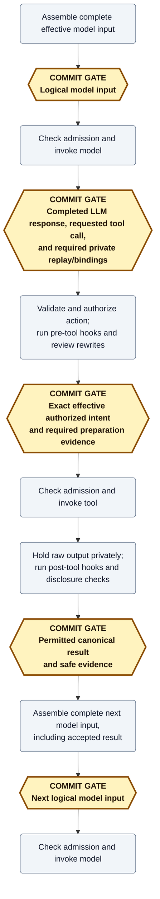

# Execution and recovery

**Review question:** What must commit before work advances, and what can recovery honestly establish?
This packet covers execution ordering and evidence, not authorization policy or physical storage layout.
It is a design draft.

## Ordinary path: one model turn and its tool call

Suppose a user asks Mecatl to update a file.
The server first prepares a request to the LLM; the LLM may answer by requesting a file-editing tool call.
The server must preserve enough evidence at each boundary that a replacement server can tell what was decided without repeating the work to find out.
That is the purpose of the private, append-only session history.
A live progress message or an in-memory result is not yet an accepted history record.

Follow the server through five different kinds of evidence:

1. The LLM requests an edit with particular arguments.
   This records what the model wanted, not permission to do it.
2. The server checks the action, including any trusted argument changes, and records the exact authorized **intent**.
   This establishes what may execute, not that execution has started or finished.
3. The tool returns output to the server.
   That output is available for processing, but may still contain content that cannot be disclosed or retained.
4. The server completes the required processing and records the permitted **canonical result**: the authoritative result for that tool call.
   Only then can it confirm that result as accepted.
5. The server includes the accepted result in a complete later model request and records that request before invoking the LLM.
   Accepting a result and submitting it to the model are separate events.

A **phase** describes work or waiting, such as checking arguments or waiting for approval.
A **commit gate** says which facts must be accepted into history before the next dependent step.
**Execution admission** is the final check immediately before invoking a model or tool: the server can still reject work because cancellation or ownership loss won the race.
These distinctions matter even on the ordinary path; recording permission is not an irrevocable instruction to execute.

The ordinary path uses amber hexagons labeled **COMMIT GATE** for required durable prerequisites and gray rounded boxes for work.
A gate need not mean a separate physical write.



## Failure: knowledge is not the outside world

A tool changes a file and the process dies before outcome evidence commits.
Missing evidence does not prove failure; inspecting the current file does not necessarily establish exactly what this invocation did.
With intent but no established outcome, recovery can report unknown; it cannot automatically rerun an uncertain ordinary tool.
The history makes the server's knowledge durable; it does not make a file change and a history append one atomic outside-world operation.

Without intent, the protocol did not dispatch the tool, but pre-intent hooks may still have effects.
A reconstructible execution ask remains pending rather than being settled as ordinary not-started work.
A canonical result is reconstructed without redispatch; lost unreleased output is unavailable rather than recreated.
The [failure-evidence matrix](session-commit-history-contracts.md#failure-evidence-and-dependent-work-gates) owns the exhaustive boundary cases.

First-cutover crash settlement fences the former writer, repairs pairing from evidence, and marks active crashed runs interrupted rather than automatically resuming them.
Here, repairing pairing means giving each requested tool call its evidence-supported result or explicit recovery disposition, not inventing missing output.
A later authorized attach can start new work; read-only inspection cannot.

## Race: concurrent read results

A single LLM response requests two read-only tool calls, `[A, B]`.
Tool call B may finish and pass disclosure checks while tool call A is still running or its output is held for release.
Execution readiness, durable result acceptance, client publication, and assembly of the next LLM request are separate concerns.
In ordinary terms, B can be ready to record before A, and the client can learn B's accepted result before the server has everything needed to ask the LLM what to do next.

That assembly preserves the original LLM tool-call order even when completion and acceptance order differ.
This does not change scheduling: reads can still run in parallel, while mutations remain serialized.

## Planned maintenance: pause, hand off, continue

Suppose an operator wants to replace a server without making the user restart the conversation.
This is a deliberate pause-and-transfer operation, not a claim that every crash can resume transparently.
The same retained evidence supports deliberate handoff, not just recovery after failure.
For a compatible-replica upgrade or other maintenance, the owner can stop admitting work and seek a safe pause point for the root session and every active descendant.
A commit gate is not automatically such a point: the whole tree must be parked, with no model request or external tool call in flight and all required outcomes and continuation committed.
A parked descendant is delegated work whose next step is recorded and safely waiting, not a child that has been declared finished.
An execution approval wait with reconstructible continuation is also parkable; memory-only release holds must first be explicitly settled or invalidated.

In the sequence below, `[C ...]` means establish the listed committed facts before the following dependent step.
Fenced ownership means storage will reject the old owner's writes after the new owner acquires authority; it does not mean an external process has been killed.

```text
replica A drains the tree to a safe pause point
[C complete handoff marker naming every parked continuation]
A unloads local state and releases ownership
replica B acquires fenced ownership and verifies the parked tree
B continues the same run and pending delegated work
```

For example, A finishes a tool call, commits its permitted result and the rest of the tree's parked state, then hands off before the next model request.
B reconstructs that continuation and proceeds without rerunning the tool.
A parked child remains pending delegation, not a fabricated completed result.

A successful planned handoff is intended to be transparent to users: no new prompt, manual resume, replacement run, or repeated approval is required because the replica changed.
A brief pause or automatic client reconnect is compatible with that goal; a server-side successor must discover runnable work without waiting for a client.
This is [later runtime capability](session-commit-history.md#compatible-replica-active-tree-handoff-later-phase), separate from first-cutover explicit crash recovery and the initial incompatible upgrade.
If drain cannot publish a complete handoff before shutdown, use crash recovery rather than claim transparent continuation.

## Imported assumptions

The examples rely on the following local contracts; the links provide their fuller treatment.
[History is the private authority](vocabulary.md); checkpoints and client views derive from it.
[Storage acceptance](storage-and-observation.md) checks that an append extends the expected history head and comes from its current authorized owner, under declared backend guarantees.
[Authorization and hooks](authorization-and-hooks.md) establish the exact action and arguments permitted for execution, including any trusted rewrites.
[Model continuation](model-continuation.md) requires the effective instructions, messages, tools, settings, and private provider continuation to be reconstructible before invocation.
Cancellation can close admission even after an intent commits; a tool call's output can still require processing or a release decision after the run ends, as [result settlement](cancellation-and-results.md) explains.

## Settled rules and why

**Detailed constraints begin here.**
The examples above explain the boundaries; this section collects their precise qualifications and the less common cases.

Mecatl uses durable orchestration: retain accepted decisions and outcomes before allowing work that depends on them.
Reconstruction is not external execution.
Replay applies retained facts; it never calls the model, runs a tool, or invokes a hook merely to reproduce an earlier result.
Checkpoints accelerate replay rather than replacing its authority.

A requested action, authorized intent, available output, accepted canonical result, and later model consumption are different facts.
A phase names work or waiting; a commit establishes facts; execution admission is the last eligibility decision before invocation.
Neither intent acceptance nor input acceptance wins a race against cancellation by itself.

### Gate grouping and write costs

Facts can share a commit only when establishing them does not require crossing a gate between them.
Independent ready results can batch; a tool's intent and result cannot, because execution separates them.
Completed pre-tool evidence can share the intent commit when ready.
Applicable hook-input anchors, exact asks/verdicts, and confirmed or actionable publication have their own prerequisites in the [gate table](session-commit-history-contracts.md#required-commit-gates-by-phase).
A hook-input anchor is a retained definition/input record or reference that lets the server reconstruct the exact permitted hook invocation.
No separate hard write is required merely for tool return or entry into processing.

B's permitted result becomes eligible for acceptance without waiting solely for tool call A's position in the original LLM response, retaining B's tool-call identity and position in that response.
The coordinator can combine both if ready within bounded delay/size limits, or flush B when its bounds require.
A cannot postpone B indefinitely; B is confirmed only after acceptance.
Model-facing assembly restores required canonical/provider order and waits for all required outcomes and approvals.
Existing read-parallel/mutate-serial barriers remain unchanged.

In text sequences elsewhere, `[C ...]` means the same requirement: establish the listed committed facts before the following dependent step.

The [named phases](session-commit-history-contracts.md#named-phases) explain work between these boundaries.
The ordinary baseline for a response requesting N tools is `1 + 2N` gates before eligible grouping, excluding extra asks, hook anchors, and the next logical-input gate.
This is not a physical-write count; the [budget](session-commit-history.md#commit-budget-and-batching) separates those costs.

### Persistence stalls and ownership uncertainty

Storage failure reduces availability: dependent work pauses until prerequisite acceptance is established.
Already-started work may finish into bounded memory, and permitted provisional progress can remain visible without becoming durable.
An ambiguous append must be resolved by transition identity before retry or dependent work.
For example, if the write may have succeeded but its acknowledgement was lost, the server looks up that same transition rather than recording a second decision or assuming failure.
Ownership loss stops the old engine; a successor reconstructs accepted history rather than repairing it from old-owner memory.
No generic tentative aggregate, rollback layer, or universal prepare/accept/apply scheme is required.
For a transition, committing before changing authoritative in-memory state can suffice; ordinary internal computation does not automatically need a commit.
Speculative tool execution, even for file edits, remains outside this design.

The narrow existing renewal-uncertainty exception permits only a request whose complete input was already committed, with provisional output and no dependent work until valid acceptance; it is not general speculation.
See [distributed recovery](session-commit-history.md#distributed-recovery-and-evidence), including its pending-approval exception and scheduler responsibilities.
Graceful compatible-replica tree handoff is [later work](session-commit-history.md#compatible-replica-active-tree-handoff-later-phase), not first-cutover crash recovery.

## Open decisions and detail

How should an implementation represent a transition and divide responsibility between the engine and the component coordinating commits?
What evidence should it encode when a crash leaves the external outcome uncertain, and how should it assemble accepted results into canonical and provider-specific order?
What batching and replay limits keep a stalled backend from creating unbounded queues?
How should adapters demonstrate the same failure behavior?

Interface details still to specify:

- Concrete transition/aggregate APIs, engine/coordinator allocation, meaningful post-crash evidence encodings, and canonical/provider assembly representations remain open.
  They must enforce the settled gates without requiring a universal rollback protocol.
- Batching topology is settled, but delay/size defaults, backpressure, replay bounds, and measured physical-write costs are not.
- Concrete cross-adapter conformance contracts must cover denied/ambiguous appends, lost acknowledgements and notifications, and unknown external effects.

See [acceptance cases](session-commit-history-contracts.md#acceptance-scenarios) and [shared conformance requirements](session-commit-history.md#shared-conformance-and-fault-injection-scenarios).
The [successor-admission bundling question](cancellation-and-results.md#open-decisions-and-detail) remains explicitly unresolved.
