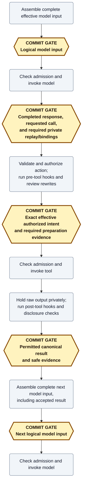

# Execution and recovery

**Review question:** What must commit before work advances, and what can recovery honestly establish?
This packet covers execution ordering and evidence, not authorization policy or physical storage layout.
It is a design draft.

## Imported assumptions

[History is the private authority](vocabulary.md); checkpoints and client views derive from it.
[Storage acceptance](storage-and-observation.md) checks that an append extends the expected history head and comes from its current authorized owner, under declared backend guarantees.
[Authorization and hooks](authorization-and-hooks.md) establish the exact action and arguments permitted for execution, including any trusted rewrites.
[Model continuation](model-continuation.md) requires the effective instructions, messages, tools, settings, and private provider continuation to be reconstructible before invocation.
Cancellation can close admission even after an intent commits; a call's output can still require processing or a release decision after the run ends, as [result settlement](cancellation-and-results.md) explains.

## Settled rules and why

Mecatl uses durable orchestration: retain accepted decisions and outcomes before allowing work that depends on them.
Reconstruction is not external execution.
Replay applies retained facts; it never calls the model, runs a tool, or invokes a hook merely to reproduce an earlier result.
Checkpoints accelerate replay rather than replacing its authority.

A requested action, authorized intent, available output, accepted canonical result, and later model consumption are different facts.
A phase names work or waiting; a commit establishes facts; execution admission is the last eligibility decision before invocation.
Neither intent acceptance nor input acceptance wins a race against cancellation by itself.

Facts can share a commit only when establishing them does not require crossing a gate between them.
Independent ready results can batch; a tool's intent and result cannot, because execution separates them.
Completed pre-tool evidence can share the intent commit when ready.
Applicable hook-input anchors, exact asks/verdicts, and confirmed or actionable publication have their own prerequisites in the [gate table](session-commit-history-contracts.md#required-commit-gates-by-phase).
No separate hard write is required merely for tool return or entry into processing.

Storage failure reduces availability: dependent work pauses until prerequisite acceptance is established.
Already-started work may finish into bounded memory, and permitted provisional progress can remain visible without becoming durable.
An ambiguous append must be resolved by transition identity before retry or dependent work.
Ownership loss stops the old engine; a successor reconstructs accepted history rather than repairing it from old-owner memory.
No generic tentative aggregate, rollback layer, or universal prepare/accept/apply scheme is required.
For a transition, committing before changing authoritative in-memory state can suffice; ordinary internal computation does not automatically need a commit.
Speculative tool execution, even for file edits, remains outside this design.

## Ordinary path: one model turn and its tool call

The ordinary path uses amber hexagons labeled **COMMIT GATE** for required durable prerequisites and gray rounded boxes for work.
A gate need not mean a separate physical write.

In text sequences elsewhere, `[C ...]` means the same requirement: establish the listed committed facts before the following dependent step.

The [named phases](session-commit-history-contracts.md#named-phases) explain work between these boundaries.
The ordinary baseline for a response requesting N tools is `1 + 2N` gates before eligible grouping, excluding extra asks, hook anchors, and the next logical-input gate.
This is not a physical-write count; the [budget](session-commit-history.md#commit-budget-and-batching) separates those costs.

## Failure: knowledge is not the outside world

A tool changes a file and the process dies before outcome evidence commits.
Missing evidence does not prove failure; inspecting the current file does not necessarily establish exactly what this invocation did.
With intent but no established outcome, recovery can report unknown; it cannot automatically rerun an uncertain ordinary tool.
Without intent, the protocol did not dispatch the tool, but pre-intent hooks may still have effects.
A reconstructible execution ask remains pending rather than being settled as ordinary not-started work.
A canonical result is reconstructed without redispatch; lost unreleased output is unavailable rather than recreated.
The [failure-evidence matrix](session-commit-history-contracts.md#failure-evidence-and-dependent-work-gates) owns the exhaustive boundary cases.

First-cutover crash settlement fences the former writer, repairs pairing from evidence, and marks active crashed runs interrupted rather than automatically resuming them.
A later authorized attach can start new work; read-only inspection cannot.
The narrow existing renewal-uncertainty exception permits only a request whose complete input was already committed, with provisional output and no dependent work until valid acceptance; it is not general speculation.
See [distributed recovery](session-commit-history.md#distributed-recovery-and-evidence), including its pending-approval exception and scheduler responsibilities.
Graceful compatible-replica tree handoff is [later work](session-commit-history.md#compatible-replica-active-tree-handoff-later-phase), not first-cutover crash recovery.

## Race: concurrent read results

For model calls `[A, B]`, B may finish and pass disclosure checks while A is still running or held.
Execution readiness, durable result acceptance, client publication, and model-message assembly are separate concerns.
B's permitted result becomes eligible for acceptance without waiting solely for A's request position, retaining call identity and original call position.
The coordinator can combine both if ready within bounded delay/size limits, or flush B when its bounds require.
A cannot postpone B indefinitely; B is confirmed only after acceptance.
Model-facing assembly restores required canonical/provider order and waits for all required outcomes and approvals.
Existing read-parallel/mutate-serial barriers remain unchanged.

## Open decisions and detail

Concrete transition/aggregate APIs, engine/coordinator allocation, meaningful post-crash evidence encodings, and canonical/provider assembly representations remain open.
They must enforce the settled gates without requiring a universal rollback protocol.
Batching topology is settled, but delay/size defaults, backpressure, replay bounds, and measured physical-write costs are not.
Concrete cross-adapter conformance contracts must cover denied/ambiguous appends, lost acknowledgements and notifications, and unknown external effects.
See [acceptance cases](session-commit-history-contracts.md#acceptance-scenarios) and [shared conformance requirements](session-commit-history.md#shared-conformance-and-fault-injection-scenarios).
The [successor-admission bundling question](cancellation-and-results.md#open-decisions-and-detail) remains explicitly unresolved.
